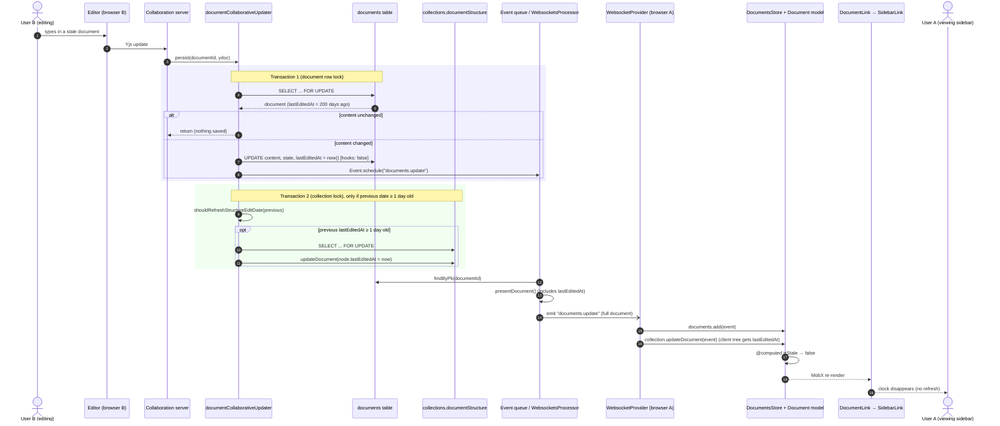

<!-- Generated by SpecStory, Markdown v2.1.0 -->

# 2026-10-17 01:45:53Z

<!-- Claude Code Session 3800f601-8cde-4fb3-b326-d937cc0e73d8 (2026-10-17 01:45:53Z) -->

_**User (2026-10-17 01:45:53Z)**_

how would i approach this issue? can I just use the already existing data of when a document was last updated?

<pasted_content id="62b3">
Summary
Documents that haven't been edited in a long time have no visual signal in the sidebar. Adding a subtle indicator would help users identify content that may need review at a glance.

User Story
As a team member, I want to see a visual indicator on documents that haven't been updated recently so that I can quickly identify potentially stale content while browsing the sidebar.

User Scenario
A user opens the sidebar and sees a muted or flagged indicator next to a document that hasn't been edited in over 90 days. They recognize it may be outdated and click in to review it.

Acceptance Criteria

Documents not edited within a threshold show a stale indicator in the sidebar
The indicator is subtle and does not distract from normal browsing
The indicator disappears when the document is edited
The indicator respects the existing isBadgedNew pattern in Document.ts
Out of Scope

Configurable threshold per workspace (separate issue)
Notifications or emails about stale documents
Stale indicators on collections
Open Questions

What should the default be? 90 days? 180 days?
Should the indicator appear on nested documents in collapsed sidebar section
</pasted_content id="62b3">


---

_**Agent (claude-opus-5-5 2026-10-17 01:45:57Z)**_

<tool-use data-tool-type="search" data-tool-name="Grep"><details>
<summary>Tool use: **Grep**</summary>
 path `app/models/Document.ts` pattern `isBadgedNew|isStale|updatedAt`

```text
284-
285-  @computed
286-  get noun(): string {
287-    return t("document");
288-  }
289-
290-  @computed
291-  get modifiedSinceViewed(): boolean {
292:    return !!this.lastViewedAt && this.lastViewedAt < this.updatedAt;
293-  }
294-
295-  @computed
296:  get isBadgedNew(): boolean {
297-    return (
298-      !this.lastViewedAt &&
299-      differenceInDays(new Date(), new Date(this.createdAt)) < 14
300-    );
301-  }
302-
303-  @computed
304-  get isStarred(): boolean {
--
399-      return undefined;
400-    }
401-
402-    return addDays(new Date(this.deletedAt), 30).toString();
403-  }
404-
405-  @computed
406-  get isPersistedOnce(): boolean {
407:    return this.createdAt === this.updatedAt;
408-  }
409-
410-  @computed
411-  get isFromTemplate(): boolean {
412-    return !!this.templateId;
413-  }
414-
415-  @computed
```
</details></tool-use>

_**Agent (claude-opus-5-5 2026-10-17 01:46:00Z)**_

<tool-use data-tool-type="search" data-tool-name="Grep"><details>
<summary>Tool use: **Grep**</summary>
 path `app` pattern `isBadgedNew`

```text
app\models\Document.ts:296:  get isBadgedNew(): boolean {
app\components\DocumentListItem.tsx:176:                {document.isBadgedNew && document.createdBy?.id !== user.id && (
```
</details></tool-use>

_**Agent (claude-opus-5-5 2026-10-17 01:46:06Z)**_

<tool-use data-tool-type="search" data-tool-name="Grep"><details>
<summary>Tool use: **Grep**</summary>
 path `shared/types.ts` pattern `export type NavigationNode = \{`

```text
478:export type NavigationNode = {
479-  id: string;
480-  title: string;
481-  url: string;
482-  emoji?: string;
483-  icon?: string;
484-  color?: string;
485-  children: NavigationNode[];
486-  isDraft?: boolean;
487-  collectionId?: string;
488-  type?: NavigationNodeType;
489-  parent?: NavigationNode | null;
490-  depth?: number;
491-};
492-
```
</details></tool-use>

_**Agent (claude-opus-5-5 2026-10-17 01:46:07Z)**_

<tool-use data-tool-type="search" data-tool-name="Grep"><details>
<summary>Tool use: **Grep**</summary>
 path `app/components/Sidebar/components/DocumentLink.tsx` pattern `documents\.get\(|node\.id|const document =`

```text
63:  const expanded = expansion.isExpanded(node.id);
64:  const isActiveDocument = activeDocument && activeDocument.id === node.id;
66:    !!node.children.length || activeDocument?.parentDocumentId === node.id;
74:      expansion.collapse(node.id);
76:  }, [expansion, expanded, hasChildDocuments, node.id]);
83:      void fetchChildDocuments(node.id);
87:    node.id,
96:    activeDocument?.parentDocumentId === node.id
172:            parentId={node.id}
198:  const can = usePolicy(node.id);
200:  const document = documents.get(node.id);
206:  const expanded = expansion.isExpanded(node.id);
214:          expansion.collapse(node.id);
220:          expansion.expand(node.id);
228:    expansion.expand(node.id);
229:  }, [expansion, node.id]);
232:    expansion.collapse(node.id);
233:  }, [expansion, node.id]);
236:    void prefetchDocument?.(node.id);
285:  const isMoving = documents.movingDocumentId === node.id;
328:      if (expansion.isExpanded(node.id)) {
332:          parentDocumentId: node.id,
351:          parentDocumentId: node.id,
360:      collection?.addDocument(newDocument, node.id);
361:      membership?.addDocument(newDocument, node.id);
373:      node.id,
380:    documentId: node.id,
418:      documentId={node.id}
```
</details></tool-use>

_**Agent (claude-opus-5-5 2026-10-17 01:46:08Z)**_

<tool-use data-tool-type="search" data-tool-name="Grep"><details>
<summary>Tool use: **Grep**</summary>
 path `server/models/Document.ts` pattern `updatedAt|lastModifiedById|editedAt|publishedAt`

```text
130:    publishedAt: {
406:  publishedAt: Date | null;
470:      !model.publishedAt ||
496:    if (model.archivedAt || !model.publishedAt || !model.collectionId) {
555:      model.collaboratorIds.concat(model.lastModifiedById)
646:  @BelongsTo(() => User, "lastModifiedById")
651:  lastModifiedById: string;
920:    return !this.publishedAt;
1064:    this.lastModifiedById = user.id;
1069:    if (this.publishedAt) {
1114:    this.publishedAt = new Date();
1149:    if (!this.publishedAt) {
1184:    this.lastModifiedById = user.id;
1187:    this.publishedAt = null;
1247:    if (this.publishedAt && collection?.isActive) {
1298:    this.lastModifiedById = user.id;
1303:  getTimestamp = () => Math.round(new Date(this.updatedAt).getTime() / 1000);
1339:                publishedAt: {
1346:                publishedAt: {
1389:        child.lastModifiedById = user.id;
1398:    this.lastModifiedById = user.id;
1422:        child.lastModifiedById = user.id;
1430:    this.lastModifiedById = user.id;
```
</details></tool-use>

_**Agent (claude-opus-5-5 2026-10-17 01:46:12Z)**_

<tool-use data-tool-type="read" data-tool-name="Read"><details>
<summary>Tool use: **Read**</summary>
 `./app/components/Sidebar/components/DocumentLink.tsx`

```text
195	  const { documents } = useStores();
196	  const { t } = useTranslation();
197	  const history = useHistory();
198	  const can = usePolicy(node.id);
199	  const canUpdate = can.update;
200	  const document = documents.get(node.id);
201	  const [isEditing, setIsEditing] = React.useState(false);
202	  const editableTitleRef = React.useRef<RefHandle>(null);
203	  const sidebarContext = useSidebarContext();
204	  const user = useCurrentUser();
205	  const expansion = useSidebarExpansion();
206	  const expanded = expansion.isExpanded(node.id);
207	
208	  const handleDisclosureClick = React.useCallback(
209	    (ev?: React.MouseEvent<HTMLElement>) => {
```
</details></tool-use>

_**Agent (claude-opus-5-5 2026-10-17 01:46:13Z)**_

<tool-use data-tool-type="search" data-tool-name="Grep"><details>
<summary>Tool use: **Grep**</summary>
 path `server/models/Document.ts` pattern `toNavigationNode|asNavigationNode`

```text
1328:  toNavigationNode = async (
1329-    options?: FindOptions<Document> & { includeArchived?: boolean }
1330-  ): Promise<NavigationNode> => {
1331-    // Checking if the record is new is a performance optimization – new docs cannot have children
1332-    const childDocuments = this.isNewRecord
1333-      ? []
1334-      : await (this.constructor as typeof Document).unscoped().findAll({
1335-          where: options?.includeArchived
1336-            ? {
1337-                teamId: this.teamId,
1338-                parentDocumentId: this.id,
1339-                publishedAt: {
1340-                  [Op.ne]: null,
1341-                },
1342-              }
1343-            : {
1344-                teamId: this.teamId,
1345-                parentDocumentId: this.id,
1346-                publishedAt: {
1347-                  [Op.ne]: null,
1348-                },
--
1357:      childDocuments.map((child) => child.toNavigationNode(options))
1358-    );
1359-
1360-    return {
1361-      id: this.id,
1362-      title: this.title,
1363-      url: this.url,
1364-      icon: isNil(this.icon) ? undefined : this.icon,
1365-      color: isNil(this.color) ? undefined : this.color,
1366-      children,
1367-    };
1368-  };
1369-
1370-  private restoreArchivedWithChildren = async (
1371-    ctx: APIContext,
1372-    { collectionId }: { collectionId: string }
1373-  ) => {
1374-    const { user } = ctx.state.auth;
1375-    const { transaction } = ctx.state;
1376-
1377-    const restoreChildren = async (parentDocumentId: string) => {
```
</details></tool-use>

_**Agent (claude-opus-5-5 2026-10-17 01:46:26Z)**_

Yes, you can use the existing `updatedAt` field, and you don't need a migration. The catch is getting that date into the sidebar.

## The model part is easy

Add a computed getter next to `isBadgedNew` in [app/models/Document.ts:296](app/models/Document.ts#L296):

```ts
@computed
get isStale(): boolean {
  return (
    !!this.publishedAt &&
    differenceInDays(new Date(), new Date(this.updatedAt)) > 90
  );
}
```

This meets "respects the existing isBadgedNew pattern." It also meets "disappears when the document is edited": MobX recomputes the getter when `updatedAt` changes after a save. Excluding drafts keeps it to published docs. Put 90 in a constant so the later configurable-threshold issue can replace it.

## The sidebar is the hard part

The sidebar doesn't render full `Document` models. It renders `NavigationNode`s from the collection's `documentStructure`, and that type has no timestamps ([shared/types.ts:478](shared/types.ts#L478)). In [DocumentLink.tsx:200](app/components/Sidebar/components/DocumentLink.tsx#L200) the component calls `documents.get(node.id)`. That only returns a document already loaded in the client store. Most documents in the sidebar haven't been loaded, so the getter alone would only show the indicator on documents you've already opened.

You have two options:

1. **Client-only (simple but incomplete):** in `DocumentLink`, show the indicator when `document?.isStale` is true. It's a small change, but coverage is spotty. It's fine for a prototype or demo.
2. **Add the date to the navigation tree (complete):**
   - Add `updatedAt?: string` to `NavigationNode`.
   - Return it from `toNavigationNode()` in [server/models/Document.ts:1360](server/models/Document.ts#L1360).
   - Make sure every code path that updates `documentStructure` also writes the new date. Otherwise the indicator won't clear after an edit.
   - Use a shared helper like `isStale(date)` so the node and the model use the same logic.

   This is the right fix, but it touches more code. Collections that already exist won't have the field in their stored structure until they're rebuilt or their documents are updated, so treat a missing date as "not stale."

## One caveat about `updatedAt`

`updatedAt` is Sequelize's row timestamp. Any save to the row bumps it, not just content edits. Moving or archiving a document will probably count as "fresh" too. That's likely fine for this issue, but say so in your PR. A stricter version would need a field that only changes when the content changes, and that's scope creep.

## UI and open questions

- **Indicator:** a small muted dot or clock icon, or slightly reduced title opacity, with a tooltip like "Not updated in 90+ days". Avoid anything as loud as the "New" badge in `DocumentListItem.tsx`.
- **Default threshold:** I'd pick 90 days and make it a constant.
- **Collapsed sections:** only show the indicator on visible nodes. Rolling it up to parents adds noise and logic the issue doesn't ask for.

For a class sprint, I'd do option 1 first to get the model getter, UI and tests working. Then do option 2 if you have time, or file it as a follow-up.

---

_**User (2026-10-17 01:48:52Z)**_

how many more lines of code would it take to make a field that only changes when the content changes

---

_**Agent (claude-opus-5-5 2026-10-17 01:48:59Z)**_

<tool-use data-tool-type="search" data-tool-name="Grep"><details>
<summary>Tool use: **Grep**</summary>
 path `server` pattern `lastModifiedById =|lastModifiedById:`

```text
server\commands\accountProvisioner.ts:326:        lastModifiedById: collection.createdById,
server\commands\documentCollaborativeUpdater.ts:65:    const lastModifiedById = isDeleted
server\commands\documentCreator.ts:224:    lastModifiedById: lastModifiedById ?? createdById ?? user.id,
server\commands\documentMover.ts:93:    document.lastModifiedById = user.id;
server\commands\documentMover.ts:106:    document.lastModifiedById = user.id;
server\models\Collection.ts:429:        lastModifiedById: ctx.auth.user.id,
server\models\Collection.ts:842:        lastModifiedById: user.id,
server\models\Collection.test.ts:308:      lastModifiedById: collection.createdById,
server\models\Collection.test.ts:361:      lastModifiedById: collection.createdById,
server\models\Collection.test.ts:389:      lastModifiedById: collection.createdById,
server\test\factories.ts:413:      lastModifiedById: overrides.userId,
server\test\factories.ts:469:      lastModifiedById: overrides.userId,
server\commands\documentUpdater.ts:116:    document.lastModifiedById = user.id;
server\models\Document.ts:651:  lastModifiedById: string;
server\models\Document.ts:1064:    this.lastModifiedById = user.id;
server\models\Document.ts:1184:    this.lastModifiedById = user.id;
server\models\Document.ts:1298:    this.lastModifiedById = user.id;
server\models\Document.ts:1389:        child.lastModifiedById = user.id;
server\models\Document.ts:1398:    this.lastModifiedById = user.id;
server\models\Document.ts:1422:        child.lastModifiedById = user.id;
server\models\Document.ts:1430:    this.lastModifiedById = user.id;
server\scripts\seed-demo.ts:180:    lastModifiedById: userId,
server\routes\api\collections\collections.ts:886:        lastModifiedById: user.id,
server\routes\api\templates\templates.ts:51:      lastModifiedById: user.id,
server\routes\api\templates\templates.ts:258:      lastModifiedById: user.id,
server\queues\tasks\DocumentPublishedNotificationsTask.test.ts:30:      lastModifiedById: user.id,
server\queues\tasks\DocumentPublishedNotificationsTask.test.ts:74:      lastModifiedById: user.id,
server\queues\processors\ImportsProcessor.ts:495:              lastModifiedById: resolvedCreatedById,
server\models\Template.ts:160:  lastModifiedById: string;
server\routes\api\documents\documents.ts:1232:      lastModifiedById: user.id,
server\queues\tasks\RevisionCreatedNotificationsTask.test.ts:116:      lastModifiedById: user.id,
server\queues\tasks\RevisionCreatedNotificationsTask.test.ts:524:      lastModifiedById: user.id,
```
</details></tool-use>

_**Agent (claude-opus-5-5 2026-10-17 01:48:59Z)**_

<tool-use data-tool-type="search" data-tool-name="Glob"><details>
<summary>Tool use: **Glob**</summary>
 pattern `server/migrations/*.js`

```text
server\migrations\20160619080644-initial.js
server\migrations\20160622043741-add-parent-document.js
server\migrations\20160626063409-add-indexes.js
server\migrations\20160626175224-add-revisions.js
server\migrations\20160711071958-search-index.js
server\migrations\20160726061511-atlas-creator.js
server\migrations\20160812145029-document-atlas-soft-delete.js
server\migrations\20160814083127-paranoia-indeces.js
server\migrations\20160814095336-add-document-createdById.js
server\migrations\20160814111419-add-document-collaboratorIds.js
server\migrations\20160815142720-app-collection-urlId.js
server\migrations\20160816082738-add-revision-index.js
server\migrations\20160824061730-add-apikeys.js
server\migrations\20160824062457-add-apikey-indeces.js
server\migrations\20160911230444-user-optional-slack-id.js
server\migrations\20160911232911-user-unique-fields.js
server\migrations\20160911234928-user-[REDACTED:generic-credential-uri]word.js
server\migrations\20170603185012-add-collection-documentStructure-migration.js
server\migrations\20170604052346-add-views.js
server\migrations\20170604052347-add-stars.js
server\migrations\20170712055148-non-unique-email.js
server\migrations\20170712072234-uniq-slack-id.js
server\migrations\20170729215619-emoji.js
server\migrations\20170827182423-improve-references.js
server\migrations\20170904202454-allow-null-username.js
server\migrations\20171010042938-add-event.js
server\migrations\20171016012353-remove-collection-navigationtree.js
server\migrations\20171017055026-remove-document-html.js
server\migrations\20171019071915-user-avatar-url.js
server\migrations\20171023064220-collection-color.js
server\migrations\20171218043717-add-authentications.js
server\migrations\20171225143838-set-admins.js
server\migrations\20180115021837-add-drafts.js
server\migrations\20180212033504-add-integrations.js
server\migrations\20180225203847-document-pinning.js
server\migrations\20180303193036-suspended-users.js
server\migrations\20180324214403-serializer-upgrade.js
server\migrations\20180513041057-add-share-links.js
server\migrations\20180528233909-google-auth.js
server\migrations\20180528233910-rename-serviceid.js
server\migrations\20180604182823-user-tracking.js
server\migrations\20180604191743-revoke-share-links.js
server\migrations\20180707220121-more-soft-delete.js
server\migrations\20180707231201-remove-[REDACTED:generic-credential-uri]words.js
server\migrations\20180708231200-serviceid-null.js
server\migrations\20180808061353-cleanup.js
server\migrations\20180819054252-disable-sharing.js
server\migrations\20181031015046-add-subdomain-to-team.js
server\migrations\20181124000438-add-notifications.js
server\migrations\20181215192422-document-embeds.js
server\migrations\20181227001547-collection-permissions.js
server\migrations\20190404035736-add-archive.js
server\migrations\20190423051708-add-search-indexes.js
server\migrations\20190606035733-events.js
server\migrations\20190704070630-welcome-docs.js
server\migrations\20190706213213-backlinks.js
server\migrations\20190811231511-maintainers.js
server\migrations\20191118023010-cascade-delete.js
server\migrations\20191119023010-cascade-backlinks.js
server\migrations\20191119023011-cascade-parent-documents.js
server\migrations\20191119023012-cascade-shares.js
server\migrations\20191119023013-cascade-backlinks2.js
server\migrations\20191121035144-guest-invite.js
server\migrations\20191211044318-create-groups.js
server\migrations\20191211044319-create-group-users.js
server\migrations\20191228031525-edit-presence.js
server\migrations\20200104233831-attachments.js
server\migrations\20200122083721-create-collection-groups.js
server\migrations\20200316040755-document-editor-version.js
server\migrations\20200328175012-cascade-delete.js
server\migrations\20200330053639-document-version.js
server\migrations\20200519032353-text-backup.js
server\migrations\20200522054958-collection-icon.js
server\migrations\20200723055414-add-published-to-shares.js
server\migrations\20200727051157-add-templates.js
server\migrations\20200812170227-remove-collection-type.js
server\migrations\20200915010511-create-search-queries.js
server\migrations\20200926204620-add-missing-indexes.js
server\migrations\20201028043021-reverse-document-id-index.js
server\migrations\20201103050534-custom-domains.js
server\migrations\20201106122752-i18n.js
server\migrations\20201206210619-update-attachment-cols.js
server\migrations\20201211080408-attachment-no-cascade.js
server\migrations\20201230031607-collection-sort.js
server\migrations\20210110143902-collection-rename-creator-id.js
server\migrations\20210208062816-disable-collection-sharing.js
server\migrations\20210218111237-add-collection-index.js
server\migrations\20210226232041-authentication-providers.js
server\migrations\20210310051804-[REDACTED:generic-credential-uri]port.js
server\migrations\20210314173941-isViewer.js
server\migrations\20210327005406-read-only-collections.js
server\migrations\20210418053152-share-last-viewed.js
server\migrations\20210426055334-nested-document-sharing.js
server\migrations\20210430024222-marketing-tracking.js
server\migrations\20210716064654-introduce-previousTitles.js
server\migrations\20210716071454-search-index-previousTitles.js
server\migrations\20210716162923-events-indexes.js
server\migrations\20210730042450-remove-unused-indexes.js
server\migrations\20210730044247-remove-backup-column.js
server\migrations\20210730044248-create-realtime.js
(Showing 100 of 297 matching files; 197 more are not listed. Narrow the pattern or path to see the rest.)
```
</details></tool-use>

_**Agent (claude-opus-5-5 2026-10-17 01:49:02Z)**_

<tool-use data-tool-type="search" data-tool-name="Grep"><details>
<summary>Tool use: **Grep**</summary>
 path `server/commands/documentCollaborativeUpdater.ts` pattern `changed|content|text|save\(`

```text
59:    const content = Node.fromJSON(
63:    const isUnchanged = isEqual(document.content, content);
70:    if (isUnchanged) {
101:        content,
```
</details></tool-use>

_**Agent (claude-opus-5-5 2026-10-17 01:49:03Z)**_

<tool-use data-tool-type="read" data-tool-name="Read"><details>
<summary>Tool use: **Read**</summary>
 `./server/commands/documentUpdater.ts`

```text
80	  if (templateId) {
81	    document.templateId = templateId;
82	  }
83	  if (fullWidth !== undefined) {
84	    document.fullWidth = fullWidth;
85	  }
86	  if (insightsEnabled !== undefined) {
87	    document.insightsEnabled = insightsEnabled;
88	  }
89	  if (text !== undefined) {
90	    document = DocumentHelper.applyMarkdownToDocument(
91	      document,
92	      await TextHelper.replaceImagesWithAttachments(ctx, text, user, {
93	        base64Only: true,
94	      }),
95	      editMode,
96	      findText
97	    );
98	  }
99	
100	  const changed = document.changed();
101	  const eventData = done !== undefined ? { done } : undefined;
102	
103	  const event = {
104	    name: "documents.update",
105	    documentId: document.id,
106	    collectionId: cId,
107	    data: eventData,
108	  };
109	
110	  if (publish && cId) {
111	    if (!document.collectionId) {
112	      document.collectionId = cId;
113	    }
114	    await document.publish(ctx, { collectionId: cId, data: eventData });
115	  } else if (changed) {
116	    document.lastModifiedById = user.id;
117	    document.updatedBy = user;
118	    await document.saveWithCtx(ctx, undefined, { data: eventData });
119	  } else if (done) {
120	    await Event.schedule({
121	      ...event,
122	      actorId: user.id,
123	      teamId: document.teamId,
124	    });
125	  }
126	
127	  return await Document.findByPk(document.id, {
128	    userId: user.id,
129	    rejectOnEmpty: true,
```
</details></tool-use>

_**Agent (claude-opus-5-5 2026-10-17 01:49:08Z)**_

<tool-use data-tool-type="search" data-tool-name="Grep"><details>
<summary>Tool use: **Grep**</summary>
 path `server/models/Document.ts` pattern `@BeforeSave|@BeforeUpdate|@BeforeCreate`

```text
461:  @BeforeSave
462-  static async updateCollectionStructure(
463-    model: Document,
464-    { transaction }: SaveOptions<InferAttributes<Document>>
465-  ) {
466-    // templates, drafts, and archived documents don't appear in the structure
467-    // and so never need to be updated when the title changes
--
520:  @BeforeCreate
521-  static setDocumentVersion(model: Document) {
522-    if (model.version === undefined) {
523-      model.version = DOCUMENT_VERSION;
524-    }
525-
526-    return this.processUpdate(model);
--
529:  @BeforeUpdate
530-  static async processUpdate(model: Document) {
531-    // ensure documents have a title
532-    model.title = model.title || "";
533-
534-    const previousTitle = model.previous("title");
535-    if (previousTitle && previousTitle !== model.title) {
--
562:  @BeforeUpdate
563-  static async checkParentDocument(model: Document, options: SaveOptions) {
564-    if (
565-      model.previous("parentDocumentId") === model.parentDocumentId ||
566-      !model.parentDocumentId
567-    ) {
568-      return;
```
</details></tool-use>

_**Agent (claude-opus-5-5 2026-10-17 01:49:16Z)**_

It's about 40–50 lines of production code, plus 20–40 lines of tests. That's under 100 lines total, and none of it is complicated.

The work is small because the model already has a hook that runs on every save. `processUpdate` in [server/models/Document.ts:529](server/models/Document.ts#L529) is a `@BeforeUpdate` hook, and `@BeforeCreate` calls it too. Content changes arrive through two different paths: the API path in `documentUpdater.ts` and the live-editing path in `documentCollaborativeUpdater.ts`. Setting the field in the hook covers both, so you don't have to update each code path separately.

| Piece | Where | ~Lines |
|---|---|---|
| Migration: add `contentUpdatedAt` column, fill it in for existing rows, `down` drops it | new file in `server/migrations/` | 20–25 |
| Column declaration | `server/models/Document.ts` | 4 |
| Set the field when content changes | inside `processUpdate` | 4–6 |
| Send it to the client | `server/presenters/document.ts` | 1 |
| Client field, used by `isStale` | `app/models/Document.ts` | 3 |
| Tests (editing content sets it; moving the document doesn't) | `server/models/Document.test.ts` | 20–40 |

The hook logic is roughly:

```ts
if (model.changed("content") || model.changed("text") || model.changed("title")) {
  model.contentUpdatedAt = new Date();
}
```

Whether a title change counts as an edit is your call. I'd count it.

Things to decide:

- **Filling in existing rows.** Copying `updatedAt` into the new column is one line, but it inherits the noise you're trying to get rid of. A better source is each document's most recent revision date, because revisions are only created when content changes. That takes about 5 more lines of SQL.
- **The sidebar.** If you also go with option 2 from before, `toNavigationNode()` would return `contentUpdatedAt` instead of `updatedAt`. That's one changed line, not a new one.
- **Scope.** A new database column is a larger change to justify in the PR than a getter. It's still cheap, though, and it makes "disappears when the document is edited" accurate rather than approximate.

---

_**User (2026-10-17 01:50:22Z)**_

update this with the new column plan:

<pasted_content id="62b3">
Summary
Documents that haven't been edited in a long time have no visual signal in the sidebar. Adding a subtle indicator would help users identify content that may need review at a glance.

User Story
As a team member, I want to see a visual indicator on documents that haven't been updated recently so that I can quickly identify potentially stale content while browsing the sidebar.

User Scenario
A user opens the sidebar and sees a muted or flagged indicator next to a document that hasn't been edited in over 90 days. They recognize it may be outdated and click in to review it.

Acceptance Criteria

Documents not edited within a threshold show a stale indicator in the sidebar
The indicator is subtle and does not distract from normal browsing
The indicator disappears when the document is edited
The indicator respects the existing isBadgedNew pattern in Document.ts
Out of Scope

Configurable threshold per workspace (separate issue)
Notifications or emails about stale documents
Stale indicators on collections
Open Questions

What should the default be? 90 days? 180 days?
Should the indicator appear on nested documents in collapsed sidebar section
</pasted_content id="62b3">


---

_**Agent (claude-opus-5-5 2026-10-17 01:50:36Z)**_

Written for: your teammates reading this GitHub issue.

```markdown
## Summary
Documents that haven't been edited in a long time have no visual signal in the sidebar. A subtle indicator would help users spot content that may need review at a glance.

## User Story
As a team member, I want to see a visual indicator on documents that haven't been updated recently, so that I can quickly find potentially stale content while browsing the sidebar.

## User Scenario
A user opens the sidebar and sees a muted indicator next to a document whose content hasn't been edited in over 90 days. They see that it may be outdated and click in to review it.

## Technical Approach
`updatedAt` can't be used on its own, because any save bumps it (moving a document, archiving it, and so on). Those aren't content edits. This issue adds a dedicated `contentUpdatedAt` column that only changes when a document's content or title changes.

**Server**
- **Migration:** add a nullable `contentUpdatedAt` column to `documents`. Fill it in for existing rows from each document's most recent revision, falling back to `updatedAt` when there is no revision. `down` drops the column.
- **`server/models/Document.ts`:** declare the column. In the existing `processUpdate` hook (which runs on both create and update), set `contentUpdatedAt = new Date()` when `content`, `text`, or `title` has changed. This covers both the API and the live-editing save paths without changing either command.
- **`server/presenters/document.ts`:** include `contentUpdatedAt` in the API response.
- **`toNavigationNode()`:** include `contentUpdatedAt` so the sidebar can use it. Documents the client hasn't loaded aren't in the client store, so the sidebar can't rely on the full `Document` model.

**Shared**
- Add `contentUpdatedAt?: string` to `NavigationNode` in `shared/types.ts`.
- Add a `STALE_DOCUMENT_THRESHOLD_DAYS = 90` constant and a helper `isStale(date)` that the model and the sidebar both use.

**Client**
- **`app/models/Document.ts`:** add `contentUpdatedAt` and an `isStale` computed getter next to `isBadgedNew`. Drafts are never stale.
- **`app/components/Sidebar/components/DocumentLink.tsx`:** show a small muted icon with a tooltip ("Not updated in 90+ days"). Use the loaded document when the store has it, otherwise the navigation node's value. If the date is missing, don't show the indicator.

## Acceptance Criteria
- [ ] A `contentUpdatedAt` column exists and is filled in for existing documents
- [ ] `contentUpdatedAt` changes when a document's content or title changes
- [ ] `contentUpdatedAt` does **not** change when a document is moved, archived, restored, or has other non-content updates
- [ ] Published documents not edited in 90 days show a stale indicator in the sidebar
- [ ] The indicator is subtle and does not distract from normal browsing
- [ ] The indicator disappears when the document is edited
- [ ] `isStale` follows the existing `isBadgedNew` pattern in `app/models/Document.ts`
- [ ] Tests cover: editing content updates the field, moving the document does not, and the threshold edges (89, 90, and 91 days)

## Out of Scope
- Configurable threshold per workspace (separate issue; the constant makes this easy to swap later)
- Notifications or emails about stale documents
- Stale indicators on collections
- Rolling up stale status from children to collapsed parent nodes

## Decisions
- **Default threshold:** 90 days, defined as a single constant.
- **Collapsed sections:** the indicator only appears on visible nodes. Collapsed parents don't show their children's stale status.

## Estimated Size
About 40–50 lines of production code plus 20–40 lines of tests.
```

The two original open questions are now under "Decisions," using the defaults I recommended earlier: 90 days, and visible nodes only. If your team hasn't agreed on those yet, change that heading back to "Open Questions."

---

_**User (2026-10-22 02:39:57Z)**_

make a new branch called feat-flag_stale_docs

---

_**Agent (claude-opus-5-5 2026-10-22 02:40:02Z)**_

<tool-use data-tool-type="unknown" data-tool-name="PowerShell"><details>
<summary>Tool use: **PowerShell**</summary>
Check current branch and divergence from main

```text
 M .vscode/settings.json
?? .specstory/
?? "docker-compose copy.yml"
?? outline-data/
main
188294f0a Merge pull request #77 from CSCI-435-SE/docs/showcase1-handout
```
</details></tool-use>

_**Agent (claude-opus-5-5 2026-10-22 02:40:05Z)**_

<tool-use data-tool-type="unknown" data-tool-name="PowerShell"><details>
<summary>Tool use: **PowerShell**</summary>
Create and switch to new branch

```text
Switched to a new branch 'feat-flag_stale_docs'
feat-flag_stale_docs
```
</details></tool-use>

_**Agent (claude-opus-5-5 2026-10-22 02:40:06Z)**_

I created `feat-flag_stale_docs` from `main` (at `188294f0a`) and switched to it, so it doesn't include the issue #58 commits.

Your uncommitted change to `.vscode/settings.json` and the untracked files came along to the new branch; nothing was committed or lost.

---

_**User (2026-10-22 02:41:33Z)**_

we made a new "lastedited" section rather than using last updated. how much did this add?

---

_**Agent (claude-opus-5-5 2026-10-22 02:41:36Z)**_

<tool-use data-tool-type="unknown" data-tool-name="PowerShell"><details>
<summary>Tool use: **PowerShell**</summary>
Show branch commits and diff stats against main

```text
feat-flag_stale_docs
 M .vscode/settings.json
?? .specstory/
?? "docker-compose copy.yml"
?? outline-data/
warning: in the working copy of '.vscode/settings.json', CRLF will be replaced by LF the next time Git touches it
 .vscode/settings.json | 1 +
 1 file changed, 1 insertion(+)
```
</details></tool-use>

_**Agent (claude-opus-5-5 2026-10-22 02:41:50Z)**_

<tool-use data-tool-type="unknown" data-tool-name="PowerShell"><details>
<summary>Tool use: **PowerShell**</summary>
Find commits touching lastEdited across branches

```text
E: unsupported filetype C:\Users\lgyal\AppData\Local\Temp/git-blob-a04008/confluence.doc
fatal: unable to read files to diff
  remotes/origin/dependabot/npm_and_yarn/aws-42cf0fa2c6
  remotes/origin/dependabot/npm_and_yarn/fortawesome-e82dc1c586
  remotes/origin/dependabot/npm_and_yarn/sentry-a7f492346b
  remotes/origin/semgrep-autofix/1791911973
  remotes/origin/semgrep-autofix/1791910760
* feat-flag_stale_docs
  main
  remotes/origin/HEAD -> origin/main
  remotes/origin/main
  remotes/origin/docs/showcase1-handout
```
</details></tool-use>

_**Agent (claude-opus-5-5 2026-10-22 02:41:54Z)**_

<tool-use data-tool-type="unknown" data-tool-name="PowerShell"><details>
<summary>Tool use: **PowerShell**</summary>
Fetch remotes and search recent commits for lastEdited

```text
  origin/automated/update-node-lts
  origin/dependabot/npm_and_yarn/aws-42cf0fa2c6
  origin/dependabot/npm_and_yarn/fortawesome-e82dc1c586
  origin/dependabot/npm_and_yarn/sentry-a7f492346b
  origin/semgrep-autofix/1791911973
  origin/semgrep-autofix/1791910760
  origin/HEAD -> origin/main
  origin/main
```
</details></tool-use>

_**Agent (claude-opus-5-5 2026-10-22 02:42:01Z)**_

<tool-use data-tool-type="search" data-tool-name="Grep"><details>
<summary>Tool use: **Grep**</summary>
 pattern `lastEdited|last_edited`

```text
Found 3 files
server\test\fixtures\notion-page.json
server\test\fixtures\notion-page-with-empty-text-nodes.json
plugins\notion\server\notion.ts
```
</details></tool-use>

_**Agent (claude-opus-5-5 2026-10-22 02:42:04Z)**_

I can't measure it yet because I can't find that work anywhere I can see:

- **This branch:** `feat-flag_stale_docs` has no commits beyond `main`. The only uncommitted change is one line in `.vscode/settings.json`.
- **Other branches:** I fetched from origin and searched the commit history on all branches, local and remote, for `lastEdited`. Nothing matched.
- **Working tree:** the only `lastEdited` matches are in the existing Notion importer and its test fixtures, not new code.

The work is probably on a teammate's machine or a branch that hasn't been pushed yet. Push it or tell me the branch name, and I'll run a diff stat against `main` and break down the lines by file.

---

_**User (2026-10-22 02:42:23Z)**_

i mean we discussed it for the plan for this stale document flagging feature

---

_**Agent (claude-opus-5-5 2026-10-22 02:42:29Z)**_

Using a dedicated `lastEdited` column instead of `updatedAt` adds about 35–40 lines of production code, plus about 15–20 lines of tests. That's compared with the same sidebar feature built on `updatedAt`.

| Added by the new column | ~Lines |
|---|---|
| Migration: add the column, fill it in from each document's latest revision, `down` drops it | 25–30 |
| Column declaration in `server/models/Document.ts` | 4 |
| Set it in `processUpdate` when content or title changes | 4–6 |
| Return it from `server/presenters/document.ts` | 1 |
| Client model field | 2 |
| Tests that a move or archive doesn't update it | 15–20 |

Everything else costs the same either way: the `isStale` getter, the threshold constant, the date on `NavigationNode`, the sidebar indicator and the threshold tests. With `lastEdited` they read the new field, but no lines are added.

The whole feature with the new column comes to roughly 80–100 lines of production code and 35–60 lines of tests. That's about double the `updatedAt` version, and the extra lines are what make "disappears when the document is edited" accurate. Moving or archiving a document won't reset the indicator.

---

_**User (2026-10-22 02:45:15Z)**_

how many lines would this whole feature be in total? or is it the same number you just described

---

_**Agent (claude-opus-5-5 2026-10-22 02:45:19Z)**_

It's the same number I just gave: about 80–100 lines of production code and 35–60 lines of tests, so roughly 115–160 lines in total.

| Part | ~Lines |
|---|---|
| `lastEdited` column (migration, model, hook, presenter, client field) | 35–45 |
| Shared threshold constant and `isStale(date)` helper | 8–10 |
| Add `lastEdited` to `NavigationNode` and return it from `toNavigationNode()` | 3 |
| `isStale` getter in `app/models/Document.ts` | 6–8 |
| Sidebar indicator in `DocumentLink.tsx` (icon, tooltip, styling) | 20–30 |
| **Production total** | **~80–100** |
| Tests (field updates on edit but not on move or archive, plus 89/90/91-day edges) | 35–60 |
| **Total** | **~115–160** |

The "Estimated Size" line in the issue I drafted is wrong. It says 40–50 lines of production code plus 20–40 lines of tests, but that only covered the column work, not the sidebar indicator or the shared helper. Change it to:

```markdown
## Estimated Size
About 80–100 lines of production code plus 35–60 lines of tests.
```

---

_**User (2026-10-22 02:46:11Z)**_

how many story points would this be?

---

_**Agent (claude-opus-5-5 2026-10-22 02:46:18Z)**_

I'd call it **5 points** on the usual Fibonacci scale (1, 2, 3, 5, 8).

The code isn't hard, and the plan is already worked out, which keeps it out of 8 territory. It still isn't a 3:

- **It touches every layer.** There's a migration, the server model and presenter, shared types, the client model and a UI component. Each piece is small, but you have to test the whole flow end to end.
- **The migration is the riskiest part.** Filling in existing rows from the latest revision needs a SQL subquery, and you'll want to test it against real data. In your repo that's `outline-data/`.
- **It needs tests in two places.** The server tests check that edits update the field and moves don't, and the client tests check the 90-day boundary.
- **Some UI judgment is involved.** "Subtle" usually takes a round of feedback.

**How to adjust it:**

- **3 points** if your team has already written an Outline migration and edited the sidebar, for example during issue #58.
- **8 points** if this is anyone's first time with Sequelize migrations or the collaborative editing code, or if you split the issue badly and end up with blocking dependencies.

Story points only mean something next to your team's past estimates. Compare this one with a past issue you sized as 5, like #58 if you did, and see whether it feels about the same size.

---

_**User (2026-10-22 03:08:52Z)**_

go into the implementation steps in more detail

---

_**Agent (claude-opus-5-5 2026-10-22 03:09:11Z)**_

<tool-use data-tool-type="read" data-tool-name="Read"><details>
<summary>Tool use: **Read**</summary>
 `C:\Users\lgyal\Downloads\code2026\outline\server\models\Document.ts`

```text
455	    if (!title.length) {
456	      return `/doc/untitled-${urlId}`;
457	    }
458	    const slugifiedTitle = slugify(title);
459	    // If the slugified title is empty (e.g., title only had special characters),
460	    // use "untitled" as a fallback to prevent empty URL segments
461	    if (!slugifiedTitle) {
462	      return `/doc/untitled-${urlId}`;
463	    }
464	    return `/doc/${slugifiedTitle}-${urlId}`;
465	  }
466	
467	  // hooks
468	
469	  @BeforeSave
470	  static async updateCollectionStructure(
471	    model: Document,
472	    { transaction }: SaveOptions<InferAttributes<Document>>
473	  ) {
474	    // templates, drafts, and archived documents don't appear in the structure
475	    // and so never need to be updated when the title changes
476	    if (
477	      model.archivedAt ||
478	      !model.publishedAt ||
479	      !(
480	        model.changed("title") ||
481	        model.changed("icon") ||
482	        model.changed("color")
483	      ) ||
484	      !model.collectionId
485	    ) {
486	      return;
487	    }
488	
489	    const collection = await Collection.findByPk(model.collectionId, {
490	      includeDocumentStructure: true,
491	      transaction,
492	      lock: Transaction.LOCK.UPDATE,
493	    });
494	    if (!collection) {
495	      return;
496	    }
497	
498	    await collection.updateDocument(model, { transaction });
499	    model.collection = collection;
500	  }
501	
502	  @AfterCreate
503	  static async addDocumentToCollectionStructure(model: Document) {
504	    if (model.archivedAt || !model.publishedAt || !model.collectionId) {
505	      return;
506	    }
507	
508	    return this.sequelize!.transaction(async (transaction: Transaction) => {
509	      const collection = await Collection.findByPk(model.collectionId!, {
510	        includeDocumentStructure: true,
511	        transaction,
512	        lock: transaction.LOCK.UPDATE,
513	      });
514	      if (!collection) {
515	        return;
516	      }
517	
518	      await collection.addDocumentToStructure(model, 0, { transaction });
519	      model.collection = collection;
520	    });
521	  }
522	
523	  @BeforeValidate
524	  static createUrlId(model: Document) {
525	    return (model.urlId = model.urlId || generateUrlId());
526	  }
527	
528	  @BeforeCreate
529	  static setDocumentVersion(model: Document) {
530	    if (model.version === undefined) {
531	      model.version = DOCUMENT_VERSION;
532	    }
533	
534	    return this.processUpdate(model);
535	  }
536	
537	  @BeforeUpdate
538	  static async processUpdate(model: Document) {
539	    // ensure documents have a title
540	    model.title = model.title || "";
541	
542	    const previousTitle = model.previous("title");
543	    if (previousTitle && previousTitle !== model.title) {
544	      if (!model.previousTitles) {
545	        model.previousTitles = [];
546	      }
547	
548	      model.previousTitles = uniq(model.previousTitles.concat(previousTitle));
549	    }
550	
551	    // add the current user as a collaborator on this doc
552	    if (!model.collaboratorIds) {
553	      model.collaboratorIds = [];
554	    }
555	
556	    // backfill content if it's missing
557	    if (!model.content) {
558	      model.content = await DocumentHelper.toJSON(model);
559	    }
560	
561	    // ensure the last modifying user is a collaborator
562	    model.collaboratorIds = uniq(
563	      model.collaboratorIds.concat(model.lastModifiedById)
564	    );
```
</details></tool-use>

_**Agent (claude-opus-5-5 2026-10-22 03:09:13Z)**_

<tool-use data-tool-type="unknown" data-tool-name="PowerShell"><details>
<summary>Tool use: **PowerShell**</summary>
List newest migration files

```text
20260915000000-add-archived-reason-to-documents.js
20261008000000-add-description-and-is-built-in-to-templates.js
20261009000000-add-built-in-key-to-templates.js
```
</details></tool-use>

_**Agent (claude-opus-5-5 2026-10-22 03:09:23Z)**_

<tool-use data-tool-type="search" data-tool-name="Grep"><details>
<summary>Tool use: **Grep**</summary>
 path `server/models/Collection.ts` pattern `updateDocument = |updateDocument\(`

```text
972:  updateDocument = async (
973-    updatedDocument: Document,
974-    options?: { transaction?: Transaction | null | undefined }
975-  ) => {
976-    if (!this.documentStructure) {
977-      return;
978-    }
979-
980-    const { id } = updatedDocument;
981-
982-    const updateChildren = (documents: NavigationNode[]) =>
983-      Promise.all(
984-        documents.map(async (document) => {
985-          if (document.id === id) {
986-            document = {
987-              ...(await updatedDocument.toNavigationNode(options)),
988-              children: document.children,
989-            };
990-          } else {
991-            document.children = await updateChildren(document.children);
992-          }
993-
994-          return document;
995-        })
996-      );
997-
998-    this.documentStructure = await updateChildren(this.documentStructure);
999-    // Sequelize doesn't seem to set the value with splice on JSONB field
1000-    // https://github.com/sequelize/sequelize/blob/e1446837196c07b8ff0c23359b958d68af40fd6d/src/model.js#L3937
1001-    this.changed("documentStructure", true);
1002-    await this.save({
```
</details></tool-use>

_**Agent (claude-opus-5-5 2026-10-22 03:09:24Z)**_

<tool-use data-tool-type="search" data-tool-name="Grep"><details>
<summary>Tool use: **Grep**</summary>
 path `server/presenters/document.ts` pattern `updatedAt|createdAt`

```text
19:  /** Include the updatedAt timestamp for public documents. */
83:    createdAt: document.createdAt,
85:    updatedAt: document.updatedAt,
102:    res.lastViewedAt = document.views[0].updatedAt;
106:    delete res.updatedAt;
133:        importedAt: source?.createdAt ?? document.createdAt,
```
</details></tool-use>

_**Agent (claude-opus-5-5 2026-10-22 03:09:24Z)**_

<tool-use data-tool-type="read" data-tool-name="Read"><details>
<summary>Tool use: **Read**</summary>
 `C:\Users\lgyal\Downloads\code2026\outline\server\migrations\20260915000000-add-archived-reason-to-documents.js`

```text
1	"use strict";
2	
3	/** @type {import('sequelize-cli').Migration} */
4	module.exports = {
5	  async up(queryInterface, Sequelize) {
6	    await queryInterface.addColumn("documents", "archivedReason", {
7	      type: Sequelize.TEXT,
8	      allowNull: true,
9	    });
10	  },
11	
12	  async down(queryInterface, Sequelize) {
13	    await queryInterface.removeColumn("documents", "archivedReason");
14	  },
15	};
16
```
</details></tool-use>

_**Agent (claude-opus-5-5 2026-10-22 03:09:27Z)**_

<tool-use data-tool-type="search" data-tool-name="Grep"><details>
<summary>Tool use: **Grep**</summary>
 path `app/components/Sidebar/components/DocumentLink.tsx` pattern `label=|icon=|<SidebarLink|EditableTitle`

```text
16:import type { RefHandle } from "~/components/EditableTitle";
427:      icon={iconElement}
```
</details></tool-use>

_**Agent (claude-opus-5-5 2026-10-22 03:09:28Z)**_

<tool-use data-tool-type="search" data-tool-name="Grep"><details>
<summary>Tool use: **Grep**</summary>
 path `app/models` pattern `^\s+(updatedAt|lastViewedAt|publishedAt)\b`

```text
app\models\base\Model.ts-24-
app\models\base\Model.ts-25-  @observable
app\models\base\Model.ts:26:  updatedAt: string;
--
app\models\Document.ts-60-
app\models\Document.ts-61-  @observable
app\models\Document.ts:62:  lastViewedAt: string | undefined;
--
app\models\Document.ts-208-
app\models\Document.ts-209-  @observable
app\models\Document.ts:210:  publishedAt: string | undefined;
--
app\models\Template.ts-108-   */
app\models\Template.ts-109-  @observable
app\models\Template.ts:110:  publishedAt: string | null;
--
app\models\View.ts-16-
app\models\View.ts-17-  @observable
app\models\View.ts:18:  lastViewedAt: string;
```
</details></tool-use>

_**Agent (claude-opus-5-5 2026-10-22 03:09:29Z)**_

<tool-use data-tool-type="read" data-tool-name="Read"><details>
<summary>Tool use: **Read**</summary>
 `C:\Users\lgyal\Downloads\code2026\outline\app\components\Sidebar\components\DocumentLink.tsx`

```text
405	  const cursorBefore =
406	    isDraggingAnyDocument && canReorderHere && index === 0 ? (
407	      <DropCursor
408	        isActiveDrop={isOverReorderAbove}
409	        innerRef={dropToReorderAbove}
410	        position="top"
411	      />
412	    ) : undefined;
413	
414	  const cursorAfter =
415	    isDraggingAnyDocument && canReorderHere ? (
416	      <DropCursor isActiveDrop={isOverReorder} innerRef={dropToReorder} />
417	    ) : undefined;
418	
419	  return (
420	    <DocumentRow
421	      documentId={node.id}
422	      document={document}
423	      to={toPath}
424	      depth={depth}
425	      isDraft={isDraft}
426	      scrollIntoViewIfNeeded={false}
427	      icon={iconElement}
428	      unreadBadge={unreadBadge}
429	      canEdit={canUpdate}
430	      labelText={title}
431	      onTitleChange={handleTitleChange}
432	      editableTitleRef={editableTitleRef}
433	      onEditingChange={setIsEditing}
434	      expanded={expanded && !isDragging}
435	      hasChildren={hasChildren}
436	      onDisclosureClick={handleDisclosureClick}
437	      onExpand={handleExpand}
438	      onCollapse={handleCollapse}
439	      dragRef={drag}
440	      isDragging={isDragging}
441	      isMoving={isMoving}
442	      parentRef={parentRef}
443	      dropToReparentRef={dropToReparent}
444	      isActiveDropTarget={isOverReparent && canDropToReparent}
445	      cursorBefore={cursorBefore}
446	      cursorAfter={cursorAfter}
447	      menu={menu}
448	      menuOpen={menuOpen}
449	      canCreateChild={showMenuActions && can.createChildDocument}
450	      onCreateChild={handleNewDoc}
451	      contextAction={contextMenuAction}
452	      isActiveOverride={isActiveCheck}
453	      onClickIntent={handlePrefetch}
454	    />
```
</details></tool-use>

_**Agent (claude-opus-5-5 2026-10-22 03:09:31Z)**_

<tool-use data-tool-type="search" data-tool-name="Grep"><details>
<summary>Tool use: **Grep**</summary>
 path `app/components/Sidebar` pattern `unreadBadge`

```text
app\components\Sidebar\components\SidebarLink.tsx:41:  unreadBadge?: boolean;
app\components\Sidebar\components\SidebarLink.tsx-42-  /** Whether to show action buttons on hover */
app\components\Sidebar\components\SidebarLink.tsx-43-  $showActions?: boolean;
app\components\Sidebar\components\SidebarLink.tsx-44-  /** Whether the link is disabled and non-interactive */
--
app\components\Sidebar\components\SidebarLink.tsx:94:    unreadBadge,
app\components\Sidebar\components\SidebarLink.tsx-95-    contextAction,
app\components\Sidebar\components\SidebarLink.tsx-96-    ellipsis = true,
app\components\Sidebar\components\SidebarLink.tsx-97-    ...rest
--
app\components\Sidebar\components\SidebarLink.tsx:108:      paddingInlineEnd: unreadBadge ? "32px" : undefined,
app\components\Sidebar\components\SidebarLink.tsx-109-    }),
app\components\Sidebar\components\SidebarLink.tsx:110:    [depth, icon, unreadBadge]
app\components\Sidebar\components\SidebarLink.tsx-111-  );
app\components\Sidebar\components\SidebarLink.tsx-112-
app\components\Sidebar\components\SidebarLink.tsx-113-  const unreadStyle = React.useMemo(
--
app\components\Sidebar\components\SidebarLink.tsx:166:          {unreadBadge && <UnreadBadge style={unreadStyle} />}
app\components\Sidebar\components\SidebarLink.tsx-167-        </Content>
app\components\Sidebar\components\SidebarLink.tsx-168-      </ContextMenu>
app\components\Sidebar\components\SidebarLink.tsx-169-      {menu && <Actions $showActions={$showActions}>{menu}</Actions>}
--
app\components\Sidebar\components\SharedWithMeLink.tsx:162:  const unreadBadge =
app\components\Sidebar\components\SharedWithMeLink.tsx-163-    document.unreadNotifications.filter(
app\components\Sidebar\components\SharedWithMeLink.tsx-164-      (notification) =>
app\components\Sidebar\components\SharedWithMeLink.tsx-165-        notification.event === NotificationEventType.AddUserToDocument
--
app\components\Sidebar\components\SharedWithMeLink.tsx:185:      unreadBadge={unreadBadge}
app\components\Sidebar\components\SharedWithMeLink.tsx-186-      expanded={expanded && !isDragging}
app\components\Sidebar\components\SharedWithMeLink.tsx-187-      hasChildren={hasChildren}
app\components\Sidebar\components\SharedWithMeLink.tsx-188-      onDisclosureClick={handleDisclosureClick}
--
app\components\Sidebar\components\DocumentRow.tsx:43:  unreadBadge?: boolean;
app\components\Sidebar\components\DocumentRow.tsx-44-
app\components\Sidebar\components\DocumentRow.tsx-45-  /** Whether inline title updates are allowed. */
app\components\Sidebar\components\DocumentRow.tsx-46-  canEdit?: boolean;
--
app\components\Sidebar\components\DocumentRow.tsx:124:  unreadBadge,
app\components\Sidebar\components\DocumentRow.tsx-125-  label,
app\components\Sidebar\components\DocumentRow.tsx-126-  canEdit,
app\components\Sidebar\components\DocumentRow.tsx-127-  labelText,
--
app\components\Sidebar\components\DocumentRow.tsx:271:      unreadBadge={unreadBadge}
app\components\Sidebar\components\DocumentRow.tsx-272-      $showActions={menuOpen}
app\components\Sidebar\components\DocumentRow.tsx-273-      menu={menuElement}
app\components\Sidebar\components\DocumentRow.tsx-274-    />
--
app\components\Sidebar\components\DocumentLink.tsx:384:  const unreadBadge =
app\components\Sidebar\components\DocumentLink.tsx-385-    !!document?.isBadgedNew && document.createdBy?.id !== user.id;
app\components\Sidebar\components\DocumentLink.tsx-386-
app\components\Sidebar\components\DocumentLink.tsx-387-  const showMenuActions = !isDraggingAnyDocument;
--
app\components\Sidebar\components\DocumentLink.tsx:428:      unreadBadge={unreadBadge}
app\components\Sidebar\components\DocumentLink.tsx-429-      canEdit={canUpdate}
app\components\Sidebar\components\DocumentLink.tsx-430-      labelText={title}
app\components\Sidebar\components\DocumentLink.tsx-431-      onTitleChange={handleTitleChange}
```
</details></tool-use>

_**Agent (claude-opus-5-5 2026-10-22 03:09:56Z)**_

Here's the step-by-step plan. I named the column `lastEditedAt` to match the existing `lastViewedAt`; rename it if your team picked something else.

Checking the code turned up two things that change the earlier plan:

1. **The sidebar's document tree isn't rebuilt on content edits.** It's saved as JSON on the collection, and `updateCollectionStructure` ([server/models/Document.ts:469](server/models/Document.ts#L469)) only rewrites it when a document's title, icon or color changes. It also locks the collection row to do it. Live editing saves every few seconds, so rewriting the tree on every save would be a real slowdown. Step 4 limits this to one rewrite per document per day.
2. **`isBadgedNew` is already shown in the sidebar.** [DocumentLink.tsx:384](app/components/Sidebar/components/DocumentLink.tsx#L384) [REDACTED:generic-credential-uri]es it through `DocumentRow` to `SidebarLink`, which renders `<UnreadBadge>`. The stale indicator can follow the same path, which fits the acceptance criterion about following `isBadgedNew`.

---

### Step 1: Migration
New file `server/migrations/20261021000000-add-last-edited-at-to-documents.js`, in the same style as `20260915000000-add-archived-reason-to-documents.js`:

```js
async up(queryInterface, Sequelize) {
  await queryInterface.addColumn("documents", "lastEditedAt", {
    type: Sequelize.DATE,
    allowNull: true,
  });
  // Fill in from the most recent revision, falling back to updatedAt
  await queryInterface.sequelize.query(`
    UPDATE documents d
    SET "lastEditedAt" = COALESCE(
      (SELECT MAX(r."createdAt") FROM revisions r WHERE r."documentId" = d.id),
      d."updatedAt"
    )
  `);
},
async down(queryInterface) {
  await queryInterface.removeColumn("documents", "lastEditedAt");
},
```

Test it with `yarn sequelize db:migrate`, then `db:migrate:undo`, then migrate again against your local `outline-data/`.

### Step 2: Server model column
In `server/models/Document.ts`, declare the column next to `publishedAt` (around line 130):

```ts
@IsDate
@Column
lastEditedAt: Date | null;
```

Copy the exact decorators from the neighboring date columns.

### Step 3: Set it in `processUpdate`
In `processUpdate` ([Document.ts:537](server/models/Document.ts#L537)), which runs on both create and update:

```ts
if (
  model.isNewRecord ||
  model.changed("content") ||
  model.changed("text") ||
  model.changed("title")
) {
  model.lastEditedAt = new Date();
}
```

Put this **above** the "backfill content if it's missing" block. That block sets `content` on old documents, and running this check after it would make those count as edited.

### Step 4: Add the date to the sidebar tree
- **`shared/types.ts`:** add `lastEditedAt?: string;` to `NavigationNode`.
- **`toNavigationNode()`** ([Document.ts:1360](server/models/Document.ts#L1360)): add `lastEditedAt: this.lastEditedAt?.toISOString()`.
- **`updateCollectionStructure`:** also rewrite the tree when the edit date is more than a day old:

```ts
const previous = model.previous("lastEditedAt");
const editDateStale =
  model.changed("lastEditedAt") &&
  (!previous || differenceInDays(new Date(), previous) >= 1);

if (
  model.archivedAt ||
  !model.publishedAt ||
  !(model.changed("title") || model.changed("icon") ||
    model.changed("color") || editDateStale) ||
  !model.collectionId
) {
  return;
}
```

This keeps the date in the tree at most a day behind, which is fine for a 90-day threshold.

**Check hook order:** `processUpdate` runs `@BeforeUpdate` and `updateCollectionStructure` runs `@BeforeSave`. Make sure `lastEditedAt` is already set when the second one runs, using a test or a breakpoint. If it isn't, set `lastEditedAt` in a `@BeforeSave` hook instead.

**Existing collections:** their stored trees won't have the field until each document is edited or renamed. Treating a missing date as "not stale" (Step 6) makes that safe. If you want the indicator to show up right away, rebuild the trees in the migration, but that's extra work and probably not worth it.

### Step 5: Return it from the API
In `server/presenters/document.ts` around line 85, next to `updatedAt`, add `lastEditedAt: document.lastEditedAt,`.

### Step 6: Shared constant and helper
In `shared/utils/` (or wherever the shared date helpers live):

```ts
export const STALE_DOCUMENT_THRESHOLD_DAYS = 90;

export function isStale(lastEditedAt?: string | Date | null): boolean {
  if (!lastEditedAt) {
    return false;
  }
  return (
    differenceInDays(new Date(), new Date(lastEditedAt)) >=
    STALE_DOCUMENT_THRESHOLD_DAYS
  );
}
```

Both the client model and the sidebar use this, so they can't disagree about what counts as stale.

### Step 7: Client model
In `app/models/Document.ts`, add the field next to `lastViewedAt` (line 61) and the getter next to `isBadgedNew` (line 296):

```ts
@observable
lastEditedAt: string | undefined;

@computed
get isStale(): boolean {
  return !!this.publishedAt && isStale(this.lastEditedAt);
}
```

### Step 8: Sidebar indicator
Follow the `unreadBadge` path:

- **[DocumentLink.tsx:384](app/components/Sidebar/components/DocumentLink.tsx#L384):**
  ```ts
  const staleBadge = document ? document.isStale : isStale(node.lastEditedAt);
  ```
  Prefer the loaded document because it updates live after an edit. Fall back to the tree for documents that haven't been loaded.
- **`DocumentRow.tsx`:** add a `staleBadge?: boolean` prop next to `unreadBadge` (line 43) and [REDACTED:generic-credential-uri] it down at line 271.
- **`SidebarLink.tsx`:** render a small muted icon (a clock icon from `outline-icons`, colored with `theme.textTertiary`) inside a `Tooltip` reading "Not edited in 90+ days". Leave room for it in the right padding the same way `unreadBadge` does at line 108. When both badges apply, show only `unreadBadge`.

### Step 9: Tests
**Server, in `server/models/Document.test.ts`:**
- Creating a document sets `lastEditedAt`.
- Changing `text` or `title` updates it.
- Moving or archiving a document doesn't change it.
- A content edit when the stored date is more than a day old updates the collection's tree. A second edit the same day doesn't.

**Shared or client:**
- `isStale` returns false at 89 days, true at 90 and 91, and false for a missing date.
- The model getter returns false for drafts.

### Step 10: Manual check
1. Run the app.
2. Set one document's date back in SQL: `UPDATE documents SET "lastEditedAt" = now() - interval '100 days' WHERE id = '...'`.
3. Rewrite that document's tree entry, either by renaming the document or by setting its date in the collection's stored tree too.
4. Confirm the indicator shows up, then edit the document and confirm it disappears.

---

**Suggested order:** steps 1–3 and their server tests first, so the data side is solid. Then steps 4–5, then 6–8. If the team splits the work, steps 1–5 (server) and 6–8 (client) can be separate PRs, as long as the server PR merges first.

Step 4 is new compared with the plan in the issue and adds about 10 lines. It's also the main reason this stays at 5 points rather than 3.

---

_**User (2026-10-22 16:40:44Z)**_

<ide_opened_file>The user opened the file c:\Users\lgyal\Downloads\code2026\outline\app\scenes\Archive.tsx in the IDE. This may or may not be related to the current task.</ide_opened_file>

implement step 1

---

_**Agent (claude-opus-5-5 2026-10-22 16:40:48Z)**_

<tool-use data-tool-type="unknown" data-tool-name="PowerShell"><details>
<summary>Tool use: **PowerShell**</summary>
Confirm branch and newest migrations

```text
feat-flag_stale_docs
 M .vscode/settings.json
?? .specstory/
?? "docker-compose copy.yml"
?? outline-data/
20261008000000-add-description-and-is-built-in-to-templates.js
20261009000000-add-built-in-key-to-templates.js
```
</details></tool-use>

_**Agent (claude-opus-5-5 2026-10-22 16:40:52Z)**_

<tool-use data-tool-type="search" data-tool-name="Grep"><details>
<summary>Tool use: **Grep**</summary>
 path `server/migrations` pattern `queryInterface\.sequelize\.query\(\s*`\s*UPDATE`

```text
Found 5 files limit: 5
server\migrations\20261009000000-add-built-in-key-to-templates.js
server\migrations\20260603000000-commenting-access-preference.js
server\migrations\20260514000000-cascade-resolved-to-reply-comments.js
server\migrations\20250810173939-remove-team-name-nullable.js
server\migrations\20240617151506-add-icon-to-document.js
```
</details></tool-use>

_**Agent (claude-opus-5-5 2026-10-22 16:40:54Z)**_

<tool-use data-tool-type="read" data-tool-name="Read"><details>
<summary>Tool use: **Read**</summary>
 `C:\Users\lgyal\Downloads\code2026\outline\server\migrations\20261009000000-add-built-in-key-to-templates.js`

```text
1	"use strict";
2	
3	// Keys for the built-in templates seeded before this column existed, matched
4	// by their original titles.
5	const keysByTitle = {
6	  "Meeting notes": "meeting-notes",
7	  "Project brief": "project-brief",
8	  Retrospective: "retrospective",
9	  "Bug report": "bug-report",
10	  "Decision record": "decision-record",
11	};
12	
13	/** @type {import('sequelize-cli').Migration} */
14	module.exports = {
15	  async up(queryInterface, Sequelize) {
16	    await queryInterface.sequelize.transaction(async (transaction) => {
17	      await queryInterface.addColumn(
18	        "documents",
19	        "builtInKey",
20	        {
21	          type: Sequelize.STRING,
22	          allowNull: true,
23	        },
24	        { transaction }
25	      );
26	
27	      for (const [title, key] of Object.entries(keysByTitle)) {
28	        await queryInterface.sequelize.query(
29	          `UPDATE documents SET "builtInKey" = :key
30	           WHERE "isBuiltIn" = true AND template = true AND title = :title AND "builtInKey" IS NULL`,
31	          { replacements: { key, title }, transaction }
32	        );
33	      }
34	
35	      await queryInterface.addIndex("documents", ["teamId", "builtInKey"], {
36	        name: "documents_team_id_built_in_key",
37	        unique: true,
38	        where: { builtInKey: { [Sequelize.Op.ne]: null } },
39	        transaction,
40	      });
41	    });
42	  },
43	
44	  async down(queryInterface) {
45	    await queryInterface.sequelize.transaction(async (transaction) => {
46	      await queryInterface.removeIndex(
47	        "documents",
48	        "documents_team_id_built_in_key",
49	        { transaction }
50	      );
51	      await queryInterface.removeColumn("documents", "builtInKey", {
52	        transaction,
53	      });
54	    });
55	  },
56	};
57
```
</details></tool-use>

_**Agent (claude-opus-5-5 2026-10-22 16:41:00Z)**_

<tool-use data-tool-type="write" data-tool-name="Write"><details>
<summary>Tool use: **Write**</summary>

```javascript
"use strict";

/** @type {import('sequelize-cli').Migration} */
module.exports = {
  async up(queryInterface, Sequelize) {
    await queryInterface.sequelize.transaction(async (transaction) => {
      await queryInterface.addColumn(
        "documents",
        "lastEditedAt",
        {
          type: Sequelize.DATE,
          allowNull: true,
        },
        { transaction }
      );

      // Revisions are only created when content changes, so the most recent
      // one is a better estimate of the last edit than updatedAt, which is
      // bumped by moves, archiving, and other non-content saves.
      await queryInterface.sequelize.query(
        `UPDATE documents d
         SET "lastEditedAt" = COALESCE(
           (SELECT MAX(r."createdAt") FROM revisions r WHERE r."documentId" = d.id),
           d."updatedAt"
         )`,
        { transaction }
      );
    });
  },

  async down(queryInterface) {
    await queryInterface.removeColumn("documents", "lastEditedAt");
  },
};

```

```text
File created successfully at: C:\Users\lgyal\Downloads\code2026\outline\server\migrations\20261022000000-add-last-edited-at-to-documents.js (file state is current in your context — no need to Read it back)
```
</details></tool-use>

_**Agent (claude-opus-5-5 2026-10-22 16:41:02Z)**_

Migration written. Checking whether a local database is available to run it against.

_**Agent (claude-opus-5-5 2026-10-22 16:41:03Z)**_

<tool-use data-tool-type="unknown" data-tool-name="PowerShell"><details>
<summary>Tool use: **PowerShell**</summary>
Find migration scripts and running containers

```text
Exit code 1
package.json:25:    "db:create-migration": "sequelize migration:create",
package.json:26:    "db:create": "sequelize db:create",
package.json:27:    "db:migrate": "sequelize db:migrate",
package.json:28:    "db:rollback": "sequelize db:migrate:undo",
package.json:29:    "db:reset": "sequelize db:drop && sequelize db:create && sequelize db:migrate",
package.json:30:    "db:create:test": "NODE_ENV=test sequelize db:create",
package.json:31:    "db:migrate:test": "NODE_ENV=test sequelize db:migrate",
package.json:32:    "db:drop:test": "NODE_ENV=test sequelize db:drop",
package.json:246:    "sequelize": "^6.37.8",
package.json:247:    "sequelize-cli": "^6.6.5",
package.json:248:    "sequelize-strict-attributes": "^1.0.2",
package.json:249:    "sequelize-typescript": "^2.1.6",
```
</details></tool-use>

_**Agent (claude-opus-5-5 2026-10-22 16:41:08Z)**_

I added Step 1 as [server/migrations/20261022000000-add-last-edited-at-to-documents.js](server/migrations/20261022000000-add-last-edited-at-to-documents.js), but I haven't run it. Docker isn't running, so there's no local database to migrate against.

The migration does three things:
- **Adds the column:** a nullable `lastEditedAt` date column on `documents`.
- **Fills in existing rows:** each document gets the date of its latest revision, or `updatedAt` if it has no revisions. I added a comment explaining why revisions are the better source.
- **Rolls back cleanly:** `down` drops the column.

I wrapped the column add and the fill-in in one transaction, like the newest migration (`20261009000000-add-built-in-key-to-templates.js`), so a failure partway through won't leave a half-filled column.

To test it, start Docker and Postgres, then run:

```
yarn db:migrate
yarn db:rollback
yarn db:migrate
```

After it runs, this query should show realistic dates, with older documents getting older dates:

```sql
SELECT title, "updatedAt", "lastEditedAt" FROM documents ORDER BY "lastEditedAt" LIMIT 10;
```

Nothing is committed yet. Want me to go on to Steps 2 and 3, the model column and the `processUpdate` hook?

---

_**User (2026-10-22 20:28:19Z)**_

ok, docker and postgres are running now

---

_**Agent (claude-opus-5-5 2026-10-22 20:28:24Z)**_

<tool-use data-tool-type="unknown" data-tool-name="PowerShell"><details>
<summary>Tool use: **PowerShell**</summary>
List running containers and database config

```text
outline-postgres-1 | postgres | Up 12 seconds (healthy) | 127.0.0.1:5432->5432/tcp
outline-redis-1 | redis | Up 12 seconds (healthy) | 127.0.0.1:6379->6379/tcp
outline-mailpit-1 | axllent/mailpit | Up 12 seconds (healthy) | 127.0.0.1:1027->1025/tcp, 127.0.0.1:8027->8025/tcp

NODE_ENV=production
DATABASE_URL=postgres://user:[REDACTED:generic-credential-uri]@127.0.0.1:5432/outline
DATABASE_CONNECTION_POOL_MIN=
DATABASE_CONNECTION_POOL_MAX=
```
</details></tool-use>

_**Agent (claude-opus-5-5 2026-10-22 20:28:27Z)**_

<tool-use data-tool-type="unknown" data-tool-name="PowerShell"><details>
<summary>Tool use: **PowerShell**</summary>
Show sequelize CLI configuration

```text
Exit code 1
require("@dotenvx/dotenvx").config({
  path: process.env.NODE_ENV === "test" ? ".env.test" : ".env",
});

var path = require('path');

module.exports = {
  'config': path.resolve('server/config', 'database.js'),
  'migrations-path': path.resolve('server', 'migrations'),
  'models-path': path.resolve('server', 'models'),
}
```
</details></tool-use>

_**Agent (claude-opus-5-5 2026-10-22 20:28:28Z)**_

<tool-use data-tool-type="read" data-tool-name="Read"><details>
<summary>Tool use: **Read**</summary>
 `C:\Users\lgyal\Downloads\code2026\outline\server\config\database.js`

```text
1	const shared = {
2	  use_env_variable: process.env.DATABASE_URL ? "DATABASE_URL" : undefined,
3	  dialect: "postgres",
4	  host: process.env.DATABASE_HOST,
5	  port: process.env.DATABASE_PORT || 5432,
6	  username: process.env.DATABASE_USER,
7	  [REDACTED:generic-credential-uri]word: process.env.DATABASE_PASSWORD || undefined,
8	  database: process.env.DATABASE_NAME,
9	};
10	
11	// The runtime honours PGSSLMODE=disable (see server/storage/database.ts), so the
12	// CLI should too — otherwise `yarn db:migrate` forces SSL against a local
13	// Postgres and fails with "The server does not support SSL connections".
14	const sslDisabled = process.env.PGSSLMODE === "disable";
15	
16	module.exports = {
17	  development: shared,
18	  test: shared,
19	  "production-ssl-disabled": shared,
20	  production: sslDisabled
21	    ? shared
22	    : {
23	        ...shared,
24	        dialectOptions: {
25	          ssl: {
26	            rejectUnauthorized: false,
27	          },
28	        },
29	      },
30	};
31
```
</details></tool-use>

_**Agent (claude-opus-5-5 2026-10-22 20:28:51Z)**_

<tool-use data-tool-type="unknown" data-tool-name="PowerShell"><details>
<summary>Tool use: **PowerShell**</summary>
Run pending database migrations

```text
.env:317:PGSSLMODE=disable
⟐ injected env (91) from .env · dotenvx@1.66.0

Sequelize CLI [Node: 22.23.2, CLI: 6.6.5, ORM: 6.37.8]

Loaded configuration file "server\config\database.js".
Using environment "production".
== 20261022000000-add-last-edited-at-to-documents: migrating =======
== 20261022000000-add-last-edited-at-to-documents: migrated (0.041s)
```
</details></tool-use>

_**Agent (claude-opus-5-5 2026-10-22 20:28:55Z)**_

<tool-use data-tool-type="unknown" data-tool-name="PowerShell"><details>
<summary>Tool use: **PowerShell**</summary>
Check the backfilled lastEditedAt values

```text
 total | filled | older_than_updated 
-------+--------+--------------------
    13 |     13 |                  5
(1 row)

         title         |         updatedAt          |        lastEditedAt        
-----------------------+----------------------------+----------------------------
 Local development     | 2026-09-09 15:36:01.461+00 | 2026-09-09 15:36:01.461+00
 Code review           | 2026-09-09 15:36:01.486+00 | 2026-09-09 15:36:01.486+00
 Architecture overview | 2026-09-09 15:36:01.509+00 | 2026-09-09 15:36:01.509+00
 Roadmap               | 2026-09-09 15:36:01.539+00 | 2026-09-09 15:36:01.539+00
 Decision log          | 2026-09-09 15:36:01.556+00 | 2026-09-09 15:36:01.556+00
 Collaboration test    | 2026-09-09 15:36:01.585+00 | 2026-09-09 15:36:01.585+00
 Notion but live       | 2026-09-11 19:26:15.989+00 | 2026-09-11 19:26:15.989+00
 Onboarding            | 2026-09-11 19:31:00.793+00 | 2026-09-11 19:31:00.793+00
(8 rows)
```
</details></tool-use>

_**Agent (claude-opus-5-5 2026-10-22 20:28:56Z)**_

Migration applied and backfill looks right. Now testing rollback and re-apply.

_**Agent (claude-opus-5-5 2026-10-22 20:29:01Z)**_

<tool-use data-tool-type="unknown" data-tool-name="PowerShell"><details>
<summary>Tool use: **PowerShell**</summary>
Roll back, verify column dropped, migrate again

```text
⟐ injected env (91) from .env · dotenvx@1.66.0

Sequelize CLI [Node: 22.23.2, CLI: 6.6.5, ORM: 6.37.8]

Loaded configuration file "server\config\database.js".
Using environment "production".
== 20261022000000-add-last-edited-at-to-documents: reverting =======
== 20261022000000-add-last-edited-at-to-documents: reverted (0.011s)

     0

⟐ injected env (91) from .env · dotenvx@1.66.0

Sequelize CLI [Node: 22.23.2, CLI: 6.6.5, ORM: 6.37.8]

Loaded configuration file "server\config\database.js".
Using environment "production".
== 20261022000000-add-last-edited-at-to-documents: migrating =======
== 20261022000000-add-last-edited-at-to-documents: migrated (0.025s)
```
</details></tool-use>

_**Agent (claude-opus-5-5 2026-10-22 20:29:06Z)**_

Step 1 works: the migration ran against your local database, rolled back cleanly and re-applied without errors.

**Migrate:** it finished in 0.04 seconds, and all 13 documents now have a `lastEditedAt` value.

**Fill-in from revisions:** 5 of the 13 documents got a date earlier than their `updatedAt`. Those documents were saved without a content change after their last revision, so the column is already filtering out the noise. The other 8 have no revisions and fell back to `updatedAt`. All 8 look like seeded documents, which have never been edited through the editor.

**Rollback:** `yarn db:rollback` dropped the column, which I confirmed with a schema query. Running `yarn db:migrate` again added it back without errors.

Your local database now has the column. If you switch to another branch, run `yarn db:rollback` first, or that branch's code will see an extra column it doesn't know about.

Nothing is committed yet. Want me to commit Step 1, or go straight on to Steps 2 and 3?

---

_**User (2026-10-22 20:30:41Z)**_

implement steps 2 and 3

---

_**Agent (claude-opus-5-5 2026-10-22 20:30:43Z)**_

<tool-use data-tool-type="read" data-tool-name="Read"><details>
<summary>Tool use: **Read**</summary>
 `C:\Users\lgyal\Downloads\code2026\outline\server\models\Document.ts`

```text
120	      as: "createdBy",
121	      paranoid: false,
122	    },
123	    {
124	      model: User,
125	      as: "updatedBy",
126	      paranoid: false,
127	    },
128	  ],
129	  where: {
130	    publishedAt: {
131	      [Op.ne]: null,
132	    },
133	    sourceMetadata: {
134	      trial: {
135	        [Op.is]: null,
136	      },
137	    },
138	    template: false,
139	  },
140	  attributes: {
141	    include: [stateIfContentEmpty],
142	  },
143	}))
144	// @ts-expect-error Type 'Literal' is not assignable to type 'string | ProjectionAlias'.
145	@Scopes(() => ({
146	  withoutState: {
147	    attributes: {
148	      include: [stateIfContentEmpty],
149	    },
150	  },
151	  withCollection: {
152	    include: [
153	      {
154	        model: Collection,
155	        as: "collection",
156	      },
157	    ],
158	  },
159	  withState: {
160	    attributes: {
161	      // resets to include the state column
162	      include: [],
163	    },
164	  },
165	  withDrafts: {
166	    include: [
167	      {
168	        association: "createdBy",
169	        paranoid: false,
170	      },
171	      {
172	        association: "updatedBy",
173	        paranoid: false,
174	      },
175	    ],
176	  },
177	  withViews: (userId: string) => {
178	    if (!userId) {
179	      return {};
180	    }
181	    return {
182	      include: [
183	        {
184	          model: View,
185	          as: "views",
186	          where: {
187	            userId,
188	          },
189	          required: false,
190	          separate: true,
191	        },
192	      ],
193	    };
194	  },
195	  withMembership: (userId: string, paranoid = true) => {
196	    if (!userId) {
197	      return {};
198	    }
199	
200	    return {
201	      include: [
202	        {
203	          model: Collection.scope([
204	            "defaultScope",
205	            {
206	              method: ["withMembership", userId],
207	            },
208	          ]),
209	          as: "collection",
210	          paranoid,
211	        },
212	        {
213	          association: "memberships",
214	          where: {
215	            userId,
216	          },
217	          required: false,
218	          separate: true,
219	        },
220	        {
221	          association: "groupMemberships",
222	          required: false,
223	          // use of "separate" property: sequelize breaks when there are
224	          // nested "includes" with alternating values for "required"
225	          // see https://github.com/sequelize/sequelize/issues/9869
226	          separate: true,
227	          // include for groups that are members of this document,
228	          // of which userId is a member of, resulting in:
229	          // GroupMembership [inner join] Group [inner join] GroupUser [where] userId
230	          include: [
231	            {
232	              model: Group,
233	              as: "group",
234	              required: true,
235	              include: [
236	                {
237	                  model: GroupUser,
238	                  as: "groupUsers",
239	                  required: true,
240	                  where: {
241	                    userId,
242	                  },
243	                },
244	              ],
245	            },
246	          ],
247	        },
248	      ],
249	    };
250	  },
251	  withAllMemberships: {
252	    include: [
253	      {
254	        association: "memberships",
255	        required: false,
256	      },
257	      {
258	        model: GroupMembership,
259	        as: "groupMemberships",
260	        required: false,
261	        // use of "separate" property: sequelize breaks when there are
262	        // nested "includes" with alternating values for "required"
263	        // see https://github.com/sequelize/sequelize/issues/9869
264	        separate: true,
265	        // include for groups that are members of this collection,
266	        // of which userId is a member of, resulting in:
267	        // CollectionGroup [inner join] Group [inner join] GroupUser [where] userId
268	        include: [
269	          {
270	            model: Group,
271	            as: "group",
272	            required: true,
273	            include: [
274	              {
275	                model: GroupUser,
276	                as: "groupUsers",
277	                required: true,
278	              },
279	            ],
280	          },
281	        ],
282	      },
283	    ],
284	  },
285	}))
286	@Table({ tableName: "documents", modelName: "document" })
287	@Fix
288	class Document extends ArchivableModel<
289	  InferAttributes<Document>,
290	  Partial<InferCreationAttributes<Document>>
291	> {
292	  @SimpleLength({
293	    min: 10,
294	    max: 10,
295	    msg: `urlId must be 10 characters`,
296	  })
297	  @Unique
298	  @Column(DataType.STRING)
299	  urlId: string;
300	
301	  @Length({
302	    max: DocumentValidation.maxTitleLength,
303	    msg: `Document title must be ${DocumentValidation.maxTitleLength} characters or less`,
304	  })
305	  @Column(DataType.STRING)
306	  title: string;
307	
308	  @Length({
309	    max: DocumentValidation.maxSummaryLength,
310	    msg: `Document summary must be ${DocumentValidation.maxSummaryLength} characters or less`,
311	  })
312	  @Column(DataType.STRING)
313	  @SkipChangeset
314	  summary: string;
315	
316	  @Length({
317	    max: DocumentValidation.maxArchivedReasonLength,
318	    msg: `Archived reason must be ${DocumentValidation.maxArchivedReasonLength} characters or less`,
319	  })
320	  @Column(DataType.TEXT)
321	  @SkipChangeset
322	  archivedReason: string | null;
323	
324	  @Column(DataType.ARRAY(DataType.STRING))
325	  previousTitles: string[];
326	
327	  @IsNumeric
328	  @Column(DataType.SMALLINT)
329	  version?: number | null;
330	
331	  @Default(false)
332	  @Column(DataType.BOOLEAN)
333	  fullWidth: boolean;
334	
335	  @Default(false)
336	  @Column(DataType.BOOLEAN)
337	  template: boolean;
338	
339	  @Column(DataType.BOOLEAN)
340	  insightsEnabled: boolean;
341	
342	  /** The version of the editor last used to edit this document. */
343	  @SimpleLength({
344	    max: 255,
345	    msg: `editorVersion must be 255 characters or less`,
346	  })
347	  @Column(DataType.STRING)
348	  editorVersion: string | null;
349	
350	  /** An icon to use as the document icon. */
351	  @Column(DataType.STRING)
352	  icon: string | null;
353	
354	  /** The color of the icon. */
355	  @IsHexColor
356	  @Column(DataType.STRING)
357	  color: string | null;
358	
359	  /**
360	   * The content of the document as Markdown.
361	   *
362	   * @deprecated Use `content` instead, or `DocumentHelper.toMarkdown` if exporting lossy markdown.
363	   * This column will be removed in a future migration.
364	   */
365	  @Column(DataType.TEXT)
366	  @SkipChangeset
367	  text: string;
368	
369	  /** The likely language of the content, in ISO 639-1 format. */
370	  @Column(DataType.STRING(2))
371	  @MaxLength(2)
372	  language: string;
373	
374	  /**
375	   * The content of the document as JSON, this is a snapshot at the last time the state was saved.
376	   */
377	  @Column(DataType.JSONB)
378	  @SkipChangeset
379	  content: ProsemirrorData | null;
380	
381	  /**
382	   * The content of the document as YJS collaborative state, this column can be quite large and
383	   * should only be selected from the DB when the `content` snapshot cannot be used.
384	   */
385	  @SimpleLength({
386	    max: DocumentValidation.maxStateLength,
387	    msg: `Document collaborative state is too large, you must create a new document`,
388	  })
389	  @Column(DataType.BLOB)
390	  @SkipChangeset
391	  state?: Uint8Array | null;
392	
393	  /** Whether this document is part of onboarding. */
394	  @Default(false)
395	  @Column(DataType.BOOLEAN)
396	  isWelcome: boolean;
397	
398	  /** How many versions there are in the history of this document. */
399	  @IsNumeric
400	  @Default(0)
401	  @Column(DataType.INTEGER)
402	  revisionCount: number;
403	
404	  /** A score representing the popularity of this document based on views and engagement. */
405	  @IsFloat
406	  @Default(0)
407	  @Column(DataType.FLOAT)
408	  @SkipChangeset
409	  popularityScore: number;
410	
411	  /** Whether the document is published, and if so when. */
412	  @IsDate
413	  @Column(DataType.DATE)
414	  publishedAt: Date | null;
415	
416	  /** An array of user IDs that have edited this document. */
417	  @Column(DataType.ARRAY(DataType.UUID))
418	  collaboratorIds: string[];
419
```
</details></tool-use>

_**Agent (claude-opus-5-5 2026-10-22 20:30:55Z)**_

<tool-use data-tool-type="write" data-tool-name="Edit"><details>
<summary>Tool use: **Edit**</summary>

```text
The file C:\Users\lgyal\Downloads\code2026\outline\server\models\Document.ts has been updated successfully.
```
</details></tool-use>

_**Agent (claude-opus-5-5 2026-10-22 20:30:56Z)**_

<tool-use data-tool-type="write" data-tool-name="Edit"><details>
<summary>Tool use: **Edit**</summary>

```text
The file C:\Users\lgyal\Downloads\code2026\outline\server\models\Document.ts has been updated successfully.
```
</details></tool-use>

_**Agent (claude-opus-5-5 2026-10-22 20:31:03Z)**_

<tool-use data-tool-type="write" data-tool-name="Edit"><details>
<summary>Tool use: **Edit**</summary>

```text
The file C:\Users\lgyal\Downloads\code2026\outline\server\models\Document.ts has been updated successfully.
```
</details></tool-use>

_**Agent (claude-opus-5-5 2026-10-22 20:31:04Z)**_

Model edits are in. Now type-checking and running a quick test against the hook.

_**Agent (claude-opus-5-5 2026-10-22 20:31:06Z)**_

<tool-use data-tool-type="unknown" data-tool-name="PowerShell"><details>
<summary>Tool use: **PowerShell**</summary>
Find type-check and test scripts

```text
package.json:16:    "lint": "oxlint --type-aware app server shared plugins",
package.json:34:    "test": "TZ=UTC vitest run",
package.json:37:    "test:server": "TZ=UTC vitest run --project server",
DATABASE_URL=postgres://user:[REDACTED:generic-credential-uri]@127.0.0.1:5432/outline-test
```
</details></tool-use>

_**Agent (claude-opus-5-5 2026-10-22 20:31:17Z)**_

<tool-use data-tool-type="unknown" data-tool-name="PowerShell"><details>
<summary>Tool use: **PowerShell**</summary>
Type-check the project

```text
Exit code 1
```
</details></tool-use>

_**Agent (claude-opus-5-5 2026-10-22 20:31:22Z)**_

<tool-use data-tool-type="unknown" data-tool-name="PowerShell"><details>
<summary>Tool use: **PowerShell**</summary>
Type-check and show output

```text
Exit code 1
exit: 1

                                                                               
                This is not the tsc command you are looking for                
                                                                               

To get access to the TypeScript compiler, tsc, from the command line either:

- Use **npm install typescript to first add TypeScript to your project **before using npx
- Use **yarn to avoid accidentally running code from un-installed packages
```
</details></tool-use>

_**Agent (claude-opus-5-5 2026-10-22 20:31:24Z)**_

<tool-use data-tool-type="unknown" data-tool-name="PowerShell"><details>
<summary>Tool use: **PowerShell**</summary>
Find TypeScript tooling in package.json

```text
package.json:249:    "sequelize-typescript": "^2.1.6",
package.json:363:    "oxlint-tsgolint": "0.23.0",
package.json:369:    "typescript": "^6.0.3",
package.json:371:    "vite-tsconfig-paths": "^6.1.1",
```
</details></tool-use>

_**Agent (claude-opus-5-5 2026-10-22 20:33:12Z)**_

<tool-use data-tool-type="unknown" data-tool-name="PowerShell"><details>
<summary>Tool use: **PowerShell**</summary>
Type-check with the project's TypeScript

```text
exit: 0
```
</details></tool-use>

_**Agent (claude-opus-5-5 2026-10-22 20:33:14Z)**_

Type-check [REDACTED:generic-credential-uri]es. Writing a temporary test to verify the hook behavior.

_**Agent (claude-opus-5-5 2026-10-22 20:33:15Z)**_

<tool-use data-tool-type="unknown" data-tool-name="PowerShell"><details>
<summary>Tool use: **PowerShell**</summary>
Inspect existing Document model test setup

```text
import { EmptyResultError, Op } from "sequelize";
import { CollectionPermission } from "@shared/types";
import slugify from "@shared/utils/slugify";
import { parser } from "@server/editor";
import Document from "@server/models/Document";
import {
  buildDocument,
  buildDraftDocument,
  buildCollection,
  buildComment,
  buildResolvedComment,
  buildTeam,
  buildUser,
  buildGuestUser,
} from "@server/test/factories";
import { withAPIContext } from "@server/test/support";
import Collection from "./Collection";
import UserMembership from "./UserMembership";

beforeEach(() => {
  vi.resetAllMocks();
});

describe("#getSummary", () => {
  test("should strip markdown", async () => {

server\models\Document.test.ts:24:describe("#getSummary", () => {
server\models\Document.test.ts:46:describe("#destroyWithCtx", () => {
server\models\Document.test.ts:110:describe("#save", () => {
server\models\Document.test.ts:135:describe("#findAllChildDocumentIds", () => {
server\models\Document.test.ts:261:describe("#findAncestorDocuments", () => {
server\models\Document.test.ts:398:describe("#findByPk", () => {
server\models\Document.test.ts:442:describe("findByIds", () => {
server\models\Document.test.ts:513:describe("tasks", () => {
server\models\Document.test.ts:570:describe("commentCount", () => {
```
</details></tool-use>

_**Agent (claude-opus-5-5 2026-10-22 20:33:23Z)**_

<tool-use data-tool-type="write" data-tool-name="Write"><details>
<summary>Tool use: **Write**</summary>

```typescript
import { buildCollection, buildDocument } from "@server/test/factories";

const longAgo = new Date("2026-01-01T00:00:00Z");

describe("lastEditedAt (temporary check)", () => {
  test("is set on create", async () => {
    const document = await buildDocument();
    expect(document.lastEditedAt).toBeInstanceOf(Date);
  });

  test("updates when text changes", async () => {
    const document = await buildDocument();
    await document.update({ lastEditedAt: longAgo }, { hooks: false });
    document.text = "new content";
    await document.save();
    expect(document.lastEditedAt!.getTime()).toBeGreaterThan(longAgo.getTime());
  });

  test("updates when title changes", async () => {
    const document = await buildDocument();
    await document.update({ lastEditedAt: longAgo }, { hooks: false });
    document.title = "Renamed";
    await document.save();
    expect(document.lastEditedAt!.getTime()).toBeGreaterThan(longAgo.getTime());
  });

  test("does not update when moved", async () => {
    const document = await buildDocument();
    const other = await buildCollection({ teamId: document.teamId });
    await document.update({ lastEditedAt: longAgo }, { hooks: false });
    document.collectionId = other.id;
    await document.save();
    await document.reload();
    expect(document.lastEditedAt).toEqual(longAgo);
  });

  test("does not update when fullWidth changes", async () => {
    const document = await buildDocument();
    await document.update({ lastEditedAt: longAgo }, { hooks: false });
    document.fullWidth = !document.fullWidth;
    await document.save();
    await document.reload();
    expect(document.lastEditedAt).toEqual(longAgo);
  });
});

```

```text
File created successfully at: C:\Users\lgyal\Downloads\code2026\outline\server\models\lastEditedAt.tmp.test.ts (file state is current in your context — no need to Read it back)
```
</details></tool-use>

_**Agent (claude-opus-5-5 2026-10-22 20:33:27Z)**_

<tool-use data-tool-type="unknown" data-tool-name="PowerShell"><details>
<summary>Tool use: **PowerShell**</summary>
Apply migrations to the test database

```text
exit: 0
== 20261009000000-add-built-in-key-to-templates: migrating =======
== 20261009000000-add-built-in-key-to-templates: migrated (0.083s)

== 20261022000000-add-last-edited-at-to-documents: migrating =======
== 20261022000000-add-last-edited-at-to-documents: migrated (0.224s)
```
</details></tool-use>

_**Agent (claude-opus-5-5 2026-10-22 20:35:02Z)**_

<tool-use data-tool-type="unknown" data-tool-name="PowerShell"><details>
<summary>Tool use: **PowerShell**</summary>
Run the temporary lastEditedAt tests

```text
exit: 0

 RUN  v4.1.5 C:/Users/lgyal/Downloads/code2026/outline


 Test Files  1 [REDACTED:generic-credential-uri]ed (1)
      Tests  5 [REDACTED:generic-credential-uri]ed (5)
   Start at  20:33:33
   Duration  62.65s (transform 11.37s, setup 61.05s, import 389ms, tests 470ms, environment 0ms)

node.exe : Sourcemap for 
"C:/Users/lgyal/Downloads/code2026/outline/node_modules/prosemirror-codemark/dist/esm/index.js" points to missing 
source files
At C:\Program Files\nodejs\yarn.ps1:16 char:5
+     & "$basedir/node$exe"  "$basedir/node_modules/corepack/dist/yarn. ...
+     ~~~~~~~~~~~~~~~~~~~~~~~~~~~~~~~~~~~~~~~~~~~~~~~~~~~~~~~~~~~~~~~~~
    + CategoryInfo          : NotSpecified: (Sourcemap for "...ng source files:String) [], RemoteException
    + FullyQualifiedErrorId : NativeCommandError
 
Sourcemap for "C:/Users/lgyal/Downloads/code2026/outline/node_modules/prosemirror-codemark/dist/esm/plugin.js" points 
to missing source files
Sourcemap for "C:/Users/lgyal/Downloads/code2026/outline/node_modules/prosemirror-codemark/dist/esm/utils.js" points 
to missing source files
Sourcemap for "C:/Users/lgyal/Downloads/code2026/outline/node_modules/prosemirror-codemark/dist/esm/inputRules.js" 
points to missing source files
Sourcemap for "C:/Users/lgyal/Downloads/code2026/outline/node_modules/prosemirror-codemark/dist/esm/actions.js" points 
to missing source files
```
</details></tool-use>

_**Agent (claude-opus-5-5 2026-10-22 20:35:03Z)**_

All 5 [REDACTED:generic-credential-uri]. Running the existing Document model tests for regressions, then removing the temp file.

_**Agent (claude-opus-5-5 2026-10-22 20:35:51Z)**_

<tool-use data-tool-type="unknown" data-tool-name="PowerShell"><details>
<summary>Tool use: **PowerShell**</summary>
Delete temp test and run related existing tests

```text
exit: 0

 Test Files  3 [REDACTED:generic-credential-uri]ed (3)
      Tests  80 [REDACTED:generic-credential-uri]ed (80)
   Duration  29.79s (transform 34.53s, setup 51.64s, import 26.92s, tests 7.46s, environment 0ms)
```
</details></tool-use>

_**Agent (claude-opus-5-5 2026-10-22 20:35:53Z)**_

<tool-use data-tool-type="unknown" data-tool-name="PowerShell"><details>
<summary>Tool use: **PowerShell**</summary>
Show working tree changes

```text
 M .vscode/settings.json
 M server/models/Document.ts
?? .specstory/
?? "docker-compose copy.yml"
?? outline-data/
?? server/migrations/20261022000000-add-last-edited-at-to-documents.js
warning: in the working copy of '.vscode/settings.json', CRLF will be replaced by LF the next time Git touches it
 .vscode/settings.json     |  1 +
 server/models/Document.ts | 19 +++++++++++++++++++
 2 files changed, 20 insertions(+)
```
</details></tool-use>

_**Agent (claude-opus-5-5 2026-10-22 20:36:00Z)**_

I've added Steps 2 and 3 in [server/models/Document.ts](server/models/Document.ts), 19 new lines. The type-check [REDACTED:generic-credential-uri]es and the existing tests still [REDACTED:generic-credential-uri].

**Step 2, the column:** `lastEditedAt` is declared right after `publishedAt`, using the same `@IsDate` and `@Column(DataType.DATE)` decorators. I also gave it `@SkipChangeset`, which the model already uses on `content` and `text`. Without it, every edit would record a `lastEditedAt` change in the document's change events, which is noise.

**Step 3, the hook in `processUpdate`:**
- **Edits:** when the content, text or title changes, `lastEditedAt` is set to the current time.
- **New documents:** they get the current time, except when `lastEditedAt` is already set. I added that exception so an import can [REDACTED:generic-credential-uri] the original date through. Importers don't do that yet, though, so imported documents will look freshly edited for now.
- **Order:** the check runs before the existing "backfill content if missing" block, so filling in `content` on an old document doesn't count as an edit.

**Testing:**
- **Temporary test:** I wrote one and ran it against the test database, after applying the new migration to `outline-test`. All 5 cases [REDACTED:generic-credential-uri]ed: creating a document sets the date, changing the text or title updates it, and moving to another collection or toggling full width leaves it alone. I deleted the file afterwards, since the real tests belong in Step 9. Those 5 cases can be copied straight into `Document.test.ts` then.
- **Existing tests:** `Document.test.ts`, `documentUpdater.test.ts` and `documentMover.test.ts` all [REDACTED:generic-credential-uri], 80 tests in total.
- **Type-check:** `yarn tsc --noEmit` [REDACTED:generic-credential-uri]es.

Nothing is committed yet. The branch has the new migration file and the `Document.ts` change, plus your earlier `.vscode/settings.json` edit, which I'd leave out of the commit. Steps 1–3 make a natural first commit. Want me to make it?

---

_**User (2026-10-22 20:40:02Z)**_

yes

---

_**Agent (claude-opus-5-5 2026-10-22 20:40:06Z)**_

<tool-use data-tool-type="unknown" data-tool-name="PowerShell"><details>
<summary>Tool use: **PowerShell**</summary>
Commit the migration and model changes

```text
d26cddddb feat: add lastEditedAt column to track document content edits
 M .vscode/settings.json
?? .specstory/
?? "docker-compose copy.yml"
?? outline-data/
```
</details></tool-use>

_**Agent (claude-opus-5-5 2026-10-22 20:40:08Z)**_

I committed Steps 1–3 as `d26cddddb` on `feat-flag_stale_docs`. The commit contains only the migration and the `Document.ts` change. Your `.vscode/settings.json` edit and the untracked files are still uncommitted, and nothing has been pushed.

The next part is Steps 4 and 5: putting the date into the sidebar tree and returning it from the API. Should I go ahead?

---

_**User (2026-10-22 20:40:28Z)**_

yes, and describe what you do

---

_**Agent (claude-opus-5-5 2026-10-22 20:40:33Z)**_

I'll start by checking the order Sequelize runs hooks in, since Step 4 depends on `processUpdate` (`@BeforeUpdate`) running before `updateCollectionStructure` (`@BeforeSave`).

_**Agent (claude-opus-5-5 2026-10-22 20:40:34Z)**_

<tool-use data-tool-type="search" data-tool-name="Grep"><details>
<summary>Tool use: **Grep**</summary>
 path `node_modules/sequelize/lib/model.js` pattern `runHooks\(`before|runHooks\("beforeSave|runHooks\(`after`

```text
2436:      await this.constructor.runHooks(`before${hook}`, this, options);
2547:      await this.constructor.runHooks(`after${hook}`, result, options);
```
</details></tool-use>

_**Agent (claude-opus-5-5 2026-10-22 20:40:36Z)**_

<tool-use data-tool-type="search" data-tool-name="Grep"><details>
<summary>Tool use: **Grep**</summary>
 path `node_modules/sequelize/lib/hooks.js` pattern `beforeSave|afterSave`

```text
17:  beforeSave: { params: 2, proxies: ["beforeUpdate", "beforeCreate"] },
18:  afterSave: { params: 2, proxies: ["afterUpdate", "afterCreate"] },
```
</details></tool-use>

_**Agent (claude-opus-5-5 2026-10-22 20:40:36Z)**_

<tool-use data-tool-type="read" data-tool-name="Read"><details>
<summary>Tool use: **Read**</summary>
 `C:\Users\lgyal\Downloads\code2026\outline\node_modules\sequelize\lib\model.js`

```text
2428	    if (options.hooks) {
2429	      const beforeHookValues = _.pick(this.dataValues, options.fields);
2430	      let ignoreChanged = _.difference(this.changed(), options.fields);
2431	      let hookChanged;
2432	      let afterHookValues;
2433	      if (updatedAtAttr && options.fields.includes(updatedAtAttr)) {
2434	        ignoreChanged = _.without(ignoreChanged, updatedAtAttr);
2435	      }
2436	      await this.constructor.runHooks(`before${hook}`, this, options);
2437	      if (options.defaultFields && !this.isNewRecord) {
2438	        afterHookValues = _.pick(this.dataValues, _.difference(this.changed(), ignoreChanged));
2439	        hookChanged = [];
2440	        for (const key of Object.keys(afterHookValues)) {
2441	          if (afterHookValues[key] !== beforeHookValues[key]) {
2442	            hookChanged.push(key);
2443	          }
2444	        }
2445	        options.fields = _.uniq(options.fields.concat(hookChanged));
2446	      }
2447	      if (hookChanged) {
2448	        if (options.validate) {
2449	          options.skip = _.difference(Object.keys(this.constructor.rawAttributes), hookChanged);
2450	          await this.validate(options);
2451	          delete options.skip;
2452	        }
```
</details></tool-use>

_**Agent (claude-opus-5-5 2026-10-22 20:40:43Z)**_

<think><details><summary>Thought Process</summary>
Since `@BeforeSave` runs as `beforeUpdate` and hooks execute in declaration order, `updateCollectionStructure` fires first. I also found Sequelize only persists hook-set fields when no explicit `fields` list is [REDACTED:generic-credential-uri]ed, so I'll check the live-editing save path next.

</details></think>

_**Agent (claude-opus-5-5 2026-10-22 20:40:43Z)**_

<tool-use data-tool-type="read" data-tool-name="Read"><details>
<summary>Tool use: **Read**</summary>
 `C:\Users\lgyal\Downloads\code2026\outline\server\commands\documentCollaborativeUpdater.ts`

```text
55	
56	    // Round-trip through the schema so the stored JSON is canonical. The raw
57	    // y-prosemirror output includes empty `attrs: {}` on every mark, and outputs
58	    // properties in a different order - resulting in spurious "edits"
59	    const content = Node.fromJSON(
60	      schema,
61	      yDocToProsemirrorJSON(ydoc, "default")
62	    ).toJSON() as ProsemirrorData;
63	    const isUnchanged = isEqual(document.content, content);
64	    const isDeleted = !!document.deletedAt;
65	    const lastModifiedById = isDeleted
66	      ? document.lastModifiedById
67	      : (sessionCollaboratorIds[sessionCollaboratorIds.length - 1] ??
68	        document.lastModifiedById);
69	
70	    if (isUnchanged) {
71	      return;
72	    }
73	
74	    Logger.info(
75	      "multiplayer",
76	      `Persisting ${documentId}, attributed to ${lastModifiedById}`
77	    );
78	
79	    // extract collaborators from doc user data
80	    const pud = new Y.PermanentUserData(ydoc);
81	    const pudIds = Array.from(pud.clients.values());
82	    const collaboratorIds = uniq([
83	      ...(document.collaboratorIds ?? []),
84	      ...sessionCollaboratorIds,
85	      ...pudIds,
86	    ]);
87	
88	    // Either the client or server version could be null, or they could both be
89	    // set. In that case we want to use the greater (newer) version.
90	    const editorVersion =
91	      document.editorVersion && clientVersion
92	        ? semver.gt(clientVersion, document.editorVersion)
93	          ? clientVersion
94	          : document.editorVersion
95	        : clientVersion
96	          ? clientVersion
97	          : document.editorVersion;
98	
99	    await document.update(
100	      {
101	        content,
102	        state: Buffer.from(state),
103	        lastModifiedById,
104	        collaboratorIds,
105	        editorVersion,
106	      },
107	      {
108	        transaction,
109	        // Hooks MUST NOT be called or the AfterUpdate hook in Document model may
110	        // result in infinite processing.
111	        hooks: false,
112	      }
113	    );
114
```
</details></tool-use>

_**Agent (claude-opus-5-5 2026-10-22 20:40:49Z)**_

<think><details><summary>Thought Process</summary>
Found an issue: live editing saves with `hooks: false`, so the `processUpdate` hook never fires for typed edits and `lastEditedAt` doesn't update — my earlier tests only [REDACTED:generic-credential-uri]ed because they used `save()`, which does run hooks. I'll finish reviewing this file before fixing it.

</details></think>

_**Agent (claude-opus-5-5 2026-10-22 20:40:49Z)**_

<tool-use data-tool-type="read" data-tool-name="Read"><details>
<summary>Tool use: **Read**</summary>
 `C:\Users\lgyal\Downloads\code2026\outline\server\commands\documentCollaborativeUpdater.ts`

```text
1	import isEqual from "fast-deep-equal";
2	import { uniq } from "es-toolkit/compat";
3	import { Node } from "prosemirror-model";
4	import { yDocToProsemirrorJSON } from "y-prosemirror";
5	import * as Y from "yjs";
6	import type { ProsemirrorData } from "@shared/types";
7	import { schema } from "@server/editor";
8	import Logger from "@server/logging/Logger";
9	import { Document, Event } from "@server/models";
10	import { sequelize } from "@server/storage/database";
11	import { AuthenticationType } from "@server/types";
12	import semver from "semver";
13	
14	type Props = {
15	  /** The document ID to update. */
16	  documentId: string;
17	  /** Current collaobrative state. */
18	  ydoc: Y.Doc;
19	  /** The user IDs that have modified the document since it was last persisted. */
20	  sessionCollaboratorIds: string[];
21	  /** Whether the last connection to the document left. */
22	  isLastConnection: boolean;
23	  /** The client version, if available. */
24	  clientVersion: string | null;
25	};
26	
27	export default async function documentCollaborativeUpdater({
28	  documentId,
29	  ydoc,
30	  sessionCollaboratorIds,
31	  isLastConnection,
32	  clientVersion,
33	}: Props) {
34	  return sequelize.transaction(async (transaction) => {
35	    await sequelize.query(`SET LOCAL lock_timeout = '15s';`, {
36	      transaction,
37	    });
38	
39	    const document = await Document.unscoped()
40	      .scope("withoutState")
41	      .findOne({
42	        where: {
43	          id: documentId,
44	        },
45	        transaction,
46	        lock: {
47	          of: Document,
48	          level: transaction.LOCK.UPDATE,
49	        },
50	        rejectOnEmpty: true,
51	        paranoid: false,
52	      });
53	
54	    const state = Y.encodeStateAsUpdate(ydoc);
```
</details></tool-use>

_**Agent (claude-opus-5-5 2026-10-22 20:40:49Z)**_

<tool-use data-tool-type="read" data-tool-name="Read"><details>
<summary>Tool use: **Read**</summary>
 `C:\Users\lgyal\Downloads\code2026\outline\server\commands\documentCollaborativeUpdater.ts`

```text
114	
115	    await Event.schedule({
116	      name: "documents.update",
117	      documentId: document.id,
118	      collectionId: document.collectionId,
119	      teamId: document.teamId,
120	      actorId: lastModifiedById,
121	      authType: AuthenticationType.APP,
122	      data: {
123	        multiplayer: true,
124	        title: document.title,
125	        done: isLastConnection,
126	      },
127	    });
128	  });
129	}
130
```
</details></tool-use>

_**Agent (claude-opus-5-5 2026-10-22 20:41:06Z)**_

<think><details><summary>Thought Process</summary>
Live editing by[REDACTED:generic-credential-uri]es hooks unlike title and API edits, so it needs its own fix. Before writing the Step 4 code, I'll check whether `saveWithCtx` [REDACTED:generic-credential-uri]es an explicit `fields` list that could prevent hook-set values from saving.

</details></think>

_**Agent (claude-opus-5-5 2026-10-22 20:41:06Z)**_

<tool-use data-tool-type="search" data-tool-name="Grep"><details>
<summary>Tool use: **Grep**</summary>
 path `server/models/base/Model.ts` pattern `saveWithCtx|fields:`

```text
49:  // eslint-disable-next-line @typescript-eslint/no-explicit-any -- Sequelize's Attributes<M> resolves to never under object default; load-bearing for static helpers like saveWithCtx<M extends Model>.
50-  TModelAttributes extends object = any,
51-  TCreationAttributes extends object = TModelAttributes,
52-> extends SequelizeModel<TModelAttributes, TCreationAttributes> {
53-  /**
54-   * The namespace to use for events - defaults to the table name if none is provided.
55-   */
56-  static eventNamespace: string | undefined;
57-
58-  /**
59-   * Validates this instance, and if the validation [REDACTED:generic-credential-uri]es, persists it to the database.
60-   */
61:  public saveWithCtx<M extends Model>(
62-    ctx: APIContext,
63-    options?: SaveOptions<Attributes<M>>,
64-    eventOpts?: EventOverrideOptions
65-  ) {
66-    const hookContext: HookContext = {
67-      ...ctx.context,
68-      event: {
69-        ...eventOpts,
70-        publish: true,
71-      },
72-    };
73-    return this.save({ ...options, ...hookContext });
```
</details></tool-use>

_**Agent (claude-opus-5-5 2026-10-22 20:41:07Z)**_

<tool-use data-tool-type="read" data-tool-name="Read"><details>
<summary>Tool use: **Read**</summary>
 `C:\Users\lgyal\Downloads\code2026\outline\server\presenters\document.ts`

```text
70	      options?.includeData === false
71	        ? undefined
72	        : asData || options?.includeData
73	          ? data
74	          : undefined,
75	    text,
76	    icon: document.icon,
77	    color: document.color,
78	    tasks: {
79	      completed: 0,
80	      total: 0,
81	    },
82	    language: document.language,
83	    createdAt: document.createdAt,
84	    createdBy: undefined,
85	    updatedAt: document.updatedAt,
86	    updatedBy: undefined,
87	    publishedAt: document.publishedAt,
88	    archivedAt: document.archivedAt,
89	    archivedReason: document.archivedReason,
90	    deletedAt: document.deletedAt,
91	    collaboratorIds: [],
92	    revision: document.revisionCount,
93	    fullWidth: document.fullWidth,
94	    collectionId: undefined,
95	    parentDocumentId: undefined,
96	    lastViewedAt: undefined,
97	    isCollectionDeleted: undefined,
98	    backlinkIds: options?.backlinkIds,
99	  };
100	
101	  if (!!document.views && document.views.length > 0) {
102	    res.lastViewedAt = document.views[0].updatedAt;
103	  }
104	
105	  if (options.isPublic && !options.includeUpdatedAt) {
106	    delete res.updatedAt;
107	  }
108	
109	  if (document.summary) {
110	    res.summary = document.summary;
111	  }
112	
113	  if (!options.isPublic) {
114	    res.tasks = document.tasks;
```
</details></tool-use>

_**Agent (claude-opus-5-5 2026-10-22 20:41:09Z)**_

`saveWithCtx` [REDACTED:generic-credential-uri]es options straight through, so API saves are fine. Now the edits, starting with the model.

_**Agent (claude-opus-5-5 2026-10-22 20:41:10Z)**_

<tool-use data-tool-type="search" data-tool-name="Grep"><details>
<summary>Tool use: **Grep**</summary>
 path `server/models/Document.ts` pattern `from "date-fns"|^import .*Collection|NavigationNode`

```text
49:  NavigationNode,
59:import Collection from "./Collection";
1388:   * @returns Promise resolving to a NavigationNode
1390:  toNavigationNode = async (
1392:  ): Promise<NavigationNode> => {
1419:      childDocuments.map((child) => child.toNavigationNode(options))
```
</details></tool-use>

_**Agent (claude-opus-5-5 2026-10-22 20:41:13Z)**_

<tool-use data-tool-type="unknown" data-tool-name="PowerShell"><details>
<summary>Tool use: **PowerShell**</summary>
Check date-fns usage and Document imports

```text
Exit code 1
/* oxlint-disable lines-between-class-members */
import { compact, isNil, uniq } from "es-toolkit/compat";
import type {
  Identifier,
  InferAttributes,
  InferCreationAttributes,
  NonNullFindOptions,
  SaveOptions,
  ScopeOptions,
  FindOptions,
  WhereOptions,
} from "sequelize";
import {
  Transaction,
  Op,
```
</details></tool-use>

_**Agent (claude-opus-5-5 2026-10-22 20:41:16Z)**_

<tool-use data-tool-type="unknown" data-tool-name="PowerShell"><details>
<summary>Tool use: **PowerShell**</summary>
Look for a shared time constant helper

```text
shared/utils/time.ts:22:export class Day {
server/models/IntegrationAuthentication.ts:21:import { Minute } from "@shared/utils/time";
server/models/SearchQuery.ts:14:import { Second } from "@shared/utils/time";
server/models/WebhookSubscription.ts:24:import { Hour } from "@shared/utils/time";
```
</details></tool-use>

_**Agent (claude-opus-5-5 2026-10-22 20:41:17Z)**_

<tool-use data-tool-type="read" data-tool-name="Read"><details>
<summary>Tool use: **Read**</summary>
 `C:\Users\lgyal\Downloads\code2026\outline\shared\utils\time.ts`

```text
1	export class Second {
2	  /** Milliseconds in a second */
3	  public static ms = 1000;
4	}
5	
6	export class Minute {
7	  /** Milliseconds in a minute */
8	  public static ms = 60 * Second.ms;
9	  /** Seconds in a minute */
10	  public static seconds = 60;
11	}
12	
13	export class Hour {
14	  /** Milliseconds in an hour */
15	  public static ms = 60 * Minute.ms;
16	  /** Seconds in an hour */
17	  public static seconds = 60 * Minute.seconds;
18	  /** Minutes in an hour */
19	  public static minutes = 60;
20	}
21	
22	export class Day {
23	  /** Milliseconds in a day */
24	  public static ms = 24 * Hour.ms;
25	  /** Seconds in a day */
26	  public static seconds = 24 * Hour.seconds;
27	  /** Minutes in a day */
28	  public static minutes = 24 * Hour.minutes;
29	}
30	
31	export class Week {
32	  /** Milliseconds in a week */
33	  public static ms = 7 * Day.ms;
34	  /** Seconds in a week */
35	  public static seconds = 7 * Day.seconds;
36	  /** Minutes in a week */
37	  public static minutes = 7 * Day.minutes;
38	  /** Days in a week */
39	  public static days = 7;
40	}
41
```
</details></tool-use>

_**Agent (claude-opus-5-5 2026-10-22 20:41:22Z)**_

<think><details><summary>Thought Process</summary>
I'll make four changes for Step 4: move `lastEditedAt` logic into its own `@BeforeSave` hook placed above `updateCollectionStructure` so it runs first, add a helper to check if the tree's date is stale by over a day, have `updateCollectionStructure` rewrite the tree when stale, and fix live editing to set `lastEditedAt` itself.

</details></think>

_**Agent (claude-opus-5-5 2026-10-22 20:41:34Z)**_

<tool-use data-tool-type="write" data-tool-name="Edit"><details>
<summary>Tool use: **Edit**</summary>

```text
The file C:\Users\lgyal\Downloads\code2026\outline\server\models\Document.ts has been updated successfully.
```
</details></tool-use>

_**Agent (claude-opus-5-5 2026-10-22 20:41:36Z)**_

<tool-use data-tool-type="write" data-tool-name="Edit"><details>
<summary>Tool use: **Edit**</summary>

```text
The file C:\Users\lgyal\Downloads\code2026\outline\server\models\Document.ts has been updated successfully.
```
</details></tool-use>

_**Agent (claude-opus-5-5 2026-10-22 20:41:37Z)**_

<tool-use data-tool-type="write" data-tool-name="Edit"><details>
<summary>Tool use: **Edit**</summary>

```text
The file C:\Users\lgyal\Downloads\code2026\outline\server\models\Document.ts has been updated successfully.
```
</details></tool-use>

_**Agent (claude-opus-5-5 2026-10-22 20:41:38Z)**_

<tool-use data-tool-type="write" data-tool-name="Edit"><details>
<summary>Tool use: **Edit**</summary>

```text
The file C:\Users\lgyal\Downloads\code2026\outline\server\models\Document.ts has been updated successfully.
```
</details></tool-use>

_**Agent (claude-opus-5-5 2026-10-22 20:41:39Z)**_

<tool-use data-tool-type="write" data-tool-name="Edit"><details>
<summary>Tool use: **Edit**</summary>

```text
The file C:\Users\lgyal\Downloads\code2026\outline\shared\types.ts has been updated successfully.
```
</details></tool-use>

_**Agent (claude-opus-5-5 2026-10-22 20:41:44Z)**_

<think><details><summary>Thought Process</summary>
Moving to the live-editing fix: the updater sets lastEditedAt directly and, if the tree's copy is over a day old, refreshes it in a separate transaction after releasing the document lock, since locking collection-then-document here could deadlock with the hook path's reverse lock order.

</details></think>

_**Agent (claude-opus-5-5 2026-10-22 20:41:53Z)**_

<tool-use data-tool-type="write" data-tool-name="Edit"><details>
<summary>Tool use: **Edit**</summary>

```text
The file C:\Users\lgyal\Downloads\code2026\outline\server\commands\documentCollaborativeUpdater.ts has been updated successfully.
```
</details></tool-use>

_**Agent (claude-opus-5-5 2026-10-22 20:41:54Z)**_

<tool-use data-tool-type="write" data-tool-name="Edit"><details>
<summary>Tool use: **Edit**</summary>

```text
The file C:\Users\lgyal\Downloads\code2026\outline\server\commands\documentCollaborativeUpdater.ts has been updated successfully.
```
</details></tool-use>

_**Agent (claude-opus-5-5 2026-10-22 20:41:55Z)**_

<tool-use data-tool-type="write" data-tool-name="Edit"><details>
<summary>Tool use: **Edit**</summary>

```text
The file C:\Users\lgyal\Downloads\code2026\outline\server\commands\documentCollaborativeUpdater.ts has been updated successfully.
```
</details></tool-use>

_**Agent (claude-opus-5-5 2026-10-22 20:41:56Z)**_

<tool-use data-tool-type="write" data-tool-name="Edit"><details>
<summary>Tool use: **Edit**</summary>

```text
The file C:\Users\lgyal\Downloads\code2026\outline\server\commands\documentCollaborativeUpdater.ts has been updated successfully.
```
</details></tool-use>

_**Agent (claude-opus-5-5 2026-10-22 20:41:57Z)**_

<tool-use data-tool-type="write" data-tool-name="Edit"><details>
<summary>Tool use: **Edit**</summary>

```text
The file C:\Users\lgyal\Downloads\code2026\outline\server\commands\documentCollaborativeUpdater.ts has been updated successfully.
```
</details></tool-use>

_**Agent (claude-opus-5-5 2026-10-22 20:41:59Z)**_

Step 5 is the presenter. It returns `lastEditedAt` next to `updatedAt` and hides it on public share pages whenever `updatedAt` is hidden, so publicly shared pages don't reveal more than they do now.

_**Agent (claude-opus-5-5 2026-10-22 20:42:04Z)**_

<tool-use data-tool-type="write" data-tool-name="Edit"><details>
<summary>Tool use: **Edit**</summary>

```text
The file C:\Users\lgyal\Downloads\code2026\outline\server\presenters\document.ts has been updated successfully.
```
</details></tool-use>

_**Agent (claude-opus-5-5 2026-10-22 20:42:05Z)**_

<tool-use data-tool-type="write" data-tool-name="Edit"><details>
<summary>Tool use: **Edit**</summary>

```text
The file C:\Users\lgyal\Downloads\code2026\outline\server\presenters\document.ts has been updated successfully.
```
</details></tool-use>

_**Agent (claude-opus-5-5 2026-10-22 20:43:36Z)**_

<tool-use data-tool-type="unknown" data-tool-name="PowerShell"><details>
<summary>Tool use: **PowerShell**</summary>
Type-check the project

```text
exit: 0
```
</details></tool-use>

_**Agent (claude-opus-5-5 2026-10-22 20:43:40Z)**_

<think><details><summary>Thought Process</summary>
Type-check [REDACTED:generic-credential-uri]es. I'll write a temporary test covering hook order, the once-a-day limit, and live editing, starting by reviewing how existing collaborative updater tests build documents.

</details></think>

_**Agent (claude-opus-5-5 2026-10-22 20:43:41Z)**_

<tool-use data-tool-type="unknown" data-tool-name="PowerShell"><details>
<summary>Tool use: **PowerShell**</summary>
Find tests for the collaborative updater

```text
    Directory: C:\Users\lgyal\Downloads\code2026\outline\server\commands


Mode                 LastWriteTime         Length Name                                                                 
----                 -------------         ------ ----                                                                 
-a----          9/3/2026  11:12 AM           2230 documentCollaborativeUpdater.test.ts                                 
-a----        10/22/2026   4:41 PM           5021 documentCollaborativeUpdater.ts                                      
server/commands/documentCollaborativeUpdater.test.ts
```
</details></tool-use>

_**Agent (claude-opus-5-5 2026-10-22 20:43:42Z)**_

<tool-use data-tool-type="read" data-tool-name="Read"><details>
<summary>Tool use: **Read**</summary>
 `C:\Users\lgyal\Downloads\code2026\outline\server\commands\documentCollaborativeUpdater.test.ts`

```text
1	import { Node } from "prosemirror-model";
2	import { prosemirrorToYDoc } from "y-prosemirror";
3	import { schema } from "@server/editor";
4	import { buildDocument, buildUser } from "@server/test/factories";
5	import documentCollaborativeUpdater from "./documentCollaborativeUpdater";
6	
7	describe("documentCollaborativeUpdater", () => {
8	  const buildYDoc = (content: object[]) => {
9	    const doc = Node.fromJSON(schema, { type: "doc", content });
10	    return prosemirrorToYDoc(doc, "default");
11	  };
12	
13	  it("persists canonical JSON without empty attrs on marks", async () => {
14	    const user = await buildUser();
15	    const document = await buildDocument({
16	      teamId: user.teamId,
17	      userId: user.id,
18	    });
19	
20	    const ydoc = buildYDoc([
21	      {
22	        type: "paragraph",
23	        content: [
24	          {
25	            type: "text",
26	            text: "Deciders:",
27	            marks: [{ type: "strong" }],
28	          },
29	        ],
30	      },
31	    ]);
32	
33	    await documentCollaborativeUpdater({
34	      documentId: document.id,
35	      ydoc,
36	      sessionCollaboratorIds: [user.id],
37	      isLastConnection: true,
38	      clientVersion: null,
39	    });
40	
41	    await document.reload();
42	
43	    const marks = JSON.stringify(document.content).match(/"attrs":\{\}/g);
44	    expect(marks).toBeNull();
45	
46	    const text = document.content?.content?.[0]?.content?.[0];
47	    expect(text?.marks).toEqual([{ type: "strong" }]);
48	  });
49	
50	  it("does not persist when content is unchanged", async () => {
51	    const user = await buildUser();
52	    const content = [
53	      {
54	        type: "paragraph",
55	        content: [{ type: "text", text: "Hello" }],
56	      },
57	    ];
58	    const ydoc = buildYDoc(content);
59	
60	    const document = await buildDocument({
61	      teamId: user.teamId,
62	      userId: user.id,
63	      content: Node.fromJSON(schema, { type: "doc", content }).toJSON(),
64	    });
65	
66	    const updatedAt = document.updatedAt;
67	
68	    await documentCollaborativeUpdater({
69	      documentId: document.id,
70	      ydoc,
71	      sessionCollaboratorIds: [user.id],
72	      isLastConnection: true,
73	      clientVersion: null,
74	    });
75	
76	    await document.reload();
77	    expect(document.updatedAt).toEqual(updatedAt);
78	  });
79	});
80
```
</details></tool-use>

_**Agent (claude-opus-5-5 2026-10-22 20:43:59Z)**_

<tool-use data-tool-type="write" data-tool-name="Write"><details>
<summary>Tool use: **Write**</summary>

```typescript
import { Node } from "prosemirror-model";
import { prosemirrorToYDoc } from "y-prosemirror";
import { schema } from "@server/editor";
import { Collection, Document } from "@server/models";
import { buildCollection, buildDocument, buildUser } from "@server/test/factories";
import documentCollaborativeUpdater from "./documentCollaborativeUpdater";

const longAgo = new Date("2026-01-01T00:00:00Z");

const structureEditDate = async (document: Document) => {
  const collection = await Collection.findByPk(document.collectionId!, {
    includeDocumentStructure: true,
  });
  return collection!.documentStructure!.find((n) => n.id === document.id)
    ?.lastEditedAt;
};

const buildYDoc = (text: string) =>
  prosemirrorToYDoc(
    Node.fromJSON(schema, {
      type: "doc",
      content: [{ type: "paragraph", content: [{ type: "text", text }] }],
    }),
    "default"
  );

describe("lastEditedAt (temporary check)", () => {
  test("new document has lastEditedAt in collection structure", async () => {
    const document = await buildDocument();
    expect(await structureEditDate(document)).toEqual(
      document.lastEditedAt!.toISOString()
    );
  });

  test("text edit via save() still sets lastEditedAt", async () => {
    const document = await buildDocument();
    await document.update({ lastEditedAt: longAgo }, { hooks: false });
    document.text = "changed";
    await document.save();
    await document.reload();
    expect(document.lastEditedAt!.getTime()).toBeGreaterThan(longAgo.getTime());
  });

  test("move does not change lastEditedAt", async () => {
    const document = await buildDocument();
    const other = await buildCollection({ teamId: document.teamId });
    await document.update({ lastEditedAt: longAgo }, { hooks: false });
    document.collectionId = other.id;
    await document.save();
    await document.reload();
    expect(document.lastEditedAt).toEqual(longAgo);
  });

  test("text edit refreshes structure when edit date is over a day old", async () => {
    const document = await buildDocument();
    await document.update({ lastEditedAt: longAgo }, { hooks: false });
    document.text = "changed";
    await document.save();
    await document.reload();
    expect(await structureEditDate(document)).toEqual(
      document.lastEditedAt!.toISOString()
    );
  });

  test("text edit does not refresh structure within a day", async () => {
    const document = await buildDocument();
    const before = await structureEditDate(document);
    document.text = "changed";
    await document.save();
    expect(await structureEditDate(document)).toEqual(before);
  });

  test("collaborative edit sets lastEditedAt and refreshes structure", async () => {
    const user = await buildUser();
    const document = await buildDocument({
      teamId: user.teamId,
      userId: user.id,
    });
    await document.update({ lastEditedAt: longAgo }, { hooks: false });

    await documentCollaborativeUpdater({
      documentId: document.id,
      ydoc: buildYDoc("collab edit"),
      sessionCollaboratorIds: [user.id],
      isLastConnection: true,
      clientVersion: null,
    });

    await document.reload();
    expect(document.lastEditedAt!.getTime()).toBeGreaterThan(longAgo.getTime());
    expect(await structureEditDate(document)).toEqual(
      document.lastEditedAt!.toISOString()
    );
  });

  test("collaborative edit within a day does not refresh structure", async () => {
    const user = await buildUser();
    const document = await buildDocument({
      teamId: user.teamId,
      userId: user.id,
    });
    const before = await structureEditDate(document);

    await documentCollaborativeUpdater({
      documentId: document.id,
      ydoc: buildYDoc("collab edit"),
      sessionCollaboratorIds: [user.id],
      isLastConnection: true,
      clientVersion: null,
    });

    await document.reload();
    expect(document.lastEditedAt!.toISOString()).not.toEqual(before);
    expect(await structureEditDate(document)).toEqual(before);
  });
});

```

```text
File created successfully at: C:\Users\lgyal\Downloads\code2026\outline\server\commands\lastEditedAt.tmp.test.ts (file state is current in your context — no need to Read it back)
```
</details></tool-use>

_**Agent (claude-opus-5-5 2026-10-22 20:44:30Z)**_

<tool-use data-tool-type="unknown" data-tool-name="PowerShell"><details>
<summary>Tool use: **PowerShell**</summary>
Run the temporary Step 4 tests

```text
exit: 0

 RUN  v4.1.5 C:/Users/lgyal/Downloads/code2026/outline
 Test Files  1 [REDACTED:generic-credential-uri]ed (1)
      Tests  7 [REDACTED:generic-credential-uri]ed (7)
   Start at  20:44:01
   Duration  16.05s (transform 9.01s, setup 15.06s, import 312ms, tests 493ms, environment 0ms)
```
</details></tool-use>

_**Agent (claude-opus-5-5 2026-10-22 20:44:33Z)**_

<think><details><summary>Thought Process</summary>
All 7 tests [REDACTED:generic-credential-uri], confirming the new hook runs before updateCollectionStructure as intended. I'll delete the temp file and run the broader test suite, including the documents API tests since the presenter changed.

</details></think>

_**Agent (claude-opus-5-5 2026-10-22 20:45:53Z)**_

<tool-use data-tool-type="unknown" data-tool-name="PowerShell"><details>
<summary>Tool use: **PowerShell**</summary>
Delete temp test and run related existing tests

```text
exit: 0

 Test Files  8 [REDACTED:generic-credential-uri]ed (8)
      Tests  495 [REDACTED:generic-credential-uri]ed (495)
   Duration  63.47s (transform 99.81s, setup 211.13s, import 29.60s, tests 53.95s, environment 4ms)
```
</details></tool-use>

_**Agent (claude-opus-5-5 2026-10-22 20:46:02Z)**_

<tool-use data-tool-type="unknown" data-tool-name="PowerShell"><details>
<summary>Tool use: **PowerShell**</summary>
Lint changed files and show diff stats

```text
exit: 0
warning: in the working copy of '.vscode/settings.json', CRLF will be replaced by LF the next time Git touches it
warning: in the working copy of 'server/commands/documentCollaborativeUpdater.ts', CRLF will be replaced by LF the next time Git touches it
warning: in the working copy of 'shared/types.ts', CRLF will be replaced by LF the next time Git touches it
 .vscode/settings.json                           |  1 +
 server/commands/documentCollaborativeUpdater.ts | 36 +++++++++++++++--
 server/models/Document.ts                       | 51 ++++++++++++++++++-------
 server/presenters/document.ts                   |  2 +
 shared/types.ts                                 |  2 +
 5 files changed, 75 insertions(+), 17 deletions(-)
```
</details></tool-use>

_**Agent (claude-opus-5-5 2026-10-22 20:46:14Z)**_

I've finished Steps 4 and 5, and they fix a bug in the Step 3 commit. That commit set `lastEditedAt` only in a save hook, and live editing in the editor skips hooks, so typing in a document never updated the date. Only API edits and renames did. The earlier temp tests missed this because they saved directly, which does run hooks.

Type-check, lint and the 8 related test files (495 tests) [REDACTED:generic-credential-uri]. Nothing is committed.

**Step 4: the date in the sidebar tree**

- **[shared/types.ts](shared/types.ts):** `NavigationNode` has a new optional `lastEditedAt` field.
- **[server/models/Document.ts](server/models/Document.ts):**
  - **`toNavigationNode()`** includes `lastEditedAt`, so new and newly published documents get it in the tree.
  - **New `setLastEditedAt` hook.** I moved the edit-tracking logic out of `processUpdate` into this hook. It sits above `updateCollectionStructure` so it runs first, since the tree check needs to see the new date, and the comment says the order matters. Running first also means the content backfill in `processUpdate` still doesn't count as an edit.
  - **`shouldRefreshStructureEditDate()`** is a small helper that's true when the tree's copy of the date is a day or more old.
  - **`updateCollectionStructure`** now also rewrites the tree when the date changed and the helper says it's time. Edits within the same day don't touch the collection.
- **[server/commands/documentCollaborativeUpdater.ts](server/commands/documentCollaborativeUpdater.ts):** this is where live edits are saved.
  - **Fix:** it now sets `lastEditedAt` itself, because it saves with hooks turned off.
  - **Tree refresh:** when the tree's date is a day or more old, it updates the tree in a separate transaction after the document is saved. Doing it inside the same transaction could deadlock, because API edits take the collection lock before the document lock and this path would take them in the reverse order.

**Step 5: the API**

- **[server/presenters/document.ts](server/presenters/document.ts):** responses include `lastEditedAt`. Public share pages hide it whenever they hide `updatedAt`, so they don't reveal anything new.

**What I checked**

I ran 7 temporary tests and deleted them afterwards:
- A new document's tree entry has the date.
- Saving a text change sets the date, and moving the document doesn't.
- An edit refreshes the tree when the stored date is old, and leaves it alone when it's recent.
- A live edit sets the date and refreshes the tree when the stored date is old.
- A live edit leaves the tree alone when the stored date is recent.

The test that checks the tree refresh after a text edit only [REDACTED:generic-credential-uri]es if the new hook runs before `updateCollectionStructure`, so it confirms the order.

**Size:** about 60 new lines of production code. That's more than the 4 lines I estimated for Step 4. The live-editing fix and the separate transaction account for most of the difference, and the story-point estimate of 5 still holds.

Your existing collections don't have the date in their trees yet. A document's entry gets it the first time the document is edited after this change. Until the sidebar code lands in Step 8, nothing displays it anyway, and a missing date will be treated as "not stale."

Should I commit Steps 4 and 5, including the live-editing fix?

---

_**User (2026-10-22 20:47:24Z)**_

yes

---

_**Agent (claude-opus-5-5 2026-10-22 20:47:28Z)**_

<tool-use data-tool-type="unknown" data-tool-name="PowerShell"><details>
<summary>Tool use: **PowerShell**</summary>
Commit Steps 4 and 5

```text
warning: in the working copy of 'server/commands/documentCollaborativeUpdater.ts', CRLF will be replaced by LF the next time Git touches it
warning: in the working copy of 'shared/types.ts', CRLF will be replaced by LF the next time Git touches it
6f75f6b61 feat: include lastEditedAt in collection structure and API
d26cddddb feat: add lastEditedAt column to track document content edits
188294f0a Merge pull request #77 from CSCI-435-SE/docs/showcase1-handout
 M .vscode/settings.json
 M server/presenters/__snapshots__/user.test.ts.snap
 M server/routes/api/collections/__snapshots__/collections.test.ts.snap
?? .specstory/
?? "docker-compose copy.yml"
?? outline-data/
```
</details></tool-use>

_**Agent (claude-opus-5-5 2026-10-22 20:47:30Z)**_

I committed Steps 4 and 5 as `6f75f6b61`, but the test run also left changes in two snapshot files I didn't touch. I'm checking those before anything else.

_**Agent (claude-opus-5-5 2026-10-22 20:47:32Z)**_

<tool-use data-tool-type="unknown" data-tool-name="PowerShell"><details>
<summary>Tool use: **PowerShell**</summary>
Show the snapshot file changes

```text
(PowerShell completed with no output)
```
</details></tool-use>

_**Agent (claude-opus-5-5 2026-10-22 20:47:34Z)**_

<tool-use data-tool-type="unknown" data-tool-name="PowerShell"><details>
<summary>Tool use: **PowerShell**</summary>
Recheck status and line-ending config

```text
 M .vscode/settings.json
 M server/presenters/__snapshots__/user.test.ts.snap
 M server/routes/api/collections/__snapshots__/collections.test.ts.snap
?? .specstory/
?? "docker-compose copy.yml"
?? outline-data/
warning: in the working copy of '.vscode/settings.json', CRLF will be replaced by LF the next time Git touches it
 .vscode/settings.json | 1 +
 1 file changed, 1 insertion(+)
true
```
</details></tool-use>

_**Agent (claude-opus-5-5 2026-10-22 20:47:36Z)**_

Vitest rewrote both snapshot files during the test run, but only their line endings changed (`git diff` shows no content changes). I'm restoring them to keep the working tree clean.

_**Agent (claude-opus-5-5 2026-10-22 20:47:38Z)**_

<tool-use data-tool-type="unknown" data-tool-name="PowerShell"><details>
<summary>Tool use: **PowerShell**</summary>
Restore the two snapshot files

```text
 M .vscode/settings.json
?? .specstory/
?? "docker-compose copy.yml"
?? outline-data/
```
</details></tool-use>

_**Agent (claude-opus-5-5 2026-10-22 20:47:40Z)**_

Steps 4 and 5 are committed as `6f75f6b61` on `feat-flag_stale_docs`, on top of `d26cddddb` from Steps 1–3. The commit includes the fix that makes edits in the editor update `lastEditedAt`.

The earlier test run had rewritten line endings in two snapshot files without changing their content. I restored both, so the only uncommitted changes left are your `.vscode/settings.json` edit and the untracked files. Nothing has been pushed.

The server side is done. Next are Steps 6–8: the shared `isStale` helper, the client model getter, and the sidebar indicator.

---

_**User (2026-10-22 20:50:10Z)**_

go ahead

---

_**Agent (claude-opus-5-5 2026-10-22 20:50:11Z)**_

I'll start with Step 6, the shared helper. I'm looking for an existing date-utilities file and a shared constants file to put it in.

_**Agent (claude-opus-5-5 2026-10-22 20:50:14Z)**_

<tool-use data-tool-type="unknown" data-tool-name="PowerShell"><details>
<summary>Tool use: **PowerShell**</summary>
Find shared date utilities and constants

```text
Exit code 1
date.test.ts
date.ts
parseDocumentSlug.test.ts
parseDocumentSlug.ts
parseNaturalLanguageDate.test.ts
parseNaturalLanguageDate.ts
time.ts
timers.ts
.oxlintrc.json
constants.ts
env.ts
random.test.ts
random.ts
schema.ts
types.ts
validations.ts
```
</details></tool-use>

_**Agent (claude-opus-5-5 2026-10-22 20:50:16Z)**_

<tool-use data-tool-type="unknown" data-tool-name="PowerShell"><details>
<summary>Tool use: **PowerShell**</summary>
List exports in date utils and constants

```text
shared\utils\date.ts:2:import type { Locale } from "date-fns";
shared\utils\date.ts:3:import {
shared\utils\date.ts:19:import {
shared\utils\date.ts:45:import type { DateFilter } from "../types";
shared\utils\date.ts:46:import { isBrowser } from "./browser";
shared\utils\date.ts:53:export function usesMonthFirstFormat(): boolean {
shared\utils\date.ts:74:export function parseDate(dateStr: string): Date | null {
shared\utils\date.ts:140:export function subtractDate(date: Date, period: DateFilter) {
shared\utils\date.ts:166:export function dateToRelative(
shared\utils\date.ts:203:export function unicodeCLDRtoBCP47(locale: string) {
shared\utils\date.ts:213:export function unicodeBCP47toCLDR(locale: string) {
shared\utils\date.ts:223:export function unicodeCLDRtoISO639(locale: string) {
shared\utils\date.ts:232:export function getCurrentDateAsString(locale?: Intl.LocalesArgument) {
shared\utils\date.ts:245:export function getCurrentTimeAsString(locale?: Intl.LocalesArgument) {
shared\utils\date.ts:258:export function getCurrentDateTimeAsString(locale?: Intl.LocalesArgument) {
shared\utils\date.ts:301:export function dateLocale(language: keyof typeof locales | undefined | null) {
shared\utils\date.ts:305:export { locales };
shared\utils\date.ts:314:export function toISODate(date: Date): string {
shared\utils\date.ts:327:export function parseISODate(iso: string): Date | null {
shared\utils\date.ts:345:export function dateToReadable(
shared\utils\date.ts:371:export function dateToRelativeReadable(
shared\constants.ts:11:export const MAX_AVATAR_DISPLAY = 6;
shared\constants.ts:13:export const Pagination = {
shared\constants.ts:20:export const CSRF = {
shared\constants.ts:26:export const TeamPreferenceDefaults: TeamPreferences = {
shared\constants.ts:43:export const UserPreferenceDefaults: UserPreferences = {
```
</details></tool-use>

_**Agent (claude-opus-5-5 2026-10-22 20:50:21Z)**_

<think><details><summary>Thought Process</summary>
I'll create a new file, `shared/utils/isStale.ts`, keeping the threshold constant there too so it's easy to change later, consistent with the one-function-per-file style used in `parseDocumentSlug.ts`.

</details></think>

_**Agent (claude-opus-5-5 2026-10-22 20:50:25Z)**_

<tool-use data-tool-type="write" data-tool-name="Write"><details>
<summary>Tool use: **Write**</summary>

```typescript
import { differenceInDays } from "date-fns";

/** The number of days without an edit after which a document is considered stale. */
export const STALE_DOCUMENT_THRESHOLD_DAYS = 90;

/**
 * Whether a document is stale, based on when its content was last edited.
 *
 * @param lastEditedAt When the document content was last edited.
 * @returns True if the document has not been edited within the threshold, false
 * if it has or the edit date is unknown.
 */
export function isStale(lastEditedAt: string | Date | null | undefined) {
  if (!lastEditedAt) {
    return false;
  }

  return (
    differenceInDays(new Date(), new Date(lastEditedAt)) >=
    STALE_DOCUMENT_THRESHOLD_DAYS
  );
}

```

```text
File created successfully at: C:\Users\lgyal\Downloads\code2026\outline\shared\utils\isStale.ts (file state is current in your context — no need to Read it back)
```
</details></tool-use>

_**Agent (claude-opus-5-5 2026-10-22 20:50:25Z)**_

<tool-use data-tool-type="read" data-tool-name="Read"><details>
<summary>Tool use: **Read**</summary>
 `C:\Users\lgyal\Downloads\code2026\outline\shared\utils\parseDocumentSlug.test.ts`

```text
1	import sharedEnv from "../env";
2	import parseDocumentSlug from "./parseDocumentSlug";
3	
4	sharedEnv.URL = "https://app.outline.dev";
5	
6	describe("#parseDocumentSlug", () => {
7	  it("should work with fully qualified url", () => {
8	    expect(
9	      parseDocumentSlug("http://example.com/doc/my-doc-y4j4tR4UuV")
10	    ).toEqual("my-doc-y4j4tR4UuV");
11	  });
12	
13	  it("should work with paths after document slug", () => {
14	    expect(
15	      parseDocumentSlug(
```
</details></tool-use>

_**Agent (claude-opus-5-5 2026-10-22 20:50:26Z)**_

Adding the boundary tests for the helper as a permanent test file (part of Step 9, but it belongs with the helper):

_**Agent (claude-opus-5-5 2026-10-22 20:50:32Z)**_

<tool-use data-tool-type="write" data-tool-name="Write"><details>
<summary>Tool use: **Write**</summary>

```typescript
import { subDays } from "date-fns";
import { isStale, STALE_DOCUMENT_THRESHOLD_DAYS } from "./isStale";

describe("#isStale", () => {
  it("should return false for a missing date", () => {
    expect(isStale(undefined)).toBe(false);
    expect(isStale(null)).toBe(false);
  });

  it("should return false just before the threshold", () => {
    const date = subDays(new Date(), STALE_DOCUMENT_THRESHOLD_DAYS - 1);
    expect(isStale(date)).toBe(false);
  });

  it("should return true at the threshold", () => {
    const date = subDays(new Date(), STALE_DOCUMENT_THRESHOLD_DAYS);
    expect(isStale(date)).toBe(true);
  });

  it("should return true after the threshold", () => {
    const date = subDays(new Date(), STALE_DOCUMENT_THRESHOLD_DAYS + 1);
    expect(isStale(date)).toBe(true);
  });

  it("should accept ISO strings", () => {
    const date = subDays(new Date(), STALE_DOCUMENT_THRESHOLD_DAYS + 1);
    expect(isStale(date.toISOString())).toBe(true);
    expect(isStale(new Date().toISOString())).toBe(false);
  });
});

```

```text
File created successfully at: C:\Users\lgyal\Downloads\code2026\outline\shared\utils\isStale.test.ts (file state is current in your context — no need to Read it back)
```
</details></tool-use>

_**Agent (claude-opus-5-5 2026-10-22 20:50:32Z)**_

<tool-use data-tool-type="read" data-tool-name="Read"><details>
<summary>Tool use: **Read**</summary>
 `C:\Users\lgyal\Downloads\code2026\outline\app\models\Document.ts`

```text
1	import { addDays, differenceInDays } from "date-fns";
2	import i18n, { t } from "i18next";
3	import { capitalize, floor } from "es-toolkit/compat";
4	import { action, autorun, comparer, computed, observable, set } from "mobx";
5	import type {
6	  JSONObject,
7	  NavigationNode,
8	  ProsemirrorData,
9	} from "@shared/types";
10	import {
11	  type ExportContentType,
12	  FileOperationFormat,
13	  NavigationNodeType,
14	  NotificationEventType,
15	} from "@shared/types";
16	import Storage from "@shared/utils/Storage";
17	import { isRTL } from "@shared/utils/rtl";
18	import slugify from "@shared/utils/slugify";
19	import type DocumentsStore from "~/stores/DocumentsStore";
20	import User from "~/models/User";
21	import type { Properties } from "~/types";
22	import { client } from "~/utils/ApiClient";
23	import Collection from "./Collection";
24	import type Notification from "./Notification";
25	import type View from "./View";
26	import ArchivableModel from "./base/ArchivableModel";
27	import Field from "./decorators/Field";
28	import Relation from "./decorators/Relation";
29	import type { Searchable } from "./interfaces/Searchable";
30	
31	type SaveOptions = JSONObject & {
32	  publish?: boolean;
33	  done?: boolean;
34	  autosave?: boolean;
35	  /** An optional commit-style message describing why this change was made, recorded on the resulting revision */
36	  message?: string;
37	};
38	
39	export default class Document extends ArchivableModel implements Searchable {
40	  static modelName = "Document";
41	
42	  constructor(fields: Record<string, unknown>, store: DocumentsStore) {
43	    super(fields, store);
44	
45	    this.embedsDisabled = Storage.get(`embedsDisabled-${this.id}`) ?? false;
46	
47	    autorun(() => {
48	      Storage.set(
49	        `embedsDisabled-${this.id}`,
50	        this.embedsDisabled ? true : undefined
51	      );
52	    });
53	  }
54	
55	  @observable
56	  isSaving = false;
57	
58	  @observable
59	  embedsDisabled: boolean;
60	
61	  @observable
62	  lastViewedAt: string | undefined;
63	
64	  /**
65	   * An optional explanation left by the user who archived the document.
66	   */
67	  @observable
68	  archivedReason: string | null;
69	
70	  store: DocumentsStore;
```
</details></tool-use>

_**Agent (claude-opus-5-5 2026-10-22 20:50:37Z)**_

<think><details><summary>Thought Process</summary>
I'll mark `lastEditedAt` as `@observable` like `lastViewedAt` since it's server-only, rather than `@Field`. I'll also check whether the client builds its own navigation nodes, since those would need the date too.

</details></think>

_**Agent (claude-opus-5-5 2026-10-22 20:50:38Z)**_

<tool-use data-tool-type="search" data-tool-name="Grep"><details>
<summary>Tool use: **Grep**</summary>
 path `app/models/Document.ts` pattern `asNavigationNode|NavigationNode \{|: NavigationNode =>`

```text
463:    return path.map((item) => item.asNavigationNode);
464-  }
465-
466-  get titleWithDefault(): string {
467-    return this.title || i18n.t("Untitled");
468-  }
469-
470-  @action
471-  updateTasks(total: number, completed: number) {
472-    if (total !== this.tasks.total || completed !== this.tasks.completed) {
473-      this.tasks = { total, completed };
474-    }
475-  }
476-
477-  archive = (reason?: string) => this.store.archive(this, reason);
478-
479-  restore = (options?: { revisionId?: string; collectionId?: string }) =>
--
650:  get asNavigationNode(): NavigationNode {
651-    return {
652-      type: NavigationNodeType.Document,
653-      id: this.id,
654-      title: this.title,
655-      color: this.color ?? undefined,
656-      icon: this.icon ?? undefined,
657:      children: this.childDocuments.map((doc) => doc.asNavigationNode),
658-      url: this.url,
659-      isDraft: this.isDraft,
660-    };
661-  }
662-
663-  /**
664-   * Returns all children of the document.
665-   * This is determined by the collection structure, or the user/group memberships in case it's a shared document.
666-   *
667-   * @returns An array of NavigationNode objects.
668-   */
669-  @computed
670-  get children(): NavigationNode[] {
671-    const { userMemberships, groupMemberships } = this.store.rootStore;
672-    const collection = this.collection;
673-
```
</details></tool-use>

_**Agent (claude-opus-5-5 2026-10-22 20:50:46Z)**_

<tool-use data-tool-type="write" data-tool-name="Edit"><details>
<summary>Tool use: **Edit**</summary>

```text
The file C:\Users\lgyal\Downloads\code2026\outline\app\models\Document.ts has been updated successfully.
```
</details></tool-use>

_**Agent (claude-opus-5-5 2026-10-22 20:50:47Z)**_

<tool-use data-tool-type="write" data-tool-name="Edit"><details>
<summary>Tool use: **Edit**</summary>

```text
The file C:\Users\lgyal\Downloads\code2026\outline\app\models\Document.ts has been updated successfully.
```
</details></tool-use>

_**Agent (claude-opus-5-5 2026-10-22 20:50:48Z)**_

<tool-use data-tool-type="write" data-tool-name="Edit"><details>
<summary>Tool use: **Edit**</summary>

```text
The file C:\Users\lgyal\Downloads\code2026\outline\app\models\Document.ts has been updated successfully.
```
</details></tool-use>

_**Agent (claude-opus-5-5 2026-10-22 20:50:49Z)**_

<tool-use data-tool-type="write" data-tool-name="Edit"><details>
<summary>Tool use: **Edit**</summary>

```text
The file C:\Users\lgyal\Downloads\code2026\outline\app\models\Document.ts has been updated successfully.
```
</details></tool-use>

_**Agent (claude-opus-5-5 2026-10-22 20:50:51Z)**_

<tool-use data-tool-type="search" data-tool-name="Grep"><details>
<summary>Tool use: **Grep**</summary>
 path `app/models` pattern `^\s+(template|isArchived|get isArchived)\b`

```text
app\models\Collection.ts:190:  get isArchived() {
app\models\Document.ts:413:  get isArchived(): boolean {
```
</details></tool-use>

_**Agent (claude-opus-5-5 2026-10-22 20:50:52Z)**_

<tool-use data-tool-type="search" data-tool-name="Grep"><details>
<summary>Tool use: **Grep**</summary>
 path `app/models/Document.ts` pattern `template|isTemplate`

```text
187:   * A reference to the template that this document was created from.
191:  templateId: string | undefined;
327:   * Drafts, templates, and archived documents are never considered stale.
333:      !this.template &&
448:    return !!this.templateId;
```
</details></tool-use>

_**Agent (claude-opus-5-5 2026-10-22 20:50:54Z)**_

The client `Document` model has no `template` field, because templates are a separate `Template` model here, so I'm removing that check.

_**Agent (claude-opus-5-5 2026-10-22 20:50:57Z)**_

<tool-use data-tool-type="write" data-tool-name="Edit"><details>
<summary>Tool use: **Edit**</summary>

```text
The file C:\Users\lgyal\Downloads\code2026\outline\app\models\Document.ts has been updated successfully.
```
</details></tool-use>

_**Agent (claude-opus-5-5 2026-10-22 20:50:57Z)**_

<tool-use data-tool-type="read" data-tool-name="Read"><details>
<summary>Tool use: **Read**</summary>
 `C:\Users\lgyal\Downloads\code2026\outline\app\components\Sidebar\components\SidebarLink.tsx`

```text
1	import type { LocationDescriptor } from "history";
2	import * as React from "react";
3	import styled, { useTheme, css } from "styled-components";
4	import breakpoint from "styled-components-breakpoint";
5	import EventBoundary from "@shared/components/EventBoundary";
6	import { ellipsis, hover, s } from "@shared/styles";
7	import { isMobile } from "@shared/utils/browser";
8	import NudeButton from "~/components/NudeButton";
9	import { UnreadBadge } from "~/components/UnreadBadge";
10	import useClickIntent from "~/hooks/useClickIntent";
11	import { undraggableOnDesktop } from "~/styles";
12	import Disclosure from "./Disclosure";
13	import type { Props as NavLinkProps } from "./NavLink";
14	import NavLink from "./NavLink";
15	import type { ActionWithChildren } from "~/types";
16	import { ContextMenu } from "~/components/Menu/ContextMenu";
17	import { useTranslation } from "react-i18next";
18	
19	/**
20	 * Props for the SidebarLink component.
21	 * Extends NavLink props with additional sidebar-specific functionality.
22	 */
23	type Props = Omit<NavLinkProps, "to"> & {
24	  /** The location to navigate to when the link is clicked */
25	  to?: LocationDescriptor;
26	  /** Ref callback to access the underlying HTML element */
27	  innerRef?: (ref: HTMLElement | null | undefined) => void;
28	  /** Callback fired when the link is clicked */
29	  onClick?: React.MouseEventHandler<HTMLAnchorElement>;
30	  /** Callback when we expect the user to click on the link. Used for prefetching data. */
31	  onClickIntent?: React.MouseEventHandler<HTMLElement>;
32	  /** Callback fired when the disclosure icon is clicked */
33	  onDisclosureClick?: React.MouseEventHandler<HTMLElement>;
34	  /** Icon to display on the left side of the link */
35	  icon?: React.ReactNode;
36	  /** Text label or content to display for the link */
37	  label?: React.ReactNode;
38	  /** Optional menu to display on hover or interaction */
39	  menu?: React.ReactNode;
40	  /** Whether to show an unread badge indicator */
41	  unreadBadge?: boolean;
42	  /** Whether to show action buttons on hover */
43	  $showActions?: boolean;
44	  /** Whether the link is disabled and non-interactive */
45	  disabled?: boolean;
46	  /** Whether the link is currently active */
47	  active?: boolean;
48	  /** If set, a disclosure will be rendered to the left of any icon */
49	  expanded?: boolean;
50	  /** Whether this link is the current active drop target for drag and drop */
51	  isActiveDrop?: boolean;
52	  /** Whether this link represents a draft document */
53	  isDraft?: boolean;
54	  /** Nesting depth level for indentation (0-based) */
55	  depth?: number;
56	  /** Whether to truncate the label text (default: true, causes overflow: hidden) */
57	  ellipsis?: boolean;
58	  /** Whether to automatically scroll this link into view if needed */
59	  scrollIntoViewIfNeeded?: boolean;
60	  /** Optional context menu action to display */
61	  contextAction?: ActionWithChildren;
62	};
63	
64	const activeDropStyle = {
65	  fontWeight: 600,
66	};
67	
68	// Prevents the parent NavLink's mousedown handler from firing (which would
69	// navigate or toggle), without calling preventDefault — that would block the
70	// native HTML5 drag from initiating on the draggable row.
71	const stopPropagation = (ev: React.MouseEvent) => {
72	  ev.stopPropagation();
73	};
74	
75	function SidebarLink(
76	  {
77	    icon,
78	    onClick,
79	    onClickIntent,
80	    to,
81	    label,
82	    active,
83	    isActiveDrop,
84	    isDraft,
85	    menu,
86	    $showActions,
87	    exact,
88	    href,
89	    depth,
90	    className,
91	    expanded,
92	    onDisclosureClick,
93	    disabled,
94	    unreadBadge,
95	    contextAction,
96	    ellipsis = true,
97	    ...rest
98	  }: Props,
99	  ref: React.RefObject<HTMLAnchorElement>
100	) {
101	  const hasDisclosure = expanded !== undefined;
102	  const { t } = useTranslation();
103	  const theme = useTheme();
104	  const { handleMouseEnter, handleMouseLeave } = useClickIntent(onClickIntent);
105	  const style = React.useMemo(
106	    () => ({
107	      paddingInlineStart: `${(depth || 0) * 16 + (icon ? -8 : 12)}px`,
108	      paddingInlineEnd: unreadBadge ? "32px" : undefined,
109	    }),
110	    [depth, icon, unreadBadge]
111	  );
112	
113	  const unreadStyle = React.useMemo(
114	    () => ({
115	      insetInlineEnd: -20,
116	    }),
117	    []
118	  );
119	
120	  const activeStyle = React.useMemo(
121	    () => ({
122	      color: theme.text,
123	      background: theme.sidebarActiveBackground,
124	      ...style,
125	    }),
126	    [theme.text, theme.sidebarActiveBackground, style]
127	  );
128	
129	  const handleClick = React.useCallback(
130	    (ev: React.MouseEvent<HTMLAnchorElement>) => {
131	      if (onClick && !disabled && ev.isDefaultPrevented() === false) {
132	        onClick(ev);
133	      }
134	    },
135	    [onClick, disabled]
136	  );
137	
138	  const handleDisclosureClick = React.useCallback(
139	    (ev: React.MouseEvent<HTMLElement>) => {
140	      if (!hasDisclosure) {
141	        return;
142	      }
143	      ev.preventDefault();
144	      ev.stopPropagation();
145	      onDisclosureClick?.(ev);
146	    },
147	    [onDisclosureClick, hasDisclosure]
148	  );
149	
150	  const DisclosureComponent = icon ? HiddenDisclosure : Disclosure;
151	
152	  const innerContent = (
153	    <>
154	      <ContextMenu action={contextAction} ariaLabel={t("Link options")}>
155	        <Content>
156	          {hasDisclosure && (
157	            <DisclosureComponent
158	              expanded={expanded}
159	              onClick={handleDisclosureClick}
160	              onMouseDown={stopPropagation}
161	              tabIndex={-1}
162	            />
163	          )}
164	          {icon && <IconWrapper aria-hidden>{icon}</IconWrapper>}
165	          <Label $ellipsis={ellipsis}>{label}</Label>
166	          {unreadBadge && <UnreadBadge style={unreadStyle} />}
167	        </Content>
168	      </ContextMenu>
169	      {menu && <Actions $showActions={$showActions}>{menu}</Actions>}
170	    </>
171	  );
172	
173	  if (!to) {
174	    return (
175	      <Link
176	        as={href ? "a" : "button"}
177	        $isActiveDrop={isActiveDrop}
178	        $isDraft={isDraft}
179	        $disabled={disabled}
180	        style={active ? activeStyle : style}
181	        onClick={handleClick}
182	        onMouseEnter={handleMouseEnter}
183	        onMouseLeave={handleMouseLeave}
184	        onDragEnter={handleMouseEnter}
185	        href={href}
186	        className={className}
187	        ref={ref}
188	        {...rest}
189	      >
190	        {innerContent}
191	      </Link>
192	    );
193	  }
194	
195	  return (
196	    <Link
197	      $isActiveDrop={isActiveDrop}
198	      $isDraft={isDraft}
199	      $disabled={disabled}
200	      style={active ? activeStyle : style}
201	      activeStyle={isActiveDrop ? activeDropStyle : activeStyle}
202	      onClick={handleClick}
203	      onActiveClick={handleDisclosureClick}
204	      onMouseEnter={handleMouseEnter}
205	      onMouseLeave={handleMouseLeave}
206	      onDragEnter={handleMouseEnter}
207	      exact={exact !== false}
208	      to={to!}
209	      href={href}
210	      className={className}
211	      // @ts-expect-error spread props cause overload mismatch with styled NavLink
212	      ref={ref}
213	      {...rest}
214	    >
215	      {innerContent}
216	    </Link>
217	  );
218	}
219	
220	// accounts for whitespace around icon
221	export const IconWrapper = styled.span`
222	  margin-inline-start: -4px;
223	  height: 24px;
224	  overflow: hidden;
225	  flex-shrink: 0;
226	  transition: opacity 200ms ease-in-out;
227	`;
228	
229	const Content = styled.span`
230	  display: flex;
231	  align-items: start;
232	  position: relative;
233	  width: 100%;
234	  min-width: 0;
235	`;
236	
237	const Actions = styled(EventBoundary)<{ $showActions?: boolean }>`
238	  display: inline-flex;
239	  visibility: ${(props) => (props.$showActions ? "visible" : "hidden")};
240	  position: absolute;
241	  top: 3px;
242	  inset-inline-end: 4px;
243	  gap: 4px;
244	  color: ${s("textTertiary")};
245	  transition: opacity 50ms;
246	  height: 24px;
247	  background: var(--background);
248	
249	  svg {
250	    color: ${s("textSecondary")};
251	    fill: currentColor;
252	    opacity: 0.5;
253	  }
254	
255	  &:hover {
256	    visibility: visible;
257	
258	    svg {
259	      opacity: 0.75;
260	    }
261	  }
262	`;
263	
264	const HiddenDisclosure = styled(Disclosure)`
265	  position: inherit;
266	  inset-inline-start: initial;
267	  display: none;
268	  margin-inline-start: -2px;
269	  margin-inline-end: 6px;
270	`;
271	
272	const Link = styled(NavLink)<{
273	  $isActiveDrop?: boolean;
274	  $isDraft?: boolean;
275	  $disabled?: boolean;
276	}>`
277	  &:hover,
278	  &:active,
279	  &:has([data-state="open"]) {
280	    --background: ${s("sidebarHoverBackground")};
281	  }
282	
283	  &[aria-current="page"] ${Actions} {
284	    --background: ${s("sidebarActiveBackground")};
285	  }
286	
287	  ${(props) => props.$isActiveDrop && `--background: ${props.theme.slateDark};`}
288	
289	  display: flex;
290	  position: relative;
291	  text-overflow: ellipsis;
292	  font-weight: 475;
293	  padding: ${isMobile() ? 12 : 6}px 16px;
294	  border-radius: 4px;
295	  min-height: 30px;
296	  user-select: none;
297	  white-space: nowrap;
298	  background: var(--background);
299	  color: ${(props) =>
300	    props.$isActiveDrop ? props.theme.white : props.theme.sidebarText};
301	  font-size: 16px;
302	  cursor: var(--pointer);
303	  overflow: hidden;
304	  border: 0;
305	  width: 100%;
306	  ${undraggableOnDesktop()}
307	
308	  ${(props) =>
309	    props.$disabled &&
310	    css`
311	      pointer-events: none;
312	      opacity: 0.75;
313	    `}
314	
315	  ${(props) =>
316	    props.$isDraft &&
317	    css`
318	      &:after {
319	        content: "";
320	        position: absolute;
321	        inset: 0;
322	        pointer-events: none;
323	        border-radius: 4px;
324	        border: 1.5px dashed ${props.theme.sidebarDraftBorder};
325	      }
326	    `}
327	
328	  svg {
329	    ${(props) => (props.$isActiveDrop ? `fill: ${props.theme.white};` : "")}
330	    transition: fill 50ms;
331	  }
332	
333	  &: ${hover},
334	  &:has([data-state="open"]) {
335	    ${HiddenDisclosure} {
336	      display: block;
337	    }
338	    ${HiddenDisclosure} + ${IconWrapper} {
339	      visibility: hidden;
340	      opacity: 0;
341	      width: 0;
342	    }
343	  }
344	
345	  ${breakpoint("tablet")`
346	    padding-block: 3px;
347	    padding-inline: 12px 8px;
348	    font-size: 14px;
349	  `}
350	
351	  @media (hover: hover) {
352	    &:hover ${Actions},
353	    &:active ${Actions},
354	    &:has([data-state="open"]) ${Actions} {
355	      visibility: visible;
356	
357	      svg {
358	        opacity: 0.75;
359	      }
360	    }
361	
362	    &:hover,
363	    &:has([data-state="open"]) {
364	      color: ${(props) =>
365	        props.$isActiveDrop ? props.theme.white : props.theme.text};
366	    }
367	  }
368	
369	  & ${Actions} {
370	    ${NudeButton} {
371	      background: transparent;
372	
373	      &:hover,
374	      &[aria-expanded="true"] {
375	        background: ${s("sidebarControlHoverBackground")};
376	      }
377	    }
378	  }
379	`;
380	
381	const Label = styled.div<{ $ellipsis: boolean }>`
382	  position: relative;
383	  width: 100%;
384	  line-height: 24px;
385	  margin-inline-start: 2px;
386	  min-width: 0;
387	  text-align: start;
388	
389	  ${(props) => props.$ellipsis && ellipsis()}
390	
391	  * {
392	    unicode-bidi: plaintext;
393	  }
394	`;
395	
396	export default React.forwardRef<HTMLAnchorElement, Props>(SidebarLink);
397
```
</details></tool-use>

_**Agent (claude-opus-5-5 2026-10-22 20:51:02Z)**_

<think><details><summary>Thought Process</summary>
I'll render the stale icon inline after the label in `SidebarLink` so it sits alongside the content, with the hover menu still overlapping it like other row elements. Next I'll check which clock icon `outline-icons` exports and how tooltips are implemented elsewhere.

</details></think>

_**Agent (claude-opus-5-5 2026-10-22 20:51:03Z)**_

<tool-use data-tool-type="unknown" data-tool-name="PowerShell"><details>
<summary>Tool use: **PowerShell**</summary>
Find clock icons and Tooltip usage in sidebar

```text
CalendarIcon.d.ts
CalendarIcon.js
ClockIcon.d.ts
ClockIcon.js
HistoryIcon.d.ts
HistoryIcon.js
app/components/Sidebar/App.tsx:21:import Tooltip from "../Tooltip";
app/components/Sidebar/components/CollectionRow.tsx:15:import Tooltip from "~/components/Tooltip";
app/components/Sidebar/components/DocumentRow.tsx:14:import Tooltip from "~/components/Tooltip";
```
</details></tool-use>

_**Agent (claude-opus-5-5 2026-10-22 20:51:06Z)**_

<tool-use data-tool-type="unknown" data-tool-name="PowerShell"><details>
<summary>Tool use: **PowerShell**</summary>
Show Tooltip usage in DocumentRow and its props

```text
app/components/Sidebar/components/DocumentRow.tsx-225-    <Fade>
app/components/Sidebar/components/DocumentRow.tsx-226-      {canCreateChild && (
app/components/Sidebar/components/DocumentRow.tsx:227:        <Tooltip content={t("New doc")}>
app/components/Sidebar/components/DocumentRow.tsx-228-          <NudeButton
app/components/Sidebar/components/DocumentRow.tsx-229-            aria-label={t("New nested document")}
app/components/Sidebar/components/DocumentRow.tsx-230-            onClick={handleAddChild}
app/components/Sidebar/components/DocumentRow.tsx-231-          >
app/components/Sidebar/components/DocumentRow.tsx-232-            <PlusIcon />
app/components/Sidebar/components/DocumentRow.tsx-233-          </NudeButton>

app\components\Tooltip.tsx:10:export type Props = {
app\components\Tooltip.tsx:11:  /** The content to display in the tooltip. */
app\components\Tooltip.tsx:12:  content?: React.ReactChild | React.ReactChild[];
app\components\Tooltip.tsx:13:  /** A keyboard shortcut to display next to the content */
app\components\Tooltip.tsx:44:  disableHoverableContent?: boolean;
app\components\Tooltip.tsx:51:  /** Placement prop for backward compatibility with Tippy */
app\components\Tooltip.tsx:52:  placement?:
app\components\Tooltip.tsx:72: * Optionally displays a keyboard shortcut next to the content.
app\components\Tooltip.tsx:80:  content: tooltip,
app\components\Tooltip.tsx:93:  disableHoverableContent = false,
app\components\Tooltip.tsx:97:  placement,
app\components\Tooltip.tsx:110:  // Convert placement prop to side/align for backward compatibility
```
</details></tool-use>

_**Agent (claude-opus-5-5 2026-10-22 20:51:10Z)**_

I'll add a `staleBadge` prop to `SidebarLink`, next to `unreadBadge`. It shows a muted `ClockIcon` with a tooltip and is hidden when the unread badge is showing, so a row never gets two badges.

_**Agent (claude-opus-5-5 2026-10-22 20:51:22Z)**_

<tool-use data-tool-type="write" data-tool-name="Edit"><details>
<summary>Tool use: **Edit**</summary>

```text
The file C:\Users\lgyal\Downloads\code2026\outline\app\components\Sidebar\components\SidebarLink.tsx has been updated successfully. (file state is current in your context — no need to Read it back)
```
</details></tool-use>

_**Agent (claude-opus-5-5 2026-10-22 20:51:23Z)**_

<tool-use data-tool-type="write" data-tool-name="Edit"><details>
<summary>Tool use: **Edit**</summary>

```text
The file C:\Users\lgyal\Downloads\code2026\outline\app\components\Sidebar\components\SidebarLink.tsx has been updated successfully. (file state is current in your context — no need to Read it back)
```
</details></tool-use>

_**Agent (claude-opus-5-5 2026-10-22 20:51:24Z)**_

<tool-use data-tool-type="write" data-tool-name="Edit"><details>
<summary>Tool use: **Edit**</summary>

```text
The file C:\Users\lgyal\Downloads\code2026\outline\app\components\Sidebar\components\SidebarLink.tsx has been updated successfully. (file state is current in your context — no need to Read it back)
```
</details></tool-use>

_**Agent (claude-opus-5-5 2026-10-22 20:51:25Z)**_

<tool-use data-tool-type="write" data-tool-name="Edit"><details>
<summary>Tool use: **Edit**</summary>

```text
The file C:\Users\lgyal\Downloads\code2026\outline\app\components\Sidebar\components\SidebarLink.tsx has been updated successfully. (file state is current in your context — no need to Read it back)
```
</details></tool-use>

_**Agent (claude-opus-5-5 2026-10-22 20:51:26Z)**_

<tool-use data-tool-type="write" data-tool-name="Edit"><details>
<summary>Tool use: **Edit**</summary>

```text
The file C:\Users\lgyal\Downloads\code2026\outline\app\components\Sidebar\components\SidebarLink.tsx has been updated successfully. (file state is current in your context — no need to Read it back)
```
</details></tool-use>

_**Agent (claude-opus-5-5 2026-10-22 20:51:27Z)**_

<tool-use data-tool-type="write" data-tool-name="Edit"><details>
<summary>Tool use: **Edit**</summary>

```text
The file C:\Users\lgyal\Downloads\code2026\outline\app\components\Sidebar\components\SidebarLink.tsx has been updated successfully. (file state is current in your context — no need to Read it back)
```
</details></tool-use>

_**Agent (claude-opus-5-5 2026-10-22 20:51:29Z)**_

The label text is duplicated, so I'm computing it once.

_**Agent (claude-opus-5-5 2026-10-22 20:51:35Z)**_

<tool-use data-tool-type="write" data-tool-name="Edit"><details>
<summary>Tool use: **Edit**</summary>

```text
The file C:\Users\lgyal\Downloads\code2026\outline\app\components\Sidebar\components\SidebarLink.tsx has been updated successfully. (file state is current in your context — no need to Read it back)
```
</details></tool-use>

_**Agent (claude-opus-5-5 2026-10-22 20:51:36Z)**_

<tool-use data-tool-type="write" data-tool-name="Edit"><details>
<summary>Tool use: **Edit**</summary>

```text
The file C:\Users\lgyal\Downloads\code2026\outline\app\components\Sidebar\components\SidebarLink.tsx has been updated successfully. (file state is current in your context — no need to Read it back)
```
</details></tool-use>

_**Agent (claude-opus-5-5 2026-10-22 20:51:36Z)**_

<tool-use data-tool-type="read" data-tool-name="Read"><details>
<summary>Tool use: **Read**</summary>
 `C:\Users\lgyal\Downloads\code2026\outline\app\components\Sidebar\components\DocumentRow.tsx`

```text
38	  scrollIntoViewIfNeeded?: boolean;
39	
40	  /** Icon displayed to the left of the label. */
41	  icon?: React.ReactNode;
42	  /** Displays a small unread badge to the right of the label. */
43	  unreadBadge?: boolean;
44	
45	  /** Whether inline title updates are allowed. */
46	  canEdit?: boolean;
47	  /** Static label content; when provided, it is rendered in preference to `labelText`. */
48	  label?: React.ReactNode;
49	  /** Label as a text string, for editing. */
50	  labelText?: string;
51	  /** Submit handler when title updates are allowed. */
52	  onTitleChange?: (value: string) => Promise<void>;
53	  /** Forwarded ref to the `EditableTitle` instance when it is rendered. */
54	  editableTitleRef?: React.Ref<RefHandle>;
55	  /** Notifies the container when the rendered inline title enters or exits editing mode. */
56	  onEditingChange?: (editing: boolean) => void;
57	
58	  /** Whether the row is expanded. */
59	  expanded: boolean;
60	  /** Whether the row has any descendants (controls whether the disclosure renders). */
61	  hasChildren: boolean;
62	  /** Called when the disclosure caret or Alt+click toggles expansion. */
63	  onDisclosureClick: (ev?: React.MouseEvent<HTMLElement>) => void;
64	  /** Imperative expand, used by the "+" button and ArrowRight keydown. */
65	  onExpand?: () => void;
66	  /** Imperative collapse, used by ArrowLeft keydown. */
67	  onCollapse?: () => void;
68	
69	  /** Drag source ref from the container's drag hook. */
70	  dragRef?: ConnectDragSource;
71	  /** Whether the row is being dragged. */
72	  isDragging?: boolean;
73	  /** Whether the row's document is being moved. */
74	  isMoving?: boolean;
75	
76	  /** Ref to the outer Relative element; some drop hooks need to read it. */
77	  parentRef?: React.Ref<HTMLDivElement>;
78	  /** Ref for the row's reparent drop target. */
79	  dropToReparentRef?: React.Ref<HTMLDivElement>;
80	  /** Whether the row is an active drop target (visual highlight). */
81	  isActiveDropTarget?: boolean;
82	
83	  /** Cursor element rendered above the row. */
84	  cursorBefore?: React.ReactNode;
85	  /** Cursor element rendered below the row. */
86	  cursorAfter?: React.ReactNode;
87	
88	  /** Menu content rendered by the container. */
89	  menu?: React.ReactNode;
90	  /** Whether the menu's action slot is visible (e.g. while the menu is open). */
91	  menuOpen?: boolean;
92	
93	  /** When true, the "+" new-child button is rendered in the menu slot. */
94	  canCreateChild?: boolean;
95	  /** Submit handler for the inline new-child title input. */
96	  onCreateChild?: (title: string) => Promise<void>;
97	  /** Depth of the inline new-child SidebarLink. Defaults to `depth + 1`. */
98	  newChildDepth?: number;
99	
100	  /** Context menu action for the row. */
101	  contextAction?: ActionWithChildren;
102	
103	  /** Optional override for the active-match function. */
104	  isActiveOverride?: (
105	    match: match | null,
106	    location: Location<{ sidebarContext?: SidebarContextType }>
107	  ) => boolean;
108	
109	  /** Content rendered after the row (e.g. a Folder of nested child rows). */
110	  children?: React.ReactNode;
111	
112	  /** Called on click intent for prefetching. */
113	  onClickIntent?: () => void;
114	};
115	
116	function DocumentRow({
117	  documentId,
118	  document,
119	  to,
120	  depth,
121	  isDraft,
122	  scrollIntoViewIfNeeded,
123	  icon,
124	  unreadBadge,
125	  label,
126	  canEdit,
127	  labelText,
128	  onTitleChange,
129	  editableTitleRef,
130	  onEditingChange,
131	  expanded,
132	  hasChildren,
133	  onDisclosureClick,
134	  onExpand,
135	  onCollapse,
136	  dragRef,
137	  isDragging,
```
</details></tool-use>

_**Agent (claude-opus-5-5 2026-10-22 20:51:37Z)**_

Now wiring `staleBadge` through `DocumentRow`:

_**Agent (claude-opus-5-5 2026-10-22 20:51:43Z)**_

<tool-use data-tool-type="write" data-tool-name="Edit"><details>
<summary>Tool use: **Edit**</summary>

```text
The file C:\Users\lgyal\Downloads\code2026\outline\app\components\Sidebar\components\DocumentRow.tsx has been updated successfully.
```
</details></tool-use>

_**Agent (claude-opus-5-5 2026-10-22 20:51:44Z)**_

<tool-use data-tool-type="write" data-tool-name="Edit"><details>
<summary>Tool use: **Edit**</summary>

```text
The file C:\Users\lgyal\Downloads\code2026\outline\app\components\Sidebar\components\DocumentRow.tsx has been updated successfully.
```
</details></tool-use>

_**Agent (claude-opus-5-5 2026-10-22 20:51:45Z)**_

<tool-use data-tool-type="write" data-tool-name="Edit"><details>
<summary>Tool use: **Edit**</summary>

```text
The file C:\Users\lgyal\Downloads\code2026\outline\app\components\Sidebar\components\DocumentRow.tsx has been updated successfully.
```
</details></tool-use>

_**Agent (claude-opus-5-5 2026-10-22 20:51:45Z)**_

<tool-use data-tool-type="read" data-tool-name="Read"><details>
<summary>Tool use: **Read**</summary>
 `C:\Users\lgyal\Downloads\code2026\outline\app\components\Sidebar\components\DocumentLink.tsx`

```text
1	import type { Location } from "history";
2	import { observer } from "mobx-react";
3	import * as React from "react";
4	import { useTranslation } from "react-i18next";
5	import { useHistory } from "react-router-dom";
6	import scrollIntoView from "scroll-into-view-if-needed";
7	import Icon from "@shared/components/Icon";
8	import type { NavigationNode } from "@shared/types";
9	import { DocumentPermission, UserPreference } from "@shared/types";
10	import { ProsemirrorHelper } from "@shared/utils/ProsemirrorHelper";
11	import { sortNavigationNodes } from "@shared/utils/collections";
12	import type Collection from "~/models/Collection";
13	import type Document from "~/models/Document";
14	import type GroupMembership from "~/models/GroupMembership";
15	import type UserMembership from "~/models/UserMembership";
16	import type { RefHandle } from "~/components/EditableTitle";
17	import useBoolean from "~/hooks/useBoolean";
18	import useCurrentUser from "~/hooks/useCurrentUser";
19	import { useDocumentMenuAction } from "~/hooks/useDocumentMenuAction";
20	import useOnScreen from "~/hooks/useOnScreen";
21	import usePolicy from "~/hooks/usePolicy";
22	import useStores from "~/hooks/useStores";
23	import DocumentMenu from "~/menus/DocumentMenu";
24	import { documentEditPath } from "~/utils/routeHelpers";
25	import {
26	  useDragDocument,
27	  useDropToReorderDocument,
28	  useDropToReparentDocument,
29	} from "../hooks/useDragAndDrop";
30	import { useIsDragActive, useSidebarScrollElement } from "./DragActiveContext";
31	import { useSidebarExpansion } from "./SidebarExpansionContext";
32	import DocumentRow from "./DocumentRow";
33	import DropCursor from "./DropCursor";
34	import Folder from "./Folder";
35	import type { SidebarContextType } from "./SidebarContext";
36	import { useSidebarContext } from "./SidebarContext";
37	
38	type Props = {
39	  node: NavigationNode;
40	  collection?: Collection;
41	  membership?: UserMembership | GroupMembership;
42	  activeDocument: Document | null | undefined;
43	  prefetchDocument?: (documentId: string) => Promise<Document | void>;
44	  isDraft?: boolean;
45	  depth: number;
46	  index: number;
47	  parentId?: string;
48	};
49	
50	// Approximate rendered row height; used to reserve space for unmounted rows so
```
</details></tool-use>

_**Agent (claude-opus-5-5 2026-10-22 20:51:49Z)**_

<think><details><summary>Thought Process</summary>
`DocumentLink` determines badge visibility by preferring the live loaded document (so it reflects recent edits), falling back to the sidebar tree's date otherwise.

</details></think>

_**Agent (claude-opus-5-5 2026-10-22 20:51:56Z)**_

<tool-use data-tool-type="write" data-tool-name="Edit"><details>
<summary>Tool use: **Edit**</summary>

```text
The file C:\Users\lgyal\Downloads\code2026\outline\app\components\Sidebar\components\DocumentLink.tsx has been updated successfully.
```
</details></tool-use>

_**Agent (claude-opus-5-5 2026-10-22 20:51:57Z)**_

<tool-use data-tool-type="write" data-tool-name="Edit"><details>
<summary>Tool use: **Edit**</summary>

```text
The file C:\Users\lgyal\Downloads\code2026\outline\app\components\Sidebar\components\DocumentLink.tsx has been updated successfully.
```
</details></tool-use>

_**Agent (claude-opus-5-5 2026-10-22 20:51:58Z)**_

<tool-use data-tool-type="write" data-tool-name="Edit"><details>
<summary>Tool use: **Edit**</summary>

```text
The file C:\Users\lgyal\Downloads\code2026\outline\app\components\Sidebar\components\DocumentLink.tsx has been updated successfully.
```
</details></tool-use>

_**Agent (claude-opus-5-5 2026-10-22 20:53:00Z)**_

<tool-use data-tool-type="unknown" data-tool-name="PowerShell"><details>
<summary>Tool use: **PowerShell**</summary>
Type-check and lint the changed files

```text
tsc exit: 0
lint exit: 0
```
</details></tool-use>

_**Agent (claude-opus-5-5 2026-10-22 20:53:02Z)**_

Type-check and lint [REDACTED:generic-credential-uri]. Outline keeps its UI strings in a translation file, so I'm checking whether new strings need to be added there.

_**Agent (claude-opus-5-5 2026-10-22 20:53:03Z)**_

<tool-use data-tool-type="unknown" data-tool-name="PowerShell"><details>
<summary>Tool use: **PowerShell**</summary>
Find i18n script and existing translation keys

```text
package.json:8:    "copy:i18n": "node -e \"require('fs').cpSync('./shared/i18n/locales', 
'./build/shared/i18n/locales', { recursive: true })\"",
package.json:9:    "build:i18n": "i18next --silent '{shared,app,server,plugins}/**/*.{ts,tsx}' && yarn copy:i18n",
package.json:11:    "build": "yarn clean && yarn vite:build && yarn build:i18n && yarn build:server",
package.json:151:    "i18next": "^22.5.1",
package.json:152:    "i18next-fs-backend": "^2.6.6",
package.json:153:    "i18next-http-backend": "^3.0.6",
package.json:229:    "react-i18next": "^12.3.1",
package.json:356:    "i18next-parser": "^9.4.0",
shared\i18n\locales\en_US\translation.json:533:  "Link options": "Link options",
```
</details></tool-use>

_**Agent (claude-opus-5-5 2026-10-22 20:53:06Z)**_

The project generates that file with `yarn build:i18n`. I'll run it and check the diff. If it rewrites unrelated keys, I'll revert and add the one key by hand.

_**Agent (claude-opus-5-5 2026-10-22 20:53:17Z)**_

<tool-use data-tool-type="unknown" data-tool-name="PowerShell"><details>
<summary>Tool use: **PowerShell**</summary>
Regenerate translation keys and show the diff

```text
exit: 1
  syscall: 'lstat',
  path: 'C:\\Users\\lgyal\\Downloads\\code2026\\outline\\node_modules\\.bin\\0ecdsa-generate-keypair'
}
Node.js v22.23.2
```
</details></tool-use>

_**Agent (claude-opus-5-5 2026-10-22 20:53:19Z)**_

The generator crashes on Windows while scanning `node_modules`, so I'll add the key by hand. First I'll check how the file is ordered.

_**Agent (claude-opus-5-5 2026-10-22 20:53:20Z)**_

<tool-use data-tool-type="read" data-tool-name="Read"><details>
<summary>Tool use: **Read**</summary>
 `C:\Users\lgyal\Downloads\code2026\outline\shared\i18n\locales\en_US\translation.json`

```text
526	  "Import files": "Import files",
527	  "Recent": "Recent",
528	  "Go back": "Go back",
529	  "Go forward": "Go forward",
530	  "Could not load shared documents": "Could not load shared documents",
531	  "Shared with me": "Shared with me",
532	  "Show more": "Show more",
533	  "Link options": "Link options",
534	  "Could not load starred documents": "Could not load starred documents",
535	  "Starred": "Starred",
536	  "Up to date": "Up to date",
537	  "{{ releasesBehind }} versions behind_one": "{{ releasesBehind }} versions behind",
```
</details></tool-use>

_**Agent (claude-opus-5-5 2026-10-22 20:53:21Z)**_

Keys are in source-file order, and "Link options" comes from `SidebarLink.tsx`, so the new key goes right after it:

_**Agent (claude-opus-5-5 2026-10-22 20:53:25Z)**_

<tool-use data-tool-type="write" data-tool-name="Edit"><details>
<summary>Tool use: **Edit**</summary>

```text
The file C:\Users\lgyal\Downloads\code2026\outline\shared\i18n\locales\en_US\translation.json has been updated successfully.
```
</details></tool-use>

_**Agent (claude-opus-5-5 2026-10-22 20:53:38Z)**_

<tool-use data-tool-type="unknown" data-tool-name="PowerShell"><details>
<summary>Tool use: **PowerShell**</summary>
Validate JSON and run the isStale tests

```text
json ok
exit: 0

 Test Files  2 [REDACTED:generic-credential-uri]ed (2)
      Tests  10 [REDACTED:generic-credential-uri]ed (10)
   Duration  9.64s (transform 115ms, setup 97ms, import 583ms, tests 10ms, environment 9.09s)
```
</details></tool-use>

_**Agent (claude-opus-5-5 2026-10-22 20:53:41Z)**_

<think><details><summary>Thought Process</summary>
isStale tests [REDACTED:generic-credential-uri], with Vitest running them twice since they're shared across the app and server projects. Now I'll check if the client model already has a test file for the getter tests.

</details></think>

_**Agent (claude-opus-5-5 2026-10-22 20:53:42Z)**_

<tool-use data-tool-type="unknown" data-tool-name="PowerShell"><details>
<summary>Tool use: **PowerShell**</summary>
Find existing client model tests

```text
Exit code 255
Collection.test.ts
User.test.ts
app/test/Document.test.ts:7:  describe("isBadgedNew", () => {
app/test/Document.test.ts:9:      const document = new Document(
app/test/Document.test.ts:18:      expect(document.isBadgedNew).toBe(true);
app/test/Document.test.ts:22:      const document = new Document(
app/test/Document.test.ts:31:      expect(document.isBadgedNew).toBe(false);
```
</details></tool-use>

_**Agent (claude-opus-5-5 2026-10-22 20:53:44Z)**_

<tool-use data-tool-type="read" data-tool-name="Read"><details>
<summary>Tool use: **Read**</summary>
 `C:\Users\lgyal\Downloads\code2026\outline\app\test\Document.test.ts`

```text
1	import Document from "~/models/Document";
2	import stores from "~/stores";
3	
4	describe("Document model", () => {
5	  const documents = stores.documents;
6	
7	  describe("isBadgedNew", () => {
8	    test("should show unread indicator for a recently created document that has never been viewed", () => {
9	      const document = new Document(
10	        {
11	          id: "doc-1",
12	          title: "Test",
13	          createdAt: new Date().toISOString(),
14	          lastViewedAt: undefined,
15	        },
16	        documents
17	      );
18	      expect(document.isBadgedNew).toBe(true);
19	    });
20	
21	    test("should not show unread indicator once the document has been viewed", () => {
22	      const document = new Document(
23	        {
24	          id: "doc-2",
25	          title: "Test",
26	          createdAt: new Date().toISOString(),
27	          lastViewedAt: new Date().toISOString(),
28	        },
29	        documents
30	      );
31	      expect(document.isBadgedNew).toBe(false);
32	    });
33	
34	    test("should not show unread indicator once the document is older than 14 days", () => {
35	      const fifteenDaysAgo = new Date();
36	      fifteenDaysAgo.setDate(fifteenDaysAgo.getDate() - 15);
37	
38	      const document = new Document(
39	        {
40	          id: "doc-3",
```
</details></tool-use>

_**Agent (claude-opus-5-5 2026-10-22 20:53:47Z)**_

<tool-use data-tool-type="unknown" data-tool-name="PowerShell"><details>
<summary>Tool use: **PowerShell**</summary>
Show the end of the client Document test file

```text
66
        {
          id: "doc-4",
          title: "Test",
          createdAt: thirteenDaysAgo.toISOString(),
          lastViewedAt: undefined,
        },
        documents
      );
      expect(document.isBadgedNew).toBe(true);
    });
  });
});
```
</details></tool-use>

_**Agent (claude-opus-5-5 2026-10-22 20:53:48Z)**_

The existing `isBadgedNew` tests live in [app/test/Document.test.ts](app/test/Document.test.ts), so I'm adding the `isStale` getter tests next to them in the same style:

_**Agent (claude-opus-5-5 2026-10-22 20:53:56Z)**_

<tool-use data-tool-type="write" data-tool-name="Edit"><details>
<summary>Tool use: **Edit**</summary>

```text
The file C:\Users\lgyal\Downloads\code2026\outline\app\test\Document.test.ts has been updated successfully.
```
</details></tool-use>

_**Agent (claude-opus-5-5 2026-10-22 20:54:04Z)**_

<tool-use data-tool-type="unknown" data-tool-name="PowerShell"><details>
<summary>Tool use: **PowerShell**</summary>
Run client Document and sidebar tests

```text
exit: 0

 Test Files  2 [REDACTED:generic-credential-uri]ed (2)
      Tests  20 [REDACTED:generic-credential-uri]ed (20)
   Duration  4.94s (transform 2.48s, setup 3.78s, import 3.02s, tests 325ms, environment 1.48s)
```
</details></tool-use>

_**Agent (claude-opus-5-5 2026-10-22 20:54:08Z)**_

<think><details><summary>Thought Process</summary>
Tests [REDACTED:generic-credential-uri]. Now I'm checking how the client handles the `documents.update` event to confirm `lastEditedAt` refreshes correctly, since the indicator must disappear after an edit per the acceptance criteria.

</details></think>

_**Agent (claude-opus-5-5 2026-10-22 20:54:08Z)**_

<tool-use data-tool-type="search" data-tool-name="Grep"><details>
<summary>Tool use: **Grep**</summary>
 path `app/components/WebsocketProvider.tsx` pattern `documents\.update`

```text
254:      "documents.update",
255-      action((event: PartialExcept<Document, "id" | "title" | "url">) => {
256-        documents.add(event);
257-
258-        if (event.collectionId) {
259-          const collection = collections.get(event.collectionId);
260-          collection?.updateDocument(event);
261-        }
262-      })
263-    );
264-
265-    socket.on(
266-      "documents.unpublish",
267-      action(
268-        (event: {
269-          document: PartialExcept<Document, "id">;
270-          collectionId: string;
271-        }) => {
272-          const document = event.document;
273-
274-          // When document is detached as part of unpublishing, only the owner should be able to view it.
275-          if (
276-            !document.collectionId &&
277-            document.createdBy?.id !== currentUserId
278-          ) {
279-            documents.remove(document.id);
```
</details></tool-use>

_**Agent (claude-opus-5-5 2026-10-22 20:54:11Z)**_

<tool-use data-tool-type="search" data-tool-name="Grep"><details>
<summary>Tool use: **Grep**</summary>
 path `server/queues/processors/WebsocketsProcessor.ts` pattern `case "documents.update"`

```text
215:      case "documents.update": {
216-        const document = await Document.findByPk(event.documentId, {
217-          paranoid: false,
218-        });
219-        if (!document) {
220-          return;
221-        }
222-        const data = await presentDocument(undefined, document);
223-        const channels = await this.getDocumentEventChannels(event, document);
224-        return socketio.to(channels).emit(event.name, data);
225-      }
226-
227-      case "documents.move": {
228-        const documents = await Document.findAll({
229-          where: {
230-            id: event.data.documentIds,
231-          },
232-          paranoid: false,
233-        });
234-        documents.forEach((document) => {
235-          socketio.to(`collection-${document.collectionId}`).emit("entities", {
236-            event: event.name,
237-            invalidatedPolicies: [document.id],
238-            documentIds: [
239-              {
240-                id: document.id,
```
</details></tool-use>

_**Agent (claude-opus-5-5 2026-10-22 20:54:11Z)**_

<tool-use data-tool-type="search" data-tool-name="Grep"><details>
<summary>Tool use: **Grep**</summary>
 path `app/models/Collection.ts` pattern `updateDocument`

```text
239:  updateDocument(
240-    document: Pick<Document, "id" | "title" | "url" | "color" | "icon">
241-  ) {
242-    if (!this.documents) {
243-      return;
244-    }
245-
246-    const travelNodes = (nodes: NavigationNode[]) =>
247-      nodes.forEach((node) => {
248-        if (node.id === document.id) {
249-          node.color = document.color ?? undefined;
250-          node.icon = document.icon ?? undefined;
251-          node.title = document.title;
252-          node.url = document.url;
253-        } else {
254-          travelNodes(node.children);
255-        }
256-      });
257-
258-    travelNodes(this.documents);
259-  }
```
</details></tool-use>

_**Agent (claude-opus-5-5 2026-10-22 20:54:17Z)**_

<think><details><summary>Thought Process</summary>
Found that `Collection.updateDocument` only copies title, URL, icon and color, so the sidebar tree doesn't pick up the updated `lastEditedAt`. I'll add `lastEditedAt` to that copy so the tree stays consistent with the live staleness indicator.

</details></think>

_**Agent (claude-opus-5-5 2026-10-22 20:54:22Z)**_

<tool-use data-tool-type="write" data-tool-name="Edit"><details>
<summary>Tool use: **Edit**</summary>

```text
The file C:\Users\lgyal\Downloads\code2026\outline\app\models\Collection.ts has been updated successfully.
```
</details></tool-use>

_**Agent (claude-opus-5-5 2026-10-22 20:54:23Z)**_

<tool-use data-tool-type="write" data-tool-name="Edit"><details>
<summary>Tool use: **Edit**</summary>

```text
The file C:\Users\lgyal\Downloads\code2026\outline\app\models\Collection.ts has been updated successfully.
```
</details></tool-use>

_**Agent (claude-opus-5-5 2026-10-22 20:56:17Z)**_

<tool-use data-tool-type="unknown" data-tool-name="PowerShell"><details>
<summary>Tool use: **PowerShell**</summary>
Type-check, lint, and run client tests

```text
tsc exit: 0
lint exit: 0
test exit: 0

 Test Files  5 [REDACTED:generic-credential-uri]ed (5)
      Tests  31 [REDACTED:generic-credential-uri]ed (31)
   Duration  5.21s (transform 3.75s, setup 6.12s, import 5.90s, tests 343ms, environment 3.91s)
```
</details></tool-use>

_**Agent (claude-opus-5-5 2026-10-22 20:56:19Z)**_

<tool-use data-tool-type="unknown" data-tool-name="PowerShell"><details>
<summary>Tool use: **PowerShell**</summary>
Show working tree changes

```text
 M .vscode/settings.json
 M app/components/Sidebar/components/DocumentLink.tsx
 M app/components/Sidebar/components/DocumentRow.tsx
 M app/components/Sidebar/components/SidebarLink.tsx
 M app/models/Collection.ts
 M app/models/Document.ts
 M app/test/Document.test.ts
 M shared/i18n/locales/en_US/translation.json
?? .specstory/
?? "docker-compose copy.yml"
?? outline-data/
?? shared/utils/isStale.test.ts
?? shared/utils/isStale.ts
warning: in the working copy of '.vscode/settings.json', CRLF will be replaced by LF the next time Git touches it
warning: in the working copy of 'app/components/Sidebar/components/DocumentRow.tsx', CRLF will be replaced by LF the next time Git touches it
warning: in the working copy of 'app/components/Sidebar/components/SidebarLink.tsx', CRLF will be replaced by LF the next time Git touches it
warning: in the working copy of 'app/models/Collection.ts', CRLF will be replaced by LF the next time Git touches it
 .vscode/settings.json                              |  1 +
 app/components/Sidebar/components/DocumentLink.tsx |  8 +++
 app/components/Sidebar/components/DocumentRow.tsx  |  4 ++
 app/components/Sidebar/components/SidebarLink.tsx  | 29 +++++++++
 app/models/Collection.ts                           |  6 +-
 app/models/Document.ts                             | 19 ++++++
 app/test/Document.test.ts                          | 74 ++++++++++++++++++++++
 shared/i18n/locales/en_US/translation.json         |  1 +
 8 files changed, 141 insertions(+), 1 deletion(-)
```
</details></tool-use>

_**Agent (claude-opus-5-5 2026-10-22 20:56:30Z)**_

I've finished Steps 6–8. Type-check, lint and all related tests [REDACTED:generic-credential-uri] (31 client and shared tests), but I haven't looked at the indicator in the running app yet. Nothing is committed.

**Step 6: shared helper.** The new file [shared/utils/isStale.ts](shared/utils/isStale.ts) holds `STALE_DOCUMENT_THRESHOLD_DAYS = 90` and `isStale(date)`. A missing date counts as not stale. I put it in its own small file because `shared/utils/date.ts` loads every date-fns locale. [isStale.test.ts](shared/utils/isStale.test.ts) covers 89, 90 and 91 days, a missing date, and ISO strings.

**Step 7: client model**
- **[app/models/Document.ts](app/models/Document.ts):** `lastEditedAt` is observable, and `isStale` is a computed getter next to `isBadgedNew`. Drafts and archived documents are never stale. I also added the date to `asNavigationNode`, which the client uses when it adds documents to the tree itself.
- **[app/models/Collection.ts](app/models/Collection.ts):** `updateDocument` now copies `lastEditedAt` into the client's sidebar tree, along with the title and icon it already copied.
- **Indicator clears live:** the server pushes the whole document, `lastEditedAt` included, on every update. Anyone with the sidebar open sees the indicator disappear as soon as someone edits the document, without a reload.

**Step 8: sidebar UI**
- **[SidebarLink.tsx](app/components/Sidebar/components/SidebarLink.tsx):** a new `staleBadge` prop shows a muted 18px clock icon after the title, with a tooltip and screen-reader label reading "Not edited in the last 90 days." The hover actions menu covers it, so it stays out of the way. If the "new" badge is showing, the clock is hidden, so a row never gets two badges.
- **[DocumentRow.tsx](app/components/Sidebar/components/DocumentRow.tsx):** [REDACTED:generic-credential-uri]es the prop through.
- **[DocumentLink.tsx](app/components/Sidebar/components/DocumentLink.tsx):** uses the loaded document's `isStale` when there is one, otherwise the date in the tree. Drafts are excluded.
- **Translation file:** I added the tooltip text to `translation.json` by hand. `yarn build:i18n` crashes on Windows while scanning `node_modules`, so whoever runs it on Mac or Linux should confirm it produces the same line.

**Tests:** five `isStale` getter tests in [app/test/Document.test.ts](app/test/Document.test.ts), next to the existing `isBadgedNew` tests. They cover a stale document, a recent edit, a draft, an archived document and a missing date.

**Size:** about 65 lines of production code for these steps, plus about 105 lines of tests.

What's left:
- **Step 10, manual check:** I haven't seen the indicator in a real browser. I can start the app, backdate one document, and check that the icon shows up and clears after an edit.
- **Commit:** should I commit Steps 6–8 now, or after the browser check?

---

_**User (2026-10-22 20:57:11Z)**_

copy this to the WSL version so i can run it

---

_**Agent (claude-opus-5-5 2026-10-22 20:57:13Z)**_

I'll find the WSL copy of the repo first.

_**Agent (claude-opus-5-5 2026-10-22 20:57:14Z)**_

<tool-use data-tool-type="unknown" data-tool-name="PowerShell"><details>
<summary>Tool use: **PowerShell**</summary>
List WSL distributions

```text
  NAME              STATE           VERSION

* Ubuntu            Running         2

  docker-desktop    Running         2


```
</details></tool-use>

_**Agent (claude-opus-5-5 2026-10-22 20:57:18Z)**_

<tool-use data-tool-type="unknown" data-tool-name="PowerShell"><details>
<summary>Tool use: **PowerShell**</summary>
Find outline repos in WSL and show their state

```text
Exit code 2
dirname: missing operand
Try 'dirname --help' for more information.
; git -C  branch --show-current; git -C  log --oneline -2; git -C  status --short | head -20; git -C  remote -v | head -1; done: -c: line 2: syntax error: unexpected end of file from `for' command on line 1
```
</details></tool-use>

_**Agent (claude-opus-5-5 2026-10-22 20:57:19Z)**_

PowerShell mangled the quoting, so I'll [REDACTED:generic-credential-uri] the search command through a script file instead.

_**Agent (claude-opus-5-5 2026-10-22 20:57:22Z)**_

<tool-use data-tool-type="write" data-tool-name="Write"><details>
<summary>Tool use: **Write**</summary>

```sh
#!/bin/bash
for d in $(find ~ -maxdepth 4 -type d -name .git -path "*outline*" 2>/dev/null); do
  r=$(dirname "$d")
  echo "== $r"
  echo "branch: $(git -C "$r" branch --show-current)"
  git -C "$r" log --oneline -2
  echo "status:"
  git -C "$r" status --short | head -20
  git -C "$r" remote -v | head -1
done

```

```text
File created successfully at: C:\Users\lgyal\AppData\Local\Temp\claude\c--Users-lgyal-Downloads-code2026-outline\3800f601-8cde-4fb3-b326-d937cc0e73d8\scratchpad\find_outline.sh (file state is current in your context — no need to Read it back)
```
</details></tool-use>

_**Agent (claude-opus-5-5 2026-10-22 20:57:23Z)**_

<tool-use data-tool-type="unknown" data-tool-name="PowerShell"><details>
<summary>Tool use: **PowerShell**</summary>
Find outline repos in WSL and show their state

```text
== /home/lgyalokay/code2026/outline
branch: main
188294f0a Merge pull request #77 from CSCI-435-SE/docs/showcase1-handout
7d27e323e docs: match showcase 1 README to the original Semgrep handout
status:
origin	https://github.com/CSCI-435-SE/outline.git (fetch)
```
</details></tool-use>

_**Agent (claude-opus-5-5 2026-10-22 20:57:32Z)**_

<think><details><summary>Thought Process</summary>
The WSL copy is clean and matches the same base commit. I'll fetch the committed Steps 1–5 as a new branch directly from the Windows repo, then apply the uncommitted Steps 6–8 as a patch (excluding your `.vscode/settings.json` change) to avoid carrying over Windows line endings.

</details></think>

_**Agent (claude-opus-5-5 2026-10-22 20:57:34Z)**_

<tool-use data-tool-type="unknown" data-tool-name="PowerShell"><details>
<summary>Tool use: **PowerShell**</summary>
Write uncommitted Steps 6-8 to a patch file

```text
warning: in the working copy of 'app/components/Sidebar/components/DocumentRow.tsx', CRLF will be replaced by LF the next time Git touches it
warning: in the working copy of 'app/components/Sidebar/components/SidebarLink.tsx', CRLF will be replaced by LF the next time Git touches it
warning: in the working copy of 'app/models/Collection.ts', CRLF will be replaced by LF the next time Git touches it
warning: in the working copy of 'app/components/Sidebar/components/DocumentRow.tsx', CRLF will be replaced by LF the next time Git touches it
warning: in the working copy of 'app/components/Sidebar/components/SidebarLink.tsx', CRLF will be replaced by LF the next time Git touches it
warning: in the working copy of 'app/models/Collection.ts', CRLF will be replaced by LF the next time Git touches it
 app/components/Sidebar/components/DocumentLink.tsx |  8 +++
 app/components/Sidebar/components/DocumentRow.tsx  |  4 ++
 app/components/Sidebar/components/SidebarLink.tsx  | 29 +++++++++
 app/models/Collection.ts                           |  6 +-
 app/models/Document.ts                             | 19 ++++++
 app/test/Document.test.ts                          | 74 ++++++++++++++++++++++
 shared/i18n/locales/en_US/translation.json         |  1 +
 7 files changed, 140 insertions(+), 1 deletion(-)
 M .vscode/settings.json
 M app/components/Sidebar/components/DocumentLink.tsx
 M app/components/Sidebar/components/DocumentRow.tsx
 M app/components/Sidebar/components/SidebarLink.tsx
 M app/models/Collection.ts
 M app/models/Document.ts
 M app/test/Document.test.ts
 M shared/i18n/locales/en_US/translation.json
?? .specstory/
?? "docker-compose copy.yml"
?? outline-data/
?? shared/utils/isStale.test.ts
?? shared/utils/isStale.ts
```
</details></tool-use>

_**Agent (claude-opus-5-5 2026-10-22 20:57:37Z)**_

PowerShell's `Out-File` writes Windows line endings into the patch, so I'll regenerate it with git's own `--output` option, which writes the file directly.

_**Agent (claude-opus-5-5 2026-10-22 20:57:40Z)**_

<tool-use data-tool-type="unknown" data-tool-name="PowerShell"><details>
<summary>Tool use: **PowerShell**</summary>
Regenerate the patch with LF line endings

```text
size: 13050 CR count: 0
diff --git a/app/components/Sidebar/components/DocumentLink.tsx b/app/components/Sidebar/components/DocumentLink.tsx
diff --git a/app/components/Sidebar/components/DocumentRow.tsx b/app/components/Sidebar/components/DocumentRow.tsx
diff --git a/app/components/Sidebar/components/SidebarLink.tsx b/app/components/Sidebar/components/SidebarLink.tsx
diff --git a/app/models/Collection.ts b/app/models/Collection.ts
diff --git a/app/models/Document.ts b/app/models/Document.ts
diff --git a/app/test/Document.test.ts b/app/test/Document.test.ts
diff --git a/shared/i18n/locales/en_US/translation.json b/shared/i18n/locales/en_US/translation.json
diff --git a/shared/utils/isStale.test.ts b/shared/utils/isStale.test.ts
diff --git a/shared/utils/isStale.ts b/shared/utils/isStale.ts
```
</details></tool-use>

_**Agent (claude-opus-5-5 2026-10-22 20:57:41Z)**_

The patch is clean: all 9 files, with no Windows line endings. Next I'll fetch the branch into WSL, check it out, and apply the patch there.

_**Agent (claude-opus-5-5 2026-10-22 20:57:46Z)**_

<tool-use data-tool-type="write" data-tool-name="Write"><details>
<summary>Tool use: **Write**</summary>

```sh
#!/bin/bash
set -euo pipefail
WSL_REPO=~/code2026/outline
WIN_REPO=/mnt/c/Users/lgyal/Downloads/code2026/outline
PATCH=/mnt/c/Users/lgyal/AppData/Local/Temp/claude/c--Users-lgyal-Downloads-code2026-outline/3800f601-8cde-4fb3-b326-d937cc0e73d8/scratchpad/steps6-8.patch

cd "$WSL_REPO"
git fetch "$WIN_REPO" feat-flag_stale_docs:feat-flag_stale_docs
git switch feat-flag_stale_docs
git apply --check "$PATCH"
git apply "$PATCH"

echo "== branch: $(git branch --show-current)"
git log --oneline -3
echo "== status:"
git status --short
echo "== CRLF check:"
grep -lr $'\r' app/components/Sidebar/components/SidebarLink.tsx app/models/Document.ts shared/utils/isStale.ts server/models/Document.ts || echo "no CRLF"

```

```text
File created successfully at: C:\Users\lgyal\AppData\Local\Temp\claude\c--Users-lgyal-Downloads-code2026-outline\3800f601-8cde-4fb3-b326-d937cc0e73d8\scratchpad\sync_to_wsl.sh (file state is current in your context — no need to Read it back)
```
</details></tool-use>

_**Agent (claude-opus-5-5 2026-10-22 20:57:48Z)**_

<tool-use data-tool-type="unknown" data-tool-name="PowerShell"><details>
<summary>Tool use: **PowerShell**</summary>
Fetch branch into WSL repo and apply the patch

```text
== branch: feat-flag_stale_docs
6f75f6b61 feat: include lastEditedAt in collection structure and API
d26cddddb feat: add lastEditedAt column to track document content edits
188294f0a Merge pull request #77 from CSCI-435-SE/docs/showcase1-handout
== status:
 M app/components/Sidebar/components/DocumentLink.tsx
 M app/components/Sidebar/components/DocumentRow.tsx
 M app/components/Sidebar/components/SidebarLink.tsx
 M app/models/Collection.ts
 M app/models/Document.ts
 M app/test/Document.test.ts
 M shared/i18n/locales/en_US/translation.json
?? shared/utils/isStale.test.ts
?? shared/utils/isStale.ts
== CRLF check:
no CRLF
```
</details></tool-use>

_**Agent (claude-opus-5-5 2026-10-22 20:57:50Z)**_

The code is in WSL now. One last check: which database the WSL copy uses, since the new column needs a migration there.

_**Agent (claude-opus-5-5 2026-10-22 20:57:52Z)**_

<tool-use data-tool-type="unknown" data-tool-name="PowerShell"><details>
<summary>Tool use: **PowerShell**</summary>
Check database settings in the WSL copy

```text
NODE_ENV=production
DATABASE_URL=postgres://user:[REDACTED:generic-credential-uri]@127.0.0.1:5432/outline
PGSSLMODE=disable
```
</details></tool-use>

_**Agent (claude-opus-5-5 2026-10-22 20:57:59Z)**_

The WSL copy at `~/code2026/outline` now has all the work so far, on branch `feat-flag_stale_docs`:

- **Steps 1–5:** the two commits, `d26cddddb` and `6f75f6b61`, fetched from the Windows repo.
- **Steps 6–8:** applied as uncommitted changes, the same 9 files as on Windows. I checked that they have Unix line endings, and I left your `.vscode/settings.json` change out.

The WSL `.env` points at the same Postgres (`127.0.0.1:5432/outline`) I migrated earlier, so the `lastEditedAt` column should already be there. Running `yarn db:migrate` is still a safe check: it should report nothing to migrate. If the WSL copy turns out to use a different Postgres, the same command applies the migration there.

To see the indicator, a document needs an old edit date. That date has to be in two places: the document row, for documents the client has loaded, and the collection's sidebar tree, for everything else. The quickest way to get both:

1. Backdate the document:
   ```sql
   UPDATE documents SET "lastEditedAt" = now() - interval '100 days' WHERE title = 'Roadmap';
   ```
2. Rename the document in the app, then rename it back. A title change rewrites its entry in the tree using the backdated value.

A clock icon should then appear next to it in the sidebar. Edit the document and it should disappear right away.

The two copies are separate now. If you change anything in WSL, tell me and I'll bring it back to Windows, or commit from WSL. When you're done checking, I can commit Steps 6–8 on whichever side you prefer.

---

_**User (2026-10-23 01:31:38Z)**_

how do i backdate?

---

_**Agent (claude-opus-5-5 2026-10-23 01:31:51Z)**_

First, a correction: the rename step I gave you won't work. Renaming a document counts as an edit, so it resets `lastEditedAt` to now and undoes the backdate. Change the document's icon instead. An icon change rewrites the sidebar entry without counting as an edit.

**1. Backdate the document in Postgres.** Run this from PowerShell or WSL:

```bash
docker exec -it outline-postgres-1 psql -U user -d outline -c "UPDATE documents SET \"lastEditedAt\" = now() - interval '100 days' WHERE title = 'Roadmap';"
```

It should print `UPDATE 1`. Put the title of any published document you like in place of `Roadmap`. If it prints `UPDATE 0`, no document has that exact title. This lists them:

```bash
docker exec -it outline-postgres-1 psql -U user -d outline -c "SELECT title FROM documents WHERE \"publishedAt\" IS NOT NULL;"
```

**2. Get the sidebar to pick it up.** Either of these works:

- **Change the icon (best):** in the app, click the document's icon, pick a different one, then refresh the page. The sidebar entry is rewritten with the backdated date, so the clock appears even before you open the document.
- **Open the document:** refresh the page and click the document. The sidebar uses the date from the loaded document, so the clock appears. Viewing a document doesn't count as an edit.

**3. Check that it clears.** Type something in the document. Within a few seconds the clock should disappear.

If the clock doesn't appear after step 2, run this to confirm the backdate stuck:

```bash
docker exec -it outline-postgres-1 psql -U user -d outline -c "SELECT title, \"lastEditedAt\" FROM documents WHERE title = 'Roadmap';"
```

---

_**User (2026-10-23 01:42:16Z)**_

ok, everything works as expected

---

_**Agent (claude-opus-5-5 2026-10-23 01:42:37Z)**_

Good. The indicator appears for a backdated document and clears when the document is edited, which covers the main acceptance criteria.

Still to do:

- **Commit Steps 6–8.** I'd commit on Windows, since that's where the other two commits were made, then update the WSL copy to match. Should I go ahead?
- **Step 9, the remaining server tests.** The client and shared tests are already in. The server checks I ran earlier were temporary and I deleted them. Those cases should become permanent tests in `server/models/Document.test.ts` and `server/commands/documentCollaborativeUpdater.test.ts`:
  - edits set the date, and moves don't
  - the tree refreshes at most once a day
  - live edits set the date
- **Your test document.** The document you backdated stays backdated until someone edits it. That's harmless in your local data, but it'll keep showing the clock in demos.

---

_**User (2026-10-23 02:01:16Z)**_

yes

---

_**Agent (claude-opus-5-5 2026-10-23 02:01:27Z)**_

<tool-use data-tool-type="unknown" data-tool-name="PowerShell"><details>
<summary>Tool use: **PowerShell**</summary>
Commit Steps 6-8

```text
warning: in the working copy of 'app/components/Sidebar/components/DocumentRow.tsx', CRLF will be replaced by LF the next time Git touches it
warning: in the working copy of 'app/components/Sidebar/components/SidebarLink.tsx', CRLF will be replaced by LF the next time Git touches it
warning: in the working copy of 'app/models/Collection.ts', CRLF will be replaced by LF the next time Git touches it
96b53ca43 feat: show stale indicator on documents in the sidebar
6f75f6b61 feat: include lastEditedAt in collection structure and API
d26cddddb feat: add lastEditedAt column to track document content edits
188294f0a Merge pull request #77 from CSCI-435-SE/docs/showcase1-handout
 M .vscode/settings.json
?? .specstory/
?? "docker-compose copy.yml"
?? outline-data/
```
</details></tool-use>

_**Agent (claude-opus-5-5 2026-10-23 02:01:44Z)**_

<think><details><summary>Thought Process</summary>
Steps 6–8 are committed as 96b53ca43. Now I'll sync WSL by stashing its uncommitted changes as a backup, fast-forwarding to the new commit, then comparing before discarding the stash.

</details></think>

_**Agent (claude-opus-5-5 2026-10-23 02:01:48Z)**_

<tool-use data-tool-type="write" data-tool-name="Write"><details>
<summary>Tool use: **Write**</summary>

```sh
#!/bin/bash
set -euo pipefail
cd ~/code2026/outline
WIN_REPO=/mnt/c/Users/lgyal/Downloads/code2026/outline

echo "== WSL status before:"
git status --short

git fetch "$WIN_REPO" feat-flag_stale_docs
git stash push -u -m "pre-sync backup of steps 6-8"
git merge --ff-only FETCH_HEAD

echo "== differences between stash backup and new commit (empty = identical):"
git diff HEAD 'stash@{0}' --stat
git diff HEAD 'stash@{0}^3' --stat 2>/dev/null || true
for f in $(git ls-tree -r --name-only 'stash@{0}^3' 2>/dev/null); do
  git diff --no-index --stat <(git show "stash@{0}^3:$f") "$f" || true
done

echo "== WSL after:"
git log --oneline -4
git status --short

```

```text
File created successfully at: C:\Users\lgyal\AppData\Local\Temp\claude\c--Users-lgyal-Downloads-code2026-outline\3800f601-8cde-4fb3-b326-d937cc0e73d8\scratchpad\sync_commit_to_wsl.sh (file state is current in your context — no need to Read it back)
```
</details></tool-use>

_**Agent (claude-opus-5-5 2026-10-23 02:01:51Z)**_

<tool-use data-tool-type="unknown" data-tool-name="PowerShell"><details>
<summary>Tool use: **PowerShell**</summary>
Sync the new commit into the WSL repo

```text
<persisted-output>
Output too large (161.4KB). Full output saved to: C:\Users\lgyal\.claude\projects\c--Users-lgyal-Downloads-code2026-outline\3800f601-8cde-4fb3-b326-d937cc0e73d8\tool-results\bzb94y4mw.txt

Preview (first 2KB):
From /mnt/c/Users/lgyal/Downloads/code2026/outline
 * branch                feat-flag_stale_docs -> FETCH_HEAD
s/DocumentRow.tsx
 M app/components/Sidebar/components/SidebarLink.tsx
 M app/models/Collection.ts
 M app/models/Document.ts
 M app/test/Document.test.ts
 M shared/i18n/locales/en_US/translation.json
?? shared/utils/isStale.test.ts
?? shared/utils/isStale.ts
Saved working directory and index state On feat-flag_stale_docs: pre-sync backup of steps 6-8
Updating 6f75f6b61..96b53ca43
Fast-forward
 app/components/Sidebar/components/DocumentLink.tsx |  8 +++
 app/components/Sidebar/components/DocumentRow.tsx  |  4 ++
 app/components/Sidebar/components/SidebarLink.tsx  | 29 +++++++++
 app/models/Collection.ts                           |  6 +-
 app/models/Document.ts                             | 19 ++++++
 app/test/Document.test.ts                          | 74 ++++++++++++++++++++++
 shared/i18n/locales/en_US/translation.json         |  1 +
 shared/utils/isStale.test.ts                       | 30 +++++++++
 shared/utils/isStale.ts                            | 22 +++++++
 9 files changed, 192 insertions(+), 1 deletion(-)
 create mode 100644 shared/utils/isStale.test.ts
 create mode 100644 shared/utils/isStale.ts
== differences between stash backup and new commit (empty = identical):
 shared/utils/isStale.test.ts | 30 ------------------------------
 shared/utils/isStale.ts      | 22 ----------------------
 2 files changed, 52 deletions(-)
 .dockerignore                                      |    27 -
 .env.development                                   |    13 -
 .env.sample                                        |   312 -
 .env.test                                          |    55 -
 .gitattributes                                     |     5 -
 .github/FUNDING.yml                                |     3 -
 .github/ISSUE_TEMPLATE/bug_report.yml              |    63 -
 .github/ISSUE_TEMPLATE/config.yml                  |     8 -
...
</persisted-output>
```
</details></tool-use>

_**Agent (claude-opus-5-5 2026-10-23 02:02:09Z)**_

<think><details><summary>Thought Process</summary>
The fast-forward succeeded, and tracked files match the new commit exactly—the only differences are the two new files stored separately in the stash. I'll verify those two files directly.

</details></think>

_**Agent (claude-opus-5-5 2026-10-23 02:02:11Z)**_

<tool-use data-tool-type="unknown" data-tool-name="PowerShell"><details>
<summary>Tool use: **PowerShell**</summary>
Compare stashed untracked files with committed versions

```text
Exit code 2
identical; else echo : -c: line 2: syntax error: unexpected end of file from `if' command on line 1
```
</details></tool-use>

_**Agent (claude-opus-5-5 2026-10-23 02:02:16Z)**_

<tool-use data-tool-type="write" data-tool-name="Write"><details>
<summary>Tool use: **Write**</summary>

```sh
#!/bin/bash
cd ~/code2026/outline
for f in shared/utils/isStale.ts shared/utils/isStale.test.ts; do
  if git show "stash@{0}^3:$f" | cmp -s - "$f"; then
    echo "$f identical"
  else
    echo "$f DIFFERS"
  fi
done
echo "== tracked files vs stash:"
git diff HEAD 'stash@{0}' --stat -- . ':!shared/utils/isStale.ts' ':!shared/utils/isStale.test.ts'
echo "(end)"
git stash list
git status --short
git log --oneline -1

```

```text
File created successfully at: C:\Users\lgyal\AppData\Local\Temp\claude\c--Users-lgyal-Downloads-code2026-outline\3800f601-8cde-4fb3-b326-d937cc0e73d8\scratchpad\check_stash.sh (file state is current in your context — no need to Read it back)
```
</details></tool-use>

_**Agent (claude-opus-5-5 2026-10-23 02:02:17Z)**_

<tool-use data-tool-type="unknown" data-tool-name="PowerShell"><details>
<summary>Tool use: **PowerShell**</summary>
Verify the WSL stash matches the new commit

```text
shared/utils/isStale.ts identical
shared/utils/isStale.test.ts identical
== tracked files vs stash:
(end)
stash@{0}: On feat-flag_stale_docs: pre-sync backup of steps 6-8
stash@{1}: On feat-archive_reason: feat-archive_reason WIP (stashed before date range work)
stash@{2}: On main: WIP comment-char-count (stashed before switching to feat-archive_reason)
96b53ca43 feat: show stale indicator on documents in the sidebar
```
</details></tool-use>

_**Agent (claude-opus-5-5 2026-10-23 02:02:19Z)**_

The backup matches the commit exactly, so I'll drop only the backup stash I just made. The two older stashes in that list are yours, and I'm leaving them alone.

_**Agent (claude-opus-5-5 2026-10-23 02:02:28Z)**_

<tool-use data-tool-type="unknown" data-tool-name="PowerShell"><details>
<summary>Tool use: **PowerShell**</summary>
Drop the verified backup stash in WSL

```text
Permission for this action was denied by the Claude Code auto mode classifier. Reason: [Irreversible Local Destruction]. If you have other tasks that don't depend on this action, continue working on those. IMPORTANT: You *may* attempt to accomplish this action using other tools that might naturally be used to accomplish this goal, e.g. using head instead of cat. But you *should not* attempt to work around this denial in malicious ways, e.g. do not use your ability to run tests to execute non-test actions. You should only try to work around this restriction in reasonable ways that do not attempt to by[REDACTED:generic-credential-uri] the intent behind this denial. If you believe this capability is essential to complete the user's request, first try a safer method. Get as much of the rest of the task done as you can, then STOP and explain to the user what you were trying to do and why you need this permission. Let the user decide how to proceed. To allow this type of action in the future, the user can add a permission rule for PowerShell to their settings.
```
</details></tool-use>

_**Agent (claude-opus-5-5 2026-10-23 02:02:33Z)**_

I committed Steps 6–8 as `96b53ca43`, and both copies are now on the same commit.

**Windows:** `feat-flag_stale_docs` has three commits on top of `main`:
- `d26cddddb` (Steps 1–3)
- `6f75f6b61` (Steps 4–5)
- `96b53ca43` (Steps 6–8)

Only your `.vscode/settings.json` change and the untracked files are left uncommitted.

**WSL:** the branch fast-forwarded to `96b53ca43` and the working tree is clean. Before the sync I stashed its uncommitted changes as a backup, then compared that backup with the new commit. Every file is identical, so nothing from your testing was lost.

I tried to drop that backup stash, but the permission check blocked it because dropping a stash can't be undone. It's now `stash@{0}`, labeled "pre-sync backup of steps 6-8", and it's safe to delete. Run this in WSL when you're ready:

```bash
git stash drop stash@{0}
```

Check the label with `git stash list` first. Your two older stashes (`feat-archive_reason` and `comment-char-count`) shift up by one each time you drop the top one.

Nothing has been pushed yet. Step 9, the permanent server tests, is the last thing before this is ready for a PR.

---

_**User (2026-10-23 02:03:16Z)**_

go ahead

---

_**Agent (claude-opus-5-5 2026-10-23 02:03:18Z)**_

I'll add the permanent server tests. First I'm checking the style of the existing `#save` tests in `Document.test.ts`.

_**Agent (claude-opus-5-5 2026-10-23 02:03:19Z)**_

<tool-use data-tool-type="read" data-tool-name="Read"><details>
<summary>Tool use: **Read**</summary>
 `./server/models/Document.test.ts`

```text
108	});
109	
110	describe("#save", () => {
111	  test("should have empty previousTitles by default", async () => {
112	    const document = await buildDocument();
113	    expect(document.previousTitles).toBe(null);
114	  });
115	
116	  test("should include previousTitles on save", async () => {
117	    const document = await buildDocument();
118	    document.title = "test";
119	    await document.save();
120	    expect(document.previousTitles.length).toBe(1);
121	  });
122	
123	  test("should not duplicate previousTitles", async () => {
124	    const document = await buildDocument();
125	    document.title = "test";
126	    await document.save();
127	    document.title = "example";
128	    await document.save();
129	    document.title = "test";
130	    await document.save();
131	    expect(document.previousTitles.length).toBe(3);
132	  });
133	});
134	
135	describe("#findAllChildDocumentIds", () => {
136	  test("should return empty array if no children", async () => {
137	    const team = await buildTeam();
```
</details></tool-use>

_**Agent (claude-opus-5-5 2026-10-23 02:03:39Z)**_

<tool-use data-tool-type="write" data-tool-name="Edit"><details>
<summary>Tool use: **Edit**</summary>

```text
The file c:\Users\lgyal\Downloads\code2026\outline\server\models\Document.test.ts has been updated successfully.
```
</details></tool-use>

_**Agent (claude-opus-5-5 2026-10-23 02:03:40Z)**_

<tool-use data-tool-type="write" data-tool-name="Edit"><details>
<summary>Tool use: **Edit**</summary>

```text
The file c:\Users\lgyal\Downloads\code2026\outline\server\commands\documentCollaborativeUpdater.test.ts has been updated successfully.
```
</details></tool-use>

_**Agent (claude-opus-5-5 2026-10-23 02:03:41Z)**_

<tool-use data-tool-type="write" data-tool-name="Edit"><details>
<summary>Tool use: **Edit**</summary>

```text
The file c:\Users\lgyal\Downloads\code2026\outline\server\commands\documentCollaborativeUpdater.test.ts has been updated successfully.
```
</details></tool-use>

_**Agent (claude-opus-5-5 2026-10-23 02:05:34Z)**_

<tool-use data-tool-type="unknown" data-tool-name="PowerShell"><details>
<summary>Tool use: **PowerShell**</summary>
Run the new server tests

```text
exit: 0

 Test Files  2 [REDACTED:generic-credential-uri]ed (2)
      Tests  48 [REDACTED:generic-credential-uri]ed (48)
   Duration  77.65s (transform 22.29s, setup 123.69s, import 12.35s, tests 4.92s, environment 0ms)
```
</details></tool-use>

_**Agent (claude-opus-5-5 2026-10-23 02:05:52Z)**_

All 48 [REDACTED:generic-credential-uri], 11 of them new. I'll type-check and lint the test files, and make sure the run didn't touch any snapshot files this time.

_**Agent (claude-opus-5-5 2026-10-23 02:06:31Z)**_

<tool-use data-tool-type="unknown" data-tool-name="PowerShell"><details>
<summary>Tool use: **PowerShell**</summary>
Type-check, lint tests, and show status

```text
tsc exit: 0
lint exit: 0
 M .vscode/settings.json
 M server/commands/documentCollaborativeUpdater.test.ts
 M server/models/Document.test.ts
?? .specstory/
?? "docker-compose copy.yml"
?? outline-data/
```
</details></tool-use>

_**Agent (claude-opus-5-5 2026-10-23 02:06:36Z)**_

I've added the Step 9 server tests: 11 new tests in two files. All 48 tests in those two files [REDACTED:generic-credential-uri], the type-check and lint are clean, and no snapshot files changed this time.

**[server/models/Document.test.ts](server/models/Document.test.ts)** has a new `lastEditedAt` group with 8 tests, all through the API save path:
- Creating a document sets the date and puts it in the collection's sidebar tree.
- Changing the text or the title updates the date.
- Moving the document to another collection doesn't change the date.
- Changing other fields, like full width or the icon, doesn't change it either.
- A text edit refreshes the tree when the stored date is over a day old, and doesn't touch it when the date is recent.

**[server/commands/documentCollaborativeUpdater.test.ts](server/commands/documentCollaborativeUpdater.test.ts)** has 3 tests for the live-editing path, which skips hooks:
- A live edit sets the date and refreshes the tree when the stored date is old.
- A live edit within a day doesn't touch the tree.
- A save with no actual content change leaves the date alone.

These tests check that the live-editing fix from `6f75f6b61` keeps working. I'd also suggest one extra check for the PR: temporarily revert the `lastEditedAt: new Date()` line in `documentCollaborativeUpdater.ts` and confirm the first live-editing test fails. That shows the test actually catches the bug.

With Step 9 the feature is complete. The tests aren't committed yet. Should I commit them and sync WSL like last time? After that, the branch is ready to push and open a PR.

---

_**User (2026-10-23 02:08:31Z)**_

any other manual tests i should cover?

---

_**Agent (claude-opus-5-5 2026-10-23 02:08:50Z)**_

The automated tests cover the server logic and the model getter, so manual testing should focus on what they can't see: how the indicator looks, behavior across sessions, and a few edge cases. Most of these need a backdated document, set up the same way as before (SQL backdate plus an icon change).

### Visual
1. **Light and dark theme.** The clock should be muted in both, not invisible and not louder than the title.
2. **Long titles.** The title should truncate with "…" and the clock should stay visible next to it, not get pushed off or overlap.
3. **Nesting.** Backdate a child document 2–3 levels deep and check that the clock lines up with the other rows.
4. **Hover and selected rows.** Hovering a row should cover the clock with the action menu. The currently open document's row should still look right.
5. **Narrow window or mobile width.** The clock shouldn't crowd the title.
6. **Tooltip.** Hovering the clock should show "Not edited in the last 90 days."

### Behavior
7. **Two users.** Open the same workspace in two browsers, for example a normal and a private window with different users. When user B edits the stale document, the clock should disappear for user A without a refresh.
8. **Documents you haven't opened.** Refresh the page and expand a collection without opening the stale document. The clock should still show, which proves the sidebar-tree fallback works.
9. **Rename clears it, icon change doesn't.** A rename counts as an edit, and that's intended.
10. **Move a stale document** to another collection. The clock should still show after the move.
11. **Archive and restore** a stale document. It should come back still stale, because archiving isn't an edit.
12. **Duplicate a stale document.** The copy shouldn't be stale.

### Edge cases to decide as a team
13. **Publishing an old draft.** Backdate a draft, then publish it without editing. It will show the clock as soon as it's published, because publishing isn't a content edit. You could argue either way, so decide whether that's what you want, and add a line to the PR if it is.
14. **New-badge priority.** A document another user created recently that you haven't opened gets the blue "new" dot. If it's also backdated, you should see only the dot, not the clock.
15. **Other sidebar sections.** The clock only appears in collection trees, not in Starred or Shared with me, because those use different components. Confirm the team is fine with that, or note it as a follow-up.

### Undoing test data
When you're done, reset the backdated documents so they stop showing the clock in demos:

```bash
docker exec -it outline-postgres-1 psql -U user -d outline -c "UPDATE documents SET \"lastEditedAt\" = \"updatedAt\" WHERE \"lastEditedAt\" < now() - interval '90 days';"
```

Then change each document's icon once so its sidebar entry picks up the new date.

Items 13 and 15 are design questions for the team rather than bugs, so they're worth bringing up in the PR description.

---

_**User (2026-10-23 02:17:45Z)**_

i cant hover the clock because the action menu covers it

---

_**Agent (claude-opus-5-5 2026-10-23 02:18:03Z)**_

The hover menu sits on top of the right side of the row, and that's exactly where I put the clock, so its tooltip can never be reached. I'll look at how the row is laid out before picking a fix.

_**Agent (claude-opus-5-5 2026-10-23 02:18:04Z)**_

<tool-use data-tool-type="read" data-tool-name="Read"><details>
<summary>Tool use: **Read**</summary>
 `./app/components/Sidebar/components/DocumentRow.tsx`

```text
170	
171	  const handleKeyDown = React.useCallback(
172	    (ev: React.KeyboardEvent) => {
173	      if (!hasChildren) {
174	        return;
175	      }
176	      if (ev.key === "ArrowRight" && !expanded) {
177	        onExpand?.();
178	      }
179	      if (ev.key === "ArrowLeft" && expanded) {
180	        onCollapse?.();
181	      }
182	    },
183	    [hasChildren, expanded, onExpand, onCollapse]
184	  );
185	
186	  const handleAddChild = React.useCallback(
187	    (ev: React.MouseEvent<HTMLButtonElement>) => {
188	      ev.preventDefault();
189	      setIsAddingNewChild();
190	      onExpand?.();
191	    },
192	    [setIsAddingNewChild, onExpand]
193	  );
194	
195	  const handleNewChildSubmit = React.useCallback(
196	    async (value: string) => {
197	      if (!onCreateChild) {
198	        return;
199	      }
200	      try {
201	        newChildTitleRef.current?.setIsEditing(false);
202	        await onCreateChild(value);
203	        closeAddingNewChild();
204	      } catch (_err) {
205	        newChildTitleRef.current?.setIsEditing(true);
206	      }
207	    },
208	    [onCreateChild, closeAddingNewChild]
209	  );
210	
211	  const labelElement =
212	    label ??
213	    (labelText !== undefined ? (
214	      <EditableTitle
215	        title={labelText}
216	        onSubmit={onTitleChange ?? (async () => undefined)}
217	        isEditing={isEditing}
218	        onEditing={setIsEditing}
219	        canUpdate={!!canEdit}
220	        maxLength={DocumentValidation.maxTitleLength}
221	        ref={editableTitleRef}
222	      />
223	    ) : null);
224	
225	  const hasMenuContent = Boolean(menu) || canCreateChild;
226	  const menuVisible = hasMenuContent && !isEditing && !isDragging && !isMoving;
227	  const menuElement = menuVisible ? (
228	    <Fade>
229	      {canCreateChild && (
230	        <Tooltip content={t("New doc")}>
231	          <NudeButton
232	            aria-label={t("New nested document")}
233	            onClick={handleAddChild}
234	          >
235	            <PlusIcon />
236	          </NudeButton>
237	        </Tooltip>
238	      )}
239	      {menu}
240	    </Fade>
241	  ) : undefined;
242	
243	  const defaultIsActive = React.useCallback(
244	    (
245	      m: match | null,
246	      location: Location<{ sidebarContext?: SidebarContextType }>
247	    ) => {
248	      if (sidebarContext !== location.state?.sidebarContext) {
249	        return false;
250	      }
251	      return (document && location.pathname.endsWith(document.urlId)) || !!m;
252	    },
253	    [sidebarContext, document]
254	  );
255	
256	  const sidebarLinkElement = (
257	    <SidebarLink
258	      // @ts-expect-error react-router type is wrong, string component is fine.
259	      component={isEditing ? "div" : undefined}
260	      depth={depth}
261	      to={to}
262	      expanded={hasChildren && !isDragging ? expanded : undefined}
263	      onDisclosureClick={onDisclosureClick}
264	      onClickIntent={onClickIntent}
265	      contextAction={contextAction}
266	      icon={icon}
267	      isActive={isActiveOverride ?? defaultIsActive}
268	      isActiveDrop={isActiveDropTarget}
269	      label={labelElement}
270	      ellipsis={!isEditing}
271	      exact={false}
272	      scrollIntoViewIfNeeded={scrollIntoViewIfNeeded}
273	      isDraft={isDraft}
274	      unreadBadge={unreadBadge}
275	      staleBadge={staleBadge}
276	      $showActions={menuOpen}
277	      menu={menuElement}
278	    />
279	  );
280	
281	  const withImport = documentId ? (
282	    <DropToImport documentId={documentId}>{sidebarLinkElement}</DropToImport>
283	  ) : (
284	    sidebarLinkElement
```
</details></tool-use>

_**Agent (claude-opus-5-5 2026-10-23 02:18:16Z)**_

<think><details><summary>Thought Process</summary>
I'll fix the overlap by rendering the clock as the first item inside the hover menu itself, so it stays reachable on hover while still sitting at the row's edge normally—keeping the change self-contained in `SidebarLink`.

</details></think>

_**Agent (claude-opus-5-5 2026-10-23 02:18:16Z)**_

<tool-use data-tool-type="read" data-tool-name="Read"><details>
<summary>Tool use: **Read**</summary>
 `./app/components/Sidebar/components/SidebarLink.tsx`

```text
150	      ev.stopPropagation();
151	      onDisclosureClick?.(ev);
152	    },
153	    [onDisclosureClick, hasDisclosure]
154	  );
155	
156	  const DisclosureComponent = icon ? HiddenDisclosure : Disclosure;
157	  const staleLabel = t("Not edited in the last {{ days }} days", {
158	    days: STALE_DOCUMENT_THRESHOLD_DAYS,
159	  });
160	
161	  const innerContent = (
162	    <>
163	      <ContextMenu action={contextAction} ariaLabel={t("Link options")}>
164	        <Content>
165	          {hasDisclosure && (
166	            <DisclosureComponent
167	              expanded={expanded}
168	              onClick={handleDisclosureClick}
169	              onMouseDown={stopPropagation}
170	              tabIndex={-1}
171	            />
172	          )}
173	          {icon && <IconWrapper aria-hidden>{icon}</IconWrapper>}
174	          <Label $ellipsis={ellipsis}>{label}</Label>
175	          {unreadBadge && <UnreadBadge style={unreadStyle} />}
176	          {staleBadge && !unreadBadge && (
177	            <Tooltip content={staleLabel}>
178	              <StaleIndicator aria-label={staleLabel}>
179	                <ClockIcon size={18} />
180	              </StaleIndicator>
181	            </Tooltip>
182	          )}
183	        </Content>
184	      </ContextMenu>
185	      {menu && <Actions $showActions={$showActions}>{menu}</Actions>}
186	    </>
187	  );
188	
189	  if (!to) {
```
</details></tool-use>

_**Agent (claude-opus-5-5 2026-10-23 02:18:23Z)**_

<tool-use data-tool-type="write" data-tool-name="Edit"><details>
<summary>Tool use: **Edit**</summary>

```text
The file c:\Users\lgyal\Downloads\code2026\outline\app\components\Sidebar\components\SidebarLink.tsx has been updated successfully.
```
</details></tool-use>

_**Agent (claude-opus-5-5 2026-10-23 02:18:24Z)**_

<tool-use data-tool-type="write" data-tool-name="Edit"><details>
<summary>Tool use: **Edit**</summary>

```text
The file c:\Users\lgyal\Downloads\code2026\outline\app\components\Sidebar\components\SidebarLink.tsx has been updated successfully.
```
</details></tool-use>

_**Agent (claude-opus-5-5 2026-10-23 02:18:26Z)**_

The file changed on disk while I was editing, possibly from your side. I'll read the current version before going further.

_**Agent (claude-opus-5-5 2026-10-23 02:18:27Z)**_

<tool-use data-tool-type="unknown" data-tool-name="PowerShell"><details>
<summary>Tool use: **PowerShell**</summary>
Show current uncommitted changes to SidebarLink

```text
warning: in the working copy of 'app/components/Sidebar/components/SidebarLink.tsx', CRLF will be replaced by LF the next time Git touches it
diff --git a/app/components/Sidebar/components/SidebarLink.tsx b/app/components/Sidebar/components/SidebarLink.tsx
index 53044f958..df94ca453 100644
--- a/app/components/Sidebar/components/SidebarLink.tsx
+++ b/app/components/Sidebar/components/SidebarLink.tsx
@@ -157,6 +157,14 @@ function SidebarLink(
   const staleLabel = t("Not edited in the last {{ days }} days", {
     days: STALE_DOCUMENT_THRESHOLD_DAYS,
   });
+  const staleIndicator =
+    staleBadge && !unreadBadge ? (
+      <Tooltip content={staleLabel}>
+        <StaleIndicator aria-label={staleLabel}>
+          <ClockIcon size={18} />
+        </StaleIndicator>
+      </Tooltip>
+    ) : null;
 
   const innerContent = (
     <>
@@ -173,16 +181,16 @@ function SidebarLink(
           {icon && <IconWrapper aria-hidden>{icon}</IconWrapper>}
           <Label $ellipsis={ellipsis}>{label}</Label>
           {unreadBadge && <UnreadBadge style={unreadStyle} />}
-          {staleBadge && !unreadBadge && (
-            <Tooltip content={staleLabel}>
-              <StaleIndicator aria-label={staleLabel}>
-                <ClockIcon size={18} />
-              </StaleIndicator>
-            </Tooltip>
-          )}
+          {staleIndicator}
         </Content>
       </ContextMenu>
-      {menu && <Actions $showActions={$showActions}>{menu}</Actions>}
+      {menu && (
+        <Actions $showActions={$showActions}>
+          {/* repeated here as the actions cover the indicator on hover */}
+          {staleIndicator}
+          {menu}
+        </Actions>
+      )}
     </>
   );
```
</details></tool-use>

_**Agent (claude-opus-5-5 2026-10-23 02:18:33Z)**_

<think><details><summary>Thought Process</summary>
The diff only shows my edits, so the disk change was likely just a line-ending normalization from your editor, and the clock icon now matches the muted styling of the other hover menu icons. Running the type-check, lint, and sidebar tests next.

</details></think>

_**Agent (claude-opus-5-5 2026-10-23 02:19:03Z)**_

<tool-use data-tool-type="unknown" data-tool-name="PowerShell"><details>
<summary>Tool use: **PowerShell**</summary>
Type-check, lint, and run sidebar tests

```text
tsc exit: 0
lint exit: 0
test exit: 0

 Test Files  2 [REDACTED:generic-credential-uri]ed (2)
      Tests  20 [REDACTED:generic-credential-uri]ed (20)
   Duration  14.62s (transform 2.64s, setup 4.72s, import 3.16s, tests 301ms, environment 19.89s)
```
</details></tool-use>

_**Agent (claude-opus-5-5 2026-10-23 02:19:05Z)**_

All checks [REDACTED:generic-credential-uri]. Next I'll copy this change and the uncommitted Step 9 tests to WSL so you can try it, using the same patch method as before.

_**Agent (claude-opus-5-5 2026-10-23 02:19:10Z)**_

<tool-use data-tool-type="unknown" data-tool-name="PowerShell"><details>
<summary>Tool use: **PowerShell**</summary>
Create patch and apply it in the WSL repo

```text
diff --git a/app/components/Sidebar/components/SidebarLink.tsx b/app/components/Sidebar/components/SidebarLink.tsx
diff --git a/server/commands/documentCollaborativeUpdater.test.ts b/server/commands/documentCollaborativeUpdater.test.ts
diff --git a/server/models/Document.test.ts b/server/models/Document.test.ts
96b53ca43 feat: show stale indicator on documents in the sidebar
applied
 M app/components/Sidebar/components/SidebarLink.tsx
 M server/commands/documentCollaborativeUpdater.test.ts
 M server/models/Document.test.ts
```
</details></tool-use>

_**Agent (claude-opus-5-5 2026-10-23 02:19:14Z)**_

The tooltip can be reached now, but I haven't seen it in a browser yet. The type-check, lint and sidebar tests [REDACTED:generic-credential-uri].

**What changed:** in [SidebarLink.tsx](app/components/Sidebar/components/SidebarLink.tsx), the clock is now also drawn as the first item in the hover menu, to the left of "+" and "…".
- **Not hovered:** nothing changes. The clock sits at the right edge of the row.
- **Hovered:** the menu covers the right edge as before, but the clock now appears inside it. Hovering the clock shows the tooltip. It also takes on the menu's muted icon style, so it matches the buttons next to it.

The clock does shift left a little on hover, since it moves from the row's edge into the menu. That's the trade-off for keeping the tooltip reachable.

**WSL:** I applied this change, plus the Step 9 tests, to `~/code2026/outline`. They're uncommitted on top of `96b53ca43`, so you can try it there.

**What to check:**
1. Hover a stale row. The clock should appear next to "+" and "…".
2. Hover the clock. The tooltip should show "Not edited in the last 90 days."
3. Move the mouse off the row. The clock should go back to the edge with no leftover duplicate.

If it looks right, I'll commit this and the Step 9 tests together on Windows and sync WSL like last time.

---

_**User (2026-10-23 02:25:25Z)**_

commit this

---

_**Agent (claude-opus-5-5 2026-10-23 02:25:35Z)**_

I'll make two commits, since these are separate changes: the hover fix, then the Step 9 tests.

_**Agent (claude-opus-5-5 2026-10-23 02:25:39Z)**_

<tool-use data-tool-type="unknown" data-tool-name="PowerShell"><details>
<summary>Tool use: **PowerShell**</summary>
Commit the hover fix and the server tests

```text
warning: in the working copy of 'app/components/Sidebar/components/SidebarLink.tsx', CRLF will be replaced by LF the next time Git touches it
warning: in the working copy of 'server/commands/documentCollaborativeUpdater.test.ts', CRLF will be replaced by LF the next time Git touches it
1f38c7210 test: cover lastEditedAt tracking and structure refresh
dd4f5a570 fix: keep stale indicator tooltip reachable on hover
96b53ca43 feat: show stale indicator on documents in the sidebar
6f75f6b61 feat: include lastEditedAt in collection structure and API
d26cddddb feat: add lastEditedAt column to track document content edits
188294f0a Merge pull request #77 from CSCI-435-SE/docs/showcase1-handout
 M .vscode/settings.json
?? .specstory/
?? "docker-compose copy.yml"
?? outline-data/
```
</details></tool-use>

_**Agent (claude-opus-5-5 2026-10-23 02:25:42Z)**_

<think><details><summary>Thought Process</summary>
Both commits are in. Now I'll sync WSL—skipping the stash this time, since if its uncommitted files match the new commits exactly, I can stage and fast-forward without losing anything; otherwise the script will stop safely without making changes.

</details></think>

_**Agent (claude-opus-5-5 2026-10-23 02:25:45Z)**_

<tool-use data-tool-type="write" data-tool-name="Write"><details>
<summary>Tool use: **Write**</summary>

```sh
#!/bin/bash
set -euo pipefail
cd ~/code2026/outline
WIN_REPO=/mnt/c/Users/lgyal/Downloads/code2026/outline

git fetch -q "$WIN_REPO" feat-flag_stale_docs

if [ -n "$(git ls-files --others --exclude-standard)" ]; then
  echo "untracked files present, stopping:"
  git ls-files --others --exclude-standard
  exit 1
fi

if ! git diff --quiet FETCH_HEAD; then
  echo "working tree differs from the new commits, stopping:"
  git diff FETCH_HEAD --stat
  exit 1
fi

echo "working tree matches the new commits"
git add -u
git merge --ff-only -q FETCH_HEAD
git log --oneline -3
echo "== status:"
git status --short
echo "(end)"

```

```text
File created successfully at: C:\Users\lgyal\AppData\Local\Temp\claude\c--Users-lgyal-Downloads-code2026-outline\3800f601-8cde-4fb3-b326-d937cc0e73d8\scratchpad\sync_commits_to_wsl.sh (file state is current in your context — no need to Read it back)
```
</details></tool-use>

_**Agent (claude-opus-5-5 2026-10-23 02:25:46Z)**_

<tool-use data-tool-type="unknown" data-tool-name="PowerShell"><details>
<summary>Tool use: **PowerShell**</summary>
Fast-forward the WSL repo to the new commits

```text
working tree matches the new commits
1f38c7210 test: cover lastEditedAt tracking and structure refresh
dd4f5a570 fix: keep stale indicator tooltip reachable on hover
96b53ca43 feat: show stale indicator on documents in the sidebar
== status:
(end)
```
</details></tool-use>

_**Agent (claude-opus-5-5 2026-10-23 02:25:51Z)**_

I committed both changes, and the Windows and WSL copies are on the same commit, `1f38c7210`, with clean working trees. On Windows, only your `.vscode/settings.json` change and the untracked files are left uncommitted.

The branch `feat-flag_stale_docs` now has 5 commits on top of `main`:

| Commit | What |
|---|---|
| `d26cddddb` | `lastEditedAt` column, migration, model hook |
| `6f75f6b61` | Date in the sidebar tree and the API, plus the editor-edit fix |
| `96b53ca43` | Shared helper, client getter, sidebar clock |
| `dd4f5a570` | Clock stays hoverable when the action menu is open |
| `1f38c7210` | Server tests for edit tracking and tree refresh |

WSL's working tree already matched the new commits, so it fast-forwarded without needing a stash. The backup stash from last time (`stash@{0}`, "pre-sync backup of steps 6-8") is still there for you to drop.

Nothing has been pushed. The branch is ready for a PR. Should I push it and draft the PR description, including the two open design questions (publishing an old draft, and the clock not showing in Starred or Shared with me)?

---

_**User (2026-10-23 02:32:20Z)**_

<ide_opened_file>The user opened the file c:\Users\lgyal\Downloads\code2026\outline\docs\sprint2\checkin\TheOneWhoWished.md in the IDE. This may or may not be related to the current task.</ide_opened_file>

checkout the flag stale docs branch again

---

_**Agent (claude-opus-5-5 2026-10-23 02:32:21Z)**_

Every file from this feature changed on disk, which suggests the Windows repo was switched to another branch. I'll check the current state before switching.

_**Agent (claude-opus-5-5 2026-10-23 02:32:23Z)**_

<tool-use data-tool-type="unknown" data-tool-name="PowerShell"><details>
<summary>Tool use: **PowerShell**</summary>
Show current branch, status, and stashes

```text
leana-checkin
 M .vscode/settings.json
?? .specstory/
?? "docker-compose copy.yml"
?? outline-data/
c209b7db9 docs: add sprint 2 check-in for TheOneWhoWished
188294f0a Merge pull request #77 from CSCI-435-SE/docs/showcase1-handout
7d27e323e docs: match showcase 1 README to the original Semgrep handout
```
</details></tool-use>

_**Agent (claude-opus-5-5 2026-10-23 02:32:25Z)**_

You're on `leana-checkin`, and the only uncommitted change is your `.vscode/settings.json` edit, which carries over safely. Switching now:

_**Agent (claude-opus-5-5 2026-10-23 02:32:26Z)**_

<tool-use data-tool-type="unknown" data-tool-name="PowerShell"><details>
<summary>Tool use: **PowerShell**</summary>
Switch to the stale docs branch

```text
M	.vscode/settings.json
Switched to branch 'feat-flag_stale_docs'
feat-flag_stale_docs
1f38c7210 test: cover lastEditedAt tracking and structure refresh
 M .vscode/settings.json
?? .specstory/
?? "docker-compose copy.yml"
?? outline-data/
```
</details></tool-use>

_**Agent (claude-opus-5-5 2026-10-23 02:32:29Z)**_

You're back on `feat-flag_stale_docs`, at the last commit, `1f38c7210`. All five feature commits are intact, and your `.vscode/settings.json` change came along uncommitted, same as before.

The file-change notices came from the branch switch itself. `leana-checkin` was cut from `main`, so the feature files went back to their `main` versions while you were on it, and they're restored now.

Your local database still has the `lastEditedAt` column, so the feature works again without re-running the migration. If you go back to `leana-checkin` or `main` and run the app there, the extra column is harmless.

---

_**User (2026-10-23 02:36:43Z)**_

explain the new files, changed files, and 

<pasted_content id="62b3">
## Tech Debt

**Introduced:** [Describe any shortcuts, workarounds, or design compromises
made in this implementation, and why. If none, write "None."]

**Encountered:** [Describe any pre-existing tech debt you ran into while
working on this issue, and how you handled it. If none, write "None."]
</pasted_content id="62b3">


---

_**Agent (claude-opus-5-5 2026-10-23 02:36:45Z)**_

<tool-use data-tool-type="unknown" data-tool-name="PowerShell"><details>
<summary>Tool use: **PowerShell**</summary>
List files changed on the branch versus main

```text
 app/components/Sidebar/components/DocumentLink.tsx |  8 ++
 app/components/Sidebar/components/DocumentRow.tsx  |  4 +
 app/components/Sidebar/components/SidebarLink.tsx  | 39 +++++++++-
 app/models/Collection.ts                           |  6 +-
 app/models/Document.ts                             | 19 +++++
 app/test/Document.test.ts                          | 74 ++++++++++++++++++
 .../commands/documentCollaborativeUpdater.test.ts  | 88 ++++++++++++++++++++++
 server/commands/documentCollaborativeUpdater.ts    | 36 ++++++++-
 ...261022000000-add-last-edited-at-to-documents.js | 34 +++++++++
 server/models/Document.test.ts                     | 83 ++++++++++++++++++++
 server/models/Document.ts                          | 44 ++++++++++-
 server/presenters/document.ts                      |  2 +
 shared/i18n/locales/en_US/translation.json         |  1 +
 shared/types.ts                                    |  2 +
 shared/utils/isStale.test.ts                       | 30 ++++++++
 shared/utils/isStale.ts                            | 22 ++++++
 16 files changed, 486 insertions(+), 6 deletions(-)
M	app/components/Sidebar/components/DocumentLink.tsx
M	app/components/Sidebar/components/DocumentRow.tsx
M	app/components/Sidebar/components/SidebarLink.tsx
M	app/models/Collection.ts
M	app/models/Document.ts
M	app/test/Document.test.ts
M	server/commands/documentCollaborativeUpdater.test.ts
M	server/commands/documentCollaborativeUpdater.ts
A	server/migrations/20261022000000-add-last-edited-at-to-documents.js
M	server/models/Document.test.ts
M	server/models/Document.ts
M	server/presenters/document.ts
M	shared/i18n/locales/en_US/translation.json
M	shared/types.ts
A	shared/utils/isStale.test.ts
A	shared/utils/isStale.ts
```
</details></tool-use>

_**Agent (claude-opus-5-5 2026-10-23 02:37:12Z)**_

Written for: reviewers of this PR (your teammates and instructor).

```markdown
## Files

### New files
| File | Purpose |
|---|---|
| `server/migrations/20261022000000-add-last-edited-at-to-documents.js` | Adds the nullable `lastEditedAt` column to `documents` and fills it in from each document's most recent revision, falling back to `updatedAt`. `down` drops the column. |
| `shared/utils/isStale.ts` | `STALE_DOCUMENT_THRESHOLD_DAYS` (90) and `isStale(date)`, shared by the client model and the sidebar so both use the same rule. A missing date is never stale. |
| `shared/utils/isStale.test.ts` | Tests at 89, 90 and 91 days, for a missing date, and for ISO string input. |

### Changed files
**Server**
| File | Change |
|---|---|
| `server/models/Document.ts` | Declares the `lastEditedAt` column. A new `setLastEditedAt` hook sets it on create and whenever `content`, `text` or `title` changes. `updateCollectionStructure` also refreshes the sidebar tree when the stored date is over a day old, and `toNavigationNode()` includes the date. |
| `server/commands/documentCollaborativeUpdater.ts` | Sets `lastEditedAt` on editor saves, which skip model hooks. Refreshes the sidebar tree at most once a day, in a separate transaction. |
| `server/presenters/document.ts` | Returns `lastEditedAt`, hidden on public shares the same way `updatedAt` is. |
| `server/models/Document.test.ts` | 8 tests: set on create, updated by text and title edits, unchanged by moves and other fields, tree refresh at most once a day. |
| `server/commands/documentCollaborativeUpdater.test.ts` | 3 tests: editor edits set the date and refresh the tree, edits within a day leave the tree alone, a save with no content change leaves the date alone. |

**Shared**
| File | Change |
|---|---|
| `shared/types.ts` | Adds optional `lastEditedAt` to `NavigationNode`. |
| `shared/i18n/locales/en_US/translation.json` | Adds the tooltip string "Not edited in the last {{ days }} days". |

**Client**
| File | Change |
|---|---|
| `app/models/Document.ts` | Adds the `lastEditedAt` field and an `isStale` computed getter next to `isBadgedNew`; drafts and archived documents are never stale. Includes the date in `asNavigationNode`. |
| `app/models/Collection.ts` | `updateDocument` copies `lastEditedAt` into the client's sidebar tree, so the clock clears live after an edit. |
| `app/components/Sidebar/components/DocumentLink.tsx` | Decides whether to show the clock: uses the loaded document when available, otherwise the date in the sidebar tree. |
| `app/components/Sidebar/components/DocumentRow.tsx` | Passes the new `staleBadge` prop through. |
| `app/components/Sidebar/components/SidebarLink.tsx` | Renders the muted clock icon and tooltip. Hidden when the "new" badge is showing, and repeated in the hover menu so the tooltip stays reachable. |
| `app/test/Document.test.ts` | 5 tests for the `isStale` getter: stale, recently edited, draft, archived, missing date. |

## Tech Debt

**Introduced:**
- **Sidebar dates can lag by up to a day.** Each collection keeps its sidebar tree as cached JSON, and rewriting it locks the collection. To avoid doing that on every editor save, the stored date only refreshes when it's over a day old. With a 90-day threshold the lag isn't visible.
- **Existing collections don't show the clock until each document is touched.** The migration fills in the database column but doesn't rebuild every collection's sidebar tree. Until a document is edited, renamed or has its icon changed, its tree entry has no date, and a missing date counts as not stale, so long-untouched documents won't show the clock right away. Documents the client has loaded still show it correctly. A follow-up migration could rebuild the trees.
- **The fill-in is approximate.** Documents with no revisions fall back to `updatedAt`, which may be later than the real last edit.
- **The threshold is a hard-coded constant.** Making it configurable per workspace is a separate issue. The constant is the only place that issue needs to change.
- **Hook order matters.** `setLastEditedAt` must be declared before `updateCollectionStructure` and `processUpdate`, because Sequelize runs hooks in declaration order. A comment documents this, and a test fails if the order breaks.
- **The tree-refresh logic exists in two places**: the model hook and `documentCollaborativeUpdater`. Both share the same `shouldRefreshStructureEditDate` helper.
- **The clock is rendered twice in `SidebarLink`**, once in the row and once in the hover menu, because the hover menu covers the end of the row.
- **The translation key was added by hand**, because `yarn build:i18n` fails on Windows. Running it on macOS or Linux should produce the same line.
- **Imported documents look freshly edited.** The model accepts an existing `lastEditedAt` on create, but the importers don't [REDACTED:generic-credential-uri] the original edit date yet.
- **Open design questions:**
  - Publishing an old draft without editing it shows the clock immediately, because publishing isn't an edit.
  - The clock only appears in collection trees, not in Starred or Shared with me, which use different components.

**Encountered:**
- **`updatedAt` doesn't mean "last edited."** Any save bumps it, including moves and archiving. That's why this PR adds a dedicated column instead of reusing it.
- **Editor saves skip model hooks.** `documentCollaborativeUpdater` saves with `hooks: false` to avoid recursive processing, so hook-based logic never runs for the most common kind of edit. The first version of this PR missed this, and the second commit fixed it by setting the field explicitly in the updater, now covered by tests.
- **Lock-ordering risk.** The model-hook path locks the collection before writing the document, while the editor path already holds the document's row lock. Taking the collection lock inside the editor's transaction could deadlock, so the editor path's tree refresh runs in its own transaction after the document is saved.
- **The sidebar tree is a cached copy of document data.** `Collection.documentStructure` only refreshed on title, icon or color changes. Any new field shown in the sidebar has to be kept in sync by hand, on both the server and the client.
- **The hover menu covers the end of the sidebar row.** The existing unread badge has the same problem but isn't interactive. This PR works around it rather than changing the shared layout.
- **Windows tooling problems:**
  - `yarn build:i18n` fails on Windows: its quoted glob doesn't work, and it crashes scanning `node_modules/.bin`.
  - Running the server tests rewrites line endings in some snapshot files without changing their content. Those snapshot changes were reverted, not committed.
```

The Tech Debt section is written to paste straight into the PR template. The Files section can go in the PR body or your sprint check-in.

---

_**User (2026-10-23 02:40:48Z)**_

can you change the default stale days from 90 days to 180 days

---

_**Agent (claude-opus-5-5 2026-10-23 02:40:50Z)**_

I'll change the constant, then look for anything else that hard-codes 90, such as tests or comments.

_**Agent (claude-opus-5-5 2026-10-23 02:40:52Z)**_

<tool-use data-tool-type="search" data-tool-name="Grep"><details>
<summary>Tool use: **Grep**</summary>
 path `./` pattern `\b9[01]\b|90 days|90-day`

```text
shared\utils\isStale.ts:4:export const STALE_DOCUMENT_THRESHOLD_DAYS = 90;
app\test\Document.test.ts:74:    test("should be stale when a published document has not been edited in 90 days", () => {
app\test\Document.test.ts:80:          lastEditedAt: daysAgo(91),
app\test\Document.test.ts:106:          lastEditedAt: daysAgo(91),
app\test\Document.test.ts:120:          lastEditedAt: daysAgo(91),
```
</details></tool-use>

_**Agent (claude-opus-5-5 2026-10-23 02:40:54Z)**_

The client tests hard-code 91 days, which won't be stale at a 180-day threshold. I'll change them to use the constant, so a future threshold change won't break them.

_**Agent (claude-opus-5-5 2026-10-23 02:40:57Z)**_

<tool-use data-tool-type="write" data-tool-name="Edit"><details>
<summary>Tool use: **Edit**</summary>

```text
The file c:\Users\lgyal\Downloads\code2026\outline\shared\utils\isStale.ts has been updated successfully.
```
</details></tool-use>

_**Agent (claude-opus-5-5 2026-10-23 02:40:57Z)**_

<tool-use data-tool-type="read" data-tool-name="Read"><details>
<summary>Tool use: **Read**</summary>
 `./app/test/Document.test.ts`

```text
1	import Document from "~/models/Document";
2	import stores from "~/stores";
3
```
</details></tool-use>

_**Agent (claude-opus-5-5 2026-10-23 02:41:01Z)**_

<tool-use data-tool-type="unknown" data-tool-name="PowerShell"><details>
<summary>Tool use: **PowerShell**</summary>
Use the threshold constant in client tests

```text
diff --git a/app/test/Document.test.ts b/app/test/Document.test.ts
index e0ce8edfb..565b79e9b 100644
--- a/app/test/Document.test.ts
+++ b/app/test/Document.test.ts
@@ -1,4 +1,5 @@
 import Document from "~/models/Document";
+import { STALE_DOCUMENT_THRESHOLD_DAYS } from "@shared/utils/isStale";
 import stores from "~/stores";
 
 describe("Document model", () => {
@@ -71,13 +72,13 @@ describe("Document model", () => {
       return date.toISOString();
     };
 
-    test("should be stale when a published document has not been edited in 90 days", () => {
+    test("should be stale when a published document has not been edited within the threshold", () => {
       const document = new Document(
         {
           id: "stale-1",
           title: "Test",
-          publishedAt: daysAgo(200),
-          lastEditedAt: daysAgo(91),
+          publishedAt: daysAgo(STALE_DOCUMENT_THRESHOLD_DAYS + 100),
+          lastEditedAt: daysAgo(STALE_DOCUMENT_THRESHOLD_DAYS + 1),
         },
         documents
       );
@@ -89,7 +90,7 @@ describe("Document model", () => {
         {
           id: "stale-2",
           title: "Test",
-          publishedAt: daysAgo(200),
+          publishedAt: daysAgo(STALE_DOCUMENT_THRESHOLD_DAYS + 100),
           lastEditedAt: daysAgo(1),
         },
         documents
@@ -103,7 +104,7 @@ describe("Document model", () => {
           id: "stale-3",
           title: "Test",
           publishedAt: undefined,
-          lastEditedAt: daysAgo(91),
+          lastEditedAt: daysAgo(STALE_DOCUMENT_THRESHOLD_DAYS + 1),
         },
         documents
       );
@@ -115,9 +116,9 @@ describe("Document model", () => {
         {
           id: "stale-4",
           title: "Test",
-          publishedAt: daysAgo(200),
+          publishedAt: daysAgo(STALE_DOCUMENT_THRESHOLD_DAYS + 100),
           archivedAt: daysAgo(10),
-          lastEditedAt: daysAgo(91),
+          lastEditedAt: daysAgo(STALE_DOCUMENT_THRESHOLD_DAYS + 1),
         },
         documents
       );
@@ -129,7 +130,7 @@ describe("Document model", () => {
         {
           id: "stale-5",
           title: "Test",
-          publishedAt: daysAgo(200),
+          publishedAt: daysAgo(STALE_DOCUMENT_THRESHOLD_DAYS + 100),
           lastEditedAt: undefined,
         },
         documents
diff --git a/shared/utils/isStale.ts b/shared/utils/isStale.ts
index 552d1e65c..81c43be35 100644
--- a/shared/utils/isStale.ts
+++ b/shared/utils/isStale.ts
@@ -1,7 +1,7 @@
 import { differenceInDays } from "date-fns";
 
 /** The number of days without an edit after which a document is considered stale. */
-export const STALE_DOCUMENT_THRESHOLD_DAYS = 90;
+export const STALE_DOCUMENT_THRESHOLD_DAYS = 180;
 
 /**
  * Whether a document is stale, based on when its content was last edited.
```
</details></tool-use>

_**Agent (claude-opus-5-5 2026-10-23 02:43:00Z)**_

<tool-use data-tool-type="unknown" data-tool-name="PowerShell"><details>
<summary>Tool use: **PowerShell**</summary>
Type-check, lint, and run affected tests

```text
tsc exit: 0
lint exit: 0
test exit: 0

 Test Files  4 [REDACTED:generic-credential-uri]ed (4)
      Tests  30 [REDACTED:generic-credential-uri]ed (30)
   Duration  7.61s (transform 3.10s, setup 6.58s, import 5.29s, tests 374ms, environment 4.67s)
```
</details></tool-use>

_**Agent (claude-opus-5-5 2026-10-23 02:43:07Z)**_

I changed the default to 180 days. The type-check, lint and the affected tests [REDACTED:generic-credential-uri] (30 tests). Nothing is committed yet.

- **[shared/utils/isStale.ts](shared/utils/isStale.ts):** `STALE_DOCUMENT_THRESHOLD_DAYS` is now `180`. Everything else reads this constant, so the sidebar check, the client model getter and the tooltip, which now reads "Not edited in the last 180 days", all change with it.
- **[app/test/Document.test.ts](app/test/Document.test.ts):** the `isStale` tests had 91 days and 200 days written in, and 91 days isn't stale anymore. They now use `STALE_DOCUMENT_THRESHOLD_DAYS + 1` and `+ 100`, so they'll keep working if the threshold changes again. The `isStale.test.ts` boundary tests already used the constant, and the server tests don't depend on the threshold.

This changes a few earlier things:
- **Manual testing:** a 100-day backdate no longer triggers the clock. Use `interval '200 days'` in the backdate SQL. The reset query that targets documents older than 90 days should become 180 too.
- **PR text:** the Tech Debt write-up and the issue description both mention 90 days. Change those to 180. The "Decisions" line in the issue should now say 180 days.
- **WSL:** this change is only on Windows. I can commit it and sync WSL the same way as before.

Should I commit and sync?

---

_**User (2026-10-23 02:52:46Z)**_

yes, commit

---

_**Agent (claude-opus-5-5 2026-10-23 02:52:50Z)**_

<tool-use data-tool-type="unknown" data-tool-name="PowerShell"><details>
<summary>Tool use: **PowerShell**</summary>
Commit the threshold change

```text
5fb2ba686 feat: raise default stale document threshold to 180 days
1f38c7210 test: cover lastEditedAt tracking and structure refresh
 M .vscode/settings.json
?? .specstory/
?? "docker-compose copy.yml"
?? outline-data/
```
</details></tool-use>

_**Agent (claude-opus-5-5 2026-10-23 02:52:51Z)**_

Committed. Syncing WSL with the same safety-checked script (it stops if WSL has anything that doesn't match):

_**Agent (claude-opus-5-5 2026-10-23 02:52:54Z)**_

<tool-use data-tool-type="unknown" data-tool-name="PowerShell"><details>
<summary>Tool use: **PowerShell**</summary>
Fast-forward the WSL repo to the new commit

```text
Exit code 1
feat-flag_stale_docs
working tree differs from the new commits, stopping:
 app/test/Document.test.ts | 17 ++++++++---------
 shared/utils/isStale.ts   |  2 +-
 2 files changed, 9 insertions(+), 10 deletions(-)
```
</details></tool-use>

_**Agent (claude-opus-5-5 2026-10-23 02:52:58Z)**_

<think><details><summary>Thought Process</summary>
The script stopped because it was built for the earlier scenario with uncommitted WSL changes, but WSL actually has no copy of the 180-day change at all—the reported difference is just that new commit. I'll confirm WSL has no uncommitted changes and fast-forward normally.

</details></think>

_**Agent (claude-opus-5-5 2026-10-23 02:52:59Z)**_

<tool-use data-tool-type="unknown" data-tool-name="PowerShell"><details>
<summary>Tool use: **PowerShell**</summary>
Check WSL is clean, then fast-forward

```text
status:
(end)
5fb2ba686 feat: raise default stale document threshold to 180 days
1f38c7210 test: cover lastEditedAt tracking and structure refresh
```
</details></tool-use>

_**Agent (claude-opus-5-5 2026-10-23 02:53:01Z)**_

I committed the 180-day threshold as `5fb2ba686`. Windows and WSL are both on that commit with no uncommitted changes, apart from your `.vscode/settings.json` on Windows.

The sync script stopped at first only because it was written for a case where WSL had uncommitted copies of the changes. WSL had no uncommitted changes, so I fast-forwarded it directly.

The branch now has 6 commits on top of `main`, and nothing has been pushed. If you test in WSL again, backdate by 200 days instead of 100 so the clock shows.

---

_**User (2026-10-23 02:53:16Z)**_

explain why we made these compromises:

<pasted_content id="62b3">
**Introduced:**
- Sidebar dates can lag by up to a day. Each collection keeps its sidebar tree as cached JSON, and rewriting it locks the collection. To avoid doing that on every editor save, the stored date only refreshes when it's over a day old. With a 90-day threshold the lag isn't visible.
- Existing collections don't show the clock until each document is touched. The migration fills in the database column but doesn't rebuild every collection's sidebar tree. Until a document is edited, renamed or has its icon changed, its tree entry has no date, and a missing date counts as not stale, so long-untouched documents won't show the clock right away. Documents the client has loaded still show it correctly. A follow-up migration could rebuild the trees.
- The threshold is a hard-coded constant. Making it configurable per workspace is a separate issue. The constant is the only place that issue needs to change.
- Hook order matters. `setLastEditedAt` must be declared before `updateCollectionStructure` and `processUpdate`, because Sequelize runs hooks in declaration order. A comment documents this, and a test fails if the order breaks.
- The tree-refresh logic exists in two places: the model hook and `documentCollaborativeUpdater`. Both share the same `shouldRefreshStructureEditDate` helper.
- The clock is rendered twice in `SidebarLink`, once in the row and once in the hover menu, because the hover menu covers the end of the row.
</pasted_content id="62b3">


---

_**Agent (claude-opus-5-5 2026-10-23 02:53:31Z)**_

For each one, here's what the alternative was and why it lost. One correction first: the first bullet still says "90-day threshold." Since the last commit it should say 180.

**1. Sidebar dates can lag by up to a day**
- **Alternative:** rewrite the collection's sidebar tree on every save.
- **Why not:** the editor saves every few seconds while someone types, and each rewrite locks the collection row and re-saves the whole tree. Everyone editing anything in that collection would compete for the same lock, and edits to a large collection would slow down.
- **Why a day is fine:** the clock only cares whether the last edit was more than 180 days ago, so a date that's at most a day old can't change that answer. Anyone who has the document loaded sees the exact date anyway.

**2. Existing collections don't show the clock until each document is touched**
- **Alternative:** have the migration rebuild every collection's sidebar tree.
- **Why not:**
  - Rebuilding means rewriting every collection's JSON, which for a large workspace makes the migration slow and lock-heavy.
  - It's also riskier, because a bug would corrupt the navigation for every collection at once.
  - The shortcut fails safe: a missing date just means no clock, which is the same as before the feature existed.
  - It can be added later as a separate migration or one-off script without changing any of this code.

**3. The threshold is a hard-coded constant**
- **Alternative:** a workspace setting.
- **Why not:** the issue lists a configurable threshold as out of scope. A setting needs a database field, an admin UI, permissions and API changes, which is a feature of its own. Keeping the threshold in one constant means that issue only has to change one place, as the change from 90 to 180 days showed.

**4. Hook order matters**
- **Alternative:** set `lastEditedAt` inside `updateCollectionStructure`, or call the logic explicitly from every place that saves.
- **Why not:**
  - Putting it inside `updateCollectionStructure` mixes two unrelated jobs in one hook.
  - Calling it explicitly would mean finding every save path and remembering it in future ones.
  - A separate hook catches all API saves automatically. The cost is relying on declaration order, which is why the comment and the test that fails if the order breaks are there.

**5. The tree-refresh logic exists in two places**
- **Alternative:** turn hooks on in `documentCollaborativeUpdater`.
- **Why not:** that code turns hooks off on purpose. Its comment warns that enabling them can cause endless re-processing. Changing that would risk breaking live editing for everyone. The second copy is small, and both copies use one shared helper to decide when to refresh, so they can't disagree on the rule.

**6. The clock is rendered twice**
- **Alternatives:**
  - Put the clock right after the title text. Long titles would still push it under the menu.
  - Reserve space at the right edge for the menu. Every stale title would be cut short even when nobody is hovering.
  - Change the shared hover-menu layout. Every sidebar row would be affected.
- **Why the duplicate:** it's a few lines inside one component, it doesn't change the layout of any other row, and the tooltip can always be reached.

Overall, each shortcut avoids a change that's riskier or larger than this issue: locking, mass rewrites, new settings, or touching the editor's save path. Each one is also either safe when it goes wrong (no clock rather than a wrong clock) or documented so it's easy to remove later.

---

_**User (2026-10-23 03:12:58Z)**_

open a pr

---

_**Agent (claude-opus-5-5 2026-10-23 03:13:00Z)**_

I'll check whether the repo has a PR template, and how earlier PRs were written.

_**Agent (claude-opus-5-5 2026-10-23 03:13:02Z)**_

<tool-use data-tool-type="unknown" data-tool-name="PowerShell"><details>
<summary>Tool use: **PowerShell**</summary>
Find PR template and recent PRs

```text
Exit code 1
gh : The term 'gh' is not recognized as the name of a cmdlet, function, script file, or operable program. Check the 
spelling of the name, or if a path was included, verify that the path is correct and try again.
At line:1 char:365
+ ... ChildItem .github -Recurse -Filter "*pull_request*" -Name; gh pr list ...
+                                                                ~~
    + CategoryInfo          : ObjectNotFound: (gh:String) [], CommandNotFoundException
    + FullyQualifiedErrorId : CommandNotFoundException
```
</details></tool-use>

_**Agent (claude-opus-5-5 2026-10-23 03:13:04Z)**_

The GitHub CLI isn't installed on Windows, and there's no PR template in `.github`. I'll check whether WSL has the CLI and is logged in.

_**Agent (claude-opus-5-5 2026-10-23 03:13:06Z)**_

<tool-use data-tool-type="unknown" data-tool-name="PowerShell"><details>
<summary>Tool use: **PowerShell**</summary>
Check gh CLI and auth in WSL

```text
bash: line 1: gh: command not found
```
</details></tool-use>

_**Agent (claude-opus-5-5 2026-10-23 03:13:09Z)**_

<think><details><summary>Thought Process</summary>
GitHub CLI isn't available, so I'll push the branch and give you a link to open the PR form with the description ready to paste. First, let me check your project for a PR template to match the Tech Debt section format.

</details></think>

_**Agent (claude-opus-5-5 2026-10-23 03:13:12Z)**_

<tool-use data-tool-type="search" data-tool-name="Grep"><details>
<summary>Tool use: **Grep**</summary>
 path `./` pattern `Tech Debt`

```text
No files found
```
</details></tool-use>

_**Agent (claude-opus-5-5 2026-10-23 03:13:14Z)**_

<tool-use data-tool-type="search" data-tool-name="Grep"><details>
<summary>Tool use: **Grep**</summary>
 path `./docs` pattern `(?i)pull request|PR description|## Summary`

```text
No files found
```
</details></tool-use>

_**Agent (claude-opus-5-5 2026-10-23 03:13:16Z)**_

<tool-use data-tool-type="unknown" data-tool-name="PowerShell"><details>
<summary>Tool use: **PowerShell**</summary>
Show recent merged PRs on main

```text
188294f0a Merge pull request #77 from CSCI-435-SE/docs/showcase1-handout
3fb56fab2 Merge pull request #76 from CSCI-435-SE/sprint-1-report
005e9427e Merge pull request #75 from CSCI-435-SE/feature/auto-resize-image
e38e60b49 Merge pull request #33 from CSCI-435-SE/feat-archive_reason
93811947a Merge origin/main into feat-archive_reason
f6c54ebb2 Merge pull request #69 from CSCI-435-SE/feat-filter_by_date_range
aa2a57739 Merge pull request #70 from CSCI-435-SE/sprint-1-ai-logs
63d043b15 Merge pull request #71 from CSCI-435-SE/feat/issue-13-Add-a-browsable-template-gallery-with-option-to-import-community-templates
```
</details></tool-use>

_**Agent (claude-opus-5-5 2026-10-23 03:13:18Z)**_

No template is checked in, so I'll write the description from what we already have. Before pushing, I'll check whether `main` has moved since the branch was created.

_**Agent (claude-opus-5-5 2026-10-23 03:13:21Z)**_

<tool-use data-tool-type="unknown" data-tool-name="PowerShell"><details>
<summary>Tool use: **PowerShell**</summary>
Check whether main moved and branch exists remotely

```text
41f6bd915 Merge pull request #81 from CSCI-435-SE/feature/auto-resize-image
c6cc39aec docs: add sprint 2 check-in
behind: 2
```
</details></tool-use>

_**Agent (claude-opus-5-5 2026-10-23 03:13:23Z)**_

<tool-use data-tool-type="unknown" data-tool-name="PowerShell"><details>
<summary>Tool use: **PowerShell**</summary>
Check whether new main commits overlap this branch

```text
 docs/sprint2/checkin/cpaylward.md | 11 +++++++++++
 1 file changed, 11 insertions(+)
```
</details></tool-use>

_**Agent (claude-opus-5-5 2026-10-23 03:13:25Z)**_

`main` is 2 commits ahead, but they only add a check-in doc, so there's no overlap and no need to rebase. Pushing the branch:

_**Agent (claude-opus-5-5 2026-10-23 03:13:29Z)**_

<tool-use data-tool-type="unknown" data-tool-name="PowerShell"><details>
<summary>Tool use: **PowerShell**</summary>
Push the branch to GitHub

```text
Exit code 255
git : remote: 
At line:1 char:302
+ ...  } catch {} } }; git push -u origin feat-flag_stale_docs 2>&1 | Selec ...
+                      ~~~~~~~~~~~~~~~~~~~~~~~~~~~~~~~~~~~~~~~~~~~~
    + CategoryInfo          : NotSpecified: (remote: :String) [], RemoteException
    + FullyQualifiedErrorId : NativeCommandError
 
remote: Create a pull request for 'feat-flag_stale_docs' on GitHub by visiting:        
remote:      https://github.com/CSCI-435-SE/outline/pull/new/feat-flag_stale_docs        
remote: 
branch 'feat-flag_stale_docs' set up to track 'origin/feat-flag_stale_docs'.
To https://github.com/CSCI-435-SE/outline.git
 * [new branch]          feat-flag_stale_docs -> feat-flag_stale_docs
## feat-flag_stale_docs...origin/feat-flag_stale_docs
```
</details></tool-use>

_**Agent (claude-opus-5-5 2026-10-23 03:13:51Z)**_

I pushed the branch to GitHub; the "error" output above is just how PowerShell displays git's normal progress messages. GitHub's CLI isn't installed in Windows or WSL, so you'll need to open the PR yourself. That takes one click and one paste:

**1. Open:** https://github.com/CSCI-435-SE/outline/compare/main...feat-flag_stale_docs?expand=1

**2. Title:** `feat: flag stale documents in the sidebar`

**3. Description:** paste the block below and fill in the issue number on the first line. I don't know it.

Written for: your teammates and instructor reviewing the PR.

````markdown
Closes #__

## Summary
Adds a subtle clock indicator next to documents in the sidebar whose content hasn't been edited in 180 days, so stale content is easy to spot while browsing. The indicator clears as soon as the document is edited, including live for other users.

`updatedAt` couldn't be reused, because any save bumps it, including moves and archiving. This PR adds a dedicated `lastEditedAt` column that only changes when a document's content or title changes.

## How it works
**Server**
- **Migration:** adds `documents.lastEditedAt` and fills it in from each document's most recent revision, falling back to `updatedAt`.
- **Model hook:** a new `setLastEditedAt` hook in `server/models/Document.ts` sets it on create and on `content`, `text` or `title` changes.
- **Editor saves:** `documentCollaborativeUpdater` sets it explicitly, because editor saves run with hooks disabled.
- **Sidebar tree:** `lastEditedAt` is included in `NavigationNode`, so the sidebar can flag documents the client hasn't loaded. The collection's sidebar tree refreshes at most once a day per document, to avoid rewriting and locking it on every save.
- **API:** the presenter returns `lastEditedAt`, hidden on public shares the same way `updatedAt` is.

**Client**
- **Shared helper:** `shared/utils/isStale.ts` holds `STALE_DOCUMENT_THRESHOLD_DAYS = 180` and an `isStale()` helper.
- **Model getter:** `Document.isStale` is a computed getter next to `isBadgedNew`. Drafts and archived documents are never stale.
- **Sidebar:** shows a muted `ClockIcon` with the tooltip "Not edited in the last 180 days". It uses the loaded document when available, otherwise the date in the sidebar tree. It's hidden when the "new" badge is showing, and repeated in the hover menu so the tooltip stays reachable.

## Files
**New**
- `server/migrations/20261022000000-add-last-edited-at-to-documents.js`
- `shared/utils/isStale.ts`, `shared/utils/isStale.test.ts`

**Changed**
- **Server:** `server/models/Document.ts`, `server/commands/documentCollaborativeUpdater.ts`, `server/presenters/document.ts`
- **Shared:** `shared/types.ts`, `shared/i18n/locales/en_US/translation.json`
- **Client:** `app/models/Document.ts`, `app/models/Collection.ts`
- **Sidebar:** `app/components/Sidebar/components/{DocumentLink,DocumentRow,SidebarLink}.tsx`
- **Tests:** `server/models/Document.test.ts`, `server/commands/documentCollaborativeUpdater.test.ts`, `app/test/Document.test.ts`

## Testing
**Automated**
- **Server:** 11 new tests.
  - The date is set on create and updated by text and title edits.
  - Moves and other field changes leave it alone.
  - Editor saves set it, and saves with no content change don't.
  - The sidebar tree refreshes at most once a day.
- **Client and shared:** 10 new tests.
  - Threshold boundaries and a missing date.
  - The model getter for stale, recent, draft and archived documents.
- `yarn tsc` and `oxlint` [REDACTED:generic-credential-uri].

**Manual**
1. Backdate a document:
   ```sql
   UPDATE documents SET "lastEditedAt" = now() - interval '200 days' WHERE title = '<title>';
   ```
2. Change its icon, which rewrites its sidebar entry, then refresh the page.
3. The clock appears and the tooltip shows on hover.
4. Edit the document, and the clock disappears, including in a second browser without a refresh.

## Tech Debt
**Introduced:**
- **Sidebar dates can lag by up to a day.** The sidebar tree is cached JSON, and rewriting it locks the collection, so the stored date only refreshes once a day per document. With a 180-day threshold the lag isn't visible.
- **Existing sidebar trees aren't rebuilt.** The migration fills in the column, but entries in existing trees get the date only when a document is next edited, renamed or has its icon changed. Until then, a missing date counts as not stale, so it fails safe. A follow-up migration could rebuild the trees.
- **The threshold is a hard-coded constant.** Per-workspace configuration is a separate issue, and that issue only needs to change the constant.
- **Hook order matters.** `setLastEditedAt` must be declared before `updateCollectionStructure` and `processUpdate`. A comment documents this, and a test fails if the order breaks.
- **The tree-refresh logic exists in two places**, the model hook and `documentCollaborativeUpdater`, because the latter disables hooks on purpose. Both share the `shouldRefreshStructureEditDate` helper.
- **The clock is rendered twice in `SidebarLink`**, because the hover menu covers the end of the row.
- **The translation key was added by hand**, because `yarn build:i18n` fails on Windows.
- **Imported documents look freshly edited**, because the importers don't [REDACTED:generic-credential-uri] the original edit date yet.

**Encountered:**
- **`updatedAt` doesn't mean "last edited"**, which is why this PR adds a dedicated column.
- **Editor saves skip model hooks.** `documentCollaborativeUpdater` saves with `hooks: false`, so hook-based logic never runs for editor edits. Fixed by setting the field explicitly, with tests.
- **Lock-ordering risk.** The model-hook path locks the collection before writing the document, and the editor path holds the document's row lock. The editor path's tree refresh runs in its own transaction to avoid a deadlock.
- **The sidebar tree is a cached copy of document data.** `Collection.documentStructure` only refreshed on title, icon or color changes, so new sidebar fields have to be kept in sync by hand on both the server and the client.
- **Windows tooling problems.** `yarn build:i18n` fails on Windows, and the server tests rewrite snapshot line endings. Neither change is included in this PR.

## Open Questions
- **Publishing an old draft** without editing it shows the clock immediately, because publishing isn't an edit. Is that what we want?
- **Other sidebar sections:** the clock only appears in collection trees, not in Starred or Shared with me. Is that fine as a follow-up?

🤖 Generated with [Claude Code](https://claude.com/claude-code)
````

`main` is 2 commits ahead of this branch, but they only add a check-in doc and don't touch any of the same files, so the PR should merge cleanly.

---

_**User (2026-10-26 22:21:37Z)**_

what are all the parts included in this feature and how do they work together?

---

_**Agent (claude-opus-5-5 2026-10-26 22:22:02Z)**_

The feature boils down to one fact, **when a document's content was last edited**. It's stored in one place, copied to two others, and checked with one rule to decide whether to show the clock.

## The parts

**1. Storage (database)**
- **Migration:** adds the `documents.lastEditedAt` column and fills it in for existing documents from their latest revision.
- This column is the source of truth. Everything else is a copy of it or a calculation from it.

**2. Keeping it up to date (server)**

There are two ways a document gets saved, so each needs its own writer:

| Save path | Used by | Who sets `lastEditedAt` |
|---|---|---|
| Normal model save, with hooks | API edits, renames, creating, moving, archiving | the `setLastEditedAt` hook, only if `content`, `text` or `title` changed |
| Editor save, with hooks disabled | typing in the editor | `documentCollaborativeUpdater` sets it directly |

Moves, archiving and icon changes go through the first path but don't change content, so the date stays the same. That's the whole reason the column exists instead of reusing `updatedAt`.

**3. Copy #1: the sidebar tree (server)**
- **Why it exists:** each collection stores its sidebar as one cached JSON tree, `Collection.documentStructure`, with an entry per document. The sidebar draws from this tree, not from full document records, because most documents in the sidebar have never been loaded.
- **What's added:** `toNavigationNode()` now writes `lastEditedAt` into each entry.
- **When it refreshes:** rewriting the tree locks the collection, so it's limited by `shouldRefreshStructureEditDate()`. The tree is only rewritten when the stored date is over a day old. Both save paths call this helper. The editor path does it in a separate transaction to avoid a deadlock.

**4. Copy #2: the API response (server)**
- **Presenter:** the document presenter returns `lastEditedAt` with every document.
- **Live updates:** that includes the `documents.update` push the server sends to every open browser after an edit.

**5. The rule (shared)**
- **Constant:** `STALE_DOCUMENT_THRESHOLD_DAYS = 180`.
- **Helper:** `isStale(date)` returns true when the date is 180 or more days ago. A missing date counts as not stale.
- **Shared by both:** the server and the client import it from the same file, so there's only one definition.

**6. Client state**
- **`Document.isStale`:** a getter on the loaded document. It applies the rule but excludes drafts and archived documents. Because it's a MobX `@computed`, it recalculates automatically whenever `lastEditedAt` changes.
- **`Collection.updateDocument`:** keeps the client's copy of the sidebar tree in sync when an update arrives.

**7. UI (client)**
- **`DocumentLink`:** decides whether to show the clock. It uses `document.isStale` if the document is loaded, and otherwise checks the date in the sidebar tree with `isStale(node.lastEditedAt)`.
- **`DocumentRow`:** [REDACTED:generic-credential-uri]es the result through.
- **`SidebarLink`:** draws the muted clock and its tooltip. It skips the clock when the "new" badge is showing, and repeats it inside the hover menu so the tooltip can be reached.

## How they connect

```
                 ┌──────────────── WRITE SIDE (server) ────────────────┐
 typing in editor ──► documentCollaborativeUpdater ──┐
                                                     ├──► documents.lastEditedAt  (source of truth)
 API edit / rename ─► Document save ─► setLastEditedAt hook ┘        │
 move / archive ────► Document save ─► (no content change, date unchanged)
                                                                     │
                       shouldRefreshStructureEditDate()  (≥ 1 day old?)
                                                                     │
                                ┌────────────────────────────────────┤
                                ▼                                    ▼
             Collection.documentStructure              presenter → API / websocket
             (sidebar tree, cached JSON)               (full document)
                                │                                    │
                 ┌──────────────┴──── READ SIDE (client) ────────────┴──────────┐
                 ▼                                                              ▼
       node.lastEditedAt                                          Document.lastEditedAt
                 │                                                              │
                 └──────────► isStale()  ◄── shared rule (180 days) ──► Document.isStale
                                    │                                           │
                                    └──────────────► DocumentLink ◄─────────────┘
                                                  (prefer loaded document)
                                                          │
                                                  DocumentRow → SidebarLink
                                                          │
                                                   🕒 clock + tooltip
```

## Walking through common situations

**Opening the app.** The sidebar loads each collection's tree. For every row, `DocumentLink` checks whether that document is loaded. Most aren't, so it reads the date stored in the tree. Documents over 180 days old get the clock, without fetching each document.

**Opening a stale document.** It's now loaded, so `DocumentLink` switches to `document.isStale`, which uses the exact date from the API. Viewing doesn't change the date, so the clock stays.

**Someone edits a stale document.**
1. The editor save sets `lastEditedAt` to now.
2. Because the old date was over a day old, the tree entry is rewritten too.
3. The server pushes the updated document to every open browser.
4. Each client stores it, `isStale` recalculates to false, and the clock disappears everywhere without a refresh.

**Someone keeps typing the same day.** Each save updates the column, but the tree is left alone because its date is less than a day old, so there are no repeated collection locks.

**Someone moves or archives a document.** The content hasn't changed, so `lastEditedAt` stays the same and a stale document stays stale. Archived documents leave the sidebar anyway.

**Time [REDACTED:generic-credential-uri]es.** Nothing needs to run. The rule compares the stored date with today, so a document crosses the 180-day line on its own.

## Why it's split this way
- **One stored fact, one rule:** the date only lives in the database, and staleness is always calculated from it, never stored. There's no "stale" flag that could go out of sync.
- **Two copies of the date, for two kinds of reader:** the sidebar tree covers documents the client has never loaded. The API copy covers loaded documents, and it updates instantly.
- **The two save paths each need their own writer**, because the editor deliberately skips hooks. That was the bug caught in the second commit.
- **Limited to one tree rewrite a day:** the tree copy is deliberately allowed to lag a little, at most a day. That's what keeps busy collections fast, and a day doesn't matter at a 180-day threshold.

---

_**User (2026-10-26 22:26:37Z)**_

what would a UML sequence diagram for this look like?

---

_**Agent (claude-opus-5-5 2026-10-26 22:26:57Z)**_

The clearest version is two sequence diagrams: one for **an edit clearing the clock**, which is the write path, and one for **the sidebar deciding to show the clock**, which is the read path. Below they're written in Mermaid, which GitHub renders automatically in PRs, issues and `.md` files. You can also paste them into [mermaid.live](https://mermaid.live) to preview or export as an image.

### 1. An editor edit clears the clock for everyone



### 2. The sidebar decides whether to show the clock

```mermaid
sequenceDiagram
    autonumber
    actor A as User
    participant Sidebar as Sidebar (Collection tree)
    participant Link as DocumentLink
    participant Store as DocumentsStore
    participant Model as Document model
    participant Helper as isStale() (shared)
    participant Row as DocumentRow
    participant SL as SidebarLink

    A->>Sidebar: opens app / expands collection
    Sidebar->>Link: render(node) for each child node
    Link->>Store: documents.get(node.id)

    alt document is loaded in the store
        Store-->>Link: Document
        Link->>Model: document.isStale
        Model->>Helper: isStale(lastEditedAt)
        Helper-->>Model: true / false
        Model-->>Link: published && !archived && result
    else not loaded (most rows)
        Store-->>Link: undefined
        Link->>Helper: isStale(node.lastEditedAt)
        Helper-->>Link: true / false (missing date → false)
        Link->>Link: staleBadge = !isDraft && result
    end

    Link->>Row: staleBadge
    Row->>SL: staleBadge, unreadBadge
    alt staleBadge && !unreadBadge
        SL-->>A: muted clock at end of row
        opt user hovers row
            SL-->>A: clock repeated in hover menu (tooltip reachable)
        end
    else
        SL-->>A: no clock
    end
```

### How to read them

**Diagram 1, the write path:**
- **Two separate transactions.** The document is saved under its row lock in the first. The sidebar tree is updated under the collection lock in the second, and only if the stored date was a day or more old. Keeping them apart is the deadlock fix.
- **Dashed arrows (`-)`) are asynchronous.** The edit doesn't wait for other browsers to update. The websocket push happens later, from the event queue.
- **User A's clock disappears in step 16** because MobX recomputes `isStale` when the store receives the new `lastEditedAt`. No code explicitly tells the sidebar to hide it.

**Diagram 2, the read path:**
- **The `alt` block is the design's key decision:** prefer the loaded document, which has the exact, live date, and fall back to the cached tree for everything else.

Two simplifications, so the diagrams stay readable:
- **API edits and renames aren't drawn.** They follow the same shape as Diagram 1, except the `setLastEditedAt` and `updateCollectionStructure` hooks do the work inside a single save, and the collection lock comes first.
- **"Collaboration server" is a simplification** of Outline's real-time editing service, which calls `documentCollaborativeUpdater` when it saves.

I can add a third diagram for the API save path with the hook order, or render these as images for slides.

---

_**User (2026-10-26 22:31:26Z)**_

render as images

---

_**Agent (claude-opus-5-5 2026-10-26 22:31:34Z)**_

I'll render them with the Mermaid CLI, using your installed Edge browser so nothing large needs downloading. I'll save them outside the repo, in `Downloads\stale-docs-diagrams`, so they don't show up as untracked files on the branch.

_**Agent (claude-opus-5-5 2026-10-26 22:31:37Z)**_

<tool-use data-tool-type="unknown" data-tool-name="PowerShell"><details>
<summary>Tool use: **PowerShell**</summary>
Find a browser and create the output folder

```text
C:\Program Files (x86)\Microsoft\Edge\Application\msedge.exe
C:\Program Files\Google\Chrome\Application\chrome.exe
v22.23.2
C:\Users\lgyal\Downloads\stale-docs-diagrams
```
</details></tool-use>

_**Agent (claude-opus-5-5 2026-10-26 22:31:59Z)**_

<tool-use data-tool-type="write" data-tool-name="Write"><details>
<summary>Tool use: **Write**</summary>

```mmd
sequenceDiagram
    autonumber
    actor B as User B (editing)
    participant Editor as Editor (browser B)
    participant Collab as Collaboration server
    participant Updater as documentCollaborativeUpdater
    participant DocDB as documents table
    participant ColDB as collections.documentStructure
    participant Queue as Event queue / WebsocketsProcessor
    participant Socket as WebsocketProvider (browser A)
    participant Store as DocumentsStore + Document model
    participant UI as DocumentLink → SidebarLink
    actor A as User A (viewing sidebar)

    B->>Editor: types in a stale document
    Editor->>Collab: Yjs update
    Collab->>Updater: persist(documentId, ydoc)

    rect rgb(235, 238, 255)
    note over Updater,DocDB: Transaction 1 (document row lock)
    Updater->>DocDB: SELECT ... FOR UPDATE
    DocDB-->>Updater: document (lastEditedAt = 200 days ago)
    alt content unchanged
        Updater-->>Collab: return (nothing saved)
    else content changed
        Updater->>DocDB: UPDATE content, state, lastEditedAt = now() [hooks: false]
        Updater->>Queue: Event.schedule("documents.update")
    end
    end

    rect rgb(232, 248, 235)
    note over Updater,ColDB: Transaction 2 (collection lock)
    Updater->>Updater: shouldRefreshStructureEditDate(previous)
    opt previous lastEditedAt ≥ 1 day old
        Updater->>ColDB: SELECT ... FOR UPDATE
        Updater->>ColDB: updateDocument(node.lastEditedAt = now)
    end
    end

    Queue->>DocDB: findByPk(documentId)
    Queue->>Queue: presentDocument() (includes lastEditedAt)
    Queue-)Socket: emit "documents.update" (full document)
    Socket->>Store: documents.add(event)
    Socket->>Store: collection.updateDocument(event)
    Store->>Store: @computed isStale → false
    Store-->>UI: MobX re-render
    UI-->>A: clock disappears (no refresh)

```

```text
File created successfully at: C:\Users\lgyal\Downloads\stale-docs-diagrams\1-edit-clears-indicator.mmd (file state is current in your context — no need to Read it back)
```
</details></tool-use>

_**Agent (claude-opus-5-5 2026-10-26 22:32:00Z)**_

<tool-use data-tool-type="write" data-tool-name="Write"><details>
<summary>Tool use: **Write**</summary>

```mmd
sequenceDiagram
    autonumber
    actor A as User
    participant Sidebar as Sidebar (Collection tree)
    participant Link as DocumentLink
    participant Store as DocumentsStore
    participant Model as Document model
    participant Helper as isStale() (shared)
    participant Row as DocumentRow
    participant SL as SidebarLink

    A->>Sidebar: opens app / expands collection
    Sidebar->>Link: render(node) for each child node
    Link->>Store: documents.get(node.id)

    alt document is loaded in the store
        Store-->>Link: Document
        Link->>Model: document.isStale
        Model->>Helper: isStale(lastEditedAt)
        Helper-->>Model: true / false
        Model-->>Link: published && !archived && result
    else not loaded (most rows)
        Store-->>Link: undefined
        Link->>Helper: isStale(node.lastEditedAt)
        Helper-->>Link: true / false (missing date → false)
        Link->>Link: staleBadge = !isDraft && result
    end

    Link->>Row: staleBadge
    Row->>SL: staleBadge, unreadBadge
    alt staleBadge && !unreadBadge
        SL-->>A: muted clock at end of row
        opt user hovers row
            SL-->>A: clock repeated in hover menu (tooltip reachable)
        end
    else
        SL-->>A: no clock
    end

```

```text
File created successfully at: C:\Users\lgyal\Downloads\stale-docs-diagrams\2-sidebar-shows-indicator.mmd (file state is current in your context — no need to Read it back)
```
</details></tool-use>

_**Agent (claude-opus-5-5 2026-10-26 22:32:01Z)**_

<tool-use data-tool-type="write" data-tool-name="Write"><details>
<summary>Tool use: **Write**</summary>

```json
{
  "executablePath": "C:\\Program Files (x86)\\Microsoft\\Edge\\Application\\msedge.exe",
  "headless": "new"
}

```

```text
File created successfully at: C:\Users\lgyal\Downloads\stale-docs-diagrams\puppeteer-config.json (file state is current in your context — no need to Read it back)
```
</details></tool-use>

_**Agent (claude-opus-5-5 2026-10-26 22:32:10Z)**_

<tool-use data-tool-type="unknown" data-tool-name="PowerShell"><details>
<summary>Tool use: **PowerShell**</summary>
Render both diagrams to PNG and SVG

```text
(c) Microsoft Corporation. All rights reserved.

C:\Users\lgyal\Downloads\stale-docs-diagrams>
1-edit-clears-indicator.png exit: 0
(c) Microsoft Corporation. All rights reserved.

C:\Users\lgyal\Downloads\stale-docs-diagrams>
1-edit-clears-indicator.svg exit: 0
(c) Microsoft Corporation. All rights reserved.

C:\Users\lgyal\Downloads\stale-docs-diagrams>
2-sidebar-shows-indicator.png exit: 0
(c) Microsoft Corporation. All rights reserved.

C:\Users\lgyal\Downloads\stale-docs-diagrams>
2-sidebar-shows-indicator.svg exit: 0

Name                          Length
----                          ------
1-edit-clears-indicator.mmd     1853
2-sidebar-shows-indicator.mmd   1265
puppeteer-config.json            113
Shell cwd was reset to c:\Users\lgyal\Downloads\code2026\outline
```
</details></tool-use>

_**Agent (claude-opus-5-5 2026-10-26 22:32:14Z)**_

<think><details><summary>Thought Process</summary>
I found the bug: I used `$args`, a reserved PowerShell variable, so the CLI never got its options. I'll rerun with a different variable name.

</details></think>

_**Agent (claude-opus-5-5 2026-10-26 22:33:37Z)**_

<tool-use data-tool-type="unknown" data-tool-name="PowerShell"><details>
<summary>Tool use: **PowerShell**</summary>
Render both diagrams to PNG and SVG

```text
Exit code 1
1-edit-clears-indicator.png exit: 0
npx.cmd : npm warn deprecated puppeteer@23.11.1: < 24.15.0 is no longer supported
At line:1 char:699
+ ... ) { $cliArgs += @("-s","3") }; $out = & npx.cmd @cliArgs 2>&1; "$n.$e ...
+                                           ~~~~~~~~~~~~~~~~~~~~~~~
    + CategoryInfo          : NotSpecified: (npm warn deprec...onger supported:String) [], RemoteException
    + FullyQualifiedErrorId : NativeCommandError
 
Generating single mermaid chart
1-edit-clears-indicator.svg exit: 0
Generating single mermaid chart
2-sidebar-shows-indicator.png exit: 1
    at async renderMermaid (file:///C:/Users/lgyal/AppData/Local/npm-cache/_npx/e258c78485ce3160/node_modules/@mermaid-
js/mermaid-cli/src/index.js:252:22)
    at fromText 
(C:\Users\lgyal\AppData\Local\npm-cache\_npx\e258c78485ce3160\node_modules\mermaid\dist\mermaid.js:192401:21)
2-sidebar-shows-indicator.svg exit: 1
    at async renderMermaid (file:///C:/Users/lgyal/AppData/Local/npm-cache/_npx/e258c78485ce3160/node_modules/@mermaid-
js/mermaid-cli/src/index.js:252:22)
    at fromText 
(C:\Users\lgyal\AppData\Local\npm-cache\_npx\e258c78485ce3160\node_modules\mermaid\dist\mermaid.js:192401:21)

Name                          Length
----                          ------
1-edit-clears-indicator.mmd     1853
1-edit-clears-indicator.png   117036
1-edit-clears-indicator.svg    46358
2-sidebar-shows-indicator.mmd   1265
puppeteer-config.json            113
```
</details></tool-use>

_**Agent (claude-opus-5-5 2026-10-26 22:33:40Z)**_

Diagram 1 rendered. Diagram 2 failed to parse, so I'll get the full error.

_**Agent (claude-opus-5-5 2026-10-26 22:33:49Z)**_

<tool-use data-tool-type="unknown" data-tool-name="PowerShell"><details>
<summary>Tool use: **PowerShell**</summary>
Show the Mermaid parse error for diagram 2

```text
Exit code 1
Error: Parse error on line 13:
Expecting '+', '-', '()', 'ACTOR', got 'link'
Parser.parseError 
(C:\Users\lgyal\AppData\Local\npm-cache\_npx\e258c78485ce3160\node_modules\mermaid\dist\mermaid.js:154455:28)
```
</details></tool-use>

_**Agent (claude-opus-5-5 2026-10-26 22:33:52Z)**_

`Link` is a reserved word in Mermaid sequence diagrams, used for participant links. I'll rename that participant's ID to `DL`; its displayed label stays "DocumentLink".

_**Agent (claude-opus-5-5 2026-10-26 22:33:55Z)**_

<tool-use data-tool-type="unknown" data-tool-name="PowerShell"><details>
<summary>Tool use: **PowerShell**</summary>
Rename the reserved participant ID in diagram 2

```text
Exit code 1
```
</details></tool-use>

_**Agent (claude-opus-5-5 2026-10-26 22:33:56Z)**_

The rename worked. The exit code 1 came from the check that found no remaining `Link` IDs, which is the result I wanted. Rendering diagram 2:

_**Agent (claude-opus-5-5 2026-10-26 22:34:16Z)**_

<tool-use data-tool-type="unknown" data-tool-name="PowerShell"><details>
<summary>Tool use: **PowerShell**</summary>
Render diagram 2 to PNG and SVG

```text
2-sidebar-shows-indicator.png exit: 0
2-sidebar-shows-indicator.svg exit: 0

Name                          Length
----                          ------
1-edit-clears-indicator.mmd     1853
1-edit-clears-indicator.png   117036
1-edit-clears-indicator.svg    46358
2-sidebar-shows-indicator.mmd   1241
2-sidebar-shows-indicator.png 210427
2-sidebar-shows-indicator.svg  41210
puppeteer-config.json            113
```
</details></tool-use>

_**Agent (claude-opus-5-5 2026-10-26 22:34:17Z)**_

Both rendered. Checking the images to make sure they look right:

_**Agent (claude-opus-5-5 2026-10-26 22:34:18Z)**_

<tool-use data-tool-type="read" data-tool-name="Read"><details>
<summary>Tool use: **Read**</summary>
 `C:\Users\lgyal\Downloads\stale-docs-diagrams\1-edit-clears-indicator.png`
</details></tool-use>

---

_**User (2026-10-26 22:34:18Z)**_

[Image: original 2352x1080, displayed at 2000x918. Multiply coordinates by 1.18 to map to original image.]

---

_**Agent (claude-opus-5-5 2026-10-26 22:34:19Z)**_

<tool-use data-tool-type="read" data-tool-name="Read"><details>
<summary>Tool use: **Read**</summary>
 `C:\Users\lgyal\Downloads\stale-docs-diagrams\2-sidebar-shows-indicator.png`
</details></tool-use>

---

_**User (2026-10-26 22:34:19Z)**_

[Image: original 2352x1542, displayed at 2000x1311. Multiply coordinates by 1.18 to map to original image.]

---

_**Agent (claude-opus-5-5 2026-10-26 22:34:26Z)**_

I rendered both sequence diagrams and checked them visually. All the steps, transaction blocks and branches came through intact. They're in `C:\Users\lgyal\Downloads\stale-docs-diagrams\`, outside the repo, so the branch is unaffected.

| File | Use |
|---|---|
| `1-edit-clears-indicator.png` | Write path: an edit in the editor clears the clock for other users (19 steps). |
| `2-sidebar-shows-indicator.png` | Read path: how the sidebar decides whether to show the clock (17 steps). |
| `.svg` versions of both | Same diagrams. They stay sharp at any size, which is better for slides or printing. |
| `.mmd` files | Mermaid source. Edit these and re-render, or paste them into the PR or a `.md` file, where GitHub draws them. |

The PNGs are rendered at 3× resolution with a white background, so they work on dark slides.

Diagram 1 is very wide, with 11 participants. On a slide, use the SVG and give it the full width, or split it at the start of Transaction 2. The left half shows saving the edit, and the right half shows how it reaches other users.

To re-render after editing a `.mmd` file, run this from that folder:

```
npx -y @mermaid-js/mermaid-cli@11.4.2 -p puppeteer-config.json -i 1-edit-clears-indicator.mmd -o 1-edit-clears-indicator.png -b white -s 3
```

`puppeteer-config.json` in that folder points the renderer at your installed Edge, so it doesn't download Chromium.

---

_**User (2026-10-26 22:37:20Z)**_

can you do the same for a UML diagram?

---

_**Agent (claude-opus-5-5 2026-10-26 22:37:33Z)**_

Sequence diagrams are already one kind of UML diagram, so I'm assuming you mean the other common one, a **UML class diagram**. It shows each part of the feature, the fields and methods this feature added, and how the parts depend on each other. I'll render it the same way.

_**Agent (claude-opus-5-5 2026-10-26 22:37:48Z)**_

<tool-use data-tool-type="write" data-tool-name="Write"><details>
<summary>Tool use: **Write**</summary>

```mmd
---
title: Stale document indicator, UML class diagram
---
classDiagram
    direction TB

    namespace Server {
        class ServerDocument["Document (server model)"] {
            +title: string
            +content: ProsemirrorData
            +publishedAt: Date
            +collectionId: string
            +lastEditedAt: Date ★
            +shouldRefreshStructureEditDate(previous)$ boolean ★
            +setLastEditedAt(model)$ ★ «BeforeSave»
            +updateCollectionStructure(model, options)$ «BeforeSave»
            +processUpdate(model)$ «BeforeUpdate»
            +toNavigationNode() NavigationNode
        }
        class ServerCollection["Collection (server model)"] {
            +documentStructure: NavigationNode[]
            +updateDocument(document, options)
        }
        class documentCollaborativeUpdater {
            <<function>>
            +documentCollaborativeUpdater(documentId, ydoc, ...)
        }
        class presentDocument {
            <<function>>
            +presentDocument(ctx, document) JSON
        }
        class Migration["add-last-edited-at-to-documents ★"] {
            <<migration>>
            +up() adds and fills in lastEditedAt
            +down() drops lastEditedAt
        }
    }

    namespace Shared {
        class NavigationNode {
            <<type>>
            +id: string
            +title: string
            +url: string
            +lastEditedAt?: string ★
            +children: NavigationNode[]
        }
        class isStaleModule["isStale.ts ★"] {
            <<module>>
            +STALE_DOCUMENT_THRESHOLD_DAYS = 180
            +isStale(lastEditedAt) boolean
        }
    }

    namespace Client {
        class ClientDocument["Document (client model)"] {
            +publishedAt?: string
            +lastEditedAt?: string ★
            +isArchived: boolean
            +isBadgedNew: boolean
            +isStale: boolean ★ «computed»
            +asNavigationNode: NavigationNode
        }
        class ClientCollection["Collection (client model)"] {
            +documents: NavigationNode[]
            +updateDocument(document)
        }
        class WebsocketProvider {
            <<component>>
            +on documents.update(event)
        }
        class DocumentLink {
            <<component>>
            +node: NavigationNode
            +staleBadge: boolean ★
        }
        class DocumentRow {
            <<component>>
            +staleBadge?: boolean ★
            +unreadBadge?: boolean
        }
        class SidebarLink {
            <<component>>
            +staleBadge?: boolean ★
            +unreadBadge?: boolean
            -staleIndicator: ClockIcon + Tooltip ★
        }
    }

    Migration ..> ServerDocument : adds column
    ServerDocument ..> ServerCollection : refreshes tree via updateCollectionStructure
    ServerDocument ..> NavigationNode : creates
    ServerCollection o-- NavigationNode : documentStructure
    documentCollaborativeUpdater ..> ServerDocument : sets lastEditedAt (hooks off)
    documentCollaborativeUpdater ..> ServerCollection : refreshes tree (≤ once a day)
    presentDocument ..> ServerDocument : serializes lastEditedAt

    presentDocument ..> WebsocketProvider : documents.update (JSON)
    WebsocketProvider ..> ClientDocument : documents.add
    WebsocketProvider ..> ClientCollection : updateDocument
    ClientCollection o-- NavigationNode : documents
    ClientDocument ..> isStaleModule : uses
    DocumentLink ..> ClientDocument : isStale (if loaded)
    DocumentLink ..> isStaleModule : isStale(node.lastEditedAt)
    DocumentLink *-- DocumentRow : renders
    DocumentRow *-- SidebarLink : renders
    SidebarLink ..> isStaleModule : threshold for tooltip

```

```text
File created successfully at: C:\Users\lgyal\Downloads\stale-docs-diagrams\3-class-diagram.mmd (file state is current in your context — no need to Read it back)
```
</details></tool-use>

_**Agent (claude-opus-5-5 2026-10-26 22:37:59Z)**_

<tool-use data-tool-type="unknown" data-tool-name="PowerShell"><details>
<summary>Tool use: **PowerShell**</summary>
Render the class diagram to PNG and SVG

```text
3-class-diagram.png exit: 0
3-class-diagram.svg exit: 0

Name                Length
----                ------
3-class-diagram.mmd   3766
3-class-diagram.png 160807
3-class-diagram.svg  82258
```
</details></tool-use>

_**Agent (claude-opus-5-5 2026-10-26 22:38:00Z)**_

<tool-use data-tool-type="read" data-tool-name="Read"><details>
<summary>Tool use: **Read**</summary>
 `C:\Users\lgyal\Downloads\stale-docs-diagrams\3-class-diagram.png`
</details></tool-use>

---

_**User (2026-10-26 22:38:01Z)**_

[Image: original 2352x1170, displayed at 2000x995. Multiply coordinates by 1.18 to map to original image.]

---

_**Agent (claude-opus-5-5 2026-10-26 22:38:09Z)**_

I've rendered the UML class diagram. It's saved next to the sequence diagrams in `C:\Users\lgyal\Downloads\stale-docs-diagrams\` as `3-class-diagram.png`, `.svg` and `.mmd`. I checked the image, and all the boxes, labels and arrows render cleanly.

**How it's laid out:**
- **Three groups:** Server (top left), Client (top right) and Shared (bottom). The two shared pieces, `NavigationNode` and `isStale.ts`, sit between the server and client parts that use them.
- **★ marks what this feature added:** the migration, the `lastEditedAt` fields, the `setLastEditedAt` hook, `shouldRefreshStructureEditDate`, the `isStale` module and getter, and the `staleBadge` props. Unmarked members already existed and are shown for context.
- **Labels above class names** (`«function»`, `«component»`, `«type»`, `«migration»`) say what each box really is. Many of these aren't classes: some are plain functions, React components or TypeScript types.
- **Underlined methods are static.** The hooks are static methods on the model.

**How to read the arrows:**

| Arrow | Meaning | Example |
|---|---|---|
| Dashed with an open head | Uses or depends on | `DocumentLink` uses `isStale.ts` |
| Hollow diamond | Holds a collection of | `Collection` holds its tree of `NavigationNode`s |
| Filled diamond | Renders or owns | `DocumentLink` renders `DocumentRow`, which renders `SidebarLink` |

**How it pairs with the sequence diagrams:** the class diagram shows the parts and how they connect, and the sequence diagrams show the order things happen at runtime. A good order for slides is the class diagram first, then Diagram 2 (the sidebar showing the clock), then Diagram 1 (an edit clearing it).

One simplification: the arrow from `presentDocument` to `WebsocketProvider` stands in for the event queue and websocket processor between them. Diagram 1 shows that hop in detail.

---

_**User (2026-10-26 22:56:05Z)**_

in the sequence diagram, which files are new?

---

_**Agent (claude-opus-5-5 2026-10-26 22:56:18Z)**_

Only **one** participant in the sequence diagrams is a new file: **`isStale()` (shared)** in Diagram 2, which is `shared/utils/isStale.ts`. Every other participant is an existing file that was changed or left untouched.

### Diagram 1: an edit clears the clock

| Participant | File | Status |
|---|---|---|
| Editor (browser B) | the client editor | Unchanged |
| Collaboration server | Outline's real-time editing service | Unchanged |
| documentCollaborativeUpdater | `server/commands/documentCollaborativeUpdater.ts` | **Modified**: sets `lastEditedAt` and refreshes the tree |
| documents table | database table | **New column**, added by the new migration file |
| collections.documentStructure | database column | Same schema. Its JSON entries now include `lastEditedAt` |
| Event queue / WebsocketsProcessor | `server/queues/processors/WebsocketsProcessor.ts` | Unchanged |
| ↳ `presentDocument()` (step 13) | `server/presenters/document.ts` | **Modified**: returns `lastEditedAt` |
| WebsocketProvider (browser A) | `app/components/WebsocketProvider.tsx` | Unchanged |
| ↳ `collection.updateDocument` (step 16) | `app/models/Collection.ts` | **Modified**: copies `lastEditedAt` into the tree |
| DocumentsStore + Document model | `app/stores/DocumentsStore.ts` + `app/models/Document.ts` | Store unchanged, model **modified** (`isStale` getter) |
| DocumentLink → SidebarLink | `app/components/Sidebar/components/…` | **Modified** |

### Diagram 2: the sidebar decides whether to show the clock

| Participant | File | Status |
|---|---|---|
| Sidebar (Collection tree) | existing sidebar components | Unchanged |
| DocumentLink | `app/components/Sidebar/components/DocumentLink.tsx` | **Modified** |
| DocumentsStore | `app/stores/DocumentsStore.ts` | Unchanged |
| Document model | `app/models/Document.ts` | **Modified** |
| **isStale() (shared)** | **`shared/utils/isStale.ts`** | **New** |
| DocumentRow | `app/components/Sidebar/components/DocumentRow.tsx` | **Modified** |
| SidebarLink | `app/components/Sidebar/components/SidebarLink.tsx` | **Modified** |

### New files that don't appear in the diagrams
- **`server/migrations/20261022000000-add-last-edited-at-to-documents.js`** runs once, at deploy time, not during the flows shown. The class diagram shows it instead, as the `«migration»` box.
- **`shared/utils/isStale.test.ts`** is a test file, so it isn't part of the running app.

Most of the feature lives in existing files, with one new shared helper plus a migration. That matches the PR's file list: 3 new files and 13 changed.

---

_**User (2026-10-26 23:51:00Z)**_

This session is being continued from a previous conversation that ran out of context. The summary below covers the earlier portion of the conversation.

<tools-used-before-summary>Edit, Glob, Grep, PowerShell, Read, Write</tools-used-before-summary>
Summary:
1. Primary Request and Intent:
   The user (GitHub user TheOneWhoWished, student in the CSCI-435-SE/outline class repo) is implementing a GitHub issue: show a subtle stale indicator in the sidebar for documents not edited within a threshold. It should disappear when the document is edited and follow the isBadgedNew pattern. Over the session, the user asked me to:
   - plan the feature, estimate lines and story points, and rewrite the issue text;
   - create branch feat-flag_stale_docs and implement steps 1–9;
   - copy the work to the WSL repo and commit;
   - fix the tooltip being covered by the hover menu;
   - change the threshold from 90 to 180 days;
   - explain the files, tech debt and compromises;
   - open a PR;
   - explain the architecture, and produce UML sequence diagrams and a class diagram rendered as images.
   The most recent question is: "in the sequence diagram, which files are new?"

2. Key Technical Concepts:
   - Outline (Koa/Sequelize-typescript server, React/MobX client, Yjs collaborative editing).
   - Sequelize hooks: beforeSave proxies to beforeUpdate and beforeCreate, so hooks run in declaration order. Hook-set fields are only persisted when the caller doesn't [REDACTED:generic-credential-uri] explicit `fields`.
   - documentCollaborativeUpdater saves with `hooks: false`, so model hooks don't run for editor edits.
   - Collection.documentStructure is a cached JSON NavigationNode tree, previously refreshed only on title/icon/color changes. Refreshing it takes a collection row lock (`Transaction.LOCK.UPDATE`).
   - Lock-ordering deadlock avoidance: the editor path refreshes the tree in a separate transaction after the document is saved.
   - Tree refresh is limited to once a day per document (`Day.ms` from @shared/utils/time).
   - MobX @computed `isStale` recomputes when the websocket documents.update pushes the presented document, so the clock clears live.
   - i18n: translation.json is ordered by source file. `yarn build:i18n` fails on Windows.
   - Mermaid CLI (@mermaid-js/mermaid-cli@11.4.2) with puppeteer-config pointing at Edge.

3. Files and Code Sections (branch feat-flag_stale_docs, pushed to origin; commits d26cddddb, 6f75f6b61, 96b53ca43, dd4f5a570, 1f38c7210, 5fb2ba686 on top of main 188294f0a):

   **NEW files**
   - server/migrations/20261022000000-add-last-edited-at-to-documents.js: adds the nullable DATE column `lastEditedAt` in a transaction and fills it in with `COALESCE((SELECT MAX(r."createdAt") FROM revisions r WHERE r."documentId" = d.id), d."updatedAt")`. `down` removes the column.
   - shared/utils/isStale.ts:
     ```ts
     import { differenceInDays } from "date-fns";
     export const STALE_DOCUMENT_THRESHOLD_DAYS = 180;
     export function isStale(lastEditedAt: string | Date | null | undefined) {
       if (!lastEditedAt) { return false; }
       return differenceInDays(new Date(), new Date(lastEditedAt)) >= STALE_DOCUMENT_THRESHOLD_DAYS;
     }
     ```
   - shared/utils/isStale.test.ts: covers a missing date, threshold−1, threshold and threshold+1, and ISO strings, all using the constant.

   **MODIFIED files**
   - server/models/Document.ts:
     - added the `@IsDate @Column(DataType.DATE) @SkipChangeset lastEditedAt: Date | null;` field after publishedAt, and `import { Day } from "@shared/utils/time"`;
     - added `static shouldRefreshStructureEditDate(previous)` (true if previous is missing or at least `Day.ms` old);
     - added `@BeforeSave static setLastEditedAt(model)`, declared before updateCollectionStructure. On a new record it uses `model.lastEditedAt ?? new Date()`; otherwise it sets `new Date()` if content, text or title changed;
     - updateCollectionStructure now also triggers on `editDateChanged = model.changed("lastEditedAt") && Document.shouldRefreshStructureEditDate(model.previous("lastEditedAt"))`;
     - toNavigationNode adds `lastEditedAt: this.lastEditedAt?.toISOString()`.
   - server/commands/documentCollaborativeUpdater.ts:
     - the transaction result is stored in `updated`, and returns null when content is unchanged;
     - captures `previousLastEditedAt` and adds `lastEditedAt: new Date()` to the update;
     - returns `{ document, previousLastEditedAt }`;
     - after commit, if the document is published, not archived, has a collectionId and `shouldRefreshStructureEditDate(previous)` is true, a new transaction locks the Collection and calls `collection?.updateDocument(document, { transaction })`;
     - imports Collection.
   - server/presenters/document.ts: adds `lastEditedAt: document.lastEditedAt`, and deletes it along with updatedAt for public shares without includeUpdatedAt.
   - shared/types.ts: NavigationNode gets `lastEditedAt?: string;`.
   - shared/i18n/locales/en_US/translation.json: added `"Not edited in the last {{ days }} days"` after "Link options".
   - app/models/Document.ts: `@observable lastEditedAt: string | undefined;`, `@computed get isStale()` returning `!!this.publishedAt && !this.isArchived && isStale(this.lastEditedAt)`, and lastEditedAt in asNavigationNode.
   - app/models/Collection.ts: updateDocument accepts `Partial<Pick<Document,"lastEditedAt">>` and sets node.lastEditedAt when present.
   - app/components/Sidebar/components/DocumentLink.tsx: `const staleBadge = document ? document.isStale : !isDraft && isStale(node.lastEditedAt);` [REDACTED:generic-credential-uri]ed to DocumentRow.
   - app/components/Sidebar/components/DocumentRow.tsx: [REDACTED:generic-credential-uri]es the `staleBadge` prop through to SidebarLink.
   - app/components/Sidebar/components/SidebarLink.tsx:
     - `staleBadge` prop and a `staleLabel` built with t(... days: STALE_DOCUMENT_THRESHOLD_DAYS);
     - `staleIndicator` (Tooltip + StaleIndicator span + `<ClockIcon size={18} />`), shown when `staleBadge && !unreadBadge`;
     - rendered after UnreadBadge in Content and repeated as the first child inside `<Actions>` (comment: "repeated here as the actions cover the indicator on hover");
     - StaleIndicator styled with inline-flex, height 24px and a textTertiary fill at opacity 0.75.
   - Tests:
     - server/models/Document.test.ts: describe("lastEditedAt"), 8 tests;
     - server/commands/documentCollaborativeUpdater.test.ts: 3 tests, imports `type { Document }` and `Collection` from @server/models;
     - app/test/Document.test.ts: describe("isStale"), 5 tests using STALE_DOCUMENT_THRESHOLD_DAYS + 1 and + 100.

   **Diagrams**, in C:\Users\lgyal\Downloads\stale-docs-diagrams\ (outside the repo):
   - 1-edit-clears-indicator (.mmd/.png/.svg). Participants: User B, Editor, Collaboration server, documentCollaborativeUpdater, documents table, collections.documentStructure, Event queue/WebsocketsProcessor, WebsocketProvider, DocumentsStore + Document model, DocumentLink → SidebarLink, User A.
   - 2-sidebar-shows-indicator. Participants: User, Sidebar, DocumentLink (id DL), DocumentsStore, Document model, isStale() (shared), DocumentRow, SidebarLink.
   - 3-class-diagram.
   - puppeteer-config.json (Edge executablePath).

4. Errors and fixes:
   - Step 3 missed editor edits because of hooks:false. Fixed in 6f75f6b61 by setting the field explicitly in the updater.
   - Hook order: moved the logic into a separate hook declared first, and verified it with a test.
   - Deadlock risk: the tree refresh runs in a separate transaction.
   - The client model has no `template` field, so I removed that check.
   - `yarn build:i18n` crashes on Windows, so I added the key by hand.
   - Vitest rewrote line endings in snapshot files. I restored them with git checkout and didn't commit them.
   - The patch generated through PowerShell Out-File had CRLF line endings. Regenerated with `git diff --output=`.
   - PowerShell quoting broke the WSL bash commands. Used script files in the scratchpad instead.
   - `git stash drop` in WSL was denied by the auto-mode classifier as irreversible. Told the user to drop stash@{0} ("pre-sync backup of steps 6-8") themselves.
   - I wrongly told the user that renaming re-syncs the tree. Corrected: renaming resets the date, so use an icon change instead.
   - Hover menu covered the clock. Fixed by repeating the indicator in Actions.
   - Mermaid errors: `$args` is reserved in PowerShell (renamed to $cliArgs). `Link` is a Mermaid keyword (participant renamed to DL).
   - gh CLI is unavailable, so I pushed with git and gave a compare URL.

5. Problem Solving:
   - The feature is complete, pushed and manually verified by the user ("everything works as expected").
   - Windows and WSL (~/code2026/outline) are both at 5fb2ba686.
   - main is 2 commits ahead, but those commits only add a doc, so there's no conflict.
   - Backdate for testing: `docker exec -it outline-postgres-1 psql -U user -d outline -c "UPDATE documents SET \"lastEditedAt\" = now() - interval '200 days' WHERE title = '...';"`, then change the document's icon.

6. All user messages:
   - "how would i approach this issue? can I just use the already existing data of when a document was last updated?" (with the pasted issue)
   - "how many more lines of code would it take to make a field that only changes when the content changes"
   - "update this with the new column plan:" (pasted issue)
   - "make a new branch called feat-flag_stale_docs"
   - "we made a new "lastedited" section rather than using last updated. how much did this add?"
   - "i mean we discussed it for the plan for this stale document flagging feature"
   - "how many lines would this whole feature be in total? or is it the same number you just described"
   - "how many story points would this be?"
   - "go into the implementation steps in more detail"
   - "implement step 1"
   - "ok, docker and postgres are running now"
   - "implement steps 2 and 3"
   - "yes" (commit)
   - "yes, and describe what you do" (steps 4–5)
   - "yes" (commit)
   - "go ahead" (steps 6–8)
   - "copy this to the WSL version so i can run it"
   - "how do i backdate?"
   - "ok, everything works as expected"
   - "yes" (commit and sync)
   - "go ahead" (step 9)
   - "any other manual tests i should cover?"
   - "i cant hover the clock because the action menu covers it"
   - "commit this"
   - "checkout the flag stale docs branch again"
   - "explain the new files, changed files, and" (pasted Tech Debt template)
   - "can you change the default stale days from 90 days to 180 days"
   - "yes, commit"
   - "explain why we made these compromises:" (pasted the Introduced list)
   - "open a pr"
   - "what are all the parts included in this feature and how do they work together?"
   - "what would a UML sequence diagram for this look like?"
   - "render as images"
   - "can you do the same for a UML diagram?"
   - "in the sequence diagram, which files are new?"

7. Pending Tasks:
   - Answer: "in the sequence diagram, which files are new?"
   - The user still needs to open the PR on GitHub from the compare URL and fill in the issue number. Nothing for me to do unless asked.
   - Optional for the user: drop WSL stash@{0}, and reset backdated test documents.

8. Current Work:
   I had just rendered the UML class diagram (3-class-diagram.png/.svg/.mmd) and explained its legend. The user then asked which files in the sequence diagrams are new.

9. Optional Next Step:
   Answer the question "in the sequence diagram, which files are new?" in text:
   - **New file:** only `shared/utils/isStale.ts`, the "isStale() (shared)" participant in diagram 2. The migration is also new but doesn't appear as a participant; its effect is the new `lastEditedAt` column in the "documents table" participant.
   - **Existing files modified by this feature:**
     - documentCollaborativeUpdater.ts
     - server Document.ts (hooks)
     - Collection documentStructure (now contains lastEditedAt)
     - presenter (presentDocument)
     - client Document.ts (`isStale`)
     - client Collection.ts (updateDocument)
     - DocumentLink.tsx, DocumentRow.tsx, SidebarLink.tsx
   - **Unchanged participants:** the Editor, the Collaboration server, the Event queue/WebsocketsProcessor, WebsocketProvider and DocumentsStore.
   - Optionally offer to mark new and modified participants in the diagrams, for example with ★ like the class diagram.

If you need specific details from before compaction (like exact code snippets, error messages, or content you generated), read the full transcript at: C:\Users\lgyal\.claude\projects\c--Users-lgyal-Downloads-code2026-outline\3800f601-8cde-4fb3-b326-d937cc0e73d8.jsonl
Continue the conversation from where it left off without asking the user any further questions. Resume directly — do not acknowledge the summary, do not recap what was happening, do not preface with "I'll continue" or similar. Pick up the last task as if the break never happened.

The messages after this summary are the most recent messages from before compaction, kept verbatim. The summary was written without seeing them, so something it says has not happened yet may already have happened in them.

---

_**User (2026-10-27 00:46:37Z)**_

what is the yjs update between editor and collaboration server?

---

_**Agent (claude-opus-5-5 2026-10-27 00:46:41Z)**_

<tool-use data-tool-type="search" data-tool-name="Grep"><details>
<summary>Tool use: **Grep**</summary>
 path `C:\Users\lgyal\Downloads\code2026\outline\server` pattern `documentCollaborativeUpdater|debounce|onStoreDocument`

```text
No matches found
```
</details></tool-use>

_**Agent (claude-opus-5-5 2026-10-27 00:46:45Z)**_

<tool-use data-tool-type="search" data-tool-name="Grep"><details>
<summary>Tool use: **Grep**</summary>
 path `C:\Users\lgyal\Downloads\code2026\outline\server` pattern `documentCollaborativeUpdater\(|debounce|onStoreDocument|new Server\(|Server\.configure`

```text
server\commands\documentCollaborativeUpdater.ts:27:export default async function documentCollaborativeUpdater({
server\collaboration\MetricsExtension.ts:62:  async onStoreDocument({ documentName }: withContext<onChangePayload>) {
server\collaboration\PersistenceExtension.ts:2:  onStoreDocumentPayload,
server\collaboration\PersistenceExtension.ts:113:  async onStoreDocument({
server\collaboration\PersistenceExtension.ts:119:  }: onStoreDocumentPayload) {
server\collaboration\PersistenceExtension.ts:131:      await documentCollaborativeUpdater({
server\scripts\seed-demo.ts:97:          "persists it back to Postgres on a debounce.",
server\models\Revision.ts:185:      // handler can be debounced in the case of an update
server\types.ts:242:          | "documents.update.debounced";
server\queues\processors\DebounceProcessor.ts:39:        // this functions as a simple distributed debounce.
server\queues\processors\DebounceProcessor.ts:46:          name: "documents.update.debounced",
server\queues\processors\RevisionsProcessor.ts:13:    "documents.update.debounced",
server\queues\processors\RevisionsProcessor.ts:19:      case "documents.update.debounced":
server\services\collaboration.ts:44:  const hocuspocus = Server.configure({
server\services\collaboration.ts:45:    debounce: 3000,
```
</details></tool-use>

_**Agent (claude-opus-5-5 2026-10-27 00:46:47Z)**_

<tool-use data-tool-type="read" data-tool-name="Read"><details>
<summary>Tool use: **Read**</summary>
 `C:\Users\lgyal\Downloads\code2026\outline\server\collaboration\PersistenceExtension.ts`

```text
105	        `${context.user.name} changed ${documentName}`
106	      );
107	
108	      const key = Document.getCollaboratorKey(documentId);
109	      await Redis.defaultClient.sadd(key, context.user.id);
110	    }
111	  }
112	
113	  async onStoreDocument({
114	    document,
115	    context,
116	    documentName,
117	    clientsCount,
118	    requestParameters,
119	  }: onStoreDocumentPayload) {
120	    const [, documentId] = documentName.split(".");
121	    const clientVersion = requestParameters.get("editorVersion");
122	
123	    const key = Document.getCollaboratorKey(documentId);
124	    const sessionCollaboratorIds = await Redis.defaultClient.smembers(key);
125	    if (!sessionCollaboratorIds || sessionCollaboratorIds.length === 0) {
126	      Logger.debug("multiplayer", `No changes for ${documentName}`);
127	      return;
128	    }
129	
130	    try {
131	      await documentCollaborativeUpdater({
132	        documentId,
133	        ydoc: document,
134	        sessionCollaboratorIds,
135	        isLastConnection: clientsCount === 0,
136	        clientVersion,
137	      });
138	    } catch (err) {
139	      Logger.error("Unable to persist document", toError(err), {
140	        documentId,
141	        userId: context.user?.id,
142	      });
143	    }
144	  }
```
</details></tool-use>

_**Agent (claude-opus-5-5 2026-10-27 00:46:47Z)**_

<tool-use data-tool-type="read" data-tool-name="Read"><details>
<summary>Tool use: **Read**</summary>
 `C:\Users\lgyal\Downloads\code2026\outline\server\services\collaboration.ts`

```text
40	    }
41	    Logger.error("WebSocket server error", error);
42	  });
43	
44	  const hocuspocus = Server.configure({
45	    debounce: 3000,
46	    timeout: 30000,
47	    maxDebounce: 10000,
48	    extensions: [
49	      ...(env.REDIS_COLLABORATION_URL
50	        ? [
51	            new Redis({
52	              redis: RedisAdapter.collaborationClient,
53	            }),
54	          ]
55	        : []),
56	      new Throttle({
57	        throttle: env.RATE_LIMITER_COLLABORATION_REQUESTS,
58	        consideredSeconds: env.RATE_LIMITER_DURATION_WINDOW,
59	        // Ban time is defined in minutes
```
</details></tool-use>

_**Agent (claude-opus-5-5 2026-10-27 00:46:58Z)**_

The "Yjs update" arrow (step 2 in Diagram 1) is a small binary message the editor sends over a websocket each time the user changes the document. It describes only the change, not the whole document. This part is Outline's existing collaboration system, and the feature didn't touch it.

### What it is
- **Yjs** is a library for real-time collaborative editing. Each open document is held as a shared data structure called a `Y.Doc`. The editor's ProseMirror content is linked to it.
- When User B types, Yjs encodes just that change, something like "insert 'abc' at this position, by client 123", as a compact binary update.
- The browser sends that update over a websocket to the **collaboration server**. That's a separate Outline service built on **Hocuspocus**, a Yjs websocket server, set up in [server/services/collaboration.ts](server/services/collaboration.ts).
- The server merges the update into its own copy of the `Y.Doc` and [REDACTED:generic-credential-uri]es it on to anyone else who has the document open. That's how other editors see the typing live.

### How it gets to `documentCollaborativeUpdater`
The server doesn't write to the database on every keystroke. It debounces:

```ts
// server/services/collaboration.ts:44
Server.configure({ debounce: 3000, maxDebounce: 10000, ... })
```

Once the user has been idle for 3 seconds, or after 10 seconds of continuous typing at most, Hocuspocus calls `onStoreDocument` in [PersistenceExtension.ts:113](server/collaboration/PersistenceExtension.ts#L113). That calls `documentCollaborativeUpdater({ documentId, ydoc, ... })` with the **whole merged `Y.Doc`**, not the individual updates. That's step 3 in the diagram.

From there, the updater:
1. converts the `Y.Doc` to ProseMirror JSON;
2. compares it with the saved content;
3. if the content changed, saves `content` and `state` along with the new `lastEditedAt`.

### Why this matters for the feature
- **The `hooks: false` problem:** editor edits never go through the normal document update API. They take this Yjs → Hocuspocus → updater path, which saves with `hooks: false`. That's why the `@BeforeSave` hook alone missed editor edits and the updater has to set `lastEditedAt` itself.
- **How many writes:** `lastEditedAt` is written about once per debounce window, not once per keystroke. The sidebar tree refresh is further limited to once a day per document.
- **What counts as an edit:** the "content unchanged" branch handles saves where nothing really changed, for example someone only opening the document. In that case `lastEditedAt` isn't updated.

If you'd like the diagram to show this more precisely, I could relabel step 2 as "Yjs update (binary diff, websocket)" and add a note on step 3 like "debounced 3–10s (Hocuspocus onStoreDocument)".

---

_**User (2026-10-27 14:04:20Z)**_

explain what happens between collaboration server and documentCollaborativeUpdate

---

_**Agent (claude-opus-5-5 2026-10-27 14:04:23Z)**_

<tool-use data-tool-type="read" data-tool-name="Read"><details>
<summary>Tool use: **Read**</summary>
 `./server/collaboration/PersistenceExtension.ts`

```text
1	import type {
2	  onStoreDocumentPayload,
3	  onLoadDocumentPayload,
4	  onChangePayload,
5	  Extension,
6	} from "@hocuspocus/server";
7	import * as Y from "yjs";
8	import { toError } from "@shared/utils/error";
9	import Logger from "@server/logging/Logger";
10	import { trace } from "@server/logging/tracing";
11	import Document from "@server/models/Document";
12	import { ProsemirrorHelper } from "@server/models/helpers/ProsemirrorHelper";
13	import { sequelize } from "@server/storage/database";
14	import Redis from "@server/storage/redis";
15	import documentCollaborativeUpdater from "../commands/documentCollaborativeUpdater";
16	import type { withContext } from "./types";
17	
18	@trace()
19	export default class PersistenceExtension implements Extension {
20	  async onLoadDocument({
21	    documentName,
22	    ...data
23	  }: withContext<onLoadDocumentPayload>) {
24	    const [, documentId] = documentName.split(".");
25	    const fieldName = "default";
26	
27	    // Check if the given field already exists in the given y-doc. This is import
28	    // so we don't import a document fresh if it exists already.
29	    if (!data.document.isEmpty(fieldName)) {
30	      return;
31	    }
32	
33	    // First, try to find the document without a lock to check if it has state
34	    const documentWithoutLock = await Document.unscoped().findOne({
35	      attributes: ["state"],
36	      rejectOnEmpty: true,
37	      where: {
38	        id: documentId,
39	      },
40	    });
41	
42	    // If the document already has state, we can return it without needing a transaction
43	    if (documentWithoutLock.state) {
44	      const ydoc = new Y.Doc();
45	      Logger.info("database", `Document ${documentId} is in database state`);
46	      Y.applyUpdate(ydoc, documentWithoutLock.state);
47	      return ydoc;
48	    }
49	
50	    // If the document doesn't have state yet, we need to acquire a lock and create it
51	    return await sequelize.transaction(async (transaction) => {
52	      const document = await Document.unscoped().findOne({
53	        attributes: ["id", "state", "content", "text"],
54	        transaction,
55	        lock: transaction.LOCK.UPDATE,
56	        rejectOnEmpty: true,
57	        where: {
58	          id: documentId,
59	        },
60	      });
61	      let ydoc;
62	
63	      // Double-check the state in case another process created it
64	      if (document.state) {
65	        ydoc = new Y.Doc();
66	        Logger.info("database", `Document ${documentId} is in database state`);
67	        Y.applyUpdate(ydoc, document.state);
68	        return ydoc;
69	      }
70	
71	      if (document.content) {
72	        Logger.info(
73	          "database",
74	          `Document ${documentId} is not in state, creating from content`
75	        );
76	        ydoc = ProsemirrorHelper.toYDoc(document.content, fieldName);
77	      } else {
78	        Logger.info(
79	          "database",
80	          `Document ${documentId} is not in state, creating from text`
81	        );
82	        ydoc = ProsemirrorHelper.toYDoc(document.text, fieldName);
83	      }
84	      const state = ProsemirrorHelper.toState(ydoc);
85	      await document.update(
86	        {
87	          state,
88	        },
89	        {
90	          silent: true,
91	          hooks: false,
92	          transaction,
93	        }
94	      );
95	      return ydoc;
96	    });
97	  }
98	
99	  async onChange({ context, documentName }: withContext<onChangePayload>) {
100	    const [, documentId] = documentName.split(".");
101	
102	    if (context.user) {
103	      Logger.debug(
104	        "multiplayer",
105	        `${context.user.name} changed ${documentName}`
106	      );
107	
108	      const key = Document.getCollaboratorKey(documentId);
109	      await Redis.defaultClient.sadd(key, context.user.id);
110	    }
111	  }
112	
113	  async onStoreDocument({
114	    document,
115	    context,
116	    documentName,
117	    clientsCount,
118	    requestParameters,
119	  }: onStoreDocumentPayload) {
120	    const [, documentId] = documentName.split(".");
121	    const clientVersion = requestParameters.get("editorVersion");
122	
123	    const key = Document.getCollaboratorKey(documentId);
124	    const sessionCollaboratorIds = await Redis.defaultClient.smembers(key);
125	    if (!sessionCollaboratorIds || sessionCollaboratorIds.length === 0) {
126	      Logger.debug("multiplayer", `No changes for ${documentName}`);
127	      return;
128	    }
129	
130	    try {
131	      await documentCollaborativeUpdater({
132	        documentId,
133	        ydoc: document,
134	        sessionCollaboratorIds,
135	        isLastConnection: clientsCount === 0,
136	        clientVersion,
137	      });
138	    } catch (err) {
139	      Logger.error("Unable to persist document", toError(err), {
140	        documentId,
141	        userId: context.user?.id,
142	      });
143	    }
144	  }
145	}
146
```
</details></tool-use>

_**Agent (claude-opus-5-5 2026-10-27 14:04:23Z)**_

<tool-use data-tool-type="read" data-tool-name="Read"><details>
<summary>Tool use: **Read**</summary>
 `./server/commands/documentCollaborativeUpdater.ts`

```text
1	import isEqual from "fast-deep-equal";
2	import { uniq } from "es-toolkit/compat";
3	import { Node } from "prosemirror-model";
4	import { yDocToProsemirrorJSON } from "y-prosemirror";
5	import * as Y from "yjs";
6	import type { ProsemirrorData } from "@shared/types";
7	import { schema } from "@server/editor";
8	import Logger from "@server/logging/Logger";
9	import { Collection, Document, Event } from "@server/models";
10	import { sequelize } from "@server/storage/database";
11	import { AuthenticationType } from "@server/types";
12	import semver from "semver";
13	
14	type Props = {
15	  /** The document ID to update. */
16	  documentId: string;
17	  /** Current collaobrative state. */
18	  ydoc: Y.Doc;
19	  /** The user IDs that have modified the document since it was last persisted. */
20	  sessionCollaboratorIds: string[];
21	  /** Whether the last connection to the document left. */
22	  isLastConnection: boolean;
23	  /** The client version, if available. */
24	  clientVersion: string | null;
25	};
26	
27	export default async function documentCollaborativeUpdater({
28	  documentId,
29	  ydoc,
30	  sessionCollaboratorIds,
31	  isLastConnection,
32	  clientVersion,
33	}: Props) {
34	  const updated = await sequelize.transaction(async (transaction) => {
35	    await sequelize.query(`SET LOCAL lock_timeout = '15s';`, {
36	      transaction,
37	    });
38	
39	    const document = await Document.unscoped()
40	      .scope("withoutState")
41	      .findOne({
42	        where: {
43	          id: documentId,
44	        },
45	        transaction,
46	        lock: {
47	          of: Document,
48	          level: transaction.LOCK.UPDATE,
49	        },
50	        rejectOnEmpty: true,
51	        paranoid: false,
52	      });
53	
54	    const state = Y.encodeStateAsUpdate(ydoc);
55	
56	    // Round-trip through the schema so the stored JSON is canonical. The raw
57	    // y-prosemirror output includes empty `attrs: {}` on every mark, and outputs
58	    // properties in a different order - resulting in spurious "edits"
59	    const content = Node.fromJSON(
60	      schema,
61	      yDocToProsemirrorJSON(ydoc, "default")
62	    ).toJSON() as ProsemirrorData;
63	    const isUnchanged = isEqual(document.content, content);
64	    const isDeleted = !!document.deletedAt;
65	    const lastModifiedById = isDeleted
66	      ? document.lastModifiedById
67	      : (sessionCollaboratorIds[sessionCollaboratorIds.length - 1] ??
68	        document.lastModifiedById);
69	
70	    if (isUnchanged) {
71	      return null;
72	    }
73	
74	    Logger.info(
75	      "multiplayer",
76	      `Persisting ${documentId}, attributed to ${lastModifiedById}`
77	    );
78	
79	    // extract collaborators from doc user data
80	    const pud = new Y.PermanentUserData(ydoc);
81	    const pudIds = Array.from(pud.clients.values());
82	    const collaboratorIds = uniq([
83	      ...(document.collaboratorIds ?? []),
84	      ...sessionCollaboratorIds,
85	      ...pudIds,
86	    ]);
87	
88	    // Either the client or server version could be null, or they could both be
89	    // set. In that case we want to use the greater (newer) version.
90	    const editorVersion =
91	      document.editorVersion && clientVersion
92	        ? semver.gt(clientVersion, document.editorVersion)
93	          ? clientVersion
94	          : document.editorVersion
95	        : clientVersion
96	          ? clientVersion
97	          : document.editorVersion;
98	
99	    // set explicitly as hooks are disabled below
100	    const previousLastEditedAt = document.lastEditedAt;
101	
102	    await document.update(
103	      {
104	        content,
105	        state: Buffer.from(state),
106	        lastModifiedById,
107	        collaboratorIds,
108	        editorVersion,
109	        lastEditedAt: new Date(),
110	      },
111	      {
112	        transaction,
113	        // Hooks MUST NOT be called or the AfterUpdate hook in Document model may
114	        // result in infinite processing.
115	        hooks: false,
116	      }
117	    );
118	
119	    await Event.schedule({
120	      name: "documents.update",
121	      documentId: document.id,
122	      collectionId: document.collectionId,
123	      teamId: document.teamId,
124	      actorId: lastModifiedById,
125	      authType: AuthenticationType.APP,
126	      data: {
127	        multiplayer: true,
128	        title: document.title,
129	        done: isLastConnection,
130	      },
131	    });
132	
133	    return { document, previousLastEditedAt };
134	  });
135	
136	  if (!updated) {
137	    return;
138	  }
139	
140	  // Refresh lastEditedAt in the collection structure, at most once a day. This
141	  // runs in a separate transaction so that the document row lock is not held
142	  // while waiting on the collection lock.
143	  const { document, previousLastEditedAt } = updated;
144	  if (
145	    document.publishedAt &&
146	    !document.archivedAt &&
147	    document.collectionId &&
148	    Document.shouldRefreshStructureEditDate(previousLastEditedAt)
149	  ) {
150	    await sequelize.transaction(async (transaction) => {
151	      const collection = await Collection.findByPk(document.collectionId!, {
152	        includeDocumentStructure: true,
153	        transaction,
154	        lock: transaction.LOCK.UPDATE,
155	      });
156	      await collection?.updateDocument(document, { transaction });
157	    });
158	  }
159	}
160
```
</details></tool-use>

_**Agent (claude-opus-5-5 2026-10-27 14:04:24Z)**_

<tool-use data-tool-type="read" data-tool-name="Read"><details>
<summary>Tool use: **Read**</summary>
 `./server/services/collaboration.ts`

```text
1	import type { IncomingMessage } from "node:http";
2	import type http from "node:http";
3	import type { Duplex } from "node:stream";
4	import url from "node:url";
5	import { Redis } from "@hocuspocus/extension-redis";
6	import { Throttle } from "@hocuspocus/extension-throttle";
7	import { Server } from "@hocuspocus/server";
8	import type Koa from "koa";
9	import WebSocket from "ws";
10	import { DocumentValidation } from "@shared/validations";
11	import { APIUpdateExtension } from "@server/collaboration/APIUpdateExtension";
12	import { ConnectionLimitExtension } from "@server/collaboration/ConnectionLimitExtension";
13	import { ViewsExtension } from "@server/collaboration/ViewsExtension";
14	import env from "@server/env";
15	import Logger from "@server/logging/Logger";
16	import RedisAdapter from "@server/storage/redis";
17	import ShutdownHelper, { ShutdownOrder } from "@server/utils/ShutdownHelper";
18	import AuthenticationExtension from "../collaboration/AuthenticationExtension";
19	import { EditorVersionExtension } from "../collaboration/EditorVersionExtension";
20	import LoggerExtension from "../collaboration/LoggerExtension";
21	import MetricsExtension from "../collaboration/MetricsExtension";
22	import PersistenceExtension from "../collaboration/PersistenceExtension";
23	
24	export default function init(
25	  app: Koa,
26	  server: http.Server,
27	  serviceNames: string[]
28	) {
29	  const path = "/collaboration";
30	  const wss = new WebSocket.Server({
31	    noServer: true,
32	    maxPayload: DocumentValidation.maxStateLength,
33	  });
34	
35	  // Handle WebSocket server errors to prevent crashes when maxPayload is exceeded
36	  wss.on("error", (error) => {
37	    if (error?.message?.includes("Max payload size exceeded")) {
38	      Logger.warn("WebSocket server error", { message: error.message });
39	      return;
40	    }
41	    Logger.error("WebSocket server error", error);
42	  });
43	
44	  const hocuspocus = Server.configure({
45	    debounce: 3000,
46	    timeout: 30000,
47	    maxDebounce: 10000,
48	    extensions: [
49	      ...(env.REDIS_COLLABORATION_URL
50	        ? [
51	            new Redis({
52	              redis: RedisAdapter.collaborationClient,
53	            }),
54	          ]
55	        : []),
56	      new Throttle({
57	        throttle: env.RATE_LIMITER_COLLABORATION_REQUESTS,
58	        consideredSeconds: env.RATE_LIMITER_DURATION_WINDOW,
59	        // Ban time is defined in minutes
60	        banTime: 5,
61	      }),
62	      new ConnectionLimitExtension(),
63	      new EditorVersionExtension(),
64	      new AuthenticationExtension(),
65	      new PersistenceExtension(),
66	      new APIUpdateExtension(),
67	      new ViewsExtension(),
68	      new LoggerExtension(),
69	      new MetricsExtension(),
70	    ],
71	  });
72	
73	  server.on(
74	    "upgrade",
75	    function (req: IncomingMessage, socket: Duplex, head: Buffer) {
76	      if (req.url?.startsWith(path)) {
77	        // parse document id and close connection if not present in request
78	        const documentId = url
79	          .parse(req.url)
80	          .pathname?.replace(path, "")
81	          .split("/")
82	          .pop();
83	
84	        if (documentId) {
85	          // Handle socket errors that may occur during upgrade (e.g., maxPayload exceeded)
86	          socket.on("error", (error: NodeJS.ErrnoException) => {
87	            // ECONNRESET is common when clients disconnect abruptly, no need to log
88	            if (error.code === "ECONNRESET") {
89	              return;
90	            }
91	            Logger.error(
92	              "Socket error during WebSocket upgrade",
93	              error,
94	              {
95	                documentId,
96	              },
97	              req
98	            );
99	          });
100	
101	          wss.handleUpgrade(req, socket, head, (client) => {
102	            // Handle websocket connection errors as soon as the client is upgraded
103	            client.on("error", (error) => {
104	              if (error?.message?.includes("Max payload size exceeded")) {
105	                Logger.warn("Websocket error", {
106	                  message: error.message,
107	                  documentId,
108	                });
109	                return;
110	              }
111	              Logger.error(
112	                `Websocket error`,
113	                error,
114	                {
115	                  documentId,
116	                },
117	                req
118	              );
119	            });
120	
121	            hocuspocus.handleConnection(client, req, documentId);
122	          });
123	          return;
124	        }
125	      }
126	
127	      if (
128	        req.url?.startsWith("/realtime") &&
129	        serviceNames.includes("websockets")
130	      ) {
131	        // Nothing to do, the websockets service will handle this request
132	        return;
133	      }
134	
135	      // If the collaboration service is running it will close the connection
136	      socket.end(`HTTP/1.1 400 Bad Request\r\n`);
137	    }
138	  );
139	
140	  ShutdownHelper.add("collaboration", ShutdownOrder.normal, () =>
141	    hocuspocus.destroy()
142	  );
143	}
144
```
</details></tool-use>

_**Agent (claude-opus-5-5 2026-10-27 14:04:28Z)**_

<tool-use data-tool-type="search" data-tool-name="Grep"><details>
<summary>Tool use: **Grep**</summary>
 path `./server` pattern `getCollaboratorKey`

```text
server\models\Document.ts-454-   * @param documentId The ID of the document.
server\models\Document.ts-455-   * @returns Redis key for collaborators
server\models\Document.ts-456-   */
server\models\Document.ts:457:  static getCollaboratorKey(documentId: string) {
server\models\Document.ts-458-    return `collaborators:${documentId}`;
server\models\Document.ts-459-  }
server\models\Document.ts-460-
--
server\collaboration\PersistenceExtension.ts-105-        `${context.user.name} changed ${documentName}`
server\collaboration\PersistenceExtension.ts-106-      );
server\collaboration\PersistenceExtension.ts-107-
server\collaboration\PersistenceExtension.ts:108:      const key = Document.getCollaboratorKey(documentId);
server\collaboration\PersistenceExtension.ts-109-      await Redis.defaultClient.sadd(key, context.user.id);
server\collaboration\PersistenceExtension.ts-110-    }
server\collaboration\PersistenceExtension.ts-111-  }
--
server\collaboration\PersistenceExtension.ts-120-    const [, documentId] = documentName.split(".");
server\collaboration\PersistenceExtension.ts-121-    const clientVersion = requestParameters.get("editorVersion");
server\collaboration\PersistenceExtension.ts-122-
server\collaboration\PersistenceExtension.ts:123:    const key = Document.getCollaboratorKey(documentId);
server\collaboration\PersistenceExtension.ts-124-    const sessionCollaboratorIds = await Redis.defaultClient.smembers(key);
server\collaboration\PersistenceExtension.ts-125-    if (!sessionCollaboratorIds || sessionCollaboratorIds.length === 0) {
server\collaboration\PersistenceExtension.ts-126-      Logger.debug("multiplayer", `No changes for ${documentName}`);
--
server\queues\processors\RevisionsProcessor.ts-23-        }
server\queues\processors\RevisionsProcessor.ts-24-
server\queues\processors\RevisionsProcessor.ts-25-        // Get collaborator IDs since last revision was written.
server\queues\processors\RevisionsProcessor.ts:26:        const key = Document.getCollaboratorKey(event.documentId);
server\queues\processors\RevisionsProcessor.ts-27-        const collaboratorIds = await Redis.defaultClient.smembers(key);
server\queues\processors\RevisionsProcessor.ts-28-        await Redis.defaultClient.del(key);
server\queues\processors\RevisionsProcessor.ts-29-
```
</details></tool-use>

_**Agent (claude-opus-5-5 2026-10-27 14:04:42Z)**_

Between the two, Hocuspocus (the collaboration server library) merges every incoming Yjs update into one in-memory copy of the document. It waits until typing pauses, then calls Outline's **`PersistenceExtension`**, which collects a few pieces of information and [REDACTED:generic-credential-uri]es the whole merged document to `documentCollaborativeUpdater`. Nothing in this middle step was changed by the stale-docs feature.

### 1. Connection and loading (once, when the editor opens the document)
- The browser opens a websocket to `/collaboration/<documentId>`. [collaboration.ts:121](server/services/collaboration.ts#L121) hands it to Hocuspocus with `hocuspocus.handleConnection(...)`.
- Hocuspocus runs its extensions in order: throttle, connection limit, editor version, **authentication**, persistence, and so on ([collaboration.ts:48-70](server/services/collaboration.ts#L48-L70)). Authentication puts the user into `context`.
- If the document isn't in memory yet, `PersistenceExtension.onLoadDocument` ([PersistenceExtension.ts:20](server/collaboration/PersistenceExtension.ts#L20)) rebuilds the `Y.Doc` from the saved `state` column. If there's no `state` yet, it builds one from `content` or `text` and saves it.

### 2. On every Yjs update: `onChange`
Hocuspocus applies each incoming update to its single `Y.Doc` for that document and sends it on to the other connected clients. It also calls `onChange` ([PersistenceExtension.ts:99-111](server/collaboration/PersistenceExtension.ts#L99-L111)). This doesn't touch Postgres. It only records who made the edit in a Redis set:

```ts
await Redis.defaultClient.sadd(`collaborators:${documentId}`, context.user.id);
```

### 3. Debounce: deciding when to save
In [collaboration.ts:45-47](server/services/collaboration.ts#L45-L47) Hocuspocus is configured with `debounce: 3000` and `maxDebounce: 10000`:
- it saves 3 seconds after the last change;
- during continuous typing, it saves at least every 10 seconds;
- it also saves when the last client disconnects.

So many keystrokes become **one** save.

### 4. On save: `onStoreDocument`
[PersistenceExtension.ts:113-144](server/collaboration/PersistenceExtension.ts#L113-L144):
1. It gets `documentId` from the document name and `editorVersion` from the websocket URL parameters.
2. It reads the Redis set `collaborators:<id>` with `smembers`, giving the users who changed the document since the last revision.
3. **If the set is empty, it stops.** Nobody edited, for example someone only opened the document, so the updater is never called.
4. Otherwise it calls:
   ```ts
   documentCollaborativeUpdater({
     documentId,
     ydoc: document,                    // the full merged Y.Doc, not individual updates
     sessionCollaboratorIds,            // from Redis
     isLastConnection: clientsCount === 0,
     clientVersion,
   });
   ```
5. Any error is caught and logged, so a failed save doesn't crash the collaboration server.

The Redis set isn't cleared here. `RevisionsProcessor` deletes it later, when it writes a revision ([RevisionsProcessor.ts:26-28](server/queues/processors/RevisionsProcessor.ts#L26-L28)). Until then, the last ID in the set is used as `lastModifiedById`.

### 5. Inside the updater (where the feature's code runs)
- It converts the `Y.Doc` to ProseMirror JSON and compares it with the saved `content`. If they're the same, it returns `null`, so `lastEditedAt` isn't updated.
- Otherwise it saves `content`, `state`, `collaboratorIds`, `editorVersion` and **`lastEditedAt: new Date()`** with `hooks: false`.
- It schedules a `documents.update` event, with `done: isLastConnection`.
- After the commit, it refreshes the collection tree if the previous edit was at least a day old.

### Two checks before `lastEditedAt` changes
1. **Redis set empty?** Then no one typed, and the updater isn't called.
2. **Content identical?** For example, typing then undoing. The updater returns early.

`lastEditedAt` only moves when someone edited and the content is actually different. Because of the debounce, it's written at most about once every 3–10 seconds, not on every keystroke.

---

_**User (2026-10-27 14:10:58Z)**_

what happens between documentCollaborativeUpdater and documents table

---

_**Agent (claude-opus-5-5 2026-10-27 14:11:02Z)**_

<tool-use data-tool-type="search" data-tool-name="Grep"><details>
<summary>Tool use: **Grep**</summary>
 path `./server/models/Event.ts` pattern `static (async )?schedule|afterCommit`

```text
89:      // We want to use the parent transaction, otherwise the 'afterCommit' hook will never fire in this case.
90-      // See: https://github.com/sequelize/sequelize/issues/17452
91:      (options.transaction.parent || options.transaction).afterCommit(
92-        () => void globalEventQueue().add(model)
93-      );
94-      return;
95-    }
96-    void globalEventQueue().add(model);
97-  }
98-
99-  // associations
100-
101-  @BelongsTo(() => User, "userId")
102-  user: User | null;
103-
104-  @ForeignKey(() => User)
105-  @Column(DataType.UUID)
106-  userId: string | null;
107-
108-  @BelongsTo(() => Document, "documentId")
109-  document: Document | null;
110-
111-  @ForeignKey(() => Document)
112-  @Column(DataType.UUID)
113-  documentId: string | null;
114-
115-  @BelongsTo(() => User, "actorId")
116-  actor: User;
--
140:  static schedule(event: Partial<Event>) {
141-    const now = new Date();
142-    return globalEventQueue().add(
143-      this.build({
144-        createdAt: now,
145-        ...event,
146-      })
147-    );
148-  }
149-
150-  /**
151-   * Find the latest event matching the where clause
152-   *
153-   * @param where The options to match against
154-   * @returns A promise resolving to the latest event or null
155-   */
156-  static findLatest(where: WhereOptions) {
157-    return this.findOne({
158-      where,
159-      order: [["createdAt", "DESC"]],
160-    });
161-  }
162-
163-  /**
164-   * Create and persist new event from request context
165-   *
```
</details></tool-use>

_**Agent (claude-opus-5-5 2026-10-27 14:11:03Z)**_

<tool-use data-tool-type="search" data-tool-name="Grep"><details>
<summary>Tool use: **Grep**</summary>
 path `./server/models/Document.ts` pattern `withoutState`

```text
147:  withoutState: {
148-    attributes: {
149-      include: [stateIfContentEmpty],
150-    },
151-  },
152-  withCollection: {
153-    include: [
--
805:      "withoutState",
806-      {
807-        method: ["withViews", userId],
808-      },
809-      {
810-        method: ["withMembership", userId, options?.paranoid],
811-      },
--
851:      includeState ? "withState" : "withoutState",
852-      ...((includeViews
853-        ? [
854-            {
855-              method: ["withViews", userId],
856-            },
857-          ]
--
918:      includeState ? "withState" : "withoutState",
919-      ...((includeViews
920-        ? [
921-            {
922-              method: ["withViews", userId],
923-            },
924-          ]
```
</details></tool-use>

_**Agent (claude-opus-5-5 2026-10-27 14:11:20Z)**_

Between `documentCollaborativeUpdater` and the `documents` table there is one **database transaction**. It locks the document's row, reads it, compares the content, and writes it back if the content changed. Most of what's in it is Outline's existing code. The feature added the `lastEditedAt` write, and the code before and after it that captures the old date and returns it. The code is in [documentCollaborativeUpdater.ts:34-134](server/commands/documentCollaborativeUpdater.ts#L34-L134).

### 1. Open a transaction and limit the lock wait
```ts
sequelize.transaction(async (transaction) => {
  await sequelize.query(`SET LOCAL lock_timeout = '15s';`, { transaction });
```
`SET LOCAL` applies only to this transaction. If another process holds the document's row lock for more than 15 seconds, this save fails and is logged by `PersistenceExtension` instead of hanging.

### 2. Lock and read the row
```ts
Document.unscoped().scope("withoutState").findOne({
  where: { id: documentId },
  lock: { of: Document, level: transaction.LOCK.UPDATE },
  rejectOnEmpty: true,
  paranoid: false,
});
```
In SQL, this is roughly `SELECT … FROM documents WHERE id = $1 FOR UPDATE OF "Document"`. The details:
- **`FOR UPDATE`**: no one else can change this row until the transaction ends. This includes an API edit or a second collaboration server instance.
- **`withoutState`**: skips the `state` column in most cases, because it's a large binary blob and the updater rebuilds it from the `Y.Doc` anyway.
- **`paranoid: false`**: also finds soft-deleted documents, so an edit to a deleted document is still saved instead of throwing.
- **`rejectOnEmpty`**: throws an error if the document doesn't exist.

This read is also where **`previousLastEditedAt`** comes from: the row's current value, before the save.

### 3. Compute the new values (in memory, no SQL)
- `state = Y.encodeStateAsUpdate(ydoc)`: the binary Yjs state.
- `content`: the `Y.Doc` converted to ProseMirror JSON, then [REDACTED:generic-credential-uri]ed through the schema so the JSON is canonical. The comment in the code explains that this avoids "spurious edits" caused by key order or empty `attrs`.
- **Comparison:** `isEqual(document.content, content)`. If they're equal, the function returns `null`. The transaction then commits **without writing anything** and releases the lock.
- `lastModifiedById`: the last user in the Redis collaborators set, or the existing value if the document is deleted.
- `collaboratorIds`: the existing IDs plus the session IDs plus the Yjs user data, with duplicates removed.
- `editorVersion`: the newer of the client version and the stored version (compared with semver).

### 4. Write the row
```ts
document.update(
  { content, state, lastModifiedById, collaboratorIds, editorVersion,
    lastEditedAt: new Date() },          // ← added by the feature
  { transaction, hooks: false }
);
```
In SQL, this is roughly:

```sql
UPDATE documents
SET content=…, state=…, "lastModifiedById"=…, "collaboratorIds"=…,
    "editorVersion"=…, "lastEditedAt"=…, "updatedAt"=now()
WHERE id=$1
```
- Sequelize only writes the fields that changed, and it sets `updatedAt` automatically because the save isn't `silent`.
- **`hooks: false`** means none of the `Document` model's hooks run: `@BeforeSave setLastEditedAt`, `updateCollectionStructure`, and the `AfterUpdate` hook that the code comment warns could cause "infinite processing". That's why the updater sets `lastEditedAt` itself, and why it refreshes the collection tree separately afterwards.

### 5. Schedule the event
```ts
Event.schedule({ name: "documents.update", …, data: { multiplayer: true, done: isLastConnection } })
```
`Event.schedule` ([Event.ts:140](server/models/Event.ts#L140)) only builds the event and **adds it to the queue in Redis**. It doesn't insert a row into the `events` table and doesn't use the transaction. This is where the websocket broadcast and revision processing start later.

### 6. Commit
When the callback returns `{ document, previousLastEditedAt }`, Postgres commits and the row lock is released. After that, the updater opens the **second** transaction for the collection lock. Doing it afterwards means the document lock and the collection lock are never held at the same time, which avoids deadlocks.

### Summary
| Step | Database action | Lock held |
|---|---|---|
| lock_timeout | `SET LOCAL` | — |
| read | `SELECT … FOR UPDATE` | document row |
| compare | none (in memory) | document row |
| write | `UPDATE documents …` (only if changed) | document row |
| event | none (Redis queue) | document row |
| commit | `COMMIT` | released |

For the feature, only two of these steps matter:
- **Step 2** captures the old `lastEditedAt`, which decides whether to refresh the sidebar tree.
- **Step 4** sets the new value, but only when the content actually changed.

---

_**User (2026-10-27 14:24:23Z)**_

what was the new column in documents table and what was modified in document link / sidebar link

---

_**Agent (claude-opus-5-5 2026-10-27 14:24:26Z)**_

<tool-use data-tool-type="unknown" data-tool-name="PowerShell"><details>
<summary>Tool use: **PowerShell**</summary>
Show branch diff for migration and sidebar components

```text
diff --git a/app/components/Sidebar/components/DocumentLink.tsx b/app/components/Sidebar/components/DocumentLink.tsx
index 1b927a351..71a1641bb 100644
--- a/app/components/Sidebar/components/DocumentLink.tsx
+++ b/app/components/Sidebar/components/DocumentLink.tsx
@@ -9,6 +9,7 @@ import type { NavigationNode } from "@shared/types";
 import { DocumentPermission, UserPreference } from "@shared/types";
 import { ProsemirrorHelper } from "@shared/utils/ProsemirrorHelper";
 import { sortNavigationNodes } from "@shared/utils/collections";
+import { isStale } from "@shared/utils/isStale";
 import type Collection from "~/models/Collection";
 import type Document from "~/models/Document";
 import type GroupMembership from "~/models/GroupMembership";
@@ -384,6 +385,12 @@ const DocumentLinkInner = observer(function DocumentLinkInner({
   const unreadBadge =
     !!document?.isBadgedNew && document.createdBy?.id !== user.id;
 
+  // prefer the loaded document as it reflects edits immediately, otherwise
+  // fall back to the edit date stored in the collection structure.
+  const staleBadge = document
+    ? document.isStale
+    : !isDraft && isStale(node.lastEditedAt);
+
   const showMenuActions = !isDraggingAnyDocument;
   const menu =
     showMenuActions && document ? (
@@ -426,6 +433,7 @@ const DocumentLinkInner = observer(function DocumentLinkInner({
       scrollIntoViewIfNeeded={false}
       icon={iconElement}
       unreadBadge={unreadBadge}
+      staleBadge={staleBadge}
       canEdit={canUpdate}
       labelText={title}
       onTitleChange={handleTitleChange}
diff --git a/app/components/Sidebar/components/DocumentRow.tsx b/app/components/Sidebar/components/DocumentRow.tsx
index 0f452a42a..bee9123c0 100644
--- a/app/components/Sidebar/components/DocumentRow.tsx
+++ b/app/components/Sidebar/components/DocumentRow.tsx
@@ -41,6 +41,8 @@ export type DocumentRowProps = {
   icon?: React.ReactNode;
   /** Displays a small unread badge to the right of the label. */
   unreadBadge?: boolean;
+  /** Displays a muted indicator that the document has not been edited recently. */
+  staleBadge?: boolean;
 
   /** Whether inline title updates are allowed. */
   canEdit?: boolean;
@@ -122,6 +124,7 @@ function DocumentRow({
   scrollIntoViewIfNeeded,
   icon,
   unreadBadge,
+  staleBadge,
   label,
   canEdit,
   labelText,
@@ -269,6 +272,7 @@ function DocumentRow({
       scrollIntoViewIfNeeded={scrollIntoViewIfNeeded}
       isDraft={isDraft}
       unreadBadge={unreadBadge}
+      staleBadge={staleBadge}
       $showActions={menuOpen}
       menu={menuElement}
     />
diff --git a/app/components/Sidebar/components/SidebarLink.tsx b/app/components/Sidebar/components/SidebarLink.tsx
index 1f5b96d44..df94ca453 100644
--- a/app/components/Sidebar/components/SidebarLink.tsx
+++ b/app/components/Sidebar/components/SidebarLink.tsx
@@ -1,11 +1,14 @@
 import type { LocationDescriptor } from "history";
+import { ClockIcon } from "outline-icons";
 import * as React from "react";
 import styled, { useTheme, css } from "styled-components";
 import breakpoint from "styled-components-breakpoint";
 import EventBoundary from "@shared/components/EventBoundary";
 import { ellipsis, hover, s } from "@shared/styles";
 import { isMobile } from "@shared/utils/browser";
+import { STALE_DOCUMENT_THRESHOLD_DAYS } from "@shared/utils/isStale";
 import NudeButton from "~/components/NudeButton";
+import Tooltip from "~/components/Tooltip";
 import { UnreadBadge } from "~/components/UnreadBadge";
 import useClickIntent from "~/hooks/useClickIntent";
 import { undraggableOnDesktop } from "~/styles";
@@ -39,6 +42,8 @@ type Props = Omit<NavLinkProps, "to"> & {
   menu?: React.ReactNode;
   /** Whether to show an unread badge indicator */
   unreadBadge?: boolean;
+  /** Whether to show an indicator that the document has not been edited recently */
+  staleBadge?: boolean;
   /** Whether to show action buttons on hover */
   $showActions?: boolean;
   /** Whether the link is disabled and non-interactive */
@@ -92,6 +97,7 @@ function SidebarLink(
     onDisclosureClick,
     disabled,
     unreadBadge,
+    staleBadge,
     contextAction,
     ellipsis = true,
     ...rest
@@ -148,6 +154,17 @@ function SidebarLink(
   );
 
   const DisclosureComponent = icon ? HiddenDisclosure : Disclosure;
+  const staleLabel = t("Not edited in the last {{ days }} days", {
+    days: STALE_DOCUMENT_THRESHOLD_DAYS,
+  });
+  const staleIndicator =
+    staleBadge && !unreadBadge ? (
+      <Tooltip content={staleLabel}>
+        <StaleIndicator aria-label={staleLabel}>
+          <ClockIcon size={18} />
+        </StaleIndicator>
+      </Tooltip>
+    ) : null;
 
   const innerContent = (
     <>
@@ -164,9 +181,16 @@ function SidebarLink(
           {icon && <IconWrapper aria-hidden>{icon}</IconWrapper>}
           <Label $ellipsis={ellipsis}>{label}</Label>
           {unreadBadge && <UnreadBadge style={unreadStyle} />}
+          {staleIndicator}
         </Content>
       </ContextMenu>
-      {menu && <Actions $showActions={$showActions}>{menu}</Actions>}
+      {menu && (
+        <Actions $showActions={$showActions}>
+          {/* repeated here as the actions cover the indicator on hover */}
+          {staleIndicator}
+          {menu}
+        </Actions>
+      )}
     </>
   );
 
@@ -226,6 +250,19 @@ export const IconWrapper = styled.span`
   transition: opacity 200ms ease-in-out;
 `;
 
+const StaleIndicator = styled.span`
+  display: inline-flex;
+  align-items: center;
+  flex-shrink: 0;
+  height: 24px;
+  margin-inline-start: 4px;
+
+  svg {
+    fill: ${s("textTertiary")};
+    opacity: 0.75;
+  }
+`;
+
 const Content = styled.span`
   display: flex;
   align-items: start;
diff --git a/server/migrations/20261022000000-add-last-edited-at-to-documents.js b/server/migrations/20261022000000-add-last-edited-at-to-documents.js
new file mode 100644
index 000000000..e34b86b8d
--- /dev/null
+++ b/server/migrations/20261022000000-add-last-edited-at-to-documents.js
@@ -0,0 +1,34 @@
+"use strict";
+
+/** @type {import('sequelize-cli').Migration} */
+module.exports = {
+  async up(queryInterface, Sequelize) {
+    await queryInterface.sequelize.transaction(async (transaction) => {
+      await queryInterface.addColumn(
+        "documents",
+        "lastEditedAt",
+        {
+          type: Sequelize.DATE,
+          allowNull: true,
+        },
+        { transaction }
+      );
+
+      // Revisions are only created when content changes, so the most recent
+      // one is a better estimate of the last edit than updatedAt, which is
+      // bumped by moves, archiving, and other non-content saves.
+      await queryInterface.sequelize.query(
+        `UPDATE documents d
+         SET "lastEditedAt" = COALESCE(
+           (SELECT MAX(r."createdAt") FROM revisions r WHERE r."documentId" = d.id),
+           d."updatedAt"
+         )`,
+        { transaction }
+      );
+    });
+  },
+
+  async down(queryInterface) {
+    await queryInterface.removeColumn("documents", "lastEditedAt");
+  },
+};
```
</details></tool-use>

_**Agent (claude-opus-5-5 2026-10-27 14:24:40Z)**_

## The new column: `documents."lastEditedAt"`

The migration [20261022000000-add-last-edited-at-to-documents.js](server/migrations/20261022000000-add-last-edited-at-to-documents.js) does two things in one transaction:

1. **Adds the column**
   ```js
   addColumn("documents", "lastEditedAt", { type: Sequelize.DATE, allowNull: true })
   ```
   It's a nullable timestamp. `null` means "unknown", and the indicator is never shown for a null date.

2. **Fills it in for existing documents**
   ```sql
   UPDATE documents d
   SET "lastEditedAt" = COALESCE(
     (SELECT MAX(r."createdAt") FROM revisions r WHERE r."documentId" = d.id),
     d."updatedAt"
   )
   ```
   The newest revision's date is used because revisions are only created when content changes. `updatedAt` is only a fallback for documents with no revisions, since moves, archiving and other non-content saves also change it.

`down` drops the column again.

How it differs from `updatedAt`:
- `updatedAt` changes on **any** save.
- `lastEditedAt` changes only when the **content, text or title** changes:
  - normal saves set it in the `setLastEditedAt` hook;
  - editor saves set it in `documentCollaborativeUpdater`.

## DocumentLink.tsx: decides whether the row is stale
[DocumentLink.tsx](app/components/Sidebar/components/DocumentLink.tsx) has three changes:

- **Import:** `import { isStale } from "@shared/utils/isStale";`
- **A new `staleBadge` value**, computed next to the existing `unreadBadge`:
  ```ts
  // prefer the loaded document as it reflects edits immediately, otherwise
  // fall back to the edit date stored in the collection structure.
  const staleBadge = document
    ? document.isStale
    : !isDraft && isStale(node.lastEditedAt);
  ```
  - If the document is **loaded** in the store, it uses `document.isStale`, which checks that the document is published, not archived and older than the threshold. It updates live when the websocket pushes an edit.
  - If it's **not loaded**, which is most rows, it uses the `lastEditedAt` cached in the collection's tree node and skips drafts.
- **Passes the value down:** `staleBadge={staleBadge}` on `<DocumentRow>`.

## DocumentRow.tsx: [REDACTED:generic-credential-uri]es the value through
[DocumentRow.tsx](app/components/Sidebar/components/DocumentRow.tsx) adds the optional `staleBadge?: boolean` prop with a doc comment. It takes it from the props and [REDACTED:generic-credential-uri]es it on to `<SidebarLink>`. There's no other logic.

## SidebarLink.tsx: draws the clock
[SidebarLink.tsx](app/components/Sidebar/components/SidebarLink.tsx) has five changes:

1. **Imports:** `ClockIcon` from `outline-icons`, `STALE_DOCUMENT_THRESHOLD_DAYS`, and `Tooltip`.
2. **A new `staleBadge?: boolean` prop.**
3. **Builds the indicator:**
   ```tsx
   const staleLabel = t("Not edited in the last {{ days }} days", {
     days: STALE_DOCUMENT_THRESHOLD_DAYS,
   });
   const staleIndicator =
     staleBadge && !unreadBadge ? (
       <Tooltip content={staleLabel}>
         <StaleIndicator aria-label={staleLabel}>
           <ClockIcon size={18} />
         </StaleIndicator>
       </Tooltip>
     ) : null;
   ```
   - The text is translated, and the day count comes from the shared constant, so changing 180 updates the tooltip too.
   - The `!unreadBadge` check means the unread dot wins: a row never shows both.
   - `aria-label` lets screen readers announce it.
4. **Renders the indicator in two places:**
   - right after the label and the unread badge, inside `<Content>`;
   - again as the first child of `<Actions>`, with the comment "repeated here as the actions cover the indicator on hover". This was the fix for the hover menu covering the clock so its tooltip couldn't be reached.
5. **A new `StaleIndicator` styled span:**
   - `inline-flex`, centered, `flex-shrink: 0` so a long title doesn't squash it;
   - 24px tall to line up with the row;
   - 4px gap from the label;
   - icon filled with the theme's `textTertiary` colour at 75% opacity, so it stays subtle.

In short, the database column stores the date, DocumentLink decides whether the row is stale, DocumentRow [REDACTED:generic-credential-uri]es that along, and SidebarLink draws the clock and its tooltip.

---

_**User (2026-10-27 14:27:14Z)**_

explain transaction 1 document row lock and transation 2 collection lock

---

_**Agent (claude-opus-5-5 2026-10-27 14:27:19Z)**_

<tool-use data-tool-type="search" data-tool-name="Grep"><details>
<summary>Tool use: **Grep**</summary>
 path `C:\Users\lgyal\Downloads\code2026\outline\server\models\Document.ts` pattern `static async updateCollectionStructure`

```text
506:  static async updateCollectionStructure(
507-    model: Document,
508-    { transaction }: SaveOptions<InferAttributes<Document>>
509-  ) {
510-    const editDateChanged =
511-      model.changed("lastEditedAt") &&
512-      Document.shouldRefreshStructureEditDate(model.previous("lastEditedAt"));
513-
514-    // templates, drafts, and archived documents don't appear in the structure
515-    // and so never need to be updated when the title changes
516-    if (
517-      model.archivedAt ||
518-      !model.publishedAt ||
519-      !(
520-        model.changed("title") ||
521-        model.changed("icon") ||
522-        model.changed("color") ||
523-        editDateChanged
524-      ) ||
525-      !model.collectionId
526-    ) {
527-      return;
528-    }
529-
530-    const collection = await Collection.findByPk(model.collectionId, {
531-      includeDocumentStructure: true,
532-      transaction,
533-      lock: Transaction.LOCK.UPDATE,
534-    });
535-    if (!collection) {
536-      return;
537-    }
538-
539-    await collection.updateDocument(model, { transaction });
540-    model.collection = collection;
541-  }
542-
543-  @AfterCreate
544-  static async addDocumentToCollectionStructure(model: Document) {
545-    if (model.archivedAt || !model.publishedAt || !model.collectionId) {
546-      return;
547-    }
548-
549-    return this.sequelize!.transaction(async (transaction: Transaction) => {
550-      const collection = await Collection.findByPk(model.collectionId!, {
551-        includeDocumentStructure: true,
```
</details></tool-use>

_**Agent (claude-opus-5-5 2026-10-27 14:27:20Z)**_

<tool-use data-tool-type="search" data-tool-name="Grep"><details>
<summary>Tool use: **Grep**</summary>
 path `C:\Users\lgyal\Downloads\code2026\outline\server\commands` pattern `LOCK\.UPDATE`

```text
server\commands\documentMover.ts-42-  };
server\commands\documentMover.ts-43-
server\commands\documentMover.ts-44-  // Load the current and the next collection upfront and lock them
server\commands\documentMover.ts-45-  const collection = await Collection.findByPk(document.collectionId!, {
server\commands\documentMover.ts-46-    includeDocumentStructure: true,
server\commands\documentMover.ts-47-    transaction,
server\commands\documentMover.ts:48:    lock: Transaction.LOCK.UPDATE,
--
server\commands\documentMover.ts-51-
server\commands\documentMover.ts-52-  let newCollection = collection;
server\commands\documentMover.ts-53-  if (collectionChanged && collectionId) {
server\commands\documentMover.ts-54-    newCollection = await Collection.findByPk(collectionId, {
server\commands\documentMover.ts-55-      includeDocumentStructure: true,
server\commands\documentMover.ts-56-      transaction,
server\commands\documentMover.ts:57:      lock: Transaction.LOCK.UPDATE,
--
server\commands\documentMover.ts-183-    const pin = await Pin.findOne({
server\commands\documentMover.ts-184-      where: {
server\commands\documentMover.ts-185-        documentId: document.id,
server\commands\documentMover.ts-186-        collectionId: previousCollectionId,
server\commands\documentMover.ts-187-      },
server\commands\documentMover.ts-188-      transaction,
server\commands\documentMover.ts:189:      lock: Transaction.LOCK.UPDATE,
```
</details></tool-use>

_**Agent (claude-opus-5-5 2026-10-27 14:27:41Z)**_

The editor save path uses two transactions in a row. **Transaction 1** locks the **document's row** and saves the content. **Transaction 2** locks the **collection's row** and updates the cached sidebar tree. They're kept separate so the updater never holds the document lock while waiting for the collection lock.

## What a row lock is
`SELECT … FOR UPDATE` in Postgres locks the selected row until the transaction **commits or rolls back**. Anyone else who tries to lock or update that row waits. Normal reads without a lock still work.

There are two different rows involved:
- **one `documents` row** per document;
- **one `collections` row** per collection. Its `documentStructure` JSON column holds the whole sidebar tree, so **every document in the collection shares this one lock**.

## Transaction 1: document row lock
[documentCollaborativeUpdater.ts:34-134](server/commands/documentCollaborativeUpdater.ts#L34-L134)

```
BEGIN
  SET LOCAL lock_timeout = '15s'
  SELECT … FROM documents WHERE id = $1 FOR UPDATE      ← lock taken
  (compare Y.Doc content with document.content in memory)
  UPDATE documents SET content, state, …, "lastEditedAt" = now()
  Event.schedule("documents.update")                    (Redis queue, not SQL)
COMMIT                                                  ← lock released
```

- **Why it locks:** several collaboration server instances, or an API edit, could save the same document at once. The lock means one save reads the current row, compares it and writes without anyone changing the row in between.
- **The timeout:** if the lock is held for more than 15 seconds, this save fails and `PersistenceExtension` logs it. Nothing hangs.
- **What it returns for the next step:**
  - `null` if the content didn't change. The function stops there and Transaction 2 never runs.
  - otherwise `{ document, previousLastEditedAt }`, where `previousLastEditedAt` is the value read **before** the update.

## Transaction 2: collection lock
[documentCollaborativeUpdater.ts:140-158](server/commands/documentCollaborativeUpdater.ts#L140-L158)

It only runs if all of these are true:
- the document is published;
- it isn't archived;
- it has a `collectionId`;
- `shouldRefreshStructureEditDate(previousLastEditedAt)` returns true, meaning the previous edit was missing or at least one day old.

```
BEGIN
  SELECT … FROM collections WHERE id = $1 FOR UPDATE    ← lock taken
  collection.updateDocument(document)
    → find this document's node in documentStructure, rebuild it with
      toNavigationNode() (now includes lastEditedAt), save the JSON
COMMIT                                                  ← lock released
```

- **Why it locks:** `documentStructure` is one big JSON value. Changing it means reading the whole tree, changing one node, and writing the whole tree back. Without the lock, two people saving different documents in the same collection at the same time could each write their own copy of the tree, and one change would be lost.
- **The once-a-day limit:** because this lock covers the whole collection, the refresh is skipped when the tree's date is less than a day old. Otherwise every debounced save, every 3–10 seconds per active editor, would rewrite the tree and compete for this lock.

## Why there are two transactions
### 1. Deadlocks
Other code takes the two locks in the **opposite order**. For example, `documentMover` locks the collection first and then updates the document ([documentMover.ts:45-57](server/commands/documentMover.ts#L45-L57)). If everything were in one transaction:

| Time | Editor save (updater) | Moving the document (documentMover) |
|---|---|---|
| t1 | locks **document** | locks **collection** |
| t2 | waits for **collection**… | waits for **document**… |

Each one waits for the other forever. Postgres detects this and aborts one of them, so either the editor's save or the move fails.

With two transactions, the updater **releases the document lock before** it asks for the collection lock, so this cycle can't happen.

### 2. Lock contention
The collection lock can be busy when a move, a reorder or another document's refresh is happening. Waiting for it while still holding the document lock would also block anyone else trying to save that document. Splitting the transactions keeps the document lock short.

## Trade-offs
- **The two steps aren't atomic.** If Transaction 2 fails, for example because the collection lock wait times out, the content and `lastEditedAt` are **already saved**. Only the tree's copy of the date stays out of date. The error is logged by `PersistenceExtension`.
- **What that means for users:** rows that are loaded in the store read `lastEditedAt` from the document itself, so they're correct. Rows that aren't loaded use the tree's copy and could keep showing the clock. This lasts until another refresh happens: an edit after the next day, or a change to the title, icon or colour.
- **The normal API save path is different.** It uses the `updateCollectionStructure` hook ([Document.ts:506](server/models/Document.ts#L506)), which locks the collection **inside** the same transaction. That's existing Outline behaviour. The feature only added the `editDateChanged` trigger to it.

---

_**User (2026-10-27 20:08:19Z)**_

could you make the class diagram compatible with google slides?

---

_**Agent (claude-opus-5-5 2026-10-27 20:08:25Z)**_

<tool-use data-tool-type="unknown" data-tool-name="PowerShell"><details>
<summary>Tool use: **PowerShell**</summary>
Check existing diagram image sizes

```text
1-edit-clears-indicator.png 2352x1080
2-sidebar-shows-indicator.png 2352x1542
3-class-diagram.png 2352x1170
```
</details></tool-use>

_**Agent (claude-opus-5-5 2026-10-27 20:08:30Z)**_

The existing PNG is about 2:1 and Google Slides can't import SVG, so I'll re-render it at high resolution on a solid white background, padded to an exact 16:9 slide size.

_**Agent (claude-opus-5-5 2026-10-27 20:08:59Z)**_

<tool-use data-tool-type="unknown" data-tool-name="PowerShell"><details>
<summary>Tool use: **PowerShell**</summary>
Render class diagram at high resolution and pad to 16:9

```text
Generating single mermaid chart
source: 4752x2361
slides: 3600x1789, diagram 3600x1789
```
</details></tool-use>

_**Agent (claude-opus-5-5 2026-10-27 20:09:02Z)**_

PowerShell variable names aren't case-sensitive, so `$w` overwrote `$W` and the canvas came out 3600×1789 instead of 16:9. I'll redo it with distinct names.

_**Agent (claude-opus-5-5 2026-10-27 20:09:14Z)**_

<tool-use data-tool-type="unknown" data-tool-name="PowerShell"><details>
<summary>Tool use: **PowerShell**</summary>
Re-render class diagram and pad to a 16:9 canvas

```text
Generating single mermaid chart
canvas 3840x2160, diagram 3600x1789
0.8 MB
```
</details></tool-use>

_**Agent (claude-opus-5-5 2026-10-27 20:09:15Z)**_

<tool-use data-tool-type="read" data-tool-name="Read"><details>
<summary>Tool use: **Read**</summary>
 `C:\Users\lgyal\Downloads\stale-docs-diagrams\3-class-diagram-slides.png`
</details></tool-use>

---

_**User (2026-10-27 20:09:15Z)**_

[Image: original 3840x2160, displayed at 2000x1125. Multiply coordinates by 1.92 to map to original image.]

---

_**Agent (claude-opus-5-5 2026-10-27 20:09:20Z)**_

I made a Google Slides version of the class diagram and checked how it looks: all three areas (Server, Client, Shared) and the ★ markers are readable on a white background.

**File:** `C:\Users\lgyal\Downloads\stale-docs-diagrams\3-class-diagram-slides.png`

- **Format:** PNG. Google Slides can't insert SVG files, so the existing `.svg` won't work there.
- **Size:** 3840×2160 (16:9), about 0.8 MB. That's the same shape as a standard Slides page, so it fills the slide without cropping or stretching, and it stays sharp when projected or zoomed.
- **Background:** solid white, with a margin around the diagram so nothing touches the slide edge.

**To add it:** in Slides, use Insert → Image → Upload from computer and pick that file. It should fill the slide. If it doesn't, drag a corner to the slide edges; the shape already matches, so it won't distort.

It's a picture, so you can't edit the boxes or text inside Slides. If you change anything, edit `3-class-diagram.mmd` and I can re-render it. I can also make the same 16:9 versions of the two sequence diagrams.

---

_**User (2026-10-27 20:18:40Z)**_

is there a way i can get an editable version of the diagram? doesn't have to be in slides

---

_**Agent (claude-opus-5-5 2026-10-27 20:18:56Z)**_

Yes. There are two kinds of editable version: you can edit the **text the diagram is generated from**, or you can edit the **boxes and arrows themselves**.

### Option 1: Edit the text in Mermaid Live (works now, no setup)
1. Open **https://mermaid.live**.
2. Paste the contents of `C:\Users\lgyal\Downloads\stale-docs-diagrams\3-class-diagram.mmd` into the left panel.
3. Edit the text. The diagram redraws as you type, for example when you rename a field, add a class or change an arrow label.
4. Use **Actions → PNG / SVG** to download the result.

- **Good for:** changing content. The tool places everything automatically, so the layout stays tidy.
- **Limit:** you can't drag boxes to where you want them.

The same works for the two sequence diagrams' `.mmd` files.

### Option 2: Move boxes and arrows by hand (draw.io)
**draw.io** (diagrams.net) is a free web app. Every box, text line and arrow is a separate shape you can drag, restyle or delete. Its files can also:
- be exported to PNG, SVG or PDF;
- go into Google Slides through the free draw.io add-on.

Two ways to get the diagram in:
- **Import it yourself:** in draw.io, use Arrange → Insert → Advanced → Mermaid and paste the `.mmd` text. I'm not certain it turns class diagrams into separate movable shapes. Depending on the draw.io version, it may insert one block that you can only change by editing its Mermaid text.
- **I build a `.drawio` file:** each class is its own UML box, with fields and methods as separate lines. The Server, Client and Shared areas are containers, and the arrows are attached to the boxes so they follow when you move them. The layout would match the current image. It's a one-time conversion: later changes would be made in draw.io, not in the `.mmd`.

**My recommendation:** if you mainly want to tweak the wording, use mermaid.live. If you want to rearrange the layout or style it for a presentation, I can build the `.drawio` file. Should I make it, and the sequence diagrams too?

---

_**User (2026-10-27 20:20:48Z)**_

where do i copy it into? I'm not seeing a place to copy it

---

_**Agent (claude-opus-5-5 2026-10-27 20:21:00Z)**_

<tool-use data-tool-type="write" data-tool-name="Write"><details>
<summary>Tool use: **Write**</summary>

```javascript
const fs = require("fs");
const path = require("path");
const zlib = require("zlib");

const dir = process.argv[2];
const names = [
  "1-edit-clears-indicator",
  "2-sidebar-shows-indicator",
  "3-class-diagram",
];

const lines = [];
for (const name of names) {
  const code = fs.readFileSync(path.join(dir, `${name}.mmd`), "utf8");
  const state = JSON.stringify({
    code,
    mermaid: JSON.stringify({ theme: "default" }, null, 2),
    autoSync: true,
    updateDiagram: true,
  });
  const encoded = zlib
    .deflateSync(Buffer.from(state, "utf8"), { level: 9 })
    .toString("base64")
    .replace(/\+/g, "-")
    .replace(/\//g, "_")
    .replace(/=+$/, "");
  lines.push(`${name}: https://mermaid.live/edit#pako:${encoded}`);
}
fs.writeFileSync(path.join(dir, "mermaid-live-links.txt"), lines.join("\n\n") + "\n");
console.log(lines.join("\n\n"));

```

```text
File created successfully at: C:\Users\lgyal\AppData\Local\Temp\claude\c--Users-lgyal-Downloads-code2026-outline\3800f601-8cde-4fb3-b326-d937cc0e73d8\scratchpad\mermaid-links.js (file state is current in your context — no need to Read it back)
```
</details></tool-use>

_**Agent (claude-opus-5-5 2026-10-27 20:21:06Z)**_

<tool-use data-tool-type="unknown" data-tool-name="PowerShell"><details>
<summary>Tool use: **PowerShell**</summary>
Generate preloaded mermaid.live links and copy class diagram text

```text
1-edit-clears-indicator: https://mermaid.live/edit#pako:eNp9VcGO2zYQ_ZWBTjIqq4m3CxQCKtQbb4EFUnQT76It6h5ocmyzpkiFHGphBLkW6LX_0B_LlxQUJVnOanOjqPeGM-_NkB8TbgQmReLwg0fNcSXZ3rJqowEAmCejfbVF231zMhZugDl4dBhWKQpJUu9nEVAzS5LLmmmCWyEDmrl-lW6teWppE-g3Rim2Dei4MpaRNBoc2qY_fox_rAUjbMMLw32FmkbEBrv_z4krw1c3Y5oDYluFkylFJDdKIQ_puLxnrcl6Tt5O8N559NjW3aAm-NB-fgu_4tYZfkRy99ZwdM5MZLduEYE8wO-taaTAkX7LCf3WZGx76KovK-58M2xAZQSqCSXvxrS3Uh_h89__wloK3DIbvsfmLwfzl5A2Ep-k3oOL2NlGR-jNvCyj6QXQqUYHUgMDR0zhoHuERti8LKN7Bfz-lwPfmhcBcX9elp2jBdRonXSU9oHuRAYnYfhwvEVOYPfbdHF1ncHi6vsMFtfXnWjaEIJp0PYtlLUdUcCDZdqx1mZ4DUN0sOYJlOHHjt-x5mXZ8da3b2_fPECe5_DTL-_h8X61fLiN2BYxH-c-RE0VcxSKR7Ek-AEWr16BYCcHbG-6k5gi4EZTgHvND0zvUcRf40RG2lkkbzWk2tCh9YU1KLpoqBwO4V4MNlQVy-gJWfCOMIMvstbmKZ3BHwdjjq6AHVMO_5wK2o5EEQcid_yAwitMN8kwg3lnedJnq8Vo8czWRQaL74KtVy_b2o7vpa0LSM-zPG3q4JQ7GK_Ee9xZdIdh2kPtK0aY1hYbabzrApiaoN-6FOnzP__B62AtGDUpeJfnV9poEh8F68c21UZg_tydr8jZenI2fCe1uDndH0djNbsEdibWFh1qGk6eQSo1V17gZeUX7Fm82ArAShJMGQ_pzis1DEjHjrR5Wba32Xl-XM6ESLF5GXk2Ov9CqgtWAJ9JP3JT1Z5QgHTr9rYKV2Hb12N86JO7An4229_A4tyiFv1T83gX_i4L4KG9QEjH6hqZdWEqwcZ2mm10kiUV2opJkRTJx8DdJHTACjdJEfTBHfOKNslGf0qyJDzE65PmSUHWY5Z0FcW3Om5--h9NC59d

2-sidebar-shows-indicator: https://mermaid.live/edit#pako:eNqFVLuO2zAQ_JU9FgcZsH29gBhw4gAplMZGOjc0ubaIo7gKuTwnOFybD8gn5ksCitJJfgTpzOXM7swsrVehSKMoRcDvEZ3CjZEnL5u9AwCQkcnF5oC-PysmD2uQAb6FodhKz0aZVjqGndF4kD4Bhp_FJ7IWFRtywB5xdsvaVImwIRUbdFwZ93ynM5PHKSx0lVvgV9Jop0BoUuUW-AVti51UE3YsLRYzKEItPeo7Grd0njbd0vmOxmpiPNvIoPViterLJVCLLoBsW3gC_NFKpwOo94wyoQcvVqtNVYJHp9EXjjTO4EgeUKoaVG2shlTMnE2VpqRQStBDSMsTckdcmuSqX6PldwSYAJakRg3GAdcIYcy1k5KOi17JYH-87qZ2mY9Tl32gI6oDLFarnHn5nriVgT9rw6jXPBvhGbYYO7OPCE9wlDbcdO2ltfFgTahRw-MjPEivavOSDx5DtL1ktAHBEQ-ei4YCg6dzmP3DcnQaj8ahvvJ8baUL-b9-UsepGSgaE4JxJ9CSEf78-p3rs6tpiRfSnI9SnxA-wIMJGy-PfGPQ6WHNHXFL5ykz32zpnN7KRc85ROdR6gksvZPJ0JTrDabLq0rW1iU0kVGDsqSeQXLSAnRM6Y5YahliQA81vaAPl5cXzXIbjy1Kzq-zo0CDLkLBRJZNCz79F-TBThPrMhi2fUemo9x8kpiYiwZ9I40WpXhNF3vBNTa4FyXshcajTBGLvXsTc5G-i7ufToky7XIuYpu21386c_HtL1nPuTg

3-class-diagram: https://mermaid.live/edit#pako:eNqtV01u4zYUvsqDMAu5YxntrhDSBEkcYFI4ySBOUBTRIKDJ55gIRQok5TQzyLKL3qAH6G6O0F2OMicpJEqy_pO01cqi3vf--b3nLx5VDL3QC4IgkpZbgSEsLREITNE0RmmBS8YpsUpP4fpsAVQQY4BxcqdJHMkcmJ_NyyMAAMY1UsuVhKujSLozSWI0CaEIS9Rb1PDFnWeP0-rO54Xlm8grf4JvHCRWDMUk8j7VwdnzvnDeWM3lXesbVdKitCF81MpgzLVWek4saYkl6Upws0F2aEOYE4sdNUK4qE7ZgCVBjD1h3O50wLc_f28JmY1KBbvEtUazWVqdUptqzGAZwE80brlKzeQdrJQSSGSfDrSLmi3fJeZdJgnPX49wrTQuyRaf_24B04QRi8dVKJV9p2IKKsmOM-ujehKtKBpznaurzJcQd9wBWXVOtvyOZBbOFUN_As2DnfxTf3PsHL-JvN3LKxqkbOgq4LBl--ZTb6rKHvRLBbsUjXhbCmcukpXSxPJtkRXddm1vb53KPIz9_QGn-9RUDp2yKTwyRacwm83GnEo0GpS2ulWv96OF9Kn9bVrFOIGflxfnI3bP-J0mRc0IY0F2SwLMWzcgNrAqKFWZvNW71dvbi0sdHd_SxJ8AYcwAkQzWXAgDXEL9Knay-iD9CTCtEjMgV8Tw1ENeG6KRdcmr2UzdAOxjgh3f-RCRjNFZqsUr6OeglOlhD7rhgmmUY1egU0Vu8slwplgq8CbyivfZWNFy2U7Uy6vDxcnt_OL4-uzk_Or26sPlyfLDxWJ-Oz_8dQk_wQ8_ft_Ok7Pl1wOclPT4mqodC97qeBeUO-8dOdRBhhmlNi8O_mNBuDnUdMO3yMJuVIXEEWF3yM7xYVgkT1JYHxvw_JWqOEktsg4bE9Osfvh6MnZpGyTjF1NX3fd_S8JjNPcLroyi92g_arXlrI9ws5woidJ2elPJitfMzBn3cfuCxdK9BZf3bzEmR7PuBn1W0rz0Yf86MOjMpXp4iy87QwfhyOKRSo2EteTGxjZnuCL6rZn5f7zJniBXdVpusSEcC0XvT6mS8B6ulBKWJ70ZrVikGl8wm-23llQI3eihSqRxId-S2IFqVyQE7fY_NGA1Imw5gcHdbFBva-iEQDUSi6YOqFlVQdCFdBajYoUf22B6E2HQNscp-Bul7g2o9XryJqVjifK__fEXKEkRCDDyWChurzYDDmpOBP-M7ak_rKPLJWGHH8DP9p_CkS4gU9McMw0dhLGXkY2ENCnRgTtio6U2dVAj3saQz2yZspkaHNcbU4EFn69BKMKQTQagbSvleM_4cNaY8T0KvguCBsdlHSIZ6paf2adMtE5ALdH6pz637CZrPCUYrJUG67gikt7Ui1HHhDMv9HJOizy7wRgjL4TIY7gmqbCRF8knb-qR1Krlo6ReaHWKU6-onvu37A6f_gEmp_H_
```
</details></tool-use>

_**Agent (claude-opus-5-5 2026-10-27 20:21:56Z)**_

The quickest way is to open the diagram already loaded, so you don't need to paste anything. **Ctrl+click this link:**

**[Open the class diagram in Mermaid Live](https://mermaid.live/edit#pako:eNqtV01u4zYUvsqDMAu5YxntrhDSBEkcYFI4ySBOUBTRIKDJ55gIRQok5TQzyLKL3qAH6G6O0F2OMicpJEqy_pO01cqi3vf--b3nLx5VDL3QC4IgkpZbgSEsLREITNE0RmmBS8YpsUpP4fpsAVQQY4BxcqdJHMkcmJ_NyyMAAMY1UsuVhKujSLozSWI0CaEIS9Rb1PDFnWeP0-rO54Xlm8grf4JvHCRWDMUk8j7VwdnzvnDeWM3lXesbVdKitCF81MpgzLVWek4saYkl6Upws0F2aEOYE4sdNUK4qE7ZgCVBjD1h3O50wLc_f28JmY1KBbvEtUazWVqdUptqzGAZwE80brlKzeQdrJQSSGSfDrSLmi3fJeZdJgnPX49wrTQuyRaf_24B04QRi8dVKJV9p2IKKsmOM-ujehKtKBpznaurzJcQd9wBWXVOtvyOZBbOFUN_As2DnfxTf3PsHL-JvN3LKxqkbOgq4LBl--ZTb6rKHvRLBbsUjXhbCmcukpXSxPJtkRXddm1vb53KPIz9_QGn-9RUDp2yKTwyRacwm83GnEo0GpS2ulWv96OF9Kn9bVrFOIGflxfnI3bP-J0mRc0IY0F2SwLMWzcgNrAqKFWZvNW71dvbi0sdHd_SxJ8AYcwAkQzWXAgDXEL9Knay-iD9CTCtEjMgV8Tw1ENeG6KRdcmr2UzdAOxjgh3f-RCRjNFZqsUr6OeglOlhD7rhgmmUY1egU0Vu8slwplgq8CbyivfZWNFy2U7Uy6vDxcnt_OL4-uzk_Or26sPlyfLDxWJ-Oz_8dQk_wQ8_ft_Ok7Pl1wOclPT4mqodC97qeBeUO-8dOdRBhhmlNi8O_mNBuDnUdMO3yMJuVIXEEWF3yM7xYVgkT1JYHxvw_JWqOEktsg4bE9Osfvh6MnZpGyTjF1NX3fd_S8JjNPcLroyi92g_arXlrI9ws5woidJ2elPJitfMzBn3cfuCxdK9BZf3bzEmR7PuBn1W0rz0Yf86MOjMpXp4iy87QwfhyOKRSo2EteTGxjZnuCL6rZn5f7zJniBXdVpusSEcC0XvT6mS8B6ulBKWJ70ZrVikGl8wm-23llQI3eihSqRxId-S2IFqVyQE7fY_NGA1Imw5gcHdbFBva-iEQDUSi6YOqFlVQdCFdBajYoUf22B6E2HQNscp-Bul7g2o9XryJqVjifK__fEXKEkRCDDyWChurzYDDmpOBP-M7ak_rKPLJWGHH8DP9p_CkS4gU9McMw0dhLGXkY2ENCnRgTtio6U2dVAj3saQz2yZspkaHNcbU4EFn69BKMKQTQagbSvleM_4cNaY8T0KvguCBsdlHSIZ6paf2adMtE5ALdH6pz637CZrPCUYrJUG67gikt7Ui1HHhDMv9HJOizy7wRgjL4TIY7gmqbCRF8knb-qR1Krlo6ReaHWKU6-onvu37A6f_gEmp_H_)**

The diagram's text is stored inside the link, so the editor should open with the diagram showing. I built these links myself and haven't opened them in a browser. If the editor opens empty, use the paste steps below.

### If you're in the editor and want to paste
I've copied the class diagram's text to your clipboard.
- The editor page should have the **Code** box on the **left**, with sample text in it like `graph TD` or `flowchart`, and the drawing on the right.
- Click inside that box, press **Ctrl+A** to select the sample, then **Ctrl+V** to replace it.
- If you only see a landing page with buttons, click **"Edit"** or **"Try it"** first.
- If the Code box doesn't show, the window may be too narrow. Try making it wider, or look for a **Code** tab or toggle.

I haven't checked mermaid.live's current layout, so the button names may differ slightly.

### Sequence diagrams
I saved all three links, including the two sequence diagrams, to `C:\Users\lgyal\Downloads\stale-docs-diagrams\mermaid-live-links.txt`.

To save your edits, use **Actions** to download a PNG or SVG. Or copy the edited text back into the `.mmd` file and I can re-render it, including the 16:9 slide version.

---

_**User (2026-10-27 20:24:26Z)**_

can you add annotations about the design decisions we made? For example the decision to make a new lastEdited column instead of using lastUpdated?

---

_**Agent (claude-opus-5-5 2026-10-27 20:24:49Z)**_

<tool-use data-tool-type="unknown" data-tool-name="PowerShell"><details>
<summary>Tool use: **PowerShell**</summary>
Create annotated class diagram and render it

```text
Generating single mermaid chart
Generating single mermaid chart
```
</details></tool-use>

_**Agent (claude-opus-5-5 2026-10-27 20:24:50Z)**_

<tool-use data-tool-type="read" data-tool-name="Read"><details>
<summary>Tool use: **Read**</summary>
 `C:\Users\lgyal\Downloads\stale-docs-diagrams\4-class-diagram-decisions.png`
</details></tool-use>

---

_**User (2026-10-27 20:24:50Z)**_

[Image: original 4752x1776, displayed at 2000x747. Multiply coordinates by 2.38 to map to original image.]

---

_**Agent (claude-opus-5-5 2026-10-27 20:24:53Z)**_

The notes render, but the ★, ≤ and «» characters came out garbled. PowerShell 5.1 read the UTF-8 file with the wrong encoding. I'll rebuild the file reading it as UTF-8.

_**Agent (claude-opus-5-5 2026-10-27 20:25:06Z)**_

<tool-use data-tool-type="unknown" data-tool-name="PowerShell"><details>
<summary>Tool use: **PowerShell**</summary>
Rebuild annotated diagram with UTF-8 and re-render

```text
0
Generating single mermaid chart
Generating single mermaid chart
```
</details></tool-use>

_**Agent (claude-opus-5-5 2026-10-27 20:25:07Z)**_

<tool-use data-tool-type="read" data-tool-name="Read"><details>
<summary>Tool use: **Read**</summary>
 `C:\Users\lgyal\Downloads\stale-docs-diagrams\4-class-diagram-decisions.png`
</details></tool-use>

---

_**User (2026-10-27 20:25:07Z)**_

[Image: original 4752x1791, displayed at 2000x754. Multiply coordinates by 2.38 to map to original image.]

---

_**Agent (claude-opus-5-5 2026-10-27 20:25:09Z)**_

The characters display correctly now. Next I'll make the 16:9 slide version and a Mermaid Live link for it.

_**Agent (claude-opus-5-5 2026-10-27 20:25:12Z)**_

<tool-use data-tool-type="write" data-tool-name="Edit"><details>
<summary>Tool use: **Edit**</summary>

```text
The file C:\Users\lgyal\AppData\Local\Temp\claude\c--Users-lgyal-Downloads-code2026-outline\3800f601-8cde-4fb3-b326-d937cc0e73d8\scratchpad\mermaid-links.js has been updated successfully. (file state is current in your context — no need to Read it back)
```
</details></tool-use>

_**Agent (claude-opus-5-5 2026-10-27 20:25:18Z)**_

<tool-use data-tool-type="unknown" data-tool-name="PowerShell"><details>
<summary>Tool use: **PowerShell**</summary>
Make 16:9 slide version and Mermaid Live link

```text
diagram 3680x1387 on 3840x2160

4-class-diagram-decisions: https://mermaid.live/edit#pako:eNqtWN2O27gVfpUDYYHKXdvIbv92tdMESZxiU8xMgniCtogWAU0eW8TQpEBSd
qaLXLZAb3vVB-jdPkLv8ih5kvaQkq0fW5m01ZVNnf-f7xzqx4QbgUmWzGazXHvpFWaw9EwhCMOrLWoPUgvJmTd2Cq-vLoEr5hwIyTaWbWEvfQECndxoEMil
k0a7XAdxgXIRCXMNACCkRe6l0XDzJNfxTLMtupJxhCXaHVr4MZ7TE3XF80Vtz5s8aX5C6iLL1ghUkzz5oc1Mz5e1S85bqTe9d9xoj9pn8NIah1tprbEL5lm
PrKxWSroCxWOfwYJ5HIhRKnr1XJzRpJjzz4T0Rxnw8R9_6RG5wlRKvMK1RVcsva24rywSGzGkpcWdNJWbfAErYxQyfUoG-suWrjQG5guihA8_PcG1sbhkO_
zwrx5jVQrm8enBlYP-KGIKpqRj0j4qp7SGo3Ovg7iD-oYlHg-YvLlmO7lhpOHaCEwn0D040r8_XRxHw9_kyfHPPQqkKfODw1lP95sfToaqqcG0EXAM0Yi1D
TGZyFbGMi93dVRs37SLi3WlgxsPH54x-pSYg0HPxRTuhOFTmM_nY0aVFh1qf-iq-9vR40y5fzc9-DiB3y9fXI_ovZIby-qcMSFm1CUzDKU7Y37mzawR5UKp
D7N3cbFtZAxsq8p0AkwIB0wLWEulHEgN7VYcRHWv0wkIa0p3hq724f0J8CqYRTEEr24xDR3wdyUObJfngGQMziqr7gE_jxqaE-jBC6mERT3WAoMsShfmxZU
RlcI3eVL_n48lLdAOvF7ePL589nbx4unrq2fXN29vvn_1bPn9i8vF28XjPy3ht_DVNw_6cYq60raDkwYe75O1p0r2Kj46Fc9PjhweWc4jSmtePPofEyLdY8
sLuUORDb2qKZ4wsUFxjfvzJCFIWXtswIefuNmWlUcxQGPmutnP7g_GMWxnwfiToTv0-38LwmMw9wdcOcNv0b-0ZifFKcClmBiN2g9q0-gDrrl5VJ7i7hMaG
_Mupb79HGV6NOpx0FNKQ-qz0-vAWWNemf3n2HJU9CgbWTwqbZGJHt3Y2JYCV8x-bmT-P9bQMwuinje7bQZPleG3z7nR8CXcGKO8LE9G9IAih_EF8_nD3pIK
WRw93KhqW9P3KI5MrRbJwMb9Dx14iwg7yeDsbnZWbm_oZMAtMo-uzdDSamazIctgMapX-LEN5mQgHPruOIW0MObWgVmvJ58ldCxQ6ce__ROM5ggMBLurBfd
XmzMGWsmU_DP2p_55GUMsyQb4ACntP7UhQwYS0x0zHRlMiE9zdgLShcTIPCAbTbVrM3X87Qx50uWaYupg3Emfal5I5RqUYQLF5AxrX0sz3gkP550Zf0LAz2
ezDsZRhWiBtmcnvSLSNgD1SNuvTpnlCyo8owSsjQUfseKwWxiP4bxXZnmy-Aqucd_thIgPILXzyASYdZ1FuiderOzDwz9gyhngBdMbdGA0bM0O3RRY2A-k3
kyhlNoRD627xhdoQRs9qy-54Figdwakhz3dNKGQAsE1l303J-bF19C7Q4J0IL0Ds9dAfTule74Ky-4qXOqOdp6AqKDRFxib1CG1a4GgcQ_EMc-TXtiOqJon
i1_A76RStLbjO-k8LUnW7B2srdk2ctB5oKsxfXkgU1Kj1V0NeIIi1USgDt5kCmumFMlaMX5LLN4cwx6MON47wvcNbQ4a3NDiUfDKk8UvgUJpbEwBtU6Io8v
IDhcj1C4Kskg6SgMUaBHwXakkl17dxQz9Cm4oljX-ga10uNgw-FoL8JZpx2KvszVZ4IuQocPnHBpzlFOLCplDASnbGSkcCGSCXkan2zxXZod2MgVGu5vzLZ
iFEo8BGIamhzR5svh1t_6lA854gYI8oIS62Ht1uRiyImSc_2fOrxB4gfwWRbDQVD7gCWUSd2jvRgzptnCeLH4DLzSCi5e2AhX5QY3DjXae6VgG9b6qzEbyp
rNCLdfrgcd3fg43BziwTFJAv30AH__6d7quUIhiX11J58jQMBjorTY-9t7Q2B6C5snimwOISgcMrszqj9Ds71NYG6XMnqTXuW5dCqBk3qPV31Hbc4XMOlBy
h7AvUDf0-2bEQFnFiVogxIv4SEw76Jsni2_hpcV1rLga6I8fEVNSWrdeu-8aaPiZC6H5DoRla--AWWpu-nRzJkhtkCZsfQCvw9IHK3Id9lI7oLINGjjVdch
D2PLAYhnhQWoquEBTBOrYOi7ipItGxmQ7z-6oaxgv2CpYlEyTLdotkyLJkrDE5okvcIt5kkGeCFyzSnmy_H0yTVjlzfJO8yTztsJpUo_r-Hk0Hr7_N7wMGF
o
```
</details></tool-use>

_**Agent (claude-opus-5-5 2026-10-27 20:25:23Z)**_

<tool-use data-tool-type="unknown" data-tool-name="PowerShell"><details>
<summary>Tool use: **PowerShell**</summary>
Extract the annotated diagram link to a file

```text
(PowerShell completed with no output)
```
</details></tool-use>

_**Agent (claude-opus-5-5 2026-10-27 20:25:25Z)**_

<tool-use data-tool-type="read" data-tool-name="Read"><details>
<summary>Tool use: **Read**</summary>
 `C:\Users\lgyal\AppData\Local\Temp\claude\c--Users-lgyal-Downloads-code2026-outline\3800f601-8cde-4fb3-b326-d937cc0e73d8\scratchpad\link4.txt`

```text
1	https://mermaid.live/edit#pako:eNqtWN2O27gVfpUDYYHKXdvIbv92tdMESZxiU8xMgniCtogWAU0eW8TQpEBSdqaLXLZAb3vVB-jdPkLv8ih5kvaQkq0fW5m01ZVNnf-f7xzqx4QbgUmWzGazXHvpFWaw9EwhCMOrLWoPUgvJmTd2Cq-vLoEr5hwIyTaWbWEvfQECndxoEMilk0a7XAdxgXIRCXMNACCkRe6l0XDzJNfxTLMtupJxhCXaHVr4MZ7TE3XF80Vtz5s8aX5C6iLL1ghUkzz5oc1Mz5e1S85bqTe9d9xoj9pn8NIah1tprbEL5lmPrKxWSroCxWOfwYJ5HIhRKnr1XJzRpJjzz4T0Rxnw8R9_6RG5wlRKvMK1RVcsva24rywSGzGkpcWdNJWbfAErYxQyfUoG-suWrjQG5guihA8_PcG1sbhkO_zwrx5jVQrm8enBlYP-KGIKpqRj0j4qp7SGo3Ovg7iD-oYlHg-YvLlmO7lhpOHaCEwn0D040r8_XRxHw9_kyfHPPQqkKfODw1lP95sfToaqqcG0EXAM0Yi1DTGZyFbGMi93dVRs37SLi3WlgxsPH54x-pSYg0HPxRTuhOFTmM_nY0aVFh1qf-iq-9vR40y5fzc9-DiB3y9fXI_ovZIby-qcMSFm1CUzDKU7Y37mzawR5UKpD7N3cbFtZAxsq8p0AkwIB0wLWEulHEgN7VYcRHWv0wkIa0p3hq724f0J8CqYRTEEr24xDR3wdyUObJfngGQMziqr7gE_jxqaE-jBC6mERT3WAoMsShfmxZURlcI3eVL_n48lLdAOvF7ePL589nbx4unrq2fXN29vvn_1bPn9i8vF28XjPy3ht_DVNw_6cYq60raDkwYe75O1p0r2Kj46Fc9PjhweWc4jSmtePPofEyLdY8sLuUORDb2qKZ4wsUFxjfvzJCFIWXtswIefuNmWlUcxQGPmutnP7g_GMWxnwfiToTv0-38LwmMw9wdcOcNv0b-0ZifFKcClmBiN2g9q0-gDrrl5VJ7i7hMaG_Mupb79HGV6NOpx0FNKQ-qz0-vAWWNemf3n2HJU9CgbWTwqbZGJHt3Y2JYCV8x-bmT-P9bQMwuinje7bQZPleG3z7nR8CXcGKO8LE9G9IAih_EF8_nD3pIKWRw93KhqW9P3KI5MrRbJwMb9Dx14iwg7yeDsbnZWbm_oZMAtMo-uzdDSamazIctgMapX-LEN5mQgHPruOIW0MObWgVmvJ58ldCxQ6ce__ROM5ggMBLurBfdXmzMGWsmU_DP2p_55GUMsyQb4ACntP7UhQwYS0x0zHRlMiE9zdgLShcTIPCAbTbVrM3X87Qx50uWaYupg3Emfal5I5RqUYQLF5AxrX0sz3gkP550Zf0LAz2ezDsZRhWiBtmcnvSLSNgD1SNuvTpnlCyo8owSsjQUfseKwWxiP4bxXZnmy-Aqucd_thIgPILXzyASYdZ1FuiderOzDwz9gyhngBdMbdGA0bM0O3RRY2A-k3kyhlNoRD627xhdoQRs9qy-54Figdwakhz3dNKGQAsE1l303J-bF19C7Q4J0IL0Ds9dAfTule74Ky-4qXOqOdp6AqKDRFxib1CG1a4GgcQ_EMc-TXtiOqJoni1_A76RStLbjO-k8LUnW7B2srdk2ctB5oKsxfXkgU1Kj1V0NeIIi1USgDt5kCmumFMlaMX5LLN4cwx6MON47wvcNbQ4a3NDiUfDKk8UvgUJpbEwBtU6Io8vIDhcj1C4Kskg6SgMUaBHwXakkl17dxQz9Cm4oljX-ga10uNgw-FoL8JZpx2KvszVZ4IuQocPnHBpzlFOLCplDASnbGSkcCGSCXkan2zxXZod2MgVGu5vzLZiFEo8BGIamhzR5svh1t_6lA854gYI8oIS62Ht1uRiyImSc_2fOrxB4gfwWRbDQVD7gCWUSd2jvRgzptnCeLH4DLzSCi5e2AhX5QY3DjXae6VgG9b6qzEbyprNCLdfrgcd3fg43BziwTFJAv30AH__6d7quUIhiX11J58jQMBjorTY-9t7Q2B6C5snimwOISgcMrszqj9Ds71NYG6XMnqTXuW5dCqBk3qPV31Hbc4XMOlByh7AvUDf0-2bEQFnFiVogxIv4SEw76Jsni2_hpcV1rLga6I8fEVNSWrdeu-8aaPiZC6H5DoRla--AWWpu-nRzJkhtkCZsfQCvw9IHK3Id9lI7oLINGjjVdchD2PLAYhnhQWoquEBTBOrYOi7ipItGxmQ7z-6oaxgv2CpYlEyTLdotkyLJkrDE5okvcIt5kkGeCFyzSnmy_H0yTVjlzfJO8yTztsJpUo_r-Hk0Hr7_N7wMGFo
2
```
</details></tool-use>

_**Agent (claude-opus-5-5 2026-10-27 20:25:51Z)**_

I added the design decisions as yellow notes (D1–D10) on a copy of the class diagram, each pointing at the part of the code it explains. The original diagram is unchanged.

| # | Attached to | Decision |
|---|---|---|
| **D1** | Document (server) | **New `lastEditedAt` column instead of `updatedAt`.** `updatedAt` also changes on moves, archiving, pins and other non-content saves, so stale documents would keep looking fresh. |
| **D2** | Document (server) | `setLastEditedAt` is its own hook, declared before `updateCollectionStructure`, so the tree refresh sees the new date. |
| **D3** | Migration | Existing documents get their date from the newest revision, which is only created on content changes. Documents with no revisions fall back to `updatedAt`. |
| **D4** | documentCollaborativeUpdater | Editor saves run with `hooks: false`, so the updater sets `lastEditedAt` itself. |
| **D5** | documentCollaborativeUpdater | The tree refresh runs in a second transaction after the document lock is released, which avoids deadlocks with `documentMover`. It happens at most once a day per document. |
| **D6** | NavigationNode | The date is cached in the sidebar tree, so rows can be checked without loading every document. |
| **D7** | isStale.ts | One shared helper and constant for the client logic and the tooltip text. The threshold was raised from 90 to 180 days, and a missing date counts as not stale. |
| **D8** | Document (client) | `isStale` is a MobX computed value, following the `isBadgedNew` pattern, so it clears live when the websocket pushes the edited document. |
| **D9** | DocumentLink | Use the loaded document when there is one, because it's live. Otherwise use the tree's date. Drafts are never stale. |
| **D10** | SidebarLink | The unread badge wins over the clock. The clock is repeated inside the hover actions so its tooltip stays reachable. |

### Files
All in `C:\Users\lgyal\Downloads\stale-docs-diagrams\`:
- `4-class-diagram-decisions.png` and `.svg`
- `4-class-diagram-decisions-slides.png`, the 16:9 version for Google Slides
- `4-class-diagram-decisions.mmd`, the editable source

**To edit it:** **[open the annotated diagram in Mermaid Live](https://mermaid.live/edit#pako:eNqtWN2O27gVfpUDYYHKXdvIbv92tdMESZxiU8xMgniCtogWAU0eW8TQpEBSdqaLXLZAb3vVB-jdPkLv8ih5kvaQkq0fW5m01ZVNnf-f7xzqx4QbgUmWzGazXHvpFWaw9EwhCMOrLWoPUgvJmTd2Cq-vLoEr5hwIyTaWbWEvfQECndxoEMilk0a7XAdxgXIRCXMNACCkRe6l0XDzJNfxTLMtupJxhCXaHVr4MZ7TE3XF80Vtz5s8aX5C6iLL1ghUkzz5oc1Mz5e1S85bqTe9d9xoj9pn8NIah1tprbEL5lmPrKxWSroCxWOfwYJ5HIhRKnr1XJzRpJjzz4T0Rxnw8R9_6RG5wlRKvMK1RVcsva24rywSGzGkpcWdNJWbfAErYxQyfUoG-suWrjQG5guihA8_PcG1sbhkO_zwrx5jVQrm8enBlYP-KGIKpqRj0j4qp7SGo3Ovg7iD-oYlHg-YvLlmO7lhpOHaCEwn0D040r8_XRxHw9_kyfHPPQqkKfODw1lP95sfToaqqcG0EXAM0Yi1DTGZyFbGMi93dVRs37SLi3WlgxsPH54x-pSYg0HPxRTuhOFTmM_nY0aVFh1qf-iq-9vR40y5fzc9-DiB3y9fXI_ovZIby-qcMSFm1CUzDKU7Y37mzawR5UKpD7N3cbFtZAxsq8p0AkwIB0wLWEulHEgN7VYcRHWv0wkIa0p3hq724f0J8CqYRTEEr24xDR3wdyUObJfngGQMziqr7gE_jxqaE-jBC6mERT3WAoMsShfmxZURlcI3eVL_n48lLdAOvF7ePL589nbx4unrq2fXN29vvn_1bPn9i8vF28XjPy3ht_DVNw_6cYq60raDkwYe75O1p0r2Kj46Fc9PjhweWc4jSmtePPofEyLdY8sLuUORDb2qKZ4wsUFxjfvzJCFIWXtswIefuNmWlUcxQGPmutnP7g_GMWxnwfiToTv0-38LwmMw9wdcOcNv0b-0ZifFKcClmBiN2g9q0-gDrrl5VJ7i7hMaG_Mupb79HGV6NOpx0FNKQ-qz0-vAWWNemf3n2HJU9CgbWTwqbZGJHt3Y2JYCV8x-bmT-P9bQMwuinje7bQZPleG3z7nR8CXcGKO8LE9G9IAih_EF8_nD3pIKWRw93KhqW9P3KI5MrRbJwMb9Dx14iwg7yeDsbnZWbm_oZMAtMo-uzdDSamazIctgMapX-LEN5mQgHPruOIW0MObWgVmvJ58ldCxQ6ce__ROM5ggMBLurBfdXmzMGWsmU_DP2p_55GUMsyQb4ACntP7UhQwYS0x0zHRlMiE9zdgLShcTIPCAbTbVrM3X87Qx50uWaYupg3Emfal5I5RqUYQLF5AxrX0sz3gkP550Zf0LAz2ezDsZRhWiBtmcnvSLSNgD1SNuvTpnlCyo8owSsjQUfseKwWxiP4bxXZnmy-Aqucd_thIgPILXzyASYdZ1FuiderOzDwz9gyhngBdMbdGA0bM0O3RRY2A-k3kyhlNoRD627xhdoQRs9qy-54Figdwakhz3dNKGQAsE1l303J-bF19C7Q4J0IL0Ds9dAfTule74Ky-4qXOqOdp6AqKDRFxib1CG1a4GgcQ_EMc-TXtiOqJoni1_A76RStLbjO-k8LUnW7B2srdk2ctB5oKsxfXkgU1Kj1V0NeIIi1USgDt5kCmumFMlaMX5LLN4cwx6MON47wvcNbQ4a3NDiUfDKk8UvgUJpbEwBtU6Io8vIDhcj1C4Kskg6SgMUaBHwXakkl17dxQz9Cm4oljX-ga10uNgw-FoL8JZpx2KvszVZ4IuQocPnHBpzlFOLCplDASnbGSkcCGSCXkan2zxXZod2MgVGu5vzLZiFEo8BGIamhzR5svh1t_6lA854gYI8oIS62Ht1uRiyImSc_2fOrxB4gfwWRbDQVD7gCWUSd2jvRgzptnCeLH4DLzSCi5e2AhX5QY3DjXae6VgG9b6qzEbyprNCLdfrgcd3fg43BziwTFJAv30AH__6d7quUIhiX11J58jQMBjorTY-9t7Q2B6C5snimwOISgcMrszqj9Ds71NYG6XMnqTXuW5dCqBk3qPV31Hbc4XMOlByh7AvUDf0-2bEQFnFiVogxIv4SEw76Jsni2_hpcV1rLga6I8fEVNSWrdeu-8aaPiZC6H5DoRla--AWWpu-nRzJkhtkCZsfQCvw9IHK3Id9lI7oLINGjjVdchD2PLAYhnhQWoquEBTBOrYOi7ipItGxmQ7z-6oaxgv2CpYlEyTLdotkyLJkrDE5okvcIt5kkGeCFyzSnmy_H0yTVjlzfJO8yTztsJpUo_r-Hk0Hr7_N7wMGFo)**. I also added the link to `mermaid-live-links.txt`.

**On a slide:** the notes make the diagram much wider (about 2.7:1), so it fills only about the middle 65% of a 16:9 slide, with white bands above and below. The note text will be small when projected. One fix is to put the plain diagram on one slide and the D1–D10 table on the next, or the table could go in the slide's speaker notes.

---

_**User (2026-10-27 20:27:13Z)**_

for the sequence diagram, what would these annotations look like?

---

_**Agent (claude-opus-5-5 2026-10-27 20:27:21Z)**_

I'll add the same D-numbered notes to copies of both sequence diagrams. Each note goes at the step where that decision takes effect.

_**Agent (claude-opus-5-5 2026-10-27 20:27:38Z)**_

<tool-use data-tool-type="write" data-tool-name="Write"><details>
<summary>Tool use: **Write**</summary>

```mmd
sequenceDiagram
    autonumber
    actor B as User B (editing)
    participant Editor as Editor (browser B)
    participant Collab as Collaboration server
    participant Updater as documentCollaborativeUpdater
    participant DocDB as documents table
    participant ColDB as collections.documentStructure
    participant Queue as Event queue / WebsocketsProcessor
    participant Socket as WebsocketProvider (browser A)
    participant Store as DocumentsStore + Document model
    participant UI as DocumentLink → SidebarLink
    actor A as User A (viewing sidebar)

    B->>Editor: types in a stale document
    Editor->>Collab: Yjs update
    Collab->>Updater: persist(documentId, ydoc)
    Note over Collab,Updater: D2 This is the editor path. API saves (title, import)<br/>set lastEditedAt in the setLastEditedAt hook instead.

    rect rgb(235, 238, 255)
    note over Updater,DocDB: Transaction 1 (document row lock)
    Updater->>DocDB: SELECT ... FOR UPDATE
    DocDB-->>Updater: document (lastEditedAt = 200 days ago)
    alt content unchanged
        Updater-->>Collab: return (nothing saved)
        Note over Updater,DocDB: D1 Opening, moving or archiving never<br/>touches lastEditedAt (unlike updatedAt)
    else content changed
        Updater->>DocDB: UPDATE content, state, lastEditedAt = now() [hooks: false]
        Note over Updater,DocDB: D4 hooks: false skips setLastEditedAt,<br/>so the updater sets the date itself
        Updater->>Queue: Event.schedule("documents.update")
    end
    end

    rect rgb(232, 248, 235)
    note over Updater,ColDB: Transaction 2 (collection lock)
    Note over Updater,ColDB: D5 Separate transaction: the document lock is already<br/>released, so no deadlock with documentMover
    Updater->>Updater: shouldRefreshStructureEditDate(previous)
    opt previous lastEditedAt ≥ 1 day old
        Note over Updater,ColDB: D5 At most once a day per document,<br/>so typing doesn't rewrite the shared tree
        Updater->>ColDB: SELECT ... FOR UPDATE
        Updater->>ColDB: updateDocument(node.lastEditedAt = now)
        Note over ColDB: D6 Date cached in the tree so<br/>unloaded rows can be checked
    end
    end

    Queue->>DocDB: findByPk(documentId)
    Queue->>Queue: presentDocument() (includes lastEditedAt)
    Queue-)Socket: emit "documents.update" (full document)
    Socket->>Store: documents.add(event)
    Socket->>Store: collection.updateDocument(event)
    Store->>Store: @computed isStale → false
    Note over Store: D8 MobX computed, like isBadgedNew:<br/>recomputes when lastEditedAt changes
    Store-->>UI: MobX re-render
    Note over UI: D9 Loaded document wins over the<br/>tree's date, so the clock clears now
    UI-->>A: clock disappears (no refresh)

```

```text
File created successfully at: C:\Users\lgyal\Downloads\stale-docs-diagrams\5-edit-clears-indicator-decisions.mmd (file state is current in your context — no need to Read it back)
```
</details></tool-use>

_**Agent (claude-opus-5-5 2026-10-27 20:27:38Z)**_

<tool-use data-tool-type="write" data-tool-name="Write"><details>
<summary>Tool use: **Write**</summary>

```mmd
sequenceDiagram
    autonumber
    actor A as User
    participant Sidebar as Sidebar (Collection tree)
    participant DL as DocumentLink
    participant Store as DocumentsStore
    participant Model as Document model
    participant Helper as isStale() (shared)
    participant Row as DocumentRow
    participant SL as SidebarLink

    A->>Sidebar: opens app / expands collection
    Note over Sidebar: D3 Dates for older documents come from the<br/>migration (newest revision, else updatedAt)
    Sidebar->>DL: render(node) for each child node
    DL->>Store: documents.get(node.id)
    Note over DL,Store: D9 Prefer the loaded document (live),<br/>fall back to the tree's date

    alt document is loaded in the store
        Store-->>DL: Document
        DL->>Model: document.isStale
        Model->>Helper: isStale(lastEditedAt)
        Helper-->>Model: true / false
        Model-->>DL: published && !archived && result
        Note over Model: D8 Computed like isBadgedNew;<br/>drafts and archived never stale
    else not loaded (most rows)
        Store-->>DL: undefined
        DL->>Helper: isStale(node.lastEditedAt)
        Note over DL,Helper: D6 Uses the date cached in the tree,<br/>so no per-document request
        Helper-->>DL: true / false (missing date → false)
        Note over Helper: D7 One shared helper + constant (180 days);<br/>unknown date is never flagged
        DL->>DL: staleBadge = !isDraft && result
    end

    DL->>Row: staleBadge
    Row->>SL: staleBadge, unreadBadge
    alt staleBadge && !unreadBadge
        Note over SL: D10 Unread badge wins,<br/>never both on one row
        SL-->>A: muted clock at end of row
        opt user hovers row
            SL-->>A: clock repeated in hover menu (tooltip reachable)
            Note over SL: D10 Hover actions cover the row's<br/>end, so the clock is repeated there
        end
    else
        SL-->>A: no clock
    end

```

```text
File created successfully at: C:\Users\lgyal\Downloads\stale-docs-diagrams\6-sidebar-shows-indicator-decisions.mmd (file state is current in your context — no need to Read it back)
```
</details></tool-use>

_**Agent (claude-opus-5-5 2026-10-27 20:27:57Z)**_

<tool-use data-tool-type="unknown" data-tool-name="PowerShell"><details>
<summary>Tool use: **PowerShell**</summary>
Render both annotated sequence diagrams

```text
Exit code 1
Generating single mermaid chart
Generating single mermaid chart
Generating single mermaid chart

Error: Parse error on line 24:
...ike isBadgedNew;<br/>drafts and archived
-----------------------^
Expecting 'NEWLINE', ',', '()', 'SOLID_OPEN_ARROW', 'DOTTED_OPEN_ARROW', 'SOLID_ARROW', 'SOLID_ARROW_TOP', 'SOLID_ARROW_BOTTOM', 'STICK_ARROW_TOP', 'STICK_ARROW_BOTTOM', 'SOLID_ARROW_TOP_DOTTED', 'SOLID_ARROW_BOTTOM_DOTTED', 'STICK_ARROW_TOP_DOTTED', 'STICK_ARROW_BOTTOM_DOTTED', 'SOLID_ARROW_TOP_REVERSE', 'SOLID_ARROW_BOTTOM_REVERSE', 'STICK_ARROW_TOP_REVERSE', 'STICK_ARROW_BOTTOM_REVERSE', 'SOLID_ARROW_TOP_REVERSE_DOTTED', 'SOLID_ARROW_BOTTOM_REVERSE_DOTTED', 'STICK_ARROW_TOP_REVERSE_DOTTED', 'STICK_ARROW_BOTTOM_REVERSE_DOTTED', 'BIDIRECTIONAL_SOLID_ARROW', 'DOTTED_ARROW', 'BIDIRECTIONAL_DOTTED_ARROW', 'SOLID_CROSS', 'DOTTED_CROSS', 'SOLID_POINT', 'DOTTED_POINT', 'TXT', got 'INVALID'
Parser.parseError (C:\Users\lgyal\AppData\Local\npm-cache\_npx\e258c78485ce3160\node_modules\mermaid\dist\mermaid.js:154455:28)
    at #evaluate (file:///C:/Users/lgyal/AppData/Local/npm-cache/_npx/e258c78485ce3160/node_modules/puppeteer-core/lib/esm/puppeteer/cdp/ExecutionContext.js:388:19)
    at async ExecutionContext.evaluate (file:///C:/Users/lgyal/AppData/Local/npm-cache/_npx/e258c78485ce3160/node_modules/puppeteer-core/lib/esm/puppeteer/cdp/ExecutionContext.js:275:16)
    at async IsolatedWorld.evaluate (file:///C:/Users/lgyal/AppData/Local/npm-cache/_npx/e258c78485ce3160/node_modules/puppeteer-core/lib/esm/puppeteer/cdp/IsolatedWorld.js:97:16)
    at async CdpJSHandle.evaluate (file:///C:/Users/lgyal/AppData/Local/npm-cache/_npx/e258c78485ce3160/node_modules/puppeteer-core/lib/esm/puppeteer/api/JSHandle.js:146:20)
    at async CdpElementHandle.evaluate (file:///C:/Users/lgyal/AppData/Local/npm-cache/_npx/e258c78485ce3160/node_modules/puppeteer-core/lib/esm/puppeteer/api/ElementHandle.js:340:20)
    at async CdpElementHandle.$eval (file:///C:/Users/lgyal/AppData/Local/npm-cache/_npx/e258c78485ce3160/node_modules/puppeteer-core/lib/esm/puppeteer/api/ElementHandle.js:494:24)
    at async CdpFrame.$eval (file:///C:/Users/lgyal/AppData/Local/npm-cache/_npx/e258c78485ce3160/node_modules/puppeteer-core/lib/esm/puppeteer/api/Frame.js:450:20)
    at async CdpPage.$eval (file:///C:/Users/lgyal/AppData/Local/npm-cache/_npx/e258c78485ce3160/node_modules/puppeteer-core/lib/esm/puppeteer/api/Page.js:450:20)
    at async renderMermaid (file:///C:/Users/lgyal/AppData/Local/npm-cache/_npx/e258c78485ce3160/node_modules/@mermaid-js/mermaid-cli/src/index.js:252:22)
    at fromText (C:\Users\lgyal\AppData\Local\npm-cache\_npx\e258c78485ce3160\node_modules\mermaid\dist\mermaid.js:192401:21)

Generating single mermaid chart

Error: Parse error on line 24:
...ike isBadgedNew;<br/>drafts and archived
-----------------------^
Expecting 'NEWLINE', ',', '()', 'SOLID_OPEN_ARROW', 'DOTTED_OPEN_ARROW', 'SOLID_ARROW', 'SOLID_ARROW_TOP', 'SOLID_ARROW_BOTTOM', 'STICK_ARROW_TOP', 'STICK_ARROW_BOTTOM', 'SOLID_ARROW_TOP_DOTTED', 'SOLID_ARROW_BOTTOM_DOTTED', 'STICK_ARROW_TOP_DOTTED', 'STICK_ARROW_BOTTOM_DOTTED', 'SOLID_ARROW_TOP_REVERSE', 'SOLID_ARROW_BOTTOM_REVERSE', 'STICK_ARROW_TOP_REVERSE', 'STICK_ARROW_BOTTOM_REVERSE', 'SOLID_ARROW_TOP_REVERSE_DOTTED', 'SOLID_ARROW_BOTTOM_REVERSE_DOTTED', 'STICK_ARROW_TOP_REVERSE_DOTTED', 'STICK_ARROW_BOTTOM_REVERSE_DOTTED', 'BIDIRECTIONAL_SOLID_ARROW', 'DOTTED_ARROW', 'BIDIRECTIONAL_DOTTED_ARROW', 'SOLID_CROSS', 'DOTTED_CROSS', 'SOLID_POINT', 'DOTTED_POINT', 'TXT', got 'INVALID'
Parser.parseError (C:\Users\lgyal\AppData\Local\npm-cache\_npx\e258c78485ce3160\node_modules\mermaid\dist\mermaid.js:154455:28)
    at #evaluate (file:///C:/Users/lgyal/AppData/Local/npm-cache/_npx/e258c78485ce3160/node_modules/puppeteer-core/lib/esm/puppeteer/cdp/ExecutionContext.js:388:19)
    at async ExecutionContext.evaluate (file:///C:/Users/lgyal/AppData/Local/npm-cache/_npx/e258c78485ce3160/node_modules/puppeteer-core/lib/esm/puppeteer/cdp/ExecutionContext.js:275:16)
    at async IsolatedWorld.evaluate (file:///C:/Users/lgyal/AppData/Local/npm-cache/_npx/e258c78485ce3160/node_modules/puppeteer-core/lib/esm/puppeteer/cdp/IsolatedWorld.js:97:16)
    at async CdpJSHandle.evaluate (file:///C:/Users/lgyal/AppData/Local/npm-cache/_npx/e258c78485ce3160/node_modules/puppeteer-core/lib/esm/puppeteer/api/JSHandle.js:146:20)
    at async CdpElementHandle.evaluate (file:///C:/Users/lgyal/AppData/Local/npm-cache/_npx/e258c78485ce3160/node_modules/puppeteer-core/lib/esm/puppeteer/api/ElementHandle.js:340:20)
    at async CdpElementHandle.$eval (file:///C:/Users/lgyal/AppData/Local/npm-cache/_npx/e258c78485ce3160/node_modules/puppeteer-core/lib/esm/puppeteer/api/ElementHandle.js:494:24)
    at async CdpFrame.$eval (file:///C:/Users/lgyal/AppData/Local/npm-cache/_npx/e258c78485ce3160/node_modules/puppeteer-core/lib/esm/puppeteer/api/Frame.js:450:20)
    at async CdpPage.$eval (file:///C:/Users/lgyal/AppData/Local/npm-cache/_npx/e258c78485ce3160/node_modules/puppeteer-core/lib/esm/puppeteer/api/Page.js:450:20)
    at async renderMermaid (file:///C:/Users/lgyal/AppData/Local/npm-cache/_npx/e258c78485ce3160/node_modules/@mermaid-js/mermaid-cli/src/index.js:252:22)
    at fromText (C:\Users\lgyal\AppData\Local\npm-cache\_npx\e258c78485ce3160\node_modules\mermaid\dist\mermaid.js:192401:21)
```
</details></tool-use>

_**Agent (claude-opus-5-5 2026-10-27 20:28:01Z)**_

In sequence diagrams, Mermaid treats a semicolon as the end of a line, so the two notes in diagram 6 that use `;` broke parsing. Diagram 5 rendered fine. I'll swap those semicolons for commas.

_**Agent (claude-opus-5-5 2026-10-27 20:28:07Z)**_

<tool-use data-tool-type="write" data-tool-name="Edit"><details>
<summary>Tool use: **Edit**</summary>

```text
The file C:\Users\lgyal\Downloads\stale-docs-diagrams\6-sidebar-shows-indicator-decisions.mmd has been updated successfully. (file state is current in your context — no need to Read it back)
```
</details></tool-use>

_**Agent (claude-opus-5-5 2026-10-27 20:28:08Z)**_

<tool-use data-tool-type="write" data-tool-name="Edit"><details>
<summary>Tool use: **Edit**</summary>

```text
The file C:\Users\lgyal\Downloads\stale-docs-diagrams\6-sidebar-shows-indicator-decisions.mmd has been updated successfully. (file state is current in your context — no need to Read it back)
```
</details></tool-use>

_**Agent (claude-opus-5-5 2026-10-27 20:28:15Z)**_

<tool-use data-tool-type="unknown" data-tool-name="PowerShell"><details>
<summary>Tool use: **PowerShell**</summary>
Re-render the sidebar sequence diagram

```text
Generating single mermaid chart
Generating single mermaid chart
```
</details></tool-use>

_**Agent (claude-opus-5-5 2026-10-27 20:28:17Z)**_

<tool-use data-tool-type="read" data-tool-name="Read"><details>
<summary>Tool use: **Read**</summary>
 `C:\Users\lgyal\Downloads\stale-docs-diagrams\5-edit-clears-indicator-decisions.png`
</details></tool-use>

_**Agent (claude-opus-5-5 2026-10-27 20:28:18Z)**_

<tool-use data-tool-type="read" data-tool-name="Read"><details>
<summary>Tool use: **Read**</summary>
 `C:\Users\lgyal\Downloads\stale-docs-diagrams\6-sidebar-shows-indicator-decisions.png`
</details></tool-use>

---

_**User (2026-10-27 20:28:18Z)**_

[Image: original 4752x3018, displayed at 2000x1270. Multiply coordinates by 2.38 to map to original image.]

---

_**User (2026-10-27 20:28:18Z)**_

[Image: original 4752x4173, displayed at 2000x1756. Multiply coordinates by 2.38 to map to original image.]

---

_**Agent (claude-opus-5-5 2026-10-27 20:28:20Z)**_

Both diagrams render cleanly. I'll add their Mermaid Live links to the links file.

_**Agent (claude-opus-5-5 2026-10-27 20:28:23Z)**_

<tool-use data-tool-type="write" data-tool-name="Edit"><details>
<summary>Tool use: **Edit**</summary>

```text
The file C:\Users\lgyal\AppData\Local\Temp\claude\c--Users-lgyal-Downloads-code2026-outline\3800f601-8cde-4fb3-b326-d937cc0e73d8\scratchpad\mermaid-links.js has been updated successfully. (file state is current in your context — no need to Read it back)
```
</details></tool-use>

_**Agent (claude-opus-5-5 2026-10-27 20:28:26Z)**_

<tool-use data-tool-type="unknown" data-tool-name="PowerShell"><details>
<summary>Tool use: **PowerShell**</summary>
Regenerate Mermaid Live links including new diagrams

```text
2
```
</details></tool-use>

_**Agent (claude-opus-5-5 2026-10-27 20:28:36Z)**_

I added the decision notes to both sequence diagrams as yellow boxes, using the same D-numbers as the class diagram so the three line up. Each note sits right below the step where that decision takes effect. Both diagrams render cleanly, and the originals are unchanged.

### Diagram 5: an edit clears the clock (notes on 7 decisions)
| Step | Note |
|---|---|
| 3, editor hands off to the updater | **D2** This is the editor path. API saves set `lastEditedAt` in the `setLastEditedAt` hook instead. |
| 6, content unchanged | **D1** Opening, moving or archiving never touches `lastEditedAt`, unlike `updatedAt`. |
| 7, UPDATE … `hooks: false` | **D4** `hooks: false` skips the hook, so the updater sets the date itself. |
| Start of Transaction 2 | **D5** Separate transaction: the document lock is already released, so there's no deadlock with `documentMover`. |
| Inside the "≥ 1 day old" box | **D5** At most once a day per document, so typing doesn't rewrite the shared tree. |
| 11, tree updated | **D6** The date is cached in the tree so unloaded rows can be checked. |
| 17, `isStale → false` | **D8** A MobX computed value like `isBadgedNew`, so it recalculates when `lastEditedAt` changes. |
| 18, re-render | **D9** The loaded document wins over the tree's date, so the clock clears immediately. |

### Diagram 6: the sidebar shows the clock (notes on 7 decisions)
| Step | Note |
|---|---|
| 1, user opens the sidebar | **D3** Dates for older documents come from the migration: newest revision, else `updatedAt`. |
| 3, `documents.get` | **D9** Prefer the loaded document, which is live. Otherwise use the tree's date. |
| 8, loaded branch | **D8** Computed like `isBadgedNew`. Drafts and archived documents are never stale. |
| 10, not-loaded branch | **D6** Uses the date cached in the tree, so there's no per-document request. |
| 11, helper result | **D7** One shared helper and constant (180 days). An unknown date is never flagged. |
| Clock shown | **D10** The unread badge wins, so a row never shows both. |
| Hover | **D10** The hover actions cover the end of the row, so the clock is repeated there. |

D2 and D4 fit naturally in the editor flow (diagram 5), and D3 fits where the sidebar first reads dates (diagram 6). So between the two diagrams, every decision from D1 to D10 appears at least once.

The sequence diagrams are tall: diagram 6 is roughly square and diagram 5 is about 1.6:1. On a 16:9 slide they'll be small, so they're better suited to a document or a full-screen view than a slide. I haven't made 16:9 slide versions of these two.

Files are in `C:\Users\lgyal\Downloads\stale-docs-diagrams\`:
- `5-edit-clears-indicator-decisions` (`.png`, `.svg`, `.mmd`)
- `6-sidebar-shows-indicator-decisions` (`.png`, `.svg`, `.mmd`)
- Mermaid Live links for both, added to `mermaid-live-links.txt`

---

_**User (2026-10-27 20:34:14Z)**_

i mean describe how the decision to add editedat affects the diagram

---

_**Agent (claude-opus-5-5 2026-10-27 20:34:38Z)**_

Adding `lastEditedAt` instead of reusing `updatedAt` is the reason for most of what diagram 1 shows. The clearest way to see it is to compare the diagram as drawn with what it would look like had we used `updatedAt`. The step numbers below are the ones shown in diagram 1, and diagram 5 uses the same numbers.

## Steps that exist or changed because of `lastEditedAt`

| Step | What it does now | With `updatedAt` instead |
|---|---|---|
| **5** read returns `lastEditedAt = 200 days ago` | The updater keeps this old value as `previousLastEditedAt`. Later it decides whether to refresh the tree. | It would read `updatedAt`. No functional change. |
| **7** `UPDATE … lastEditedAt = now() [hooks: false]` | The updater has to **set the date itself**. `hooks: false` skips the `setLastEditedAt` hook, so nothing else would. | **Not needed.** Sequelize sets `updatedAt` automatically on every save, even with hooks off. This is the step where the original bug lived: editor edits didn't update the date at first. |
| **6** "content unchanged → nothing saved" | No save, so no date change. That's correct. | Same here. The difference shows up in flows the diagram doesn't draw (see below). |
| **9–11** Transaction 2 (collection lock) | Copies the new date into the sidebar tree, limited to once a day, in its own transaction to avoid deadlocks. | Still needed, because the tree has no date at all by default. But it would have to run on **every** save that touches `updatedAt`, not only content edits, so the tree would be rewritten far more often. |
| **13** `presentDocument()` includes `lastEditedAt` | The presenter needed a new field. | Not needed. `updatedAt` is already sent. |
| **16** `collection.updateDocument(event)` | The client copies `lastEditedAt` into its tree node. | It would copy `updatedAt`. Same amount of work. |
| **17** `@computed isStale` | Reads `lastEditedAt`. | Would read `updatedAt`. Same shape. |

In diagram 2:
- the dates for older documents come from the migration that filled in the column (D3);
- steps **6** and **10** read `lastEditedAt`, from the loaded document or from the tree.

## The main effect isn't in the diagram
The diagram only shows the **edit** flow, where both choices behave the same: the clock clears. The reason for the decision is in flows that **aren't drawn**:

| Action | `updatedAt` | `lastEditedAt` | Clock with `updatedAt` | Clock with `lastEditedAt` |
|---|---|---|---|---|
| Edit the content (diagram 1) | changes | changes | clears ✔ | clears ✔ |
| Move the document | changes | unchanged | **clears ✘** (wrong) | stays ✔ |
| Archive and restore | changes | unchanged | **clears ✘** | stays ✔ |
| Change the icon or colour, or other metadata saves | changes | unchanged | **clears ✘** | stays ✔ |

With `updatedAt`, a document nobody has read or edited in two years would lose its clock just because someone tidied up the sidebar.

## What the decision cost, in diagram terms
- **One new column**, filled in by the migration (D3, feeding diagram 2).
- **One explicit write** in step 7, because the editor path skips hooks (D4).
- **One new field** in the presenter (step 13) and in the tree (step 11).

In return, the clock only clears in the flow this diagram shows: a real content edit. Moves, archives and other metadata saves leave it alone.

To show this in the diagram itself, I could add a small third sequence diagram, "moving a document does **not** clear the clock". It would show `documentMover` changing `updatedAt` while `lastEditedAt` and the clock stay the same, which is the case that justifies the column.

---

_**User (2026-10-29 14:50:15Z)**_

save this chat with specstoy

---

_**Agent (claude-opus-5-5 2026-10-29 14:50:21Z)**_

<tool-use data-tool-type="unknown" data-tool-name="PowerShell"><details>
<summary>Tool use: **PowerShell**</summary>
Check for SpecStory CLI and existing history files

```text
FullName                                                                                                  LastWriteTime
--------                                                                                                  -------------
C:\Users\lgyal\Downloads\code2026\outline\.specstory\history\2026-10-17_01-45-53Z-how-would-i-approach.md 10/29/2026...
C:\Users\lgyal\Downloads\code2026\outline\.specstory\statistics.json                                      10/29/2026...
C:\Users\lgyal\Downloads\code2026\outline\.specstory\history\2026-10-27_20-48-08Z-make-a-new-branch.md    10/29/2026...
C:\Users\lgyal\Downloads\code2026\outline\.specstory\.project.json                                        10/29/2026...
C:\Users\lgyal\Downloads\code2026\outline\.specstory\history\2026-10-27_21-09-08Z-checkout-main.md        10/28/2026...
C:\Users\lgyal\Downloads\code2026\outline\.specstory\history                                              10/27/2026...
C:\Users\lgyal\Downloads\code2026\outline\.specstory\history\2026-10-23_02-25-59Z-checkout-main.md        10/22/2026...
C:\Users\lgyal\Downloads\code2026\outline\.specstory\history\2026-10-01_14-59-27Z-this-is-a-template.md   10/20/2026...
```
</details></tool-use>

_**Agent (claude-opus-5-5 2026-10-29 14:50:26Z)**_

<tool-use data-tool-type="unknown" data-tool-name="PowerShell"><details>
<summary>Tool use: **PowerShell**</summary>
Check the SpecStory file for this chat is up to date

```text
2026-10-29 10:50:21Z
427 KB

LineNumber Line                                                                
---------- ----                                                                
     10231 i mean describe how the decision to add editedat affects the diagram
     10280 save this chat with specstoy
```
</details></tool-use>

_**Agent (claude-opus-5-5 2026-10-29 14:50:30Z)**_

You don't need to do anything: SpecStory is already saving this chat automatically, and the saved file includes your latest message.

**File:** [.specstory/history/2026-10-17_01-45-53Z-how-would-i-approach.md](.specstory/history/2026-10-17_01-45-53Z-how-would-i-approach.md)

- It's named after the chat's first message ("how would i approach…"), from when the chat started on Oct 17.
- It was last written a few minutes ago and is about 427 KB.
- It goes up to "save this chat with specstoy". The extension should append this reply once it's sent.

It sits alongside your other saved chats in `.specstory/history/`.

**Git:** `.specstory/` isn't tracked yet, so this file won't go into your branch or PR. If you want to turn this chat in, commit it separately or attach it. I can commit just this file if you'd like, but it doesn't belong in the feature PR.
