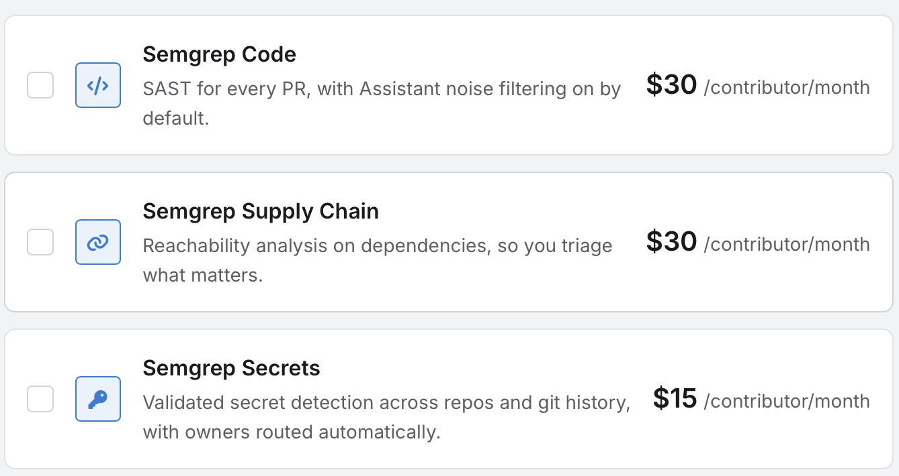

Semgrep\
Version 1.180.0\
[https://semgrep.dev/](https://semgrep.dev/)

**What it does:** Semgrep is a static application security testing tool that scans source code for security vulnerabilities. It helps developers catch issues such as SQL injection risks early into the development process. It can be integrated into a local workflow or CI/CD pipeline

**Setup:**\
Step 1 - Install semgrep:\
\# macOS\
brew install semgrep

\# Linux / WSL\
python3 -m pip install semgrep

Step 2 - Open your project directory: cd path/to/your-project

Step 3 - Run your first scan: semgrep --config=auto

If the project is not yours, ask the organization to invite you to the project.

**Use Semgrep when:**\
-You want to find security vulnerabilities early in development\
-You want automated code checks as part of a pull-request workflow\
-You want a quick way to add static security analysis without running the application

**Don’t rely on Semgrep when:**\
-You are looking for every possible vulnerability\
-You need to test runtime behavior, application deployment, authentication flows, or live infrastructure

**Upgraded plans from free version:**

 [Tutorial Video](https://www.youtube.com/watch?v=ZsgyH46ADE0)
