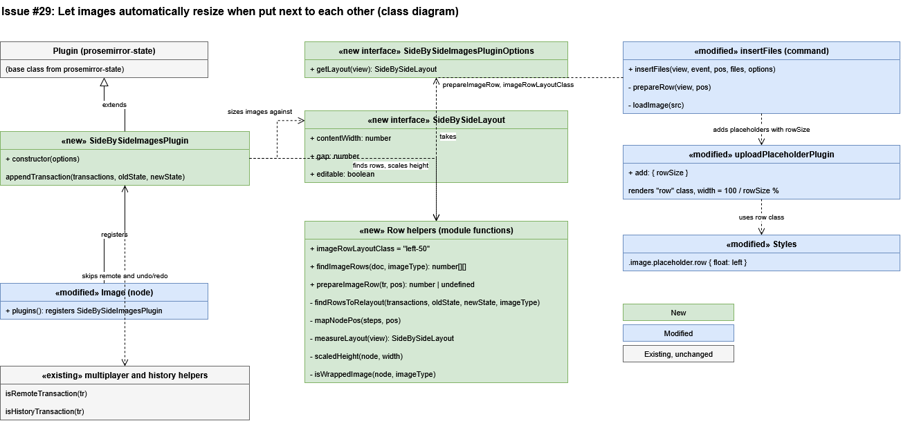
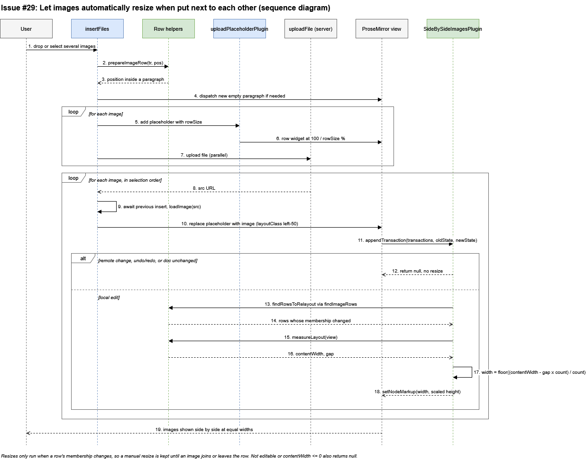

# Issue #29 -- Let images automatically resize when put next to each other
## Class Diagram

## Sequence Diagram

## Q&A
**Class diagram:**
1. Among all the classes shown in the diagram, which 1--2 are most central to understanding the codebase and solving the issue? Explain what role each one plays.
   `SideBySideImagesPlugin` (`shared/editor/plugins/SideBySideImagesPlugin.ts`) is the most central. It is a ProseMirror plugin whose `appendTransaction` hook runs after every local edit. It finds the rows of wrapped images whose membership changed, works out an equal width for each image in the row, and sets that width and a height that keeps the aspect ratio. Everything else in the solution either feeds it or supports it.
   `insertFiles` (`shared/editor/commands/insertFiles.ts`) is the second. It is the entry point when several images are dropped or selected together. It prepares a paragraph for the row, adds placeholders that already show the row's width, and inserts the images one after another in the order they were selected, even though the uploads run in parallel.
2. What is the most significant relationship shown in the diagram? Explain what it represents in the system and why it matters for understanding the solution.
   The most significant relationship is `Image` registering `SideBySideImagesPlugin` in its `plugins()` list, together with the plugin extending ProseMirror's `Plugin`. Because the plugin hooks `appendTransaction`, the resize runs on any change to a row, not just on uploads: inserting an image, deleting one, or turning wrap text on for a neighbour. That is why the feature works for all of the acceptance criteria without special handling in each place.
3. Looking back at your implementation, is there anything in this design you would change, and why?
   Two things. First, `measureLayout` reads the gap between images as 2em from the editor's computed font size, which duplicates the margin already defined in `Styles.ts`. If one changes and the other doesn't, rows would be sized wrong. I would move that value to one shared constant. Second, there is no minimum image width. A row is only skipped when the computed width is zero or less, so a long row of images becomes very small. I would add a minimum and wrap onto a new row once it is reached.
**Sequence diagram:**
1. What user action or system event starts the sequence, and what is the expected outcome when it completes successfully?
   It starts when a user drops or selects several images at once. When it completes, the images appear side by side in a single row, each sized to share the content width equally, with heights scaled so no image is distorted. The same resize also runs later if an image in the row is added or removed.
2. Identify the 2--3 most important steps in the sequence. For each one, describe what is happening and note whether it involves existing code or new/modified code from your solution.
   - **Steps 2--4, preparing the row (new code in a modified command).** `insertFiles` calls the new `prepareImageRow` to find or create a paragraph to hold the row, and returns no position when images cannot go there, for example inside a code block.
   - **Steps 5--10, ordered insertion (modified code).** Placeholders are added with a `rowSize` so they already show the right width, uploads run in parallel, and each image waits for the one before it so the row keeps the order the user chose.
   - **Steps 11--18, resizing (new code).** `appendTransaction` finds the changed rows, measures the editor, and applies the new width and scaled height with `setNodeMarkup`. Existing code handles dispatching and the upload itself.
3. What error cases or alternative paths are not shown in the diagram, and why did you leave them out?
   The diagram shows the successful path. It leaves out:
   - an upload that fails or an image that fails to load
   - remote changes, and undo and redo, which skip the resize so sizes are restored exactly
   - a read-only editor, or a content width of zero, which skip the resize
   - a position where a row cannot be created, such as a code block
   Most of these are early returns or existing behaviour and add little to explaining the solution, so showing them would have made the diagram much larger.
**Cross-cutting:**
4. If you used AI to create or check any part of the diagrams, describe what it produced, what you verified against the actual code, and what you had to correct or add. If AI was not used, write "N/A."
   I used Claude to help draft the class and sequence diagrams as draw.io files, working from the merged PR diff for this issue. It produced the class diagram, the sequence diagram, and a first draft of these answers. I opened both files in draw.io and compared the method and constant names in both diagrams against SideBySideImagesPlugin.ts, insertFiles.ts, Image.tsx, and uploadPlaceholder.tsx. I also checked that the early returns in appendTransaction come before the layout is measured, as the sequence diagram shows. I exported the diagrams to PNG and reviewed the layout. The AI's first layout had lines crossing boxes, which I fixed by moving boxes and rerouting lines.