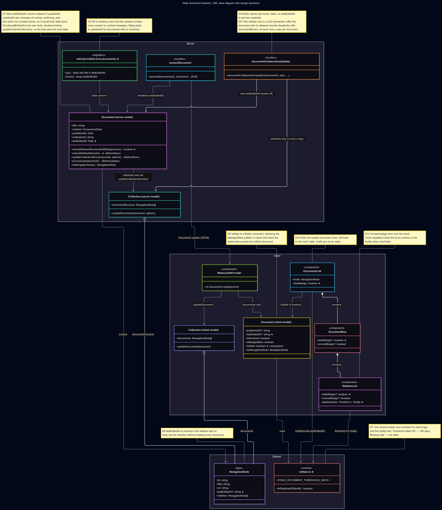
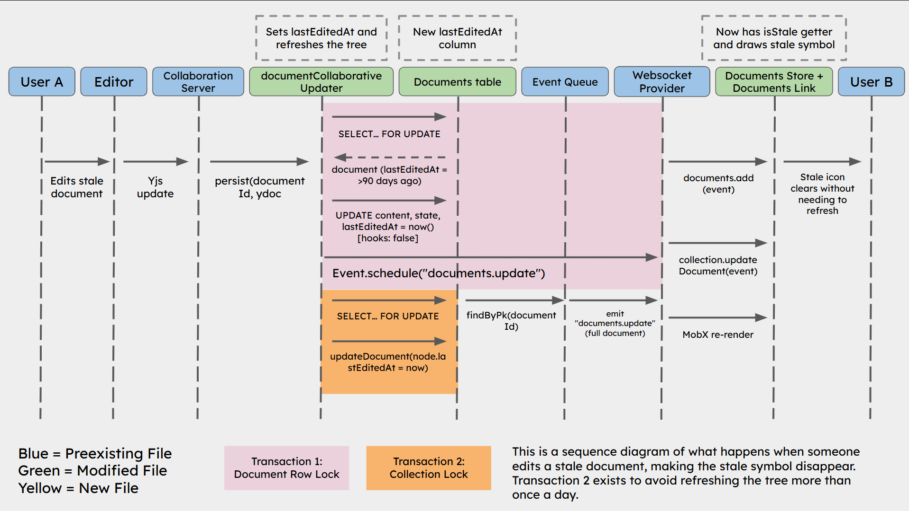

# Issue #60 -- Flag Stale Docs

## Class Diagram

## Sequence Diagram

## Q&A

**Class diagram:**

1. Among all the classes shown in the diagram, which 1--2 are most central to understanding the codebase and solving the issue? Explain what role each one plays.

Document (server model) is the most influential for the whole feature and many others. It holds the new lastEditedAt field, and its setLastEditedAt save hook decides what counts as an edit. Only changes to content, text or title count. Moving, archiving or pinning a document does not, which is why I couldn't reuse updatedAt. The model also controls how the date reaches the sidebar: toNavigationNode copies lastEditedAt into each sidebar entry, and shouldRefreshStructureEditDate limits those refreshes to once a day. Every other class in the diagram either writes this value or reads a copy of it.

isStale.ts (shared module) holds the rule that decides staleness. A document is stale if it hasn't been edited in 180 days, and a missing date is never stale. Both clientside routes to the badge call it: the client Document.isStale property and DocumentLink's fallback, isStale(node.lastEditedAt). Because the rule is in one place, the badge, the tooltip text and the tests all agree on the threshold.

2. What is the most significant relationship shown in the diagram? Explain what it represents in the system and why it matters for understanding the solution.

The most significant relationship is the aggregation from Collection (server model) to NavigationNode through documentStructure, together with the "refreshes tree" links from Document and documentCollaborativeUpdater that keep it current.

documentStructure is the cached document tree each collection stores, and it's what the sidebar draws. By adding lastEditedAt to NavigationNode, I made the sidebar able to show stale badges without loading every document. This relationship matters because it creates a second copy of the edit date that has to be kept in sync. That shaped most of the server design:

- setLastEditedAt has to run before updateCollectionStructure so the tree sees the new date.
- Real-time editor saves skip save hooks, so documentCollaborativeUpdater refreshes the tree itself. It does that in a separate transaction to avoid a deadlock with documentMover.
- Refreshes happen at most once a day per document, so frequent typing doesn't rewrite the whole tree.

DocumentLink prefers the loaded document, which is live, and falls back to the cached node only when the document isn't loaded.

3. Looking back at your implementation, is there anything in this design you would change, and why?

I'd reduce the two paths for deciding staleness (loaded document vs. cached node) to one function that takes whichever date is available. Then the drafts, archived-documents and threshold rules would live in one place instead of being partly repeated in Document.isStale and DocumentLink. I'd keep caching the date in the collection structure. Loading every document just to draw the sidebar would be much worse, and with a 180-day threshold a refresh that runs only once a day doesn't affect accuracy.

**Sequence diagram:**

1. What user action or system event starts the sequence, and what is the expected outcome when it completes successfully?

The sequence starts when User A edits a stale document in the editor. The editor sends the change through the collaboration server, which calls documentCollaborativeUpdater to save it. The flow is the same whether User A types one character or rewrites the page.

If it succeeds, the document's lastEditedAt is set to now, so it's no longer stale. User B's sidebar then drops the stale icon without a page refresh. That's because the server pushes the updated document over the websocket, and the client's isStale getter recalculates on its own. The collection's cached sidebar tree is also updated, so anyone who loads the sidebar later sees the new date too.

2. Identify the 2--3 most important steps in the sequence. For each one, describe what is happening and note whether it involves existing code or new/modified code from your solution.

**Saving the edit and setting lastEditedAt = now() (Transaction 1)**
documentCollaborativeUpdater locks the document row (SELECT … FOR UPDATE) and writes the new content with hooks: false. Because save hooks are off, my setLastEditedAt hook doesn't run, so I added lastEditedAt: new Date() directly to the update. This modifies existing code: the function and transaction were already there, and I added the field and the new column it writes to.

**Refreshing the collection's sidebar tree (Transaction 2)**
After Transaction 1 commits and releases the row lock, a second transaction locks the collection and calls updateDocument so the cached tree has the new lastEditedAt. It only runs if the previous edit was more than a day ago, and only for published, non-archived documents in a collection. This is new code. I put it in a separate transaction so the server never holds the document lock while waiting for the collection lock, which could deadlock with documentMover.

**Pushing the change to User B and clearing the icon**
The documents.update event goes through the existing event queue. The WebsocketProvider adds the full document to the Documents store and updates the collection, and MobX re-renders the sidebar. The delivery path is existing code. What's new is the isStale getter on the client Document model and the stale indicator in the sidebar components. Those turn the new date into the icon disappearing.

3. What error cases or alternative paths are not shown in the diagram, and why did you leave them out?

The diagram shows only the main success path, where editing a stale document clears the icon. I left out these other paths:

- **Nothing changed:** If the incoming Yjs state matches what's stored, the updater returns early. Nothing is saved, no event is sent and the icon stays.
- **Tree refresh skipped:** Transaction 2 doesn't run if the document was already edited in the last day (by far the most common case), or if it's a draft, archived, or not in a collection. User B still sees the icon clear, because the websocket sends the full document, but the cached tree keeps its older date.
- **Lock timeout:** Transaction 1 sets a 15-second lock_timeout. If the row is locked by someone else for longer than that, the transaction fails and is rolled back, and the collaboration server retries on a later save.

I left these out to keep the diagram focused on the question the issue asks: what happens when someone edits a stale document? Most of the alternative paths are either the existing behaviour of documentCollaborativeUpdater or conditions that skip a step without changing the result for User B. Showing them all would have buried the two-transaction design, which is the part that's specific to my solution.

**Cross-cutting:**

4. If you used AI to create or check any part of the diagrams, describe what it produced, what you verified against the actual code, and what you had to correct or add. If AI was not used, write "N/A."

For the sequence diagram, I made that myself in Google Slides as the AI-generated one was too cluttered and hard to understand. But for the class diagram, I put my code into Mermaid.js as it was too big for me to make on my own. I added the annotations and had the AI walk me through each step of the code (while looking at the actual code where it was).
