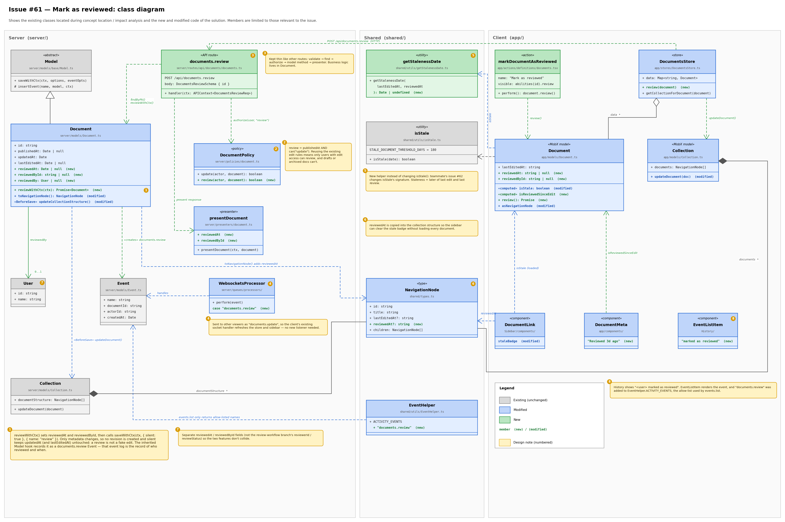
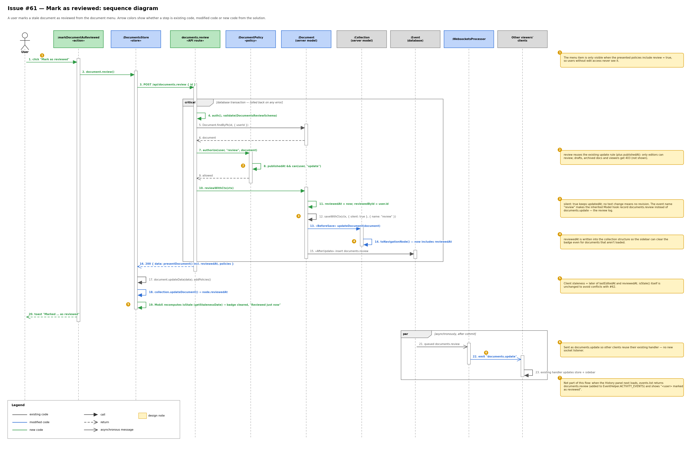

# Issue #61 -- Add mark as reviewed action on documents

## Class Diagram

## Sequence Diagram

## Q&A

**Class diagram:**

1. Among all the classes shown in the diagram, which 1--2 are most central to understanding the codebase and solving the issue? Explain what role each one plays.

   The server `Document` model (`server/models/Document.ts`) is the most central. It stores the new `reviewedAt` and `reviewedById` fields and owns the new `reviewWithCtx()` method. Because it extends `Model`, it inherits `saveWithCtx()`, which turns a save into a recorded event. Its `BeforeSave` hook also keeps the collection's sidebar structure in sync. Almost every part of the solution goes through this class.

   The client `Document` model (`app/models/Document.ts`) is the second. Its `isStale` computed value decides whether the stale indicator is shown, both on the document and in the sidebar. I changed it to measure staleness from the later of the last edit and the last review, using the new `getStalenessDate` helper. It also exposes the `review()` action that the menu item calls.

2. What is the most significant relationship shown in the diagram? Explain what it represents in the system and why it matters for understanding the solution.

   The most significant relationship is the `Document` → `Event` dependency labelled «creates» documents.review, together with the inheritance from `Model` that makes it possible. In Outline, models don't write events by hand. `Model.saveWithCtx()` runs a hook that inserts an `Event` named after the save, e.g. `documents.archive`.

   Saving the review with the event name `"review"` and `silent: true` gives three results:
   - a `documents.review` event that records who reviewed and when
   - no revision, because no content changed
   - no change to `updatedAt`

   That event is also what feeds the History panel, the websocket update to other viewers, and webhooks. Understanding this relationship is what let me meet "recorded in the edit history" without creating a false edit.

3. Looking back at your implementation, is there anything in this design you would change, and why?

   Two things. First, the split between `getStalenessDate` and `isStale` is a workaround. I kept `isStale()` unchanged because a teammate's issue (#62) changes its signature, and I wanted to avoid a merge conflict. Once #62 is merged, I would combine them into one function that takes both dates and the workspace threshold.

   Second, the document meta only shows *when* a document was reviewed, not *who* reviewed it. Showing the name would mean loading `reviewedBy` with every document query. I left that out for performance, but a lightweight way to show the reviewer's name would make the feature more useful.

**Sequence diagram:**

1. What user action or system event starts the sequence, and what is the expected outcome when it completes successfully?

   It starts when a user with edit access clicks **Mark as reviewed** in a published document's menu. When it completes:
   - `reviewedAt` and `reviewedById` are saved and a `documents.review` event is recorded, without a new revision or a change to `updatedAt`.
   - The stale indicator disappears from the document and the sidebar, and the document meta shows "Reviewed just now".
   - The user sees a confirmation toast.
   - Other people viewing the document get the update live, and the History panel shows "<user> marked as reviewed".

2. Identify the 2--3 most important steps in the sequence. For each one, describe what is happening and note whether it involves existing code or new/modified code from your solution.

   - **Steps 7–8, authorization (new code reusing existing rules).** The new `documents.review` route calls `authorize(user, "review", document)`. The new `review` policy requires the document to be published and reuses the existing `update` rule. This enforces "only users with edit access can mark a document as reviewed" without writing new permission logic.
   - **Steps 10–12, saving the review (new method on an existing mechanism).** The new `reviewWithCtx()` sets the two fields and calls the existing `saveWithCtx()` with `silent: true` and the event name `"review"`. This is what separates a review from an edit: no revision, `updatedAt` unchanged, and the existing model hook records a `documents.review` event (step 15).
   - **Steps 13–14 and 18–19, clearing the stale indicator (modified code).** On the server, the `BeforeSave` hook now also refreshes the collection structure when `reviewedAt` changes, and `toNavigationNode()` includes it. On the client, the store updates the document and the sidebar node. MobX then recomputes `isStale` using `getStalenessDate`, so the badge clears straight away and stays cleared after a reload.

3. What error cases or alternative paths are not shown in the diagram, and why did you leave them out?

   The diagram shows only the successful path. These error cases are left out:
   - 400 when the `id` is missing or invalid (the `validate` middleware)
   - 401 when the user isn't signed in
   - a not-found error when the document doesn't exist or the user can't see it
   - 403 from `authorize` for viewers, users on another team, drafts and archived documents
   - a rollback of the whole `critical` transaction if the save fails. If the request fails, the client never reaches the success toast.

   I also left out the case where the menu item is hidden, which happens when the presented policies don't include `review`, and the History panel loading events later (only mentioned in note 7).

   I left these out because they are handled by existing middleware and the existing `authorize` and transaction code, not by new logic. Drawing them would double the size of the diagram without explaining anything new about the solution. They are covered by the automated tests for `documents.review`: 400, 401, and 403 for viewers, other teams, drafts and archived documents.

**Cross-cutting:**

4. If you used AI to create or check any part of the diagrams, describe what it produced, what you verified against the actual code, and what you had to correct or add. If AI was not used, write "N/A."

   I used Claude Code (Opus 5.5), the same AI tool I used to implement the issue.

   **What it produced:** both diagrams and a first draft of the Q&A answers. It first tried Mermaid, but downloading the renderer was blocked in my environment. It then wrote Python (matplotlib) scripts that draw the diagrams as PNGs. It chose which classes, members and steps to show, the colors for existing / modified / new code, the numbered design notes, and the UML `critical` and `par` blocks in the sequence diagram.

   **What was checked against the code:** the diagrams were drawn from the actual files rather than from memory. These include the server and client `Document` models, `Model.saveWithCtx()` and `insertEvent()`, the `documents.review` route and schema, the `review` policy, the presenter, `WebsocketsProcessor`, `EventHelper`, `NavigationNode`, `DocumentsStore` and the client `Collection`. The labels on members and calls, such as `saveWithCtx(ctx, { silent: true }, { name: "review" })` and `authorize(user, "review", document)`, match the code. The error cases in sequence question 3 match the automated and manual tests.

   **What had to be corrected or added:** the AI viewed its own renders and fixed layout problems:
   - an arrow label covering the `documents.review` box, and another label covering the `Document` box
   - design note 3 not being tied to its class
   - the `critical` and `par` block headers overlapping steps 4 and 21
   - a note badge covering the arrow for step 11

